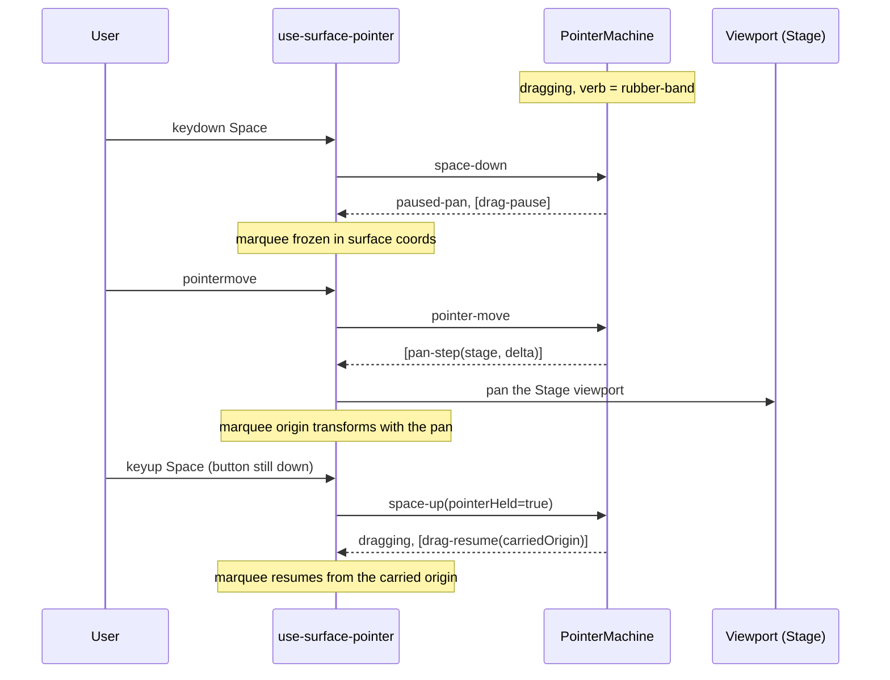

# Interaction architecture

This page describes the Stage interaction pipeline that is wired today, and
names the timeline gaps that are still designed but not built.

Every pointer, modifier, and keyboard interaction in the visualizer goes through
one resolver and one state machine. A new feature that wants a gesture adds a
row to a table here, extends the machine if it must, and ships an adapter. It
does not bind a handler in component code.

The section numbers are load-bearing: modules under `src/interactions/` cite
them in their own comments. The cursor rule is [`cursor.md`](cursor.md), not a
numbered section here.

## What is wired

The Stage runs the whole pipeline. `use-surface-pointer.ts` feeds the pointer
machine, which resolves through `gesture-resolver.ts` and commits through
`selection-store.ts`. `use-surface-wheel.ts` handles the wheel,
`layer-interactivity.ts` decides which sprites accept pointer events, and
`cursor.ts` answers what the pointer looks like on every surface in the app.

Two things sit beside that. Sprite clicks and drags on the Stage never reach the
machine. `makeStageHit` returns null over a peer, edge, or message sprite, so
the machine sees only empty-stage gestures. The sprites commit through the
`SelectMode` grammar in `types.ts` and `selectionActionFor` instead. Separately,
every gesture-owning surface claims a process-wide lock in `gesture-router.ts`,
so a drag on one surface cannot bleed into another. That router is not in the
original design; it grew in the code.

The timeline surfaces are the gap. The Scrubber, the Overview, and ScrubInput
still run their own pointer handlers under that lock rather than the machine.
Section 13 says what follows from that, and what else is designed but unbuilt.

## 1. Principles

**Spacebar wins.** Any pointer interaction while Space is held pans the surface
under it.

**The active tool owns the verb.** How a pointer event is read is a property of
the tool. Select's verbs are what users experience as the default, but Select is
not privileged; it is the tool whose verb table happens to equal the surface
defaults in § 4.5. There is no "default gesture that a tool overrides."

**Modifiers mean the same thing everywhere.** Shift, Cmd or Ctrl, Alt, and Space
carry global meanings in every tool on every surface. A tool binds verbs to
unmodified clicks only.

### 1.1 What the modifiers mean

The visualizer is a direct-manipulation canvas and timeline in the lineage of
Flash, After Effects, Photoshop, and Figma, and it inherits their conventions.

| Modifier   | Meaning                                                                          |
| ---------- | -------------------------------------------------------------------------------- |
| Shift      | Constrain or extend. Snap to grid while dragging; extend the selection on click. |
| Cmd / Ctrl | Toggle, or the other action. Toggle set membership on click.                     |
| Alt        | Clone, from-center, or sample. Reserved here for the clone verbs.                |
| Space      | Temporary Hand. Click-drag pans regardless of the active tool.                   |

A new gesture honors these. A tool may not bind Shift-click to delete, because
Shift already means extend. Bindings are constrained by the global meanings, not
merely by what is unclaimed.

**Document, view, tool, and selection are four separate state spaces.** The
document is the timeline itself. The view is what is visible: camera, zoom,
expanded categories, playhead, time window. The tool is the active verb
interpreter, one at a time. The selection is what the next selection-aware verb
will act on. None of them writes into another. A tool change never modifies the
document, and a selection change never modifies the view. Where that discipline
slips is where "why did my selection clear?" bugs come from.

**Mode is a label, not an architectural concept.** Live, Play, and Build name
three combinations of document source, editability, and recording state.

| Mode  | Document                         | Editable | Tools available                                    |
| ----- | -------------------------------- | -------- | -------------------------------------------------- |
| Live  | websocket feed (blank until Record; capture while recording) | no | Select, Hand |
| Play  | file, fixture, or claimed recording | no    | Select, Hand                                       |
| Build | file or fixture                  | yes      | Select, Hand, Add Peer, Open Session, Send Message |

The resolver and the machine never read mode. They read `activeTool`. Which
tools exist in a mode is `toolsForMode` in `src/state/app-state.ts`, enforced by
the app-state reducer: Select and Hand observe and exist everywhere, and the
authoring tools exist only where mutation authority does.

## 2. Data model

`src/interactions/types.ts` is the single source of truth for every type in this
pipeline, and its own comments carry the section labels below. Read it there. A
second copy in this file would only drift.

| Label | What it names                                                       |
| ----- | ------------------------------------------------------------------- |
| § 2.1 | `SelectionState`: the `timeRange`, `anchor`, and `selection` slots. |
| § 2.2 | `ModifierSet` and `PointerSnapshot`.                                |
| § 2.3 | `Hit`, the tagged hit-test result, and `SurfaceId` derived from it. |
| § 2.4 | `GestureContext`, `SurfaceGestureCtx`, `BuilderTool`, `ToolState`.  |
| § 2.5 | `ResolvedGesture`, `DefaultVerb`, `ToolCreateVerb`.                 |
| § 2.6 | `PointerMachineState` and its thresholds.                           |

What the types cannot argue for themselves:

**The selection holds entities, not events.** A rubber-band selects entities
whichever surface it is swept on, the stage and an empty timeline lane alike,
and clicking a pill selects the entity the pill belongs to. Shifting several entities in time means
shifting each one's events. This is the Flash model: you select layers, and
their content moves with them. Selecting one event without its sibling is not
supported, and if it is ever needed it gets a parallel event-keyed slot rather
than replacing this one.

**The anchor rides with the selection.** It is both the pivot a shift-click
extends from and the entity the Inspector follows. The reducer holds it to being
a member of the selection, or null when the selection is empty.

**A surface is canvas-backed.** The Inspector and the Toolbar are DOM panels
with native React events. They are not `Hit` variants and the machine never
fires for them.

**A double-click is an effect, not a verb.** Double-clicking an entity emits
`double-click` carrying the entity ref. The host fans that out into one
coordinated view change: focus the Inspector, center the Stage, expand and
scroll the timeline row. It never changes the document.

## 3. Modules

```
src/interactions/
├── types.ts                  // § 2 types; the SelectMode grammar
├── gesture-resolver.ts       // § 4
├── pointer-machine.ts        // § 5
├── click-actions.ts          // § 4.7 (written, not wired)
├── selection-store.ts        // § 6; selectionActionFor
├── layer-interactivity.ts    // § 7
├── cursor.ts                 // cursor.md; cursorFor, the one cursor authority
├── gesture-router.ts         // cross-surface gesture lock
├── use-gesture-surface.ts    // marks a host element as a router surface
├── use-surface-pointer.ts    // § 8.1
├── use-surface-wheel.ts      // § 8.2
└── wheel-helpers.ts          // wheelToEffect and the wheel policies
```

Every module except the two hooks is pure: no React, no Pixi, no DOM, no clock,
no global state, so unit tests drive them from fixture values. Each keeps its
tests beside it.

Two modules live outside the tree on purpose.
`src/ui/Timeline/timeline-cursor.ts` is geometry rather than rule: it turns a
position on the Scrubber or the Overview into a `Hit` and asks `cursorFor` about
it. Keyboard lives under `src/state/`, because half its verbs are playback and
persistence, which this pipeline does not own.

Only the hooks and the React components touch React, Pixi, or the DOM. Wheel and
keyboard are sibling pipelines to the pointer machine: they emit the same
families of effects and dispatch the same selection actions, but they do not go
through it. `cursor.ts` reads `pointer-machine.ts` for one thing only, which
gesture is in flight, because that has one authority and the cursor maps its
answer rather than re-deriving it.

## 4. Gesture resolver

`resolveGesture(ctx: GestureContext): ResolvedGesture` is pure, deterministic,
and total. It is the one place the precedence ladder is written down.

### 4.2 Resolution order

It runs at two moments. At pointer-down it decides the verb a drag will use. At
pointer-up, if no drag happened, it runs again against the modifiers held at
that moment, so pressing Shift between down and up makes the click a
shift-click. The Adobe rule: modifiers at release decide a click, modifiers at
drag start decide a drag.

1. Space held, so `space-pan`.
2. The Hand tool is active, so `hand-tool`.
3. Otherwise, with no modifier held, ask the tool (§ 4.4). A tool that claims
   the surface returns `tool-create`. A two-click tool that claims stage nodes
   but will not take this one returns `tool-refuses`, which carries no verb:
   nothing happens, no ring lights, and the cursor says so before the click.
   Falling through instead would quietly give the node its ordinary select
   meaning.
4. Take the surface default (§ 4.5).
5. Shift, then Cmd, may swap that default for a variant (§ 4.6a). Alt has no
   resolution-time swap.
6. Otherwise the default stands.

The resolver's own invariants, each asserted by exhausting `Hit.surface` in the
unit tests: the function is total, Space always wins, and the Select tool's verb
on every surface is exactly its § 4.5 row with no special cases. A tool override
fires only when no modifier is held, so a modified click always carries its
global meaning.

### 4.4 Tool overrides

| Tool         | stage-empty      | stage-peer       | stage-endpoint   | other surfaces |
| ------------ | ---------------- | ---------------- | ---------------- | -------------- |
| select       | —                | —                | —                | —              |
| hand         | (handled above)  |                  |                  |                |
| add-peer     | `create-peer-at` | —                | —                | —              |
| open-session | —                | `two-click-pick` | refuses          | —              |
| send-message | —                | `two-click-pick` | `two-click-pick` | —              |

Open Session refuses an endpoint because a new session mints its own two ends,
so an end already belonging to one has nothing to be. Send Message takes either
kind, because a message can name an end nothing has attributed.
`toolAcceptsNode` in `gesture-resolver.ts` is the single statement of this, read
by the resolver, the cursor, the hover ring, and the click path alike.

### 4.5 Surface defaults

The verb for each surface under an unmodified click with the Select tool.

| Surface                        | Verb                      | On drag past the threshold |
| ------------------------------ | ------------------------- | -------------------------- |
| stage-empty                    | `rubber-band`             | marquee                    |
| stage-peer                     | `select-or-drag-peer`     | drag the peer's position   |
| stage-endpoint                 | `select-or-drag-endpoint` | drag the end's position    |
| stage-edge                     | `select-edge`             | none; thin hit target      |
| stage-message                  | `select-message`          | none; point hit target     |
| timeline-overview              | `pan-view`                | pan by the drag delta      |
| timeline-overview-edge         | `resize-time-window`      | widen or narrow the window |
| timeline-ruler                 | `scrub`                   | scrub the playhead         |
| timeline-lane-empty            | `rubber-band`             | marquee                    |
| timeline-lane-event            | `select-or-drag-event`    | retime the event           |
| timeline-lane-event-right-edge | `drag-event-right-edge`   | drag the arrival time      |
| timeline-gutter-edge           | `resize-gutter`           | widen or narrow the gutter |
| timeline-gutter-chevron        | `toggle-category`         | none                       |
| timeline-gutter-eyeball        | `toggle-row-visibility`   | none                       |
| timeline-gutter-label          | `reorder-row`             | reorder the row vertically |

The empty stage and an empty lane share the marquee verb, because the gesture is
the same on both: sweep a rectangle and commit what it covers through the
`SelectMode` grammar. They differ only in what an empty-space click clears,
which § 4.7 reads off the hit.

Thin surfaces, meaning edges, messages, and edge handles, do not start drags of
their own. To rubber-band from beside one, click the empty space next to it, and
give thin surfaces narrow hit capture so they do not crowd out empty-stage
clicks. There is no fall-through from one verb to another; a single-verb
resolver cannot express it cleanly.

Nothing sets the selection's time range from a gesture. The store keeps the slot
and its actions, and the ruler seeks rather than ranges.

### 4.6a Modifiers that swap the verb

Held when the resolver runs, these return a different verb, so the adapter sees
a different `ResolvedGesture`. `modifiedShift` and `modifiedCmd` own the rows.

| Default verb           | + shift                  | + cmd                 |
| ---------------------- | ------------------------ | --------------------- |
| `select-or-drag-peer`  | `extend-selection-range` | `toggle-in-selection` |
| `select-edge`          | `extend-selection-range` | `toggle-in-selection` |
| `select-message`       | `extend-selection-range` | `toggle-in-selection` |
| `select-or-drag-event` | `extend-selection-range` | `toggle-in-selection` |
| `rubber-band`          | mode becomes `add`       | mode becomes `toggle` |

Two of those rows do not reach a live surface today. The rubber-band commit
never reads the verb's latched mode. The Stage latches Shift and Alt one way
across the drag and the Scrubber latches at the press, and both derive the
commit mode through the `SelectMode` grammar, where plain replaces, Shift adds,
and Shift-Option removes. Sprite clicks never reach the resolver at all, so Cmd
has no selection meaning on a live surface. The toggle and extend rows are
exercised by the resolver's tests and by `clickActionFor`.

### 4.6b Modifiers that change how a drag behaves

These are read by the drag handler on each pointer move. The verb does not
change, and the resolver never sees them.

| Drag verb               | + shift                              |
| ----------------------- | ------------------------------------ |
| `select-or-drag-event`  | snap to the nearest major tick       |
| `drag-event-right-edge` | snap the arrival to the nearest tick |
| `select-or-drag-peer`   | constrain to the nearest axis        |

The handler paints its own feedback, the snap line or the axis guide, reading
the modifier flags each frame. Alt is reserved for cloning on drop, which is its
canonical meaning, and no other verb may claim it.

### 4.7 Click actions

`clickActionFor(verb, hit, doc)` translates a click effect into a selection
action, a view action, or nothing at all, so click meaning stays in one testable
place. It is implemented and table-tested in `click-actions.ts` and **nothing
calls it yet**: the Stage routes clicks straight to its `onSelect` and
`onCanvasClick` callbacks, and the timeline surfaces keep their own handlers.

The mapping is one row per verb. A rubber-band click clears, and the hit decides
whether it clears the stage's way or the timeline's. The four select verbs set
the selection to that entity. A ruler click seeks, and an overview click centers
the window. Category and visibility toggles pass straight through. Row reorder
and the right-edge drag map to nothing, because only their drags mean anything.
Tool-create verbs never go through this function; the host handles creating
peers and advancing two-click sequences itself. Space-pan and hand-tool clicks
never commit; those tiers only fire drag effects.

## 5. Pointer state machine

`pointerReducer(state, event)` returns a new state and a list of effects. It is
pure; the host executes the effects. Each surface adapter owns its own machine
instance, and because pointer capture is taken at pointer-down, at most one of
them is out of `idle` at a time. An idle machine still tracks hover and the last
pointer-up.

The state has three slots. `fsm` is the foreground state, one of `idle`,
`pressed`, `dragging`, and `paused-pan`. `hover` updates on every pointer move
whatever the foreground is doing, and the cursor and hint derivations read it.
`lastUp` holds the last pointer-up so the next pointer-down can qualify as a
double-click.

### 5.3 Transitions

| From       | Event        | Guard                    | To         | Effect                            |
| ---------- | ------------ | ------------------------ | ---------- | --------------------------------- |
| idle       | pointer-down | double-click qualifies   | idle       | `double-click`                    |
| idle       | pointer-down | otherwise                | pressed    | none                              |
| idle       | pointer-move |                          | idle       | none; hover updates               |
| pressed    | pointer-move | within the threshold     | pressed    | none; hover updates               |
| pressed    | pointer-move | past the threshold       | dragging   | `drag-start`                      |
| pressed    | pointer-up   |                          | idle       | `click`, re-resolved at up        |
| pressed    | space-down   |                          | paused-pan | none; the pan starts on next move |
| pressed    | cancel       |                          | idle       | none                              |
| dragging   | pointer-move |                          | dragging   | `drag-move`                       |
| dragging   | pointer-up   |                          | idle       | `drag-end`                        |
| dragging   | space-down   |                          | paused-pan | `drag-pause`                      |
| dragging   | cancel       |                          | idle       | `drag-cancel`                     |
| paused-pan | pointer-move |                          | paused-pan | `pan-step`                        |
| paused-pan | space-up     | the button is still down | dragging   | `drag-resume`                     |
| paused-pan | space-up     | the button was released  | idle       | `drag-end`                        |
| paused-pan | pointer-up   |                          | idle       | `drag-end`                        |
| paused-pan | cancel       |                          | idle       | `drag-cancel`                     |

A pointer-down qualifies as a double-click when the previous up was within 300
ms and 4 px, on the same surface, and that surface is one of the entity
surfaces. The machine then emits `double-click` and stays idle rather than
entering `pressed`. The single click's effect has already fired, so the host
suppresses its side effects for the same 300 ms. That is the standard behavior:
the single click acts at once and the double click supersedes it if one arrives.
For a plain selection the rollback is a no-op, since selecting the same entity
twice changes nothing.

Sequence-driven tests hold three things. In `paused-pan` a pointer move emits
only `pan-step`, never a `drag-move` on the underlying verb. Every `drag-pause`
is followed by exactly one of `drag-resume`, `drag-end`, or `drag-cancel`, never
another pause. And every state and event pair has exactly one transition.

### 5.4 Effects

The reducer emits `click`, `double-click`, the drag effects, and `pan-step`.
Each adapter consumes what it cares about. A `pan-step` names the surface it
came from, which is how the host knows whether to move the Stage viewport or the
timeline view. A `click` carries its hit so the adapter can pass it to
`clickActionFor` without hit-testing again.

## 6. Selection store

`selectionReducer(state, action)` is pure, and `types.ts` owns the
`SelectionAction` union. Four actions carry a document snapshot, because they
are derived: extending a range, selecting from a time range, inverting, and
shrinking a range to its events all need to see the document. The caller
supplies it in the payload so the reducer stores no document of its own.

Which slot each action writes:

| Action                          | timeRange | anchor                 | selection                |
| ------------------------------- | --------- | ---------------------- | ------------------------ |
| set-time-range                  | write     | —                      | —                        |
| extend-time-range               | write     | —                      | —                        |
| expand-time-range               | write     | —                      | —                        |
| shrink-time-range-to-events     | write     | —                      | —                        |
| set-anchor                      | —         | write                  | —                        |
| set-selection                   | —         | last added             | write                    |
| add-to-selection                | —         | last added             | write                    |
| remove-from-selection           | —         | re-seat if removed     | write                    |
| toggle-in-selection             | —         | write                  | write                    |
| extend-selection-range          | —         | the new entity         | write, in document order |
| invert-selection                | —         | null                   | write, derived           |
| rename-entity                   | —         | only if it was renamed | rewrite the id in place  |
| set-selection-from-time-range   | —         | —                      | write, derived           |
| clear-all                       | null      | null                   | empty                    |
| clear-on-empty-click "stage"    | —         | null                   | empty                    |
| clear-on-empty-click "timeline" | null      | —                      | empty                    |

The anchor is not an independent slot; it rides with every selection write so
the membership invariant holds. Only `clear-all`, `clear-on-empty-click`, and
`set-selection-from-time-range` cross between the time range and the entity
slots, and each is an explicitly named verb with one meaning.

Three more invariants, all covered by unit tests. A time range always comes out
with its start at or before its end. Every action writes exactly the columns its
row names, asserted by an exhaustive switch, so a new action adds a row. And a
write to `selection` always returns a new `Set` instance, because the Pixi
repaint bail compares by reference.

`invert-selection`, `expand-time-range`, and `shrink-time-range-to-events`
mirror Photoshop's Select menu. They live in the reducer with nothing
dispatching them yet; they need a discoverable surface first.

## 7. Layer interactivity

`layerInteractivity(ctx)` is the one function deciding which Pixi sprite layers
accept pointer events. No component flips an event mode directly.

| Space held | Active tool  | peers  | edges  | messages |
| ---------- | ------------ | ------ | ------ | -------- |
| yes        | any          | none   | none   | none     |
| no         | hand         | none   | none   | none     |
| no         | add-peer     | none   | none   | none     |
| no         | open-session | static | none   | none     |
| no         | send-message | static | none   | none     |
| no         | select       | static | static | static   |

Space makes the whole stage pointer-transparent so the pan layer gets
everything. Hand and Add Peer both want empty-stage hits. The two-click tools
want nodes, so edges and messages fall silent and clicks land on the peers
beneath them.

This governs pointer events only. Wheel listeners live on the host `<div>`s and
are unaffected.

## 8. Adapters

### 8.1 Pointer

`useSurfacePointer(host, makeHit, handlers, ctx, surfaceTag?)` attaches the
pointer listeners to a host element and feeds a per-host machine. Returning null
from `makeHit` skips the pointer-down entirely, which is how the Stage keeps
sprite hits out of the machine. The hook takes pointer capture on down and
claims the router lock for the length of the gesture. It bridges window Space
keys into the machine's `space-down` and `space-up` events, and it re-runs the
resolver at pointer-up so a modifier pressed mid-press counts.

### 8.2 Wheel

`useSurfaceWheel(host, surface, policy, handlers)` is a sibling pipeline: same
effect families, no pointer state. It attaches a non-passive wheel listener,
because it calls `preventDefault` so the page does not scroll, and maps the
event through `wheelToEffect` under one of two policies.

A **spatial** surface such as the Stage is a 2D canvas: vertical scroll zooms
around the cursor, Shift zooms faster, and nothing pans. Panning needs Space or
the Hand tool. That is deliberate. A trackpad's two-finger gesture usually
carries a small incidental component in the other axis, and routing that to a
pan surprises people.

A **linear** surface such as the timeline is a 1D track: a horizontal swipe or
Shift with vertical pans the time window, and plain vertical zooms it. This is
the convention in audio and video editors, where the primary axis is time.

The wheel reads no tool, no selection, and no modifier beyond Shift. It is how
people navigate, and it works the same everywhere.

### 8.3 Keyboard

The app attaches one keyboard listener, in `useKeyboardInput`. It reads the
facts off each event and hands them to `resolveKeyDown` in
`state/keyboard-input.ts`, which answers the only question this layer has: what
does this press mean right now?

A key means one of two things, and each has a table.

A **held gesture** is a key whose meaning lasts as long as it is down: Space as
the temporary hand, Shift and Alt as previews of what a click would do. Each is
a row in `HELD_GESTURES` with the spellings that press it and the guard that
decides at the press whether it claims. A claim latches until the key is
released or the window loses focus, which is why the pointer leaving the canvas
mid-pan cannot turn the pan into a transport toggle. The guard is asked once and
the answer holds for the whole gesture.

A claim says what a key **offers**, and that is all it says. It cannot say what
a gesture made under it became, because a press resolves to a verb at
pointer-down and the machine owns that verb from then on. Releasing Space during
a pan leaves a pan running, because the pan was the gesture. Releasing it during
a marquee that Space interrupted puts the marquee back, because there the pan
was only an interruption. Same key event, two outcomes, told apart by what the
press resolved to.

So each reader asks the layer that owns its question. What is offered is the
key's, read from `isClaimed`; the tip explaining that Space is a temporary hand
reads that, because a tip has nothing left to say once the key is up. What is
happening is the machine's, read from `inFlightGesture`; the cursor reads that,
because a default arrow while the canvas pans under the user's hand would be
saying something false.

A **one-shot command** is everything else, and it is a row in `SHORTCUTS`. Two
rules cover the whole table: no command runs on an auto-repeat, because a held
key is not a second press, and no command shadows typing.

`resolveKeyDown` puts them in order. It asks the held table first and reaches
`dispatchShortcut` only if nothing claimed the press, so a press over the stage
never sees the Space command at all. Order decided in a function body is order a
reader can check; two listeners racing on one event would settle it by whichever
the browser called first.

Reading the tables: adding a held gesture is one row, and the keyup and blur
lifecycle come with it. Space is contextual, claimed by the pan gesture over the
stage and toggling the transport in Play and Build. Live has no transport: Space,
R, and arrow-seek do not run there. File commands exist in every mode, while
history, clipboard, and delete are Build-only. Tool keys route
through `onPickTool`, but `toolsForMode` is the authority that refuses an
authoring tool outside Build. Arrow keys nudge the selection in Build when a
nudge consumes the gesture, and otherwise scrub time, with Shift as the coarse
stride.

Whether a press landed on an input, a textarea, or a contenteditable element is
answered by `isTextInputTarget`, the one copy every keyboard pipeline reads. It
arrives as a fact on the event, and each table says what it does with it: the
pan gesture declines to claim, and no command runs.

### 8.4 Surfaces today

| Surface                        | Host               | Pipeline                                     |
| ------------------------------ | ------------------ | -------------------------------------------- |
| stage-empty                    | Stage's marker div | pointer machine and wheel hook               |
| stage-peer / edge / message    | Pixi sprites       | sprite listeners committing via `SelectMode` |
| timeline-overview and its edge | Overview marker    | own handlers under the router lock           |
| timeline-ruler, lanes, gutter  | Scrubber marker    | own handlers under the router lock           |

Moving the timeline surfaces onto the machine is the target. They already share
the router lock, the `SelectMode` grammar, `selectionActionFor`, the `Hit`
vocabulary, the App's one `SurfaceGestureCtx`, and `cursorFor`.

The Inspector, the Toolbar, and the tool options bar are DOM panels with native
React events, not surfaces. Keyboard verbs work over them, subject to the
text-input guard above.

## 9. Tools

Tools are peers. The toolbar shows the set the current mode allows, the user
picks one, and that pick is the entire input grammar until they pick another.
Select is the tool whose verbs equal the § 4.5 defaults, which is what "no
override" means; Hand is handled a step earlier than the override table, so it
never reaches it.

A tool's facts are split by concern rather than gathered into one registry.
Display facts, meaning the label, hint, and glyph, live in `TOOL_FACTS` in
`src/ui/ToolPalette.tsx`. Shortcut keys live in the `SHORTCUTS` table: V and H
everywhere, P, S, and M in Build. Which surfaces a tool claims lives in the
resolver's `toolOverride`. A tool's resting cursor lives in `restingCursor` in
`cursor.ts`. Per-tool configuration, such as the profile or the id the next
click will use, lives in `src/ui/ToolOptionsBar.tsx`.

## 11. Sequences

### 11.2 Space pressed mid-drag



## 12. Tests

Every pure module is table-driven against the tables above. The resolver is
driven over every cell of §§ 4.4 to 4.6a, the machine over every row of § 5.3,
click actions over § 4.7, layer interactivity over § 7, and the cursor over
every branch of [cursor.md](cursor.md). The selection store is tested action by
action and then over its invariants, `timeline-cursor` zone by zone, and the
shortcut table row by row including its guards.

Property tests cover what a table cannot. The resolver stays total over random
contexts, and the machine over every state and event pair. Every pause pairs
with one resume, end, or cancel. A click re-resolves at pointer-up, and a
cancelled drag emits `drag-cancel` and never a phantom `drag-end`. The selection
store has one of its own: a write to `selection` always returns a fresh `Set`.

Playwright probes live in `scripts/playwright-*-probe.ts`. The ones exercising
this pipeline include the stage rubber-band probe, the cursor-race probe for
Space held while the pointer moves, and the shift-click, multi-select,
modifier-cursor, and axis-lock probes.

## 13. What remains

The Scrubber and the Overview still run their own pointer handlers, coordinated
through the router lock and committing through `selectionActionFor`, rather than
`use-surface-pointer`. So `clickActionFor` stays unwired for them, and each host
names its own in-flight verb instead of reading it off the machine. Cursors no
longer wait on that move: both hosts hit-test into the `Hit` vocabulary and ask
`cursorFor`. When the pointer paths land, every gesture in the visualizer will
flow through one resolver and one machine.

One thing § 4.5 says that the Scrubber does not yet do, waiting on the same
move: `timeline-lane-event-right-edge` names a right edge, while the Scrubber
grabs either end of a span. It changes no cursor today, which is why it was left
alone.

Double-click drill-in is half built. The machine detects it and emits the
effect; the coordinated focus fan-out across the Inspector, Stage, and timeline
is not written.

Alt-drag cloning has its slots reserved in §§ 4.6a and 4.6b and no
implementation. The selection operations in § 6 are implemented with nothing
dispatching them. A status hint bar deriving its text from the tool, the hover,
and the machine state would fit the same shape, and is not built.
