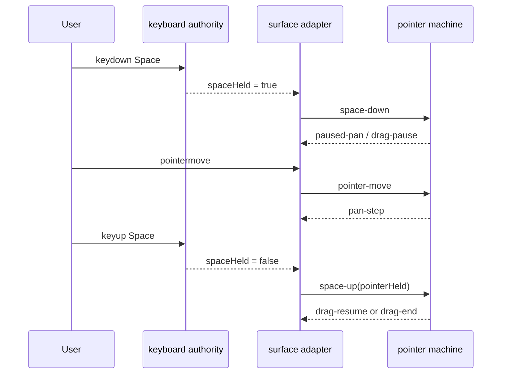

# Interaction architecture

This page describes the interaction system that is wired today. The section numbers are load-bearing: modules under
`src/interactions/` cite them. Cursor precedence has its own authority in [`cursor.md`](cursor.md).

The visualizer has one semantic vocabulary and one resolver, not one physical event loop. The Stage's empty canvas uses
the pure pointer machine. Stage sprites use Pixi listeners because they already own exact display-object hit geometry.
The Timeline's Overview and Scrubber use DOM adapters because their drags mutate different view and document structures.
All three paths share:

- `Hit`, `DefaultVerb`, and `ResolvedGesture`;
- `resolveGesture`'s precedence;
- `SelectMode` and `selectionActionFor`;
- the process-wide gesture lease in `gesture-router.ts`; and
- `cursorFor`, so the offered cursor and the next pointer-down read the same decision.

`ScrubInput` is a native DOM control. Its click-to-type and drag-to-adjust behavior is deliberately outside the canvas
gesture vocabulary.

## 1. Principles

**Spacebar wins.** Space temporarily activates Hand. A pointer-down anywhere on a canvas surface pans instead of
selecting, retiming, resizing, or invoking a gutter control.

**The active tool owns precedence.** Hand is a navigation override. Stage-only authoring tools may claim the Stage
surfaces listed in § 4.4. On the Timeline, those tools narrow to Select because no authoring verb lands there.

**Selection has one modifier grammar.** Plain replaces, Shift adds, and Shift+Option removes. Stage sprites, Stage
marquee, Timeline pills, and Timeline marquee all commit through that grammar. Cmd/Ctrl is reserved for keyboard
commands; it has no separate pointer-selection meaning.

**Document, view, tool, and selection are separate state spaces.** Document edits change the authored timeline. View
edits change camera, zoom, playhead, row expansion, or the visible time window. Tool changes choose an interpreter.
Selection changes choose the entities a selection-aware command will act on. None writes another as a side effect.

**Mode is a product state, not a gesture primitive.** The resolver and pointer machine read `activeTool`, never Live,
Play, or Build. `toolsForMode` decides which tools the current product state offers.

| Mode  | Source                              | Editable | Tools                                              |
| ----- | ----------------------------------- | -------- | -------------------------------------------------- |
| Live  | websocket feed or recording         | no       | Select, Hand                                       |
| Play  | file, fixture, or claimed recording | no       | Select, Hand                                       |
| Build | file or fixture                     | yes      | Select, Hand, Add Peer, Open Session, Send Message |

## 2. Data model

`src/interactions/types.ts` is the source of truth for the types below.

| Label | What it names                                                   |
| ----- | --------------------------------------------------------------- |
| § 2.1 | `SelectionState`: `anchor` and `selection`.                     |
| § 2.2 | `ModifierSet` and `PointerSnapshot`.                            |
| § 2.3 | `Hit`, the tagged hit-test result, and its derived `SurfaceId`. |
| § 2.4 | `GestureContext`, `SurfaceGestureCtx`, tools, and `ToolState`.  |
| § 2.5 | `ResolvedGesture`, `DefaultVerb`, and `ToolCreateVerb`.         |
| § 2.6 | `PointerMachineState` and its drag threshold.                   |

### 2.1 Selection

The selection holds entities, not observations. A Timeline pill selects the entity it depicts; a marquee selects the
entities whose painted spans or glyphs it crosses. A command that shifts selected entities then plans the observation
moves needed for each entity.

`anchor` is the Inspector-follow target. It is always a member of `selection`, and is null exactly when the selection is
empty. It is re-seated when removal takes the current anchor away.

### 2.3 Surfaces

`Hit` describes canvas-backed interaction geometry. Inspector and toolbar controls are DOM controls and are not
variants. Timeline span edges use the generic `timeline-lane-event-edge` name because either the start or end may be
grabbed; the `DragPlan` carries which edge it is.

## 3. Modules

```text
src/interactions/
├── types.ts                  # § 2 vocabulary and SelectMode
├── gesture-resolver.ts       # § 4 precedence and surface defaults
├── pointer-machine.ts        # § 5 pure Stage-empty FSM
├── selection-store.ts        # § 6 reducer and selectionActionFor
├── layer-interactivity.ts    # § 7 Pixi event ownership
├── cursor.ts                 # the one cursor authority
├── gesture-router.ts         # cross-surface gesture lease
├── use-gesture-surface.ts    # lease lifecycle for a host
├── use-surface-pointer.ts    # Stage-empty pointer adapter
├── use-surface-wheel.ts      # wheel adapter
└── wheel-helpers.ts           # pure wheel policy
```

Timeline-specific ownership lives beside Timeline geometry:

```text
src/ui/Timeline/
├── timeline-gesture.ts          # shared Timeline pointer-down controller
├── timeline-cursor.ts           # Overview/Scrubber geometry to Hit
├── event-hit-index.ts           # reusable identity and anchor index
├── event-hit.ts                 # exact pill/glyph/edge hit geometry
├── use-scrubber-interaction.ts  # cached rows and event index
└── scrubber-pointers/           # mutation adapters and drag lease
```

Pure policy stays outside React, Pixi, and the DOM. Hooks own attachment and lifecycle. Adapters own local effects, but
not precedence or selection set arithmetic.

## 4. Gesture resolver

`resolveGesture(ctx)` is pure, deterministic, and total over every `Hit` and tool. It runs at pointer-down to choose a
drag verb. The generic machine runs it again at pointer-up for a click, so a modifier pressed during a stationary press
can veto a Stage authoring verb.

### 4.2 Resolution order

1. Space held: `space-pan`.
2. Hand active: `hand-tool`.
3. On an empty Timeline lane, Option without Shift: the local `pan-view` verb. Shift+Option remains the global
   remove-selection marquee.
4. With no modifier held, ask a Stage authoring tool for an override. A two-click tool that addresses nodes but refuses
   this node returns `tool-refuses`; it does not fall through to selection.
5. Take the surface default from § 4.5.

`navigationOverride` exposes the first two rungs for host padding that has no more specific `Hit`. `timeline-gesture.ts`
narrows Stage-only tools to Select and calls the same resolver for both Overview and Scrubber pointer-down.

### 4.4 Stage tool overrides

| Tool         | stage-empty       | stage-peer        | stage-endpoint    | other surfaces    |
| ------------ | ----------------- | ----------------- | ----------------- | ----------------- |
| Select       | —                 | —                 | —                 | —                 |
| Hand         | navigation rung 2 | navigation rung 2 | navigation rung 2 | navigation rung 2 |
| Add Peer     | `create-peer-at`  | —                 | —                 | —                 |
| Open Session | —                 | `two-click-pick`  | refuses           | —                 |
| Send Message | —                 | `two-click-pick`  | `two-click-pick`  | —                 |

Open Session refuses an existing session end because a new session mints its own two ends. Send Message accepts a peer
or an unattributed end. `toolAcceptsNode` is the one statement read by resolution, cursor, hover, and the two-click
action path.

### 4.5 Surface defaults

| Surface                  | Verb                      | Drag meaning                |
| ------------------------ | ------------------------- | --------------------------- |
| stage-empty              | `rubber-band`             | marquee                     |
| stage-peer               | `select-or-drag-peer`     | move the peer               |
| stage-endpoint           | `select-or-drag-endpoint` | move the unattributed end   |
| stage-edge               | `select-edge`             | none                        |
| stage-message            | `select-message`          | none                        |
| timeline-overview        | `pan-view`                | pan the visible window      |
| timeline-overview-edge   | `resize-time-window`      | resize the visible window   |
| timeline-ruler           | `scrub`                   | move the playhead           |
| timeline-lane-empty      | `rubber-band`             | marquee                     |
| timeline-lane-event      | `select-or-drag-event`    | retime the span or glyph    |
| timeline-lane-event-edge | `drag-event-edge`         | resize either temporal edge |
| timeline-gutter-edge     | `resize-gutter`           | resize the label gutter     |
| timeline-gutter-chevron  | `toggle-category`         | none                        |
| timeline-gutter-eyeball  | `toggle-row-visibility`   | none                        |
| timeline-gutter-label    | `reorder-row`             | reorder the row             |

The empty Stage and an empty Timeline lane share a marquee verb. The adapter's hit geometry decides what the rectangle
covers; the selection interpreter decides how those hits combine with the existing set.

### 4.6 Selection and drag modifiers

Pointer-selection modifiers are interpreted at the commit boundary, not by minting alternate semantic verbs:

| Keys         | `SelectMode` | Set meaning                     |
| ------------ | ------------ | ------------------------------- |
| none         | `replace`    | selection becomes the hits      |
| Shift        | `add`        | add hits already absent         |
| Shift+Option | `remove`     | remove hits already present     |
| Option alone | `replace`    | except empty Timeline lane: pan |

Drag modifiers may change geometry while preserving the resolved verb. Shift snaps a Timeline retime to a major tick and
constrains a Stage node move to an axis. Their feedback is the snap line or axis guide painted by the adapter.

### 4.7 Adapter actions

A resolved semantic verb reaches the adapter that owns the affected state. Stage authoring effects advance the builder
tools. Timeline view verbs update the time window, playhead, expansion, or gutter. Selection gestures emit only a hit
set plus `SelectMode`; `selectionActionFor` is the one interpreter that turns that pair into `set-selection`,
`add-to-selection`, `remove-from-selection`, or `clear-on-empty-click`.

## 5. Pointer state machine

`pointerReducer(state, event)` is the pure down/move/up machine used by the Stage's empty surface. Each host instance
owns its state, and the global gesture lease ensures only one surface can be in flight.

The state has `fsm` and `hover`. `fsm` is `idle`, `pressed`, `dragging`, or `paused-pan`. `hover` is independent and
supplies the cursor authority.

### 5.3 Transitions

| From       | Event        | Guard                   | To         | Effects                         |
| ---------- | ------------ | ----------------------- | ---------- | ------------------------------- |
| idle       | pointer-down |                         | pressed    | none                            |
| idle       | pointer-move |                         | idle       | hover update                    |
| pressed    | pointer-move | below threshold         | pressed    | hover update                    |
| pressed    | pointer-move | past threshold          | dragging   | `drag-start`, first `drag-move` |
| pressed    | pointer-up   |                         | idle       | `click`, resolved at pointer-up |
| pressed    | space-down   |                         | paused-pan | none                            |
| pressed    | cancel       |                         | idle       | none                            |
| dragging   | pointer-move |                         | dragging   | `drag-move`                     |
| dragging   | pointer-up   |                         | idle       | `drag-end`                      |
| dragging   | space-down   |                         | paused-pan | `drag-pause`                    |
| dragging   | cancel       |                         | idle       | `drag-cancel`                   |
| paused-pan | pointer-move |                         | paused-pan | `pan-step`                      |
| paused-pan | space-up     | primary button held     | dragging   | `drag-resume`                   |
| paused-pan | space-up     | primary button released | idle       | `drag-end`                      |
| paused-pan | pointer-up   |                         | idle       | `drag-end`                      |
| paused-pan | cancel       |                         | idle       | `drag-cancel`                   |

The move that crosses the threshold also emits the first `drag-move`. Browsers may coalesce motion, so the result cannot
depend on receiving another move before release.

### 5.4 Effects

Effects are `click`, the drag lifecycle, and `pan-step`. An adapter executes only effects its surface owns. A click
carries its pointer-up hit; no second hit test is needed.

## 6. Selection store

`selectionReducer` is pure. The action union is deliberately small:

| Action                  | Meaning                                                  |
| ----------------------- | -------------------------------------------------------- |
| `set-selection`         | replace the set and anchor its last member               |
| `add-to-selection`      | add members and anchor the last new member               |
| `remove-from-selection` | remove members and re-seat the anchor if necessary       |
| `reconcile-with-doc`    | drop identities the current document no longer declares  |
| `rename-entity`         | rewrite one identity without losing membership or anchor |
| `clear-all`             | return `EMPTY_SELECTION`                                 |
| `clear-on-empty-click`  | return `EMPTY_SELECTION`                                 |

Every non-empty selection has an anchor inside it. Every write returns a fresh `Set`, because rendering and selectors
use reference identity as their cheap change signal. `allEntityKeys` allocates only for the explicit Cmd/Ctrl-A command,
never on render or wire paths.

## 7. Layer interactivity

`layerInteractivity(ctx)` decides which Stage sprite layers accept Pixi pointer events.

| Space | Tool         | peers  | edges  | messages |
| ----- | ------------ | ------ | ------ | -------- |
| yes   | any          | none   | none   | none     |
| no    | Hand         | none   | none   | none     |
| no    | Add Peer     | none   | none   | none     |
| no    | Open Session | static | none   | none     |
| no    | Send Message | static | none   | none     |
| no    | Select       | static | static | static   |

Space, Hand, and Add Peer need the empty Stage host. Two-click tools need node sprites but must not let edges or
messages obscure them.

## 8. Adapters

### 8.1 Pointer

`useSurfacePointer` feeds one machine instance. `makeHit` returning null skips pointer-down, which keeps Stage sprite
gestures in their Pixi owners. The hook takes pointer capture and a gesture lease for the interaction.

Space has one keyboard authority. `useKeyboardInput` updates the App's held state; `useSurfacePointer` observes that
state and sends `space-down` or `space-up` to its current machine. It does not attach a second global keyboard listener.

Timeline adapters ask `resolveTimelineGesture` before mutating. Space or Hand therefore starts pan even over a span
edge, visibility eye, or dead gutter pad. The Scrubber supplies one cached row layout and one `EventHitIndex`; ordinary
pointermove neither rebuilds rows nor scans the observation list. Effective times remain live reads so an in-flight
authoring transaction still moves its hit geometry immediately.

### 8.2 Wheel

Wheel is a sibling pipeline. Listeners are non-passive because navigation must prevent page scroll. Stage vertical wheel
zooms around the pointer. Timeline horizontal wheel or Shift-wheel pans time; plain vertical wheel zooms. Wheel over the
Scrubber gutter scrolls the row stack.

### 8.3 Keyboard

`useKeyboardInput` is the only global keyboard listener. Held gestures are latched until keyup or window blur. One-shot
commands are rows in `SHORTCUTS`; they refuse auto-repeat and text-input targets.

Escape unwinds focus before selection. Cmd/Ctrl-A selects every declared entity. Delete, clipboard, history, and
authoring tool shortcuts exist only where their owning mode allows them. Arrow keys nudge a Build selection when a nudge
consumes the key and otherwise seek by the configured stride.

### 8.4 Surface ownership

| Surface family               | Host                 | Interaction owner                         |
| ---------------------------- | -------------------- | ----------------------------------------- |
| Stage empty                  | Stage marker         | pointer machine and wheel adapter         |
| Stage peer/endpoint/edge/msg | Pixi display objects | sprite adapters, shared selection grammar |
| Timeline Overview            | Overview marker      | Timeline controller and view adapter      |
| Timeline ruler/lanes/gutter  | Scrubber marker      | Timeline controller and pointer adapters  |
| Inspector, toolbar, inputs   | DOM                  | native controls and keyboard text guard   |

These are ownership boundaries, not semantic forks. The resolver, cursor, selection interpreter, and gesture lease cross
them.

## 9. Tools

Tools are peers in the toolbar. Display facts live in `TOOL_FACTS`; shortcut keys live in `SHORTCUTS`; Stage claims live
in `toolOverride`; cursor spelling lives in `cursor.ts`; per-tool draft configuration lives in `ToolOptionsBar.tsx`.
`toolsForMode` is the authority on availability.

## 11. Space pressed mid-drag



## 12. Tests

Resolver tests exhaust every surface and tool. Machine tests cover every transition, coalesced pointer motion, Space
interruption, cancellation, and pointer-up re-resolution. Selection tests pin anchor membership, fresh-set identity,
reconciliation, rename, empty commits, and Select All.

Timeline geometry tests cover scrolled rows, gutter precedence, ruler dead space, span and glyph priority, both span
edges, authored spans with no anchor observation, and Overview grips. Timeline controller tests prove Hand and Space
turn every mutation target into pan, while Option steals only an empty lane. The indexed-hover guard makes the event
iterable throw if hit testing scans it after the index has been built.

## 13. Deliberate boundaries

The generic pointer machine is not a goal by itself. It owns the common threshold and Space-interruption lifecycle where
that lifecycle is actually shared. Timeline drags retain typed local state because resizing a view window, retiming an
observation transaction, reordering a row, and sweeping a marquee have different commit and teardown requirements.
`timeline-gesture.ts` is the shared controller that prevents those adapters from inventing precedence.

Native DOM inputs remain native. Double-click means fit on the Timeline and reset on numeric scrub inputs; it is not a
hidden entity drill-in gesture.
