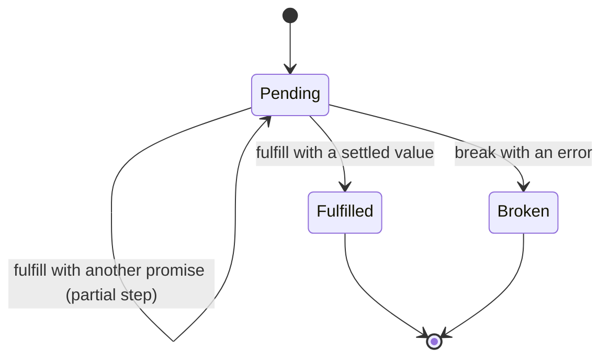
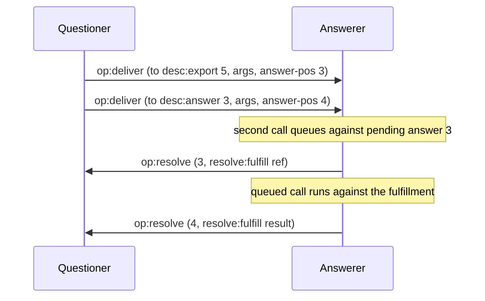
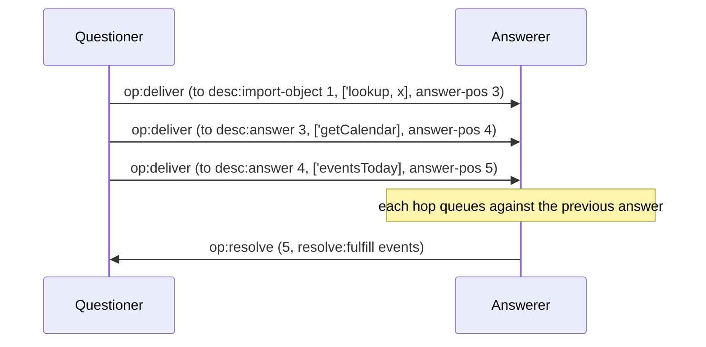
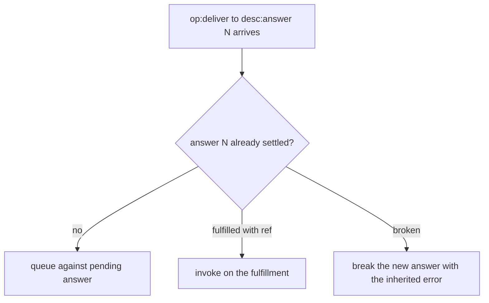
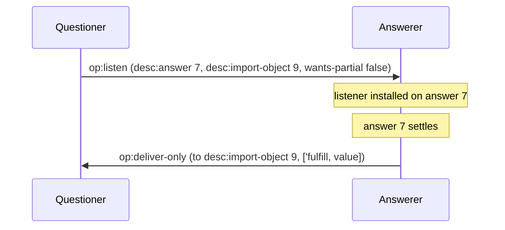
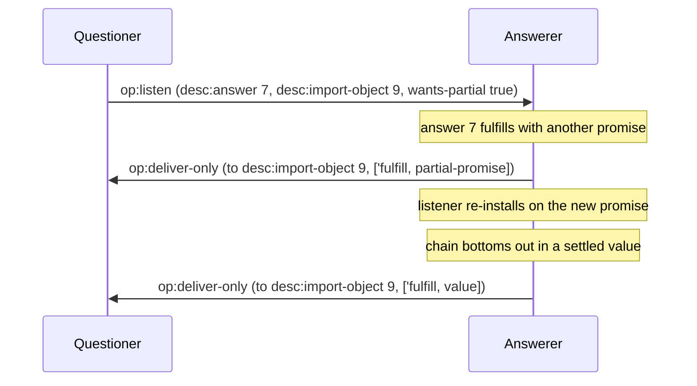
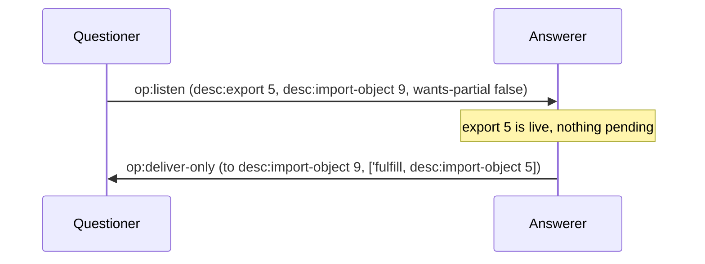

# Promises and pipelining

Anchors: CapTP Specification § Promises, § Promise pipelining, § op:listen.
The `wants-partial?` operand is `[goblins-canonical]`.

## PP-1 — Promise lifecycle

A promise settles exactly once into Fulfilled or Broken. Fulfilling with
*another promise* is a partial step — the promise stays pending against the
new target until a non-promise value or an error arrives.

## PP-2 — Pipelined deliver on an answer

A questioner may target `desc:answer N` before N has resolved. The answerer
queues the pipelined call against the pending answer and runs it on
settlement — saving the round-trip.

## PP-3 — Multi-hop chain

`a.lookup(x).getCalendar().eventsToday()` is three hops, each anchored on the
previous answer position. On the wire each hop is its own `op:deliver`
against `desc:answer`; encodings with richer path types may carry the chain
in fewer frames, but the semantics are this chain.

## PP-4 — Deliver to an already-resolved answer

If the answer has settled by the time a pipelined deliver targeting it
arrives, the call forwards to the resolution: invoked on the fulfillment
value, or broken immediately with the inherited error.

## PP-5 — op:listen, fire on settlement

The listener is an object the questioner exports. When the target settles,
the answerer delivers the resolution to the listener as an ordinary call.
With `wants-partial?` false (spec-strict), it fires exactly once, on the
eventually-settled non-promise resolution.

## PP-6 — op:listen with wants-partial `[goblins-canonical]`

With `wants-partial?` true, the listener also fires on each intermediate
promise-shaped fulfillment, re-installing on the next link until a settled
value arrives.

## PP-7 — op:listen on an already-settled target

Listening on a target that is already settled — e.g. a live local export —
fires the listener immediately with that resolution. Nothing waits.

