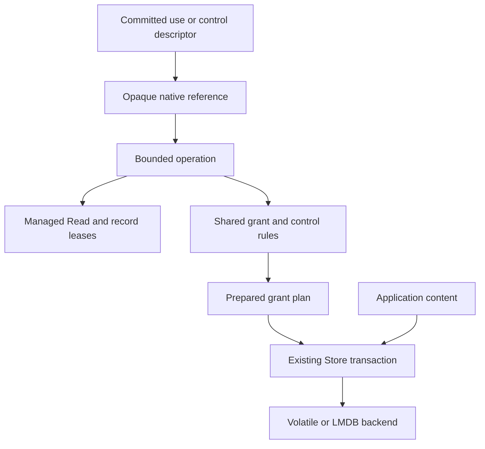

# ADR-0168 Durable managed capability bindings

## Decision

A managed capability descriptor records its role, bound grant, and control
powers. Strong Loam edges retain the exact owner header and grant record.
Control powers use the same model rules as resident controls: policy ceilings
and independent pause, resume, and revoke powers. Descriptor encoding uses
bounded Syrup fields and has no authority evaluator.

The trusted embedding restores opaque use or control references from checked,
committed descriptor leases through `access.storage.Capabilities`. Restoration
checks the requested role. A reference retains its descriptor through Loam's
existing live roots, without pinning a record or loading its graph. The
Capabilities owner supplies quotas for live references and operations and
borrows one Store; it has no executor, actor system, or transaction engine.

Held references start opaque operations without accepting a grant selector.
Each operation loads its descriptor and opens a bounded managed Read, checking
the exact owner and grant edge before evaluating current authority. Operations
expose explicit read work and completion, use checks, permitted delegation, or
control edits. They expose no Store or model view. Selected control terms
borrow fixed operation scratch; grant evaluation uses the Read's separate
scratch. A commit invalidates an operation, including one waiting on cold reads.
Unknown writes fence operations through the existing Store recovery state.

The trusted Capabilities owner stages a prepared operation into the caller's
Store transaction. Derivation stages the new grant and its use descriptor
together, so the caller can retain the proposed descriptor from content in that
same transaction. Ordinary descriptor creation can also join content updates.
Proposed references become restorable only after confirmed commit. Callers
choose explicit root retention or a containing record edge; live references
retain descriptors until their final release.

## Lifetimes and boundaries

Operations retain their source reference and own every submitted read until
exact completion. Cancel marks work for retirement; close refuses outstanding
work. Closing an operation releases its append, record leases, scratch storage,
and source reference. Closing Capabilities refuses live references or operations.
The Store's existing retention barrier prevents destroying it first.

Descriptor records are immutable through this API. Grant lifecycle and editable
terms remain in the shared grant model. Independent control attenuation and
revocation require a future persistent control model; mutating raw descriptor
records is a privileged storage operation outside the supported API.

These native operations establish restoration and admission primitives. An
application must bind a successful use check to its content effect at the same
revision. [ADR-0169](ADR-0169-managed-host-turns.md) adds managed working sets
to the existing Host adapter. Durable publication admission, remote receipts, scoped
events, and C/Rust projection remain in the [storage plan](../../planning/loam/access/storage.md).
No new CapTP protocol or remote credential mechanism is introduced.

## Evidence

Tests cover role separation, management ceilings, current ancestor restrictions,
cold read invalidation, atomic descriptor creation, native LMDB reopen and lost
acknowledgements, bounded allocation, and close barriers. Role-substitution and
management-ceiling bypass injections failed their owning test and were removed.
Native reference binding state is bounded at 96 bytes; initial operation state
is bounded at 32 KiB. Those bounds exclude record cache buffers, the Read binding
array, and the lazily allocated Append and copied plan terms. Loaded checks make
no allocator calls. Native LMDB tests reclaim an unrooted descriptor after its
last held reference is released.
