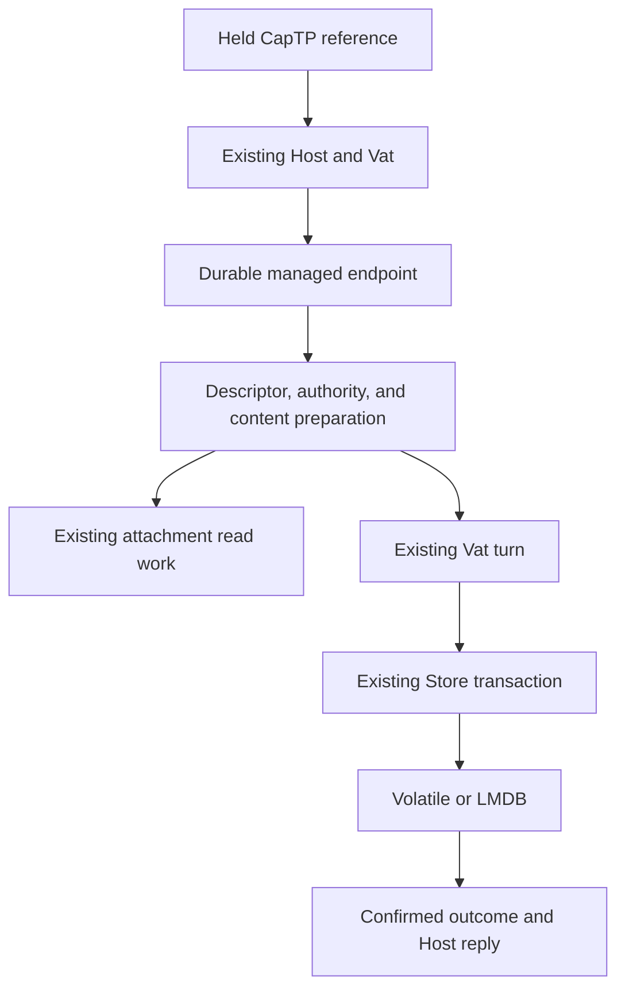

# ADR-0169 Managed Host turns

## Decision

The existing Loam hosting attachment owns admission, retained call memory,
storage submission, Vat dispatch, transaction installation, recovery, and reply
settlement. Behaviors may prepare a bounded working set before dispatch and
stage a transaction participant after invocation. Preparation emits explicit
read work. It never executes I/O or creates another scheduler.

`access.hosting` supplies that preparation for managed endpoints. A committed
endpoint retains its exact use or control descriptor. A use endpoint also binds
one resource identity to one content edge. The trusted application creates that
binding and declares the permissions and committed facts each method needs.
Recipients invoke the endpoint capability. Arguments cannot substitute its
descriptor, grant, resource, or content target.

Preparation loads the descriptor and current authority with the existing opaque
managed operation. Use calls load content and authorize before application
invocation. Control calls prepare permitted edits through the shared control
rules. The attachment stages content replacement or the prepared grant change
in its existing Store transaction and settles only after a confirmed outcome.
An unchanged control edit needs no write. Persistent grant changes retain their
ordinary change record. Remote receipts and subscriptions are separate work.

## Ownership and consistency

Preparation and its leases belong to the retained call. A Store revision change
discards preparation and restarts it, including when the invocation was already
queued. Submitted reads must complete before any borrowed buffer is retired.
The endpoint portrait lease survives invocation, commit, and resolver retries
until preparation closes, so its borrowed fields remain valid throughout.
Unknown writes retain the existing recovery fence. Near calls refuse behaviors
that require preparation before starting work. Eventual calls use the normal
bounded admission path. Application callbacks are trusted, deterministic, and
effect-restricted. The native API does not sandbox arbitrary Zig code.

Endpoint, content, and descriptor leases share the Store's existing limits.
Managed operations retain their explicit record budget and reference/operation
quotas. There is no graph-wide eager load. Busy calls and pinned records cost
memory until settlement. Sleeping endpoint references retain graph reachability
without pinning the graph in RAM.

## Scope

This establishes native fixed-resource use endpoints and editable control
endpoints. Ordinary durable publications retain and restore them through the
same strong-edge mechanism as other actors. Generic remote delegation,
resource traversal, remote change streams, foreign bindings, and arbitrary
application transaction semantics remain owned by the
[managed storage plan](../../loam/access-storage.md).

## Evidence

Portable tests cover held CapTP use/control references, policy edits, paused and
revoked use, failed callbacks, commit-gated replies, stale queued and cold
activation, repeated preparation with bounded arena use, failed reads, partial
allocation cleanup, and the portrait lease's settlement lifetime. Native LMDB
tests restore endpoints and publications after reopen and recover both committed
and aborted control changes whose local acknowledgement was lost. These are
internal protocol and persistence tests, not external interoperability or scale
measurements.
Early portrait release and ignored method-permission requirements were injected
separately. Each failed its owning regression test and was removed.
