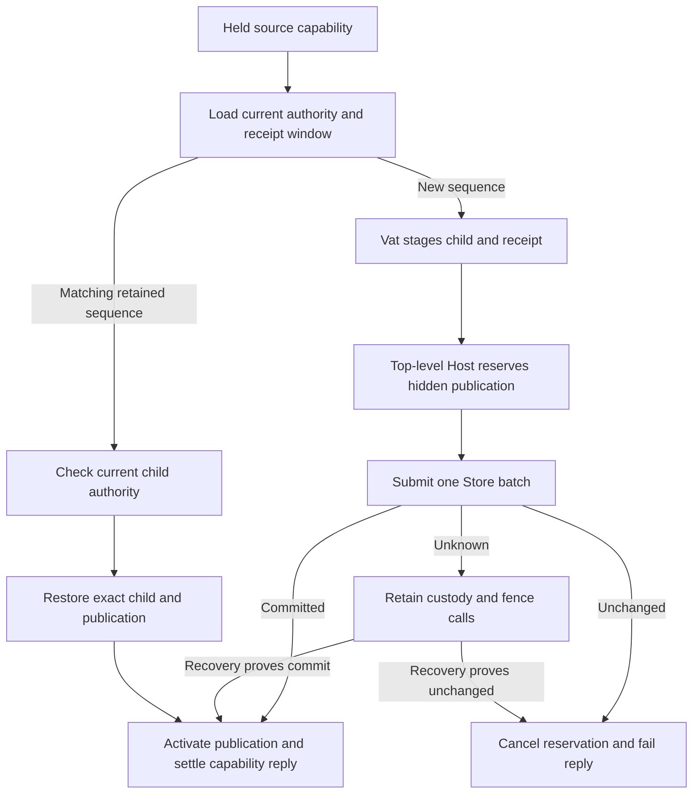

# ADR-0170 Durable facet derivation

## Decision

A managed use endpoint can derive a narrower endpoint for its same content
binding. The application decodes requested grant terms. The existing grant
model decides whether the current parent permits them. Control endpoints do
not derive use authority. The returned value is an ordinary CapTP capability.

One Store transaction stages the child grant and descriptor, child endpoint,
durable publication, source endpoint's sequence, and retry receipt. Host actor
and publication custody are reserved before submitting the write. Reserved
publications cannot be fetched. Confirmed commit activates the reservation.
Abort cancels it, and uncertainty retains it until recovery resolves the write.
The attachment continues to own all storage work, Vat dispatch, and settlement.

## Retry identity and retention

Each source endpoint has a monotonic derivation sequence and a window of eight
receipts. Callers obtain the next sequence through `derivation-sequence()` on
the source capability and invoke `derive(sequence, application arguments...)`.
The request binds that sequence to canonical encoded grant terms. A retained
matching retry returns the same child. Different terms conflict. A sequence
below the retention floor fails expired, and a future sequence fails out of
order. Retirement never makes an old sequence eligible to mint again.

Receipt lookup is direct through the source portrait's bounded strong-edge
window. It does not scan the application's graph. Concurrent holders share this
sequence domain: they can conflict and must acquire a fresh sequence for a new
request. An expired result is unavailable through this retry API. Recovery is
bounded and does not give indefinite exactly-once delivery.

Retry rechecks the source and child grants at the current revision. Paused or
revoked authority does not become usable through receipt replay. A publication
has its own rooted descriptor, so receipt retirement does not retire a shared
locator. The existing publication-retirement API owns explicit discovery
removal. Receipt rows become collectible after their source edge retires.

## Execution and failure

The generic durable Call can stage a participant in the Vat, materialize its
proposed reply at the top-level Host boundary before write submission, and run
an infallible confirmation action before
settlement. This supports a newly allocated capability without exposing it
before commit. Allocation failure before submission aborts the batch. Reply
projection failures after commit retry settlement without repeating derivation.
Top-level materialization preserves Host callback reentry rules. A read-only
replay whose Store revision changes before materialization restarts preparation.

Entropy remains an explicit embedding input. The managed core does not open a
random source, database connection, or network session. A child publication
restores through the existing Host registry after restart. The child's
`durable-name()` requires current use authority and exposes that same secret
Swiss name. Existing Host locator APIs provide peer routing. The endpoint's
version-2 format stores the optional publication edge and ordered receipt
window. There is no compatibility reader for an earlier endpoint format.

## Boundaries

This is fixed-resource derivation. Arbitrary returned application capabilities
still need an explicit attenuation contract. The reply grants use authority.
Creating a separate child control endpoint remains a trusted native owner act.
Receipt windows are bounded. A
general application operation journal, scoped event delivery, and C/Rust
projection remain in the [managed storage plan](../../loam/access-storage.md).
