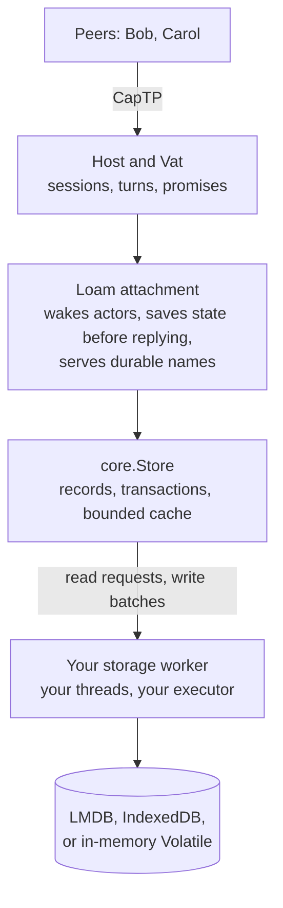
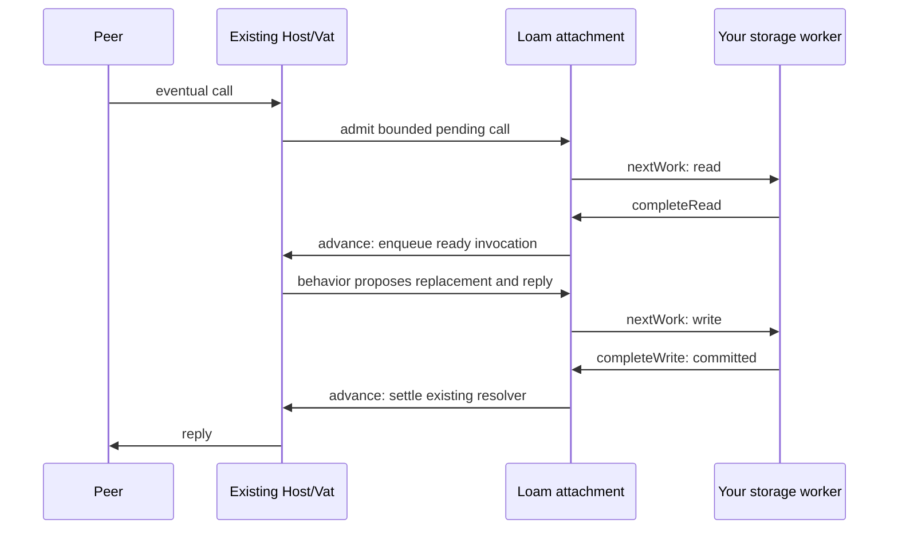

# Loam storage and durable actors

Loam is glowcap's storage layer for objects that must outlive their process.
The [Loam page](https://jimisaacs.github.io/glowcap/loam/) on the website has
diagrams. C and Rust, and Rust in the browser, use a narrower profile described
in the [C/Rust guide](loam/c-and-rust.md) and the
[browser guide](loam/browser.md).

## What Loam is for

Picture a task board shared over CapTP. Your program hosts the board, its
columns, and its cards as live objects. Bob holds a reference to one column,
and Carol keeps a sturdyref to the board. When your program restarts, every
one of those objects is gone, and so is everything Bob and Carol were
holding.

Saving the cards' text does not fix that, because a capability is a live
connection to an object, not a value you can write down. Loam saves the
objects together with the references between them and the names peers use to
reach them, so after a restart the same references reach the same objects. An
object nobody is calling can sleep on disk, so the stored graph can be far
larger than memory.

## The pieces

Loam sits between the Host you already run and a storage backend:



**Records and edges.** Loam stores each object as a record: its data, in a
schema the application declares, plus edges to other records. "This column
holds that card" is an edge. A strong edge keeps its target alive, and a weak
edge only points at it. A record marked as a root, such as the board, is kept
with nothing pointing at it. Anything a root cannot reach through strong
edges is garbage, which [collection](loam/collection.md) removes.

**Transactions.** Moving a card between columns changes two records, and a
transaction saves both changes or neither. Each change names the version of
the record it started from, so an edit prepared from stale data is refused
instead of overwriting a newer change.

**Your code does the I/O.** Loam decides what to read and write and hands your
storage worker read requests and write batches. The worker reports back. Loam
starts no thread and no event loop.

**Durable actors.** A [durable actor](#durable-actors), also called a sleepy
actor, keeps its state in a record and runs on the Host and Vat you already
have. Its state can leave memory while every reference to it keeps working. A
call loads the record, runs the actor's code, saves the new state, and only
then replies, so no caller is told about a change the store could still lose.

**Durable names.** A [publication](loam/publications.md) saves an actor's
secret name, the swiss number in a sturdyref, in an on-disk index. After a
restart nothing loads until a peer fetches a name, and then only that actor
wakes.

**Managed access.** An optional layer records who may use which resources,
and lets the owner pause, resume, or revoke that access later. The
[managed-access guide](loam/access.md) covers it.

## Words used throughout

| Term | Meaning |
| --- | --- |
| store | One durable collection of records with its own identity, such as one LMDB directory. |
| record | One object's saved state: schema, payload bytes, typed edges, and a root flag. |
| edge | A reference from one record to another, by record identity rather than memory address. |
| root | A record kept whether or not anything points at it. |
| revision | The store's commit counter. Each change names the revision it replaces. |
| lease | A short-lived borrow of one record version from the cache. |
| batch | The writes one transaction commits, handed to your worker as one unit. |
| worker | Runs reads and batches against the backend. `hosting.Worker` tracks each request until its result is installed, and your code picks the thread. |
| backend | The storage engine: `Lmdb`, IndexedDB in the browser, or the in-memory `Volatile`. |
| attachment | The connection between one store and a Host. It wakes actors and saves their state. |
| behavior | The function that runs one schema's actors: saved state and a call in, a reply out. |
| publication | A durable secret name that peers fetch to reach an actor after a restart. |
| recipe | A saved instruction for getting a reference back: a local record, another attachment, or a sturdyref. |
| collection | The background deletion of records no root reaches. |

## A first durable actor

[Example 07](../examples/zig/07_durable_card.zig) is the smallest complete
program. It stores one card in LMDB, moves it, shuts everything down, opens
the same directory in a fresh Host, and finds the move still there.

**A schema and a behavior.** The card's payload is one integer, how many
times it has moved. Its behavior reads the saved record and proposes new
state. The proposal counts only once Loam commits it.

```zig
fn card(call_state: *hosting.Call, state: core.RecordView, verb: []const u8, args: []const driver.Value) !driver.Value {
    if (args.len != 0) return error.InvalidArguments;
    if (state.payload.len != 8) return error.InvalidCard;
    const moves = std.mem.readInt(i64, state.payload[0..8], .little);
    if (std.mem.eql(u8, verb, "moves")) return .{ .integer = moves };
    if (std.mem.eql(u8, verb, "move")) {
        const next = try call_state.arena().alloc(u8, 8);
        std.mem.writeInt(i64, next[0..8], moves + 1, .little);
        call_state.replace(next);
        return .{ .integer = moves + 1 };
    }
    return error.NoSuchMethod;
}
```

**A store and a first record.** The program opens LMDB, builds a `core.Store`
with explicit limits, and writes one rooted record so collection keeps it.
Before an attachment exists, a write takes three lines: prepare, let the
backend commit the batch, and report the outcome.

```zig
const ticket = try store.prepare();
const outcome = db.commit(try store.beginWrite(ticket));
try store.completeWrite(ticket, outcome);
```

**An attachment and a capability.** `hosting.Attachment.create` connects the
store to the Host and registers the behavior. `attachment.restore` turns the
record back into an ordinary Host capability that can be called locally or
handed to a peer.

**A call, with its storage work.** The program sends `move` and then runs the
loop every embedding runs: drive the Vat, call `attachment.advance()`, and let
a `hosting.Worker` carry out each item from `attachment.nextWork()`. The read
wakes the card, the write saves its new state, and the reply is released only
after the write commits.

```zig
var slot: [1]hosting.Worker.Slot = undefined;
var worker: hosting.Worker = .init(&slot);
try worker.drive(attachment, db);
```

**A restart.** The second run reopens the directory with the same store
identity, restores the card, and asks how many moves it has made. The answer
is the one the first run committed. A real program would publish the card
under a [durable name](loam/publications.md) so peers can fetch it after a
restart.

Run it with `zig build examples`.

## The guides, in reading order

| Guide | Read it when you want to know |
| --- | --- |
| [Stores, transactions and reads](loam/store.md) | How a store opens, commits, reads through its cache, and recovers an unknown write. |
| [Durable names](loam/publications.md) | How peers fetch actors by sturdyref after a restart, and how names retire. |
| [Durable capability fields](loam/references.md) | How saved state holds references to other actors, attachments, and remote objects. |
| [Collecting unreachable records](loam/collection.md) | How garbage is found and deleted in bounded batches while the program runs. |
| [LMDB operations](loam/lmdb.md) | How to size, grow, compact, close, and measure the on-disk store. |
| [Managed access](loam/access.md) | How grants, use and control references, revocation and retries work. |
| [C and Rust](loam/c-and-rust.md) | How C and Rust programs create, share, edit, and restore a resource. |
| [Browser storage](loam/browser.md) | How the Rust profile stores to IndexedDB. |
| [Architecture](loam/architecture.md) | How Loam, actors, and managed access fit together. |
| [Record, transaction, and hosting API](loam/api.md) | How objects, reference fields, leases, transactions, and backend outcomes are represented. |
| [Sleepy actors](loam/actors.md) | How actors sleep, wake, keep call order, and release memory. |
| [Managed access architecture](loam/access-architecture.md) | How resources, facets, grant mutation, and change events are enforced. |
| [Managed access API](loam/access-api.md) | What an application uses from Zig or a binding to define and manage resources. |
| [Managed access storage](loam/access-storage.md) | What storage proves for grants, protected queries, restoration, and recovery. |
| [Coverage](loam/coverage.md) | Which managed-access evidence exists at each surface. |
| [Research](loam/research/memory-persistence.md) | The prior-art survey, the [persistence reuse review](loam/research/native-reuse.md), and the measurement program. |

The decision records behind these guides start at
[ADR-0162](decisions/adr/ADR-0162-loam-record-transactions-and-lmdb.md) for
records and LMDB and
[ADR-0163](decisions/adr/ADR-0163-record-backed-sleepy-actors.md) for
sleepy actors.

## Durable actors

### Attaching a store

`hosting.Attachment.create(allocator, &host, &store, behaviors, options)`
attaches one store to an existing Host. Keep the Host and Store at stable
addresses, and keep the schema and behavior tables alive until the attachment
is destroyed. Each `Behavior` pairs a schema and version with a deterministic
invocation function:

```zig
fn invoke(call: *hosting.Call, state: core.RecordView,
    verb: []const u8, args: []const driver.Value) !driver.Value
```

### What a behavior may do

For a simple actor, its record holds all of its durable state. The behavior
decodes the fields it needs and may call `call.replace(payload)` with bytes
from `call.arena()` or borrowed from the current record. Loam commits that
replacement before fulfilling the reply, and a behavior error discards it.
Replacement keeps the record's existing edges.

A behavior performs no I/O and no outside effect, because a proposal that
fails to commit is thrown away and an email already sent could not be. Loam
saves records, not mutable Zig structs or thread stacks, and the behavior
contract is not an in-process security sandbox. Behaviors that change several
records use the preparation and transaction participant hooks
described under
[managed endpoints](loam/access.md#managed-endpoints-on-the-host).

### Restoring and saving references

`attachment.restore(current_record_lease)` turns a rooted actor's record into
an ordinary held Host capability. `attachment.capture(capability)` does the
reverse for an actor in this attachment: it turns held authority into a
stored strong edge. Raw record names identify data and never reach the remote
call surface.

`call.edge(index)` restores the exact local capability an edge stores without
loading the target's state, so shared references and cycles never force a
recursive load. Returned capabilities borrow the call's custody until its
reply settles. For references to another attachment, another Host, or a
remote object, use [stored capability fields](loam/references.md). Ordinary
durable saves refuse unsupported live targets. Explicit live fields retain
the exact capability for one hosting lifetime and refuse after restart.

### How a call runs

Eventual calls use the Vat and CapTP promises you already have. Admission
copies plain-data arguments into bounded retained storage and keeps the
original ingress. The attachment merges reads for the same cold actor, keeps
each actor's pending calls in order, and queues ready invocations on the Vat.
Network activations resume through `Host.flushSession`, so Host scheduling and
session-close decisions still apply.

Your program calls `attachment.advance()` at top-level boundaries and carries
out each item from `attachment.nextWork()`:



Workers receive borrowed read and batch requests and answer through
`attachment.completeRead` or `completeWrite` on the owning context. They do not
call into the Host. An unknown write outcome keeps ownership and fences the
store. Once every other slot is released, the worker's next request is the
attachment's `recoveryBatch`, and completing it calls `attachment.resolve`.
Resume Host work through your usual pump. Purely
local ingress keeps running through the Vat's bounded drive. The
[actor process test](../test/loam_actors_crash.zig) runs the complete LMDB
call, commit and reopen path.

### Call memory

Each call reserves its whole byte allowance at admission but takes heap
blocks only as it needs them. Its immutable input and its restartable working
storage share that one physical bound, including block headers and spare
capacity. Reply data borrows the call's retained storage until the reply
settles, and foreign callbacks copy their output before returning. When a
newer commit forces the call to prepare again, its working blocks are
released and its input arguments, with the capabilities they hold, are kept.

### Near calls and capability arguments

A near call to a resident, read-only actor borrows the cache. A near call to
a cold actor returns `ResidencyRequired` without requesting I/O. Use an
eventual call, or `prefetch` and wait for it, first. A near call that would
change state or forward an invocation returns `DurableTurnRequired`. Forwarding
needs the eventual-call path to retain its target and settle its reply.

Owning local calls use `Host.callLocalCapability` on the existing Vat queue.
Their arguments and results preserve nested capability identities without a
Session. Queued custody survives observer cancellation. Bounded reply
preparation precedes state replacement or deferred resolver consumption.
`ReplyCapacity` reports a fixed reply allowance that cannot fit the result,
and heap allocation refusal remains `OutOfMemory`. A deferred resolver stays
live after either refusal and can accept a different reply.

Plain local Vat answers use model values. The Host and CapTP paths accept
nested capability arguments and keep them through reads, preparation restarts
and settlement. Receiving a capability does not make it durable: `capture`
accepts a proven target in the same attachment, and
`hosting.references.beginSave` checks supported local and established
foreign recipes. Raw local Vat reference and handoff arguments are not
supported. Administrative transactions can change edges with `capture` while
no actor calls are pending.

### Retained continuations

A Zig content callback can reserve a continuation with its original source
intent and targets. Confirmed receipt commit activates it. Unknown commit
keeps the reservation behind recovery. The reservation owns copied intent and
capability retains under an independent allowance, and holds no Store lease
through a target wait.

Public projections recheck source admission before delivering completed results.
The private executor retains the completed outcome after source loss so
the application can settle its durable receipt. Its result distinguishes failure
before target admission (`unsent`) from failure afterward (`unknown`). Neither a
fulfilled reply nor a failure determines durable effect application. The
application receipt owns that judgment. Canceling execution releases its
observer while admitted work keeps its custody until settlement. The
executor rejects an immutable reply that exceeds its allowance or contains a
capability whose home retired. It retries temporary heap refusal while retaining
the completed result and never redispatches the target. The
[Rooms effect contract](rooms/session-effects.md) describes production receipt
execution and recovery.

### Sleeping

`attachment.sleep(capability)` evicts an eligible actor's state while keeping
its callable identity. An explicit `pin` returns a Store lease, and pins or
pending calls prevent sleep. By default the cache keeps hot records and
reclaims eligible least-recently-used slots. `sleep_policy = .every_turn`
forces a cold activation after each completed call, which is useful in tests.
Sleeping is neither deletion nor revocation. With no held capabilities,
endpoint boxes retire through ordinary Vat lifetime management, and stored
objects alone allocate no actor endpoints.

### Capacity and cost

Attachment options bound the endpoint count, the pending-call count, each
call's memory, and total pending-call bytes. Pending calls also have
per-ingress count and byte ceilings derived from the Vat's queue limits,
charged apart from the Vat's runnable queue. The cache, staging, endpoint
metadata, Host custody, and LMDB and OS pages are separate costs.

Endpoint, operation and cache lookups use bounded linear scans, and per-actor
ordering can scan the operation table quadratically. Cache installation scans
its bounded slots against the transaction's changed objects. Measure these
before raising capacities.

### Durable names and shutdown

[Durable names](loam/publications.md) covers on-demand fetch, retiring a name,
index retention, the lookup work item, and destroying an attachment.

## Modules

| Surface | Responsibility |
| --- | --- |
| `glowcap.loam.collections` | Immutable, structurally shared maps for actor state and snapshots. Requires no store. |
| `glowcap.loam.records` | Store and object identities, schema limits, typed edges, and checksummed Syrup envelopes. |
| `glowcap.loam.core` | Store transactions with re-proposable staged records, exact completion and recovery, and bounded record leases. Performs no I/O. |
| `glowcap.loam.hosting` | Record-backed behavior, bounded pending calls, lazy local capability edges, and publication descriptors on an existing Host. |
| `glowcap.loam.Volatile` | In-memory backend for the same batches, with its own storage-byte limit. |
| `"glowcap_loam_lmdb"` | Optional module exposing `Lmdb`, which runs blocking storage work ([LMDB operations](loam/lmdb.md)). |
| `glowcap.loam.access` | Resource and grant views, grant preparation, bounded record codecs, and durable owner storage, with use and control custody, managed hosting, scoped observation and bounded owner retirement. |

The collections module uses "persistent" in the immutable-data-structure
sense: old versions stay available through structural sharing. Disk storage
encodes explicit records. It saves no process-local pointers or map allocator state.

## Current limits

**What a crash can lose.** Pending calls and replies can be lost when the
process dies, and a committed write can survive even though its caller never
hears back. A caller that retries then repeats the change. Managed derivation
and mutations keep bounded receipts for exact retries, described in
[retrying mutations](loam/access.md#retrying-mutations). Every other actor
interface owns its own retry contract.

**What can be saved.** Hosted fields keep direct local authority, checked
dependencies on other attachments, and established foreign sturdyrefs.
Timers, unresolved promises, subscriptions, and outside handles are not
durable fields. General durable inboxes and outboxes, and general graph
projections beyond the C, Rust and browser resource profile, are not built.

**One owner per store.** Collection traces only the store this process owns
exclusively. Explicitly deleting an unrooted record leaves incoming
references resolving as gone, and object identity is never reused. The
[browser profile](loam/browser.md) runs the same fixed-resource lifecycle on
IndexedDB.

**Managed history.** Managed owners keep 32 committed change batches of up to
16 effects each. Grant, resource, content and control changes share the
caller's Store transaction, and an abort or an unchanged effect adds no
history. Expired batches become collectible. Scoped replay and observation
read these batches. The [observation guide](loam/access.md#observing-held-access)
covers cancellation and capacity. [Bounded owner cleanup](loam/access.md#bounded-owner-cleanup)
closes owner admission, retires publications through the attachment,
compacts terminal identities and prunes indexes without resetting allocation
or receipt floors. Local tracing then reclaims the disconnected payloads. Each
permanent name reservation keeps 58 logical bytes before backend overhead.

The [shipped inventory](shipped.md#resource-models) lists what is built.

## Evidence

These build steps kill the process at chosen points and check what a fresh
process finds:

- `zig build loam-lmdb-test` covers the LMDB storage contracts, and
  `zig build loam-lmdb-crash-test` covers process interruption.
- `zig build loam-actors-crash-test` restores publications and cyclic actor
  references, then calls them through CapTP after the restart.
- `zig build loam-managed-crash-test` interrupts managed issuance,
  revocation, edits, moves and deletion before and after commit, then checks
  receipt recovery and atomic change batches in a fresh process.

These prove recovery from `SIGKILL` at the tested points, not from power loss.
