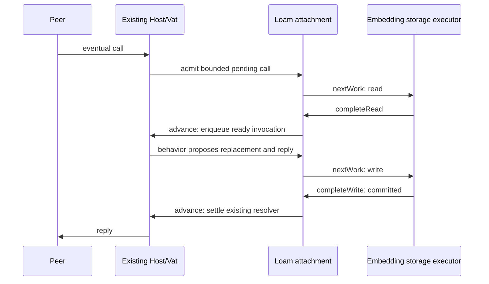
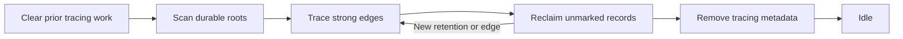

# Loam storage and durable actors

Loam is glowcap's storage layer for objects that must outlive their process.
This guide is the full contract for Zig. C and Rust, and Rust in the
browser, use a narrower profile described in the
[C/Rust guide](loam/c-and-rust.md) and the [browser guide](loam/browser.md).
The [Loam page](https://jimisaacs.github.io/glowcap/loam/) on the website explains
the same ideas with diagrams, through the example used here.

## What Loam is for

Picture a task board shared over CapTP. Your program hosts the board, its
columns, and its cards as live objects. Bob holds a reference to one column,
and Carol keeps a sturdyref to the board. When your program restarts, every
one of those objects is gone, and so is everything Bob and Carol were
holding.

Saving the cards' text to a database does not fix that. The hard part is the
references: which column holds which card, which object Bob holds, which
outside service the board calls. A capability is a live connection to an
object, not a value you can write down and read back.

Loam saves the objects together with the references between them and the
names peers use to reach them. After a restart the same objects come back and
the same references reach them. It also lets an object sleep on disk while
nobody is calling it, so the stored graph can be far larger than memory.

## How it fits together

**Records and edges.** Loam stores each object as a record: its data, in a
schema the application declares, plus edges to other records. "This column
holds that card" is an edge. A strong edge keeps its target alive, and a weak
edge only points at it. A record marked as a root, such as the board, is kept
with nothing pointing at it. Anything a root cannot reach through strong edges
is garbage, which [collection](#collecting-unreachable-records) removes.

**Transactions.** Moving a card between columns changes two records, and a
transaction saves both changes or neither. Each change names the version of
the record it started from, so an edit prepared from stale data is refused
instead of overwriting a newer change.

**Your code does the I/O.** Loam decides what to read and write but never
touches the disk, for the same reasons glowcap's protocol core never opens a
socket. It hands your storage worker read requests and write batches, and the
worker reports back. The worker runs them against an in-memory `Volatile`
backend or LMDB 1.0.2. Loam starts no thread and no event loop.

**Sleepy actors.** A [durable actor](#durable-actors) keeps its state in a
record and runs on the Host and Vat you already have. Its state can leave
memory while every reference to it keeps working. A call loads the record,
runs the actor's code, saves the new state, and only then replies, so no
caller is told about a change the store could still lose.

**Durable names.** A [publication](loam/publications.md) saves an actor's
secret name, the swiss number in a sturdyref, in an on-disk index. After a
restart nothing loads until a peer fetches a name, and then only that actor
wakes.

**Managed access.** An optional layer records who may use which resources,
and lets the owner pause, resume, or revoke that access later. The
[managed-access guide](loam/access.md) covers it.

The LMDB backend requires the LMDB 1.x disk format, so use a fresh database
directory for prerelease stores created with LMDB 0.9. The
[shipped inventory](shipped.md#resource-models) lists implemented behavior, and
the [design guide](planning/README.md) maps the remaining application
foundation.

## Modules

| Surface | Responsibility |
| --- | --- |
| `glowcap.loam.collections` | Immutable, structurally shared maps for actor state and snapshots. Requires no store. |
| `glowcap.loam.records` | Store/object identities, schema limits, typed edges, and checksummed Syrup envelopes. |
| `glowcap.loam.core` | Store transactions with re-proposable staged records, exact completion/recovery, and bounded record leases. Performs no I/O. |
| `glowcap.loam.hosting` | Record-backed behavior, bounded pending calls, lazy local capability edges, and publication descriptors on an existing Host. |
| `glowcap.loam.Volatile` | In-memory realization of the same batches, with its own storage-byte limit. |
| `"glowcap_loam_lmdb"` | Optional Zig module exposing `Lmdb`; executes blocking storage work. |
| `glowcap.loam.access` | Resource/grant views, shared grant preparation, bounded record codecs, and durable owner storage. Includes durable use/control custody, managed hosting, scoped observation and bounded owner retirement. |

The LMDB module is available from the same build dependency:

```zig
exe.root_module.addImport("glowcap", dependency.module("glowcap"));
exe.root_module.addImport("glowcap_loam_lmdb", dependency.module("glowcap_loam_lmdb"));
```

The collections module uses “persistent” in the immutable-data-structure sense:
old versions remain available through structural sharing. Disk storage encodes
explicit records; it does not save process-local pointers or the map's allocator state.

## Opening and changing a store

An LMDB store is one directory on disk, owned by one process at a time.
Every change goes through a transaction that Loam prepares and your worker
commits.

Create an existing empty directory, choose a fresh store identity, and call
`Lmdb.open(path, .{ .mode = .{ .create = identity } })`. Reopening uses
`.open = identity` and verifies that identity. Missing metadata, existing
creation, identity mismatch, and unavailable exclusive custody are distinct
failures. An error never selects volatile storage or resets an existing store.

Construct `core.Store` from the backend's claimed metadata, schema descriptors,
and explicit memory limits. Schemas are borrowed for the store's lifetime.
Keep each store and backend at a stable address while a worker borrows them.
One execution context owns each Store and delivers its completions; workers
receive batches or read requests and do not mutate the Store. The volatile
backend requires serialized calls. LMDB permits concurrent reads and one
writer, while the core admits one outstanding write per store.

A transaction proceeds through `begin`, `allocateId`, `putCopying` or `remove`,
`prepare`, and `beginWrite`. Allocate all new IDs first when constructing a
cycle. A record carries its schema/version, payload, typed edges, and retention
root flag. `putCopying` takes an expected existing revision, or null for a new
record. It copies the proposal and supplies the next committed revision.
Replacing a record's root flag uses the same atomic mutation as its content.

The returned batch borrows core-owned memory. The embedding runs
`backend.commit(batch)` and delivers its outcome to `Store.completeWrite`.
Inspect the outcome's failure cause; successful completion of the delivery
method does not turn an unchanged backend result into a successful mutation.
For a Host-based application, run LMDB storage on the existing executor
outside the Host turn. Loam creates no worker or event loop.

An unknown commit outcome retains the batch and fences reads and new writes.
Join the original worker, obtain `Store.recoveryBatch`, call the backend's
`recover`, then deliver the resolution through `Store.resolve`. A timeout or
abandoned caller cannot prove an abort. The
[LMDB tests](../test/loam/lmdb/storage_test.zig) exercise these paths using both
complete and interrupted transactions.

## Reads and memory

Reading works like writing: Loam says which record it needs, your worker
fetches it, and Loam keeps a bounded cache of what it has read.

`Store.acquire` returns a lease for a resident version or an explicit read
request. The embedding executes `backend.read(request)` and returns its result
to `Store.completeRead`, then acquires the installed record. Another request
for the same pending record reports `PendingRead` without issuing a second
load. The embedding owns any waiting callers.

`Store.view` borrows validated record bytes until `Store.release`. A held lease
can retain an older data version after a commit. Released, foreign-store, and
stale lease tokens refuse access. Canceling a read retains its buffer until the
worker completes; the canceled completion cannot install data.

Each cache slot holds either a pending read or immutable resident bytes with
their checked record envelope. Completion validates the bytes once; later
views borrow that envelope after checking the lease. Record integrity and
current authority remain separate checks, so caching a decoded record never
makes a historical lease current.

The cache charges a maximum-record buffer for each read. A transaction can opt
into `retainOnCommit`, transferring its prepared buffers into eligible cache
slots at their actual encoded size. Installation allocates nothing and never
displaces a pinned snapshot. `currentView` refuses a historical lease when
restoring authority; `view` still permits historical data reads. The cache
byte limit and its occupancy are independent of stored object count. Slot and
lease tables have separate bounded initialization costs, including one checked
envelope per slot; staged writes have a distinct byte and mutation limit.
Encoding measures before allocating and copies each changed
record once. LMDB readers copy into the reserved buffer and end before returning.
The volatile backend's full data allocation and LMDB's mapped/OS-resident pages
are separate from this cache budget.

Metadata reports object count, root count, and exact encoded record bytes.
These totals exclude indexes, database pages, cache metadata, and temporary
writes. They are not reachable-graph size or total process memory measurements.
Batch validation reads changed records and their strong targets. It scans the
bounded mutation table to resolve references within the batch; it does not scan
the whole store. Commit installation carries unchanged resident records into
the new revision. Changed and removed records become stale; prepared replacements
can become resident through `retainOnCommit`. Each lease keeps its acquisition
revision, so reusing bytes never makes an old lease current. Pending reads still
refuse completion across any committed revision change.

## LMDB capacity and measurements

LMDB maps its file into memory up to a size you choose, so a store can fill.
This section is how to see how full it is, grow it, and shrink the file
afterward.

`Lmdb.inspect()` reports map size, allocated page high water, current tree pages,
and key count. Tree pages exclude the free-page database and metadata pages.
High water includes pages available for reuse; subtracting it from map size does
not tell an application exactly how much its next write can consume.

`Lmdb.grow(new_map_bytes)` increases the map between backend operations. It
refuses while another backend operation is active and blocks new operations
during remapping. A held Loam record lease remains usable because it owns copied
bytes. Choose a larger page-aligned size, then commit normally; the next
successful LMDB write persists the larger map setting. Size selection belongs
to the embedding's storage budget, never an automatic unlimited retry.

Resolve outstanding write outcomes before maintenance. If remapping fails,
`ReopenRequired` fences backend admission because the old mapping may be gone.
Close and reopen the backend and its Store through the normal opening contract.
This refuses ambiguous use rather than continuing with invalid mapped memory.
Collection reuses database pages. Offline compaction shrinks the physical file
while keeping the configured map limit separate.

Join storage workers, resolve outstanding write outcomes, and retire the attached
Host work and Store before beginning replacement. The backend holds writer
custody throughout copying, validation, installation and synchronization:

```zig
try backend.compact();
try backend.close();
backend = try Lmdb.open(path, .{ .mode = .{ .open = expected_store_id } });
```

Installation leaves the old backend fenced, including when rename fails.
Reopening resolves the installed file and claims a new incarnation.
`beginCompaction` also exposes an owned operation with `prepare`, `install`,
`finish` and `deinit` for callers that need explicit phase boundaries.
`InstallOutcomeUnknown` from `finish` allows a sync retry without repeating
installation. Canceling before installation leaves the source usable, unless a
concurrent close has fenced it.

Only `data.mdb` is authoritative on reopen. An incomplete `loam-compact.mdb`
is ignored; the next operation discards it under the same owner lock. The
operation needs disk space for both data files and uses streaming comparisons
with bounded engine copy buffers. It allocates no Zig row copies.
The directory must stay at its opened path during validation.
The [replacement contract](decisions/adr/ADR-0181-offline-lmdb-replacement.md)
states the local filesystem, synchronization and failure assumptions.
`zig build loam-compaction-crash-test` exercises process loss and copy capacity
refusal. Linux results and macOS CI configuration do not establish macOS
execution or tested hardware power-loss behavior.

Run `zig build bench-loam -Doptimize=ReleaseFast` for the LMDB conversation
workload. It measures hot/cold calls, unchanged records after edits, wakeup
bursts, and collection beside queued reads. The
[method and limits](../bench/loam/README.md) distinguish Loam residency, tracked
Zig allocations, physical page geometry, and unmeasured process/OS memory.

## Durable actors

A durable actor, or sleepy actor, is an object whose state lives in a record.
An attachment connects a store to an existing Host, wakes actors when calls
arrive, and saves their new state before replying.

`hosting.Attachment.create(allocator, &host, &store, behaviors, options)` attaches
one store to an existing Host. Keep both at stable addresses and borrow the
schema/behavior tables until attachment destruction. Each `Behavior` pairs a
schema/version with a deterministic invocation function:

```zig
fn invoke(call: *hosting.Call, state: core.RecordView,
    verb: []const u8, args: []const driver.Value) !driver.Value
```

For a simple actor, its portrait record contains its durable state. The callback decodes the
fields it needs and may `call.replace(payload)` using bytes allocated from
`call.arena` or borrowed from the current record. It must not perform I/O or
external effects. Loam commits that replacement before fulfilling the reply;
a callback error discards it. Replacement preserves the record's existing
edges. This profile does not serialize arbitrary mutable Zig actor structs or
thread stacks, and the callback contract is not an in-process security sandbox.
Behaviors needing multiple records use the optional preparation and transaction
participant seams described under [managed endpoints](#managed-endpoints-on-the-host).

Restore a rooted actor through `attachment.restore(current_record_lease)`.
This returns an ordinary held Host capability. `attachment.capture(capability)`
converts held authority for an actor in this attachment into a stored strong
edge. Raw record names identify data; they do not enter the remote call surface.
`call.edge(index)` restores that exact stored local capability without loading
the target's state. Sharing and cycles therefore require no recursive graph
load. Returned capabilities borrow call custody through reply settlement.
For dependencies on another attachment or Host/Vat, use the checked
[durable field preparation](loam/references.md). Live-only references without a
restoration contract fail before writing.

Eventual calls use existing Vat/CapTP promises. Admission copies plain-data
arguments into a fixed call buffer and retains the original ingress. The
attachment coalesces cold reads, preserves pending-call order per actor, and
queues ready invocations on the Vat. Network activations resume through
`Host.flushSession`, preserving Host scheduling and session close decisions.
The embedding progresses `attachment.advance()` at top-level boundaries and
executes each work item obtained from `attachment.nextWork()`:



Workers receive borrowed read/batch requests and return through
`attachment.completeRead` or `completeWrite` on the owner context. They do not
call into Host. Unknown write outcomes retain ownership and fence the store;
join the worker, obtain `recoveryBatch`, query backend recovery, then call
`attachment.resolve`. Resume Host actions through the embedding's usual pump.
Purely local application ingress continues through the Vat's bounded drive.
Loam adds neither an executor nor a networking loop. The
[actor process proof](../test/loam_actors_crash.zig) demonstrates the complete
LMDB call/commit/reopen path.

A resident read-only near call borrows the cache; a cold near call returns
`ResidencyRequired` without requesting I/O. Use eventual calls or `prefetch`
and completion first. Near mutation returns `DurableTurnRequired`. Plain local
Vat answers currently cannot carry owning capability values; those replies
require the Host/CapTP path. That path also accepts nested capability arguments
and retains them through reads, preparation restarts, and settlement. Receiving
a capability does not establish durability: `capture` accepts a proven
same-attachment target, while `hosting.references.beginSave` validates supported
local or established foreign recipes. Raw local Vat reference/handoff arguments remain
unsupported. Administrative transactions can change edges using `capture`
while no actor calls are pending.

`attachment.sleep(capability)` evicts eligible state while preserving callable
identity. Explicit `pin` returns a Store lease; pins and pending calls prevent
sleep. The default cache policy retains hot records and reclaims eligible
least-recently-used slots. `sleep_policy = .every_turn` exercises forced cold
activation after each completed call. Sleeping is neither deletion nor
revocation. With no held capabilities, endpoint boxes retire through ordinary
Vat lifetime management; stored objects alone allocate no actor endpoints.

Options bound endpoint count, pending-call count, each call's memory, and total
pending-call bytes. Pending calls also have per-ingress count and byte ceilings
derived from Vat queue limits, separately charged from the Vat's runnable
queue. Cache, staging, endpoint metadata, Host custody, and LMDB/OS pages are
separate costs. Endpoint/operation/cache lookups currently use bounded linear
scans; per-actor ordering can scan the operation table quadratically. Cache
installation scans its bounded slots against the transaction's changed objects.
These are explicit performance limits to measure before increasing capacities.
The 500,000-session target still requires connection-memory and live-socket
measurements; sleepy state does not make active connections free.

### Publications and close

[Durable publication discovery](loam/publications.md) covers on-demand fetch,
retirement barriers, index retention, storage work, and attachment shutdown.

## Collecting unreachable records

Collection deletes the records that no root reaches through strong edges,
including cycles that only hold each other up. It runs in small batches that
you schedule.

Call `store.prepareCollection(work_limit)` to prepare one bounded collection
batch, then use the ordinary `beginWrite`, backend commit, and `completeWrite`
path. Inspect `store.metadata.collection.phase`; continue in later batches
until it is `idle`. Unknown outcomes use the same recovery protocol as content
writes. The embedding chooses when to schedule these batches; Loam owns the
tracing and deletion decisions.



The collector traces roots, strong edges, current live custody, pending reads,
and pinned record versions. A pinned historical record also retains its old
strong edges. Weak edges do not retain targets; unreachable cycles are reclaimed.
Tracing reads stored records without invoking actor behavior or warming its
cache. Each batch has a bounded record/phase work count; each traced record can
add up to the configured edge limit. Durable marks and a FIFO queue live in the
backend, so the work queue need not fit in application RAM.

Use `store.retain(object_id)` and `releaseRetention(token)` for local custody
outside leases. These checked tokens keep records alive independently of cache
residency; they grant no remote call authority and do not survive restart.
Actor endpoints register this custody automatically and release it when they
retire or their attachment closes. A retained actor remains callable after
collection even when it is asleep and has no durable root flag.

The first preparation captures live custody once for the cycle. Between batches,
Store reserves journal capacity before publishing a new retention, lease or
pending read, then records its marking obligation. The first lease on an
immutable resident portrait records its strong historical edges; repeated
leases on that portrait add no work. Preparation freezes new leases and
retention claims until that batch settles. Existing leases remain usable and
may be released. Ordinary writes between batches record new strong edges in
the same transaction as the content change. Once root scanning begins, new or
changed records survive the current cycle. Sweep drains outstanding tracing
work before deleting another candidate. Reopen discards incomplete tracing
progress and starts from fresh roots; it never continues an old sweep blindly.

Collection reuses one record-sized scratch buffer and a journal of at most
`max_collection_roots` identifiers until the cycle finishes. Insufficient capacity
refuses initial preparation or new custody before publication. Each tracing batch
borrows all pending obligations; only a confirmed collection receipt acknowledges
the submitted entries. Abort and uncertain outcomes preserve them. Unchanged
custody is copied, fingerprinted and seeded once, rather than once per batch.
Root shading has its own bound; the record/phase work limit does not bound all
batch work. New custody during finishing needs no marking because deletion is
over. A completed idle cycle starts directly with roots; an interrupted cycle
clears old tracing rows in separate batches before submitting fresh obligations.
[ADR-0189](decisions/adr/ADR-0189-loam-collection-custody-admission.md) owns this
admission contract; the [cost profile](../bench/loam/README.md#collection-custody-cost)
separates root work from tracing and commit counts.
Storage must have headroom for marks, queue entries, and atomic writes;
map exhaustion aborts the batch without deleting unproven garbage. The volatile
backend charges internal rows to its byte limit; LMDB uses ordered cursors while
the volatile test backend scans its hash table. These are different cost models.
Collection batches that remove no objects preserve current resident bytes.
A batch that sweeps objects conservatively invalidates the cache because its
receipt does not enumerate deleted identities. Old leases remain historical
after either kind of commit.

Reclamation updates object and encoded-record-byte totals atomically. These
totals exclude backend indexes, tracing metadata, and mapped-page overhead.
Reclamation is distinct from shrinking the database file. Offline compaction
uses the maintenance operation above. Budget collection before storage is exhausted. The process-kill
proof covers interrupted sweeps. The LMDB workload measures bounded collection
service time and queued-read interference; a separate bounded storage executor
workload measures transient and durable foreground calls during collection.

## Managed access

The [managed-access guide](loam/access.md) explains resource creation, moves,
leaf deletion, filtered child queries, use/control custody and hosted mutation
receipts. It uses the same Store, owner transaction and Host attachment described
here. Applications opt into those records and authority checks; ordinary
networking and actors do not allocate them.

## LMDB workload measurements

`zig build bench-loam -Doptimize=ReleaseFast` measures ordinary actors and
managed resources through the shipped Host/Vat and LMDB interfaces. The
managed population covers resource creation, atomic Zig use/control issuance,
control dependency chains, moves, child iteration, receipt-backed hosted content
edits and grant revocation with shallow and deeper resource/grant ancestry.
Its smoke run validates replies, warmed-record reuse, commit counts, revocation
refusal and complete Zig memory release under `check`.
The [workload method](../bench/loam/README.md) owns populations, limits,
sampling and report interpretation. A shared four-worker executor measures
sustained ordinary and managed calls, with deterministic admission refusal and
unrelated actor progress. Further profiles measure checked foreign restoration
through byte-fed sessions, larger held-facet working sets and offline compaction.
The [recorded results](../bench/loam/results.md) preserve revision, durability,
read/allocation counts and latency distributions. OS snapshots report whole-process
memory independently of tracked Zig heap and LMDB page geometry. The offered
load uses a bounded closed-loop window.

## Closing and current limits

Retire reads, settle writes, release leases, then deinitialize the Store.
`Lmdb.close` stops new work and reports `Busy` while a backend operation retains
the environment. Finish or abort that operation, join its worker, and retry
close. The lifetime lock file remains in the directory so concurrent owners
cannot acquire different lock inodes at the same path.

This advisory lock coordinates cooperating Loam adapters for the entire open
lifetime. LMDB separately serializes write transactions. All writers must use
the adapter's custody protocol so cached Loam state remains current; direct
external LMDB writes are outside this storage profile.

The LMDB adapter uses BSD `flock`, available on macOS and Linux, and an
explicitly configured LMDB map size. Map exhaustion refuses the entire
transaction; `grow` expands capacity under exclusive backend maintenance.
The [browser profile](loam/browser.md) executes the same fixed-resource
lifecycle through IndexedDB. Tracing collection is local to this exclusively
owned store. Explicit deletion of an unrooted record leaves
incoming references resolving as gone; object identity is never recycled.

Managed owners retain 32 committed change batches of up to 16 effects each.
Grant, resource, content and control changes share the caller's Store transaction;
abort and unchanged effects add no history. Expired batches become collectible.
The [access guide](loam/access.md) owns path limits, revision stamps and preparation.
Scoped replay and Zig/hosted observation use these retained batches. Exact
registration receipts recover separate receiver/canceller fronts, with opaque
context-bound cursors, current authority checks and explicit resynchronization.
The [observation guide](loam/access.md#observing-held-access) explains their
cancellation and capacity budgets.

Bounded [managed retirement](loam/access.md#bounded-owner-cleanup) closes owner
admission, retires publications through the Attachment, compacts terminal
identities and prunes indexes without resetting allocation or receipt floors.
Local tracing then reclaims disconnected payloads; permanent name reservations
remain 58 logical bytes each before backend overhead.

Hosted fields preserve direct local authority, checked attachment dependencies,
and established foreign sturdyrefs. General durable inboxes/outboxes,
and general graph projections beyond the fixed-resource C/Rust and browser
profile, remain planned. Pending calls and replies can be lost on process failure;
a committed write can survive even when its caller never receives the answer.
Managed derivation and mutations use the bounded receipt windows in the
[access guide](loam/access.md#retrying-mutations). Other actor interfaces own
their retry contract. Timers, unresolved promises,
subscriptions, and external handles are not durable fields in this profile.
Ordinary volatile actor snapshots remain independent of disk persistence.

Run `zig build loam-lmdb-test` for LMDB storage contracts and
`zig build loam-lmdb-crash-test` for process interruption.
`zig build loam-actors-crash-test` additionally restores publications and
cyclic actor references and calls them through CapTP after restart.
`zig build loam-managed-crash-test` exercises managed issuance, revocation,
control attenuation, content/reference edits, resource moves and leaf deletion.
It interrupts before and after commit, after local installation, and after
publication activation with an undelivered reply. Fresh processes fetch
durable names and verify exact receipt recovery, role separation and atomic retained change batches.
These prove SIGKILL recovery at the tested boundaries; they are not power-loss tests. LMDB is
the first backend implementation; comparative performance remains unmeasured.
