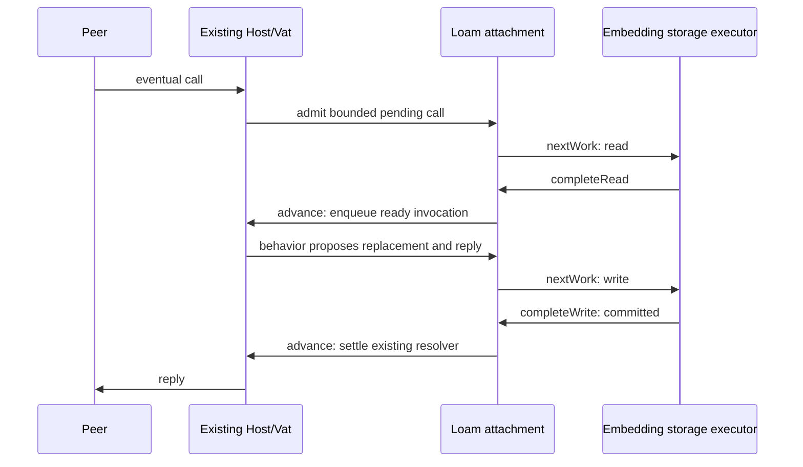

# Loam storage and durable actors

Loam stores versioned records with typed local references and atomic updates.
It provides bounded record leases, record-backed sleepy actors on the existing
Host/Vat, and an optional native LMDB backend.
The [shipped inventory](shipped.md#resource-models) lists implemented behavior;
the [design guide](planning/README.md) maps the remaining application foundation.

## Modules

| Surface | Responsibility |
| --- | --- |
| `glowcap.loam.collections` | Immutable, structurally shared maps for actor state and snapshots. Requires no store. |
| `glowcap.loam.records` | Store/object identities, schema limits, typed edges, and checksummed Syrup envelopes. |
| `glowcap.loam.core` | Store transactions with re-proposable staged records, exact completion/recovery, and bounded record leases. Performs no I/O. |
| `glowcap.loam.hosting` | Record-backed behavior, bounded pending calls, lazy local capability edges, and publication descriptors on an existing Host. |
| `glowcap.loam.Volatile` | In-memory realization of the same batches, with its own storage-byte limit. |
| `"glowcap_loam_lmdb"` | Optional native Zig module exposing `Lmdb`; executes blocking storage work. |
| `glowcap.loam.access` | Resource/grant views, shared grant preparation, bounded record codecs, and durable owner storage. Managed capability hosting remains planned. |

The native module is available from the same build dependency:

```zig
exe.root_module.addImport("glowcap", dependency.module("glowcap"));
exe.root_module.addImport("glowcap_loam_lmdb", dependency.module("glowcap_loam_lmdb"));
```

The collections module uses “persistent” in the immutable-data-structure sense:
old versions remain available through structural sharing. Disk storage encodes
explicit records; it does not save native pointers or the map's allocator state.

## Opening and changing a store

Create an existing empty directory, choose a fresh store identity, and call
`Lmdb.open(path, .{ .mode = .{ .create = identity } })`. Reopening uses
`.open = identity` and verifies that identity. Missing metadata, existing
creation, identity mismatch, and unavailable exclusive custody are distinct
failures. An error never selects volatile storage or resets an existing store.

Construct `core.Store` from the backend's claimed metadata, schema descriptors,
and explicit memory limits. Schemas are borrowed for the store's lifetime.
Keep each store and backend at a stable address while a worker borrows them.
One execution context owns each Store and delivers its completions; workers
receive batches or read requests and do not mutate the Store. The volatile
backend requires serialized calls. LMDB permits concurrent reads and serializes
its native writer, while the core admits one outstanding write per store.

A transaction proceeds through `begin`, `allocateId`, `putCopying` or `remove`,
`prepare`, and `beginWrite`. Allocate all new IDs first when constructing a
cycle. A record carries its schema/version, payload, typed edges, and retention
root flag. `putCopying` takes an expected existing revision, or null for a new
record. It copies the proposal and supplies the next committed revision.
Replacing a record's root flag uses the same atomic mutation as its content.

The returned batch borrows core-owned memory. The embedding runs
`backend.commit(batch)` and delivers its outcome to `Store.completeWrite`.
Inspect the outcome's failure cause; successful completion of the delivery
method does not turn an unchanged backend result into a successful mutation.
For a Host-based application, run native storage on the existing executor
outside the Host turn. Loam creates no worker or event loop.

An unknown commit outcome retains the batch and fences reads and new writes.
Join the original worker, obtain `Store.recoveryBatch`, call the backend's
`recover`, then deliver the resolution through `Store.resolve`. A timeout or
abandoned caller cannot prove an abort. The
[native tests](../test/loam/lmdb/storage_test.zig) exercise these paths using both
complete and interrupted transactions.

## Reads and memory

`Store.acquire` returns a lease for a resident version or an explicit read
request. The embedding executes `backend.read(request)` and returns its result
to `Store.completeRead`, then acquires the installed record. Another request
for the same pending record reports `PendingRead` without issuing a second
load. The embedding owns any waiting callers.

`Store.view` borrows validated record bytes until `Store.release`. A held lease
can retain an older data version after a commit. Released, foreign-store, and
stale lease tokens refuse access. Canceling a read retains its buffer until the
worker completes; the canceled completion cannot install data.

The cache charges a maximum-record buffer for each read. A transaction can opt
into `retainOnCommit`, transferring its prepared buffers into eligible cache
slots at their actual encoded size. Installation allocates nothing and never
displaces a pinned snapshot. `currentView` refuses a historical lease when
restoring authority; `view` still permits historical data reads. The cache
byte limit and its occupancy are independent of stored object count. Slot and
lease tables have
separate bounded initialization costs; staged writes have a distinct byte and
mutation limit. Encoding measures before allocating and copies each changed
record once. LMDB readers copy into the reserved buffer and end before returning.
The volatile backend's full data allocation and LMDB's mapped/OS-resident pages
are separate from this cache budget.

Metadata reports object count, root count, and exact encoded record bytes.
These totals exclude indexes, database pages, cache metadata, and temporary
writes. They are not reachable-graph size or total process memory measurements.
Batch validation reads changed records and their strong targets. It scans the
bounded mutation table to resolve references within the batch; it does not scan
the whole store. Commit installation carries unchanged resident records into
the new revision. Changed and removed records become stale; prepared replacements
can become resident through `retainOnCommit`. Each lease keeps its acquisition
revision, so reusing bytes never makes an old lease current. Pending reads still
refuse completion across any committed revision change.

## Native capacity and measurements

`Lmdb.inspect()` reports map size, allocated page high water, current tree pages,
and key count. Tree pages exclude the free-page database and metadata pages.
High water includes pages available for reuse; subtracting it from map size does
not tell an application exactly how much its next write can consume.

`Lmdb.grow(new_map_bytes)` increases the map between backend operations. It
refuses while another backend operation is active and blocks new operations
during remapping. A held Loam record lease remains usable because it owns copied
bytes. Choose a larger page-aligned size, then commit normally; the next
successful native write persists the larger map setting. Size selection belongs
to the embedding's storage budget, never an automatic unlimited retry.

Resolve outstanding write outcomes before maintenance. If remapping fails,
`ReopenRequired` fences backend admission because the old mapping may be gone.
Close and reopen the backend and its Store through the normal opening contract.
This refuses ambiguous use rather than continuing with invalid mapped memory.
Collection reuses database pages but does not shrink the physical file;
compaction and replacement remain unimplemented.

Run `zig build bench-loam -Doptimize=ReleaseFast` for the native conversation
workload. It measures hot/cold calls, unchanged records after edits, wakeup
bursts, and collection beside queued reads. The
[method and limits](../bench/loam/README.md) distinguish Loam residency, tracked
Zig allocations, physical page geometry, and unmeasured process/OS memory.

## Durable actors

`hosting.Attachment.create(allocator, &host, &store, behaviors, options)` attaches
one store to an existing Host. Keep both at stable addresses and borrow the
schema/behavior tables until attachment destruction. Each `Behavior` pairs a
schema/version with a deterministic invocation function:

```zig
fn invoke(call: *hosting.Call, state: core.RecordView,
    verb: []const u8, args: []const driver.Value) !driver.Value
```

For a simple actor, its portrait record contains its durable state. The callback decodes the
fields it needs and may `call.replace(payload)` using bytes allocated from
`call.arena` or borrowed from the current record. It must not perform I/O or
external effects. Loam commits that replacement before fulfilling the reply;
a callback error discards it. Replacement preserves the record's existing
edges. This profile does not serialize arbitrary mutable Zig actor structs or
native stacks, and the callback contract is not an in-process security sandbox.
Behaviors needing multiple records use the optional preparation and transaction
participant seams described under [managed endpoints](#managed-endpoints-on-the-host).

Restore a rooted actor through `attachment.restore(current_record_lease)`.
This returns an ordinary held Host capability. `attachment.capture(capability)`
converts held authority for an actor in this attachment into a stored strong
edge. Raw record names identify data; they do not enter the remote call surface.
`call.edge(index)` restores that exact stored local capability without loading
the target's state. Sharing and cycles therefore require no recursive graph
load. Returned capabilities borrow call custody through reply settlement.
Foreign or live-only references fail with `NotDurable`; they are never restored
as broader authority or replaced by newly initialized actors.

Eventual calls use existing Vat/CapTP promises. Admission copies plain-data
arguments into a fixed call buffer and retains the original ingress. The
attachment coalesces cold reads, preserves pending-call order per actor, and
queues ready invocations on the Vat. Network activations resume through
`Host.flushSession`, preserving Host scheduling and session close decisions.
The embedding progresses `attachment.advance()` at top-level boundaries and
executes each work item obtained from `attachment.nextWork()`:



Workers receive borrowed read/batch requests and return through
`attachment.completeRead` or `completeWrite` on the owner context. They do not
call into Host. Unknown write outcomes retain ownership and fence the store;
join the worker, obtain `recoveryBatch`, query backend recovery, then call
`attachment.resolve`. Resume Host actions through the embedding's usual pump.
Purely local application ingress continues through the Vat's bounded drive.
Loam adds neither an executor nor a networking loop. The
[actor process proof](../test/loam_actors_crash.zig) demonstrates the complete
native call/commit/reopen path.

A resident read-only near call borrows the cache; a cold near call returns
`ResidencyRequired` without requesting I/O. Use eventual calls or `prefetch`
and completion first. Near mutation returns `DurableTurnRequired`. Plain local
Vat answers currently cannot carry owning capability values; those replies
require the Host/CapTP path. Incoming durable calls currently accept plain data,
not capability arguments. Administrative transactions can change edges using
`capture` while no actor calls are pending.

`attachment.sleep(capability)` evicts eligible state while preserving callable
identity. Explicit `pin` returns a Store lease; pins and pending calls prevent
sleep. The default cache policy retains hot records and reclaims eligible
least-recently-used slots. `sleep_policy = .every_turn` exercises forced cold
activation after each completed call. Sleeping is neither deletion nor
revocation. With no held capabilities, endpoint boxes retire through ordinary
Vat lifetime management; stored objects alone allocate no actor endpoints.

Options bound endpoint count, pending-call count, each call's memory, and total
pending-call bytes. Pending calls also have per-ingress count and byte ceilings
derived from Vat queue limits, separately charged from the Vat's runnable
queue. Cache, staging, endpoint metadata, Host custody, and LMDB/OS pages are
separate costs. Endpoint/operation/cache lookups currently use bounded linear
scans; per-actor ordering can scan the operation table quadratically. Cache
installation scans its bounded slots against the transaction's changed objects.
These are explicit performance limits to measure before increasing capacities.
The 500,000-session target still requires connection-memory and live-socket
measurements; sleepy state does not make active connections free.

### Publications and close

Register `hosting.publication.schema` with the Store. Within an administrative
transaction, `publication.stage(attachment, entropy, held_target)` stores a
rooted descriptor of a fresh secret name and exact target. After commit, load
that descriptor and call `publication.restore`. On startup the application
supplies its bootstrap record names and Host identity; restoration needs no
actor initialization or eager state loading. Entropy must come from the
embedding's secure entropy boundary and must not be reused for another target.

To retire discovery, load the current descriptor, begin a transaction, call
`stageRetirement`, commit, reload the descriptor, and call `applyRetirement`.
Keep new fetch admission paused between commit and application to the Host
registry; resolve unknown outcomes first. A retirement tombstone survives
restart and cannot be passed to `restore`. Old snapshots cannot republish it.
Retirement preserves already-issued references. There is no automatic
publication enumeration. Keep descriptor leases or live retention tokens until
registry application completes. Durable roots or strong edges preserve bootstrap
descriptors across restart; raw identifiers alone do not retain records.
An unretained retirement tombstone can then be collected.

Drain pending calls and storage operations before `attachment.destroy()`;
it returns `Busy` while either remains. Destruction closes the attachment to
future calls. Existing capabilities retain closed routing metadata until their
Host/Vat custody ends and receive `AttachmentClosed`; they do not access the
Store afterward. Destroy the attachment before deinitializing Store or Host.
The attachment pointer must not be used after destruction succeeds.

## Collecting unreachable records

Call `store.prepareCollection(work_limit)` to prepare one bounded collection
batch, then use the ordinary `beginWrite`, backend commit, and `completeWrite`
path. Inspect `store.metadata.collection.phase`; continue in later batches
until it is `idle`. Unknown outcomes use the same recovery protocol as content
writes. The embedding chooses when to schedule these batches; Loam owns the
tracing and deletion decisions.


The collector traces roots, strong edges, current live custody, pending reads,
and pinned record versions. A pinned historical record also retains its old
strong edges. Weak edges do not retain targets; unreachable cycles are reclaimed.
Tracing reads stored records without invoking actor behavior or warming its
cache. Each batch has a bounded record/phase work count; each traced record can
add up to the configured edge limit. Durable marks and a FIFO queue live in the
backend, so the work queue need not fit in application RAM.

Use `store.retain(object_id)` and `releaseRetention(token)` for local custody
outside leases. These checked tokens keep records alive independently of cache
residency; they grant no remote call authority and do not survive restart.
Actor endpoints register this custody automatically and release it when they
retire or their attachment closes. A retained actor remains callable after
collection even when it is asleep and has no durable root flag.

Preparation captures the bounded live root set and freezes new leases and
retention claims until that batch settles. Existing leases remain usable and
may be released. Ordinary writes between batches record new strong edges in
the same transaction as the content change. Once root scanning begins, new or
changed records survive the current cycle. Sweep drains outstanding tracing
work before deleting another candidate. Reopen discards incomplete tracing
progress and starts from fresh roots; it never continues an old sweep blindly.

Collection uses one record-sized scratch buffer plus at most
`max_collection_roots` root identifiers and the bounded retention registry.
Insufficient root capacity refuses preparation rather than tracing a partial
root set. Storage must have headroom for marks, queue entries, and atomic writes;
map exhaustion aborts the batch without deleting unproven garbage. The volatile
backend charges internal rows to its byte limit; LMDB uses ordered cursors while
the volatile test backend scans its hash table. These are different cost models.
Collection batches that remove no objects preserve current resident bytes.
A batch that sweeps objects conservatively invalidates the cache because its
receipt does not enumerate deleted identities. Old leases remain historical
after either kind of commit.

Reclamation updates object and encoded-record-byte totals atomically. These
totals exclude backend indexes, tracing metadata, and mapped-page overhead.
Reclamation is distinct from shrinking the database file; compaction is not
implemented. Budget collection before storage is exhausted. The process-kill
proof covers interrupted sweeps. The native workload measures bounded collection
service time and queued-read interference; concurrent executor work remains
unmeasured.

## Managed access records

`access.core.GrantView` evaluates current grant ancestry alongside a
`ResourceView`. Both consume synchronous record sources; an unloaded row
returns a read demand for the embedding to service. They perform no hidden
storage I/O. The resident graph and ledger use these same views.

`GrantPlan.prepareCopying` prepares a trusted owner's mutation at that view
revision. `plan.changes` returns the proposed grant, optional parent update,
expected previous row revisions, and change event. The owner stages those
records with its content through one Loam transaction and exposes the event
after confirmed commit. The plan does not reserve a transaction or prove the
caller's management authority. Held use and control references still convey
that authority through their owning binding.

`access.records.ResourceRecord` and `ChangeRecord` decode into scalar values.
`GrantRecord.decodeOwned(allocator, bytes)` owns any selected-resource lists;
call `deinit(allocator)` on that result. None retains the encoded input. The
[record contract](decisions/adr/ADR-0166-access-grant-records-and-plans.md) defines
limits and borrowed view lifetimes.

### Durable owner operations

`access.storage` connects these views to a Store. Register
`access.records.profile.schemas` alongside the application's schemas. Supporting
the full managed profile requires record limits of at least 64 KiB and 514
edges. Within a staging transaction, `storage.stage.createOwner` returns the
owner's Loam header reference. Retain that reference after confirmed commit and
use it to reopen the owner. The header persists its complete policy descriptor,
logical revision pair, allocation counters, directory roots, and latest event.

Create a `storage.Read` with a bounded model-record capacity, then drive
`advance`. A `.read` result transfers a Loam read request to the embedding's
executor; deliver its exact completion through `completeRead`. `.waiting` means
work is already outstanding, possibly owned by another operation. `.ready`
allows the caller to retry its view operation. `resourceView` and `grantView`
share the resident model's evaluator. When an operation returns `RecordUnloaded`,
drive `advance` again and retry after readiness. Malformed records, missing
identities, stale revisions, and capacity exhaustion remain distinct failures.

For creation, prepare a `storage.Append` for the resource or grant family and
drive its `advance` through the same explicit read/completion pattern. A resource
append may request parent records through its Read. For grant mutations, prepare
the shared `GrantPlan` using the Read's views and persisted policy; issuance
uses the header's next grant slot with generation one. Other mutations use the
existing grant identity. Plans perform model checks; the trusted owner must
admit management authority before preparing one.

Begin the caller's Store transaction and stage content together with
`storage.stage.appendResource` or `storage.stage.grant`. Loam's existing
prepare/write/complete/recover path commits the whole batch. A failure after
managed staging starts aborts the entire batch, including content. Publish
proposed identities and events only after confirmed commit. One transaction
supports one mutation per managed owner. Reopen the Read after any commit;
uncertain writes fence its views until receipt recovery resolves the outcome.
An aborted unpublished append consumes no committed logical slot.

Read pins its header and bounded model working set. Directory traversal borrows
one additional cache slot and retains its position across misses. Its path is
at most four directory records plus the target. Capacity must fit within
`max_leases - 1`; allow cache space for the header, pinned models, and an active
directory page. A Read has at most 20 KiB of inline state plus its single binding
allocation; an Append has at most 52 KiB of inline path state. Grant decoding
uses fixed scratch whose borrow lasts until the next grant lookup. Loaded
evaluation makes no allocator calls. Store cache buffers reserve
`max_record_bytes` per slot, even for short records; these operation bounds
exclude those buffers and transaction staging.

Keep Read and Store at stable addresses while their views or an Append borrow
them. Deinitialize Append before Read. Cancellation preserves submitted buffers
until exact completion; `deinit` refuses outstanding work. The owner retains
indexed records, including revoked grants. Its latest event edge is replaced
atomically, making an older event collectible unless otherwise retained.

[ADR-0167](decisions/adr/ADR-0167-managed-owner-storage.md) defines the profile.
Native LMDB tests cover reopen, abort, uncertain revocation with matching content,
and collection of replaced events. Durable native capability bindings build on
this profile, as described below. Resource reorganization, deletion, and scoped
event delivery remain in the
[storage integration plan](planning/loam/access/storage.md).

### Durable use and control references

`storage.Capabilities` borrows one Store and enforces live-reference and operation
quotas. The trusted embedding stages use or control descriptors through
`stageUse` and `stageControl` with a current owner Read. Control powers use
`core.Control.Powers`: a policy ceiling and independent lifecycle permissions.
After confirmed commit, `restoreUse` or `restoreControl` checks a borrowed
descriptor lease to create an opaque native reference. Release the lease;
the reference retains the descriptor through Loam's live roots without pinning it.

Each reference's `begin(capacity)` creates an opaque `Operation`. The embedding
drives `advance` and `completeRead` as with Read; storage requests belong to its
executor and must stay out of hosted resource replies. Use operations expose `require` and
`prepareDeriveCopying`; controls expose `prepareEditCopying`. Wrong-role operations
refuse. Calls select the grant bound in the stored descriptor and check current
owner/grant records. An operation exposes no Store, raw model view, or grant
selector. On `RecordUnloaded`, drive the read work and retry the same request;
input slices need remain valid only through each synchronous method call.
Successful preparation owns any copied terms until operation close.

The trusted owner stages a prepared operation through `Capabilities.stage` in
the same Store transaction as content. It returns a proposed change and, for
derivation, a `derived_use` descriptor reference. The child grant and descriptor
commit together. Choose root retention or place a strong edge to that descriptor
in content before committing. Direct `storage.stage.grant` similarly returns
both the proposed change and its exact Loam grant-record reference for trusted
composition. Restore or publish results only after confirmed commit.

Operations retain their source reference, so the holder may release its alias
while work remains pending. `cancel` retires work through exact completion;
`deinit` refuses submitted reads. Close finished operations to release their
leases before admitting more work within the same cache budget. Capabilities
cannot close while any reference or operation remains. Descriptor records are
collectible after both durable retention and final native custody end.

Each reference allocates at most 96 bytes of binding state. Starting an operation
allocates at most 32 KiB, including separate fixed scratch for control and grant
terms. Opening also allocates the bounded Read binding array; delegation adds
the bounded Append and copied plan terms. Allow two leases for the descriptor
and owner header, plus the model working set and one transient directory page.
Concurrent operations share cache capacity and lease quotas. Loaded checks make
no allocator calls. Every commit invalidates old operations; uncertain outcomes
fence them until receipt recovery resolves the write.

[ADR-0168](decisions/adr/ADR-0168-durable-managed-capability-bindings.md) defines
the restoration contract. These are native admission primitives; bind a use
check to its content effect at the same revision, or use the managed hosting
adapter below. Independent control attenuation/revocation remains integration
work. Stored control descriptors are immutable
through this API; current grant lifecycle and terms remain editable.

### Managed endpoints on the Host

`access.hosting.Service` borrows Capabilities and a table of `ContentBehavior`
descriptors. Add its `behavior()` to the existing `hosting.Attachment` behavior
table. The Service, Capabilities, and behavior tables must remain at stable
addresses until the attachment closes. No additional Host, Vat, worker, or
storage queue is created.

The trusted embedding calls `stageEndpoint` in a Store batch. A use endpoint
retains its exact use descriptor and binds one resource identity to one content
record. A control endpoint retains only its exact control descriptor. This
binding is application authority: the embedding must associate the right
resource with the right content. The recipient receives an ordinary hosted
capability; method arguments cannot replace that binding. Derivation updates the
endpoint's receipt window while preserving its authority and content binding.
After commit, restore the endpoint from a checked
lease, then use ordinary durable publication and local capability edges.

For use calls, preparation loads the descriptor, content, and current managed
records. The content schema selects a `ContentBehavior`; its pure `requirement`
callback declares permissions and all relevant committed facts. Only after the
bound grant admits that requirement does `invoke` run on the existing Vat.
`ContentCall.replace` proposes a new content payload while preserving its edges.
`replaceReference` and `removeReference` update a local strong field in that
same content transaction. `ContentCall.discloseExact` hands over a stored strong
edge's saved authority. `discloseDependent` instead returns a runtime facet
whose target method must pass the current invoking and target grants. Any
capability the method did not declare is refused before settlement.
[ADR-0172](decisions/adr/ADR-0172-explicit-disclosure-of-returned-capabilities.md)
defines exact disclosure, and
[ADR-0173](decisions/adr/ADR-0173-dependent-returned-capabilities-and-reference-edits.md)
defines dependent disclosure and field edits.
The attachment commits that content row before settling the reply. The endpoint
portrait is unchanged. Application callbacks are trusted, deterministic Zig
code with no external effects; this API is not a native-code sandbox.

Control endpoints accept `pause`, `resume`, and `revoke` with no arguments.
Replies are Boolean: true for a committed change and false for an unchanged
request. An optional `decode_control` callback maps application methods to
`core.Control.Edit`, including policy edits. It only decodes requests; the
stored control powers and shared model rules decide whether they are permitted.
A changed edit stages the grant, owner revision, and latest change record in
the attachment's transaction. Control edits do not yet have a durable retry
receipt or remote event stream.

Preparation and its leases belong to the retained call. Any intervening Store
commit restarts preparation, including calls already queued for invocation.
Outstanding reads retire through exact completion before their buffers or
operation state are released. Unknown writes keep the existing recovery fence;
no affected call replies successfully until recovery resolves it. Resident near
calls return `DurableTurnRequired` for managed endpoints; use eventual sends.

Budget the endpoint and content leases in addition to the native operation's
descriptor, header, model records, and transient directory page. `record_capacity`
bounds the model working set; Capabilities quotas bound concurrently allocated
operations. These allocations are additional to the attachment's retained-call
arena and share the Store's cache and lease limits. Settled calls release all
operation custody. Content and authority rows remain eligible for ordinary LRU
eviction; sleeping references retain reachability without pinning those rows.

The generic `hosting.Behavior.prepare` seam emits read work through the same
attachment, and `Call.transaction` stages a trusted participant in its batch.
Participants must only stage mutations; the attachment begins and commits. Managed hosting
uses these seams for fixed-resource content, control, and derivation calls.
Dependent attenuation of application-returned capabilities and cross-resource
operations remain in the [storage plan](planning/loam/access/storage.md).
[ADR-0169](decisions/adr/ADR-0169-managed-host-turns.md) records the contract.

### Inspecting held access

Call `describe-access()` on a managed use endpoint to inspect its current
access to that endpoint's fixed resource. Active replies include its own
ceiling and configured policy, effective policy after ancestor restrictions,
and remaining delegation depth. Paused, revoked, and out-of-scope replies carry
only status. Control endpoints do not accept this use method.

The tagged `access:description` reply uses stable permission and constraint
keys. [ADR-0171](decisions/adr/ADR-0171-scoped-access-descriptions.md) defines the
field layout and exact unsigned integer representation. No ancestor identity,
scope inventory, owner revision, or unrelated event counter is disclosed.
This snapshot does not authorize subsequent content effects or provide an event
subscription. Each protected call continues to check current authority.

Native consumers use `GrantUse.describe(target)` or
`storage.Operation.describe(target)`. The latter returns owned bounded values
with their immutable policy vocabulary. Drive missing reads as for `require`;
stale operations and uncertain writes refuse. Hosted preparation retries stale
snapshots before invocation. Description loads authority records and leaves
application content asleep. Encoding and reply copies share the bounded call
arena; larger vocabularies need sufficient call and frame capacity.
The maximum-policy test exercises all 64 permissions and 16 constraints across
the three policies within the default 64 KiB call arena. Frame capacity remains
a separate limit; this is no throughput measurement.

### Deriving and recovering a shared facet

Set `Service.decode_derive` to decode application arguments into
`core.GrantLedger.Issue`, and supply `Service.entropy.fill` with fresh unpredictable
entropy across calls and restarts. The decoder receives the endpoint's bound
resource identity. Decoding does not grant permission: current ancestor scope,
terms, lifecycle, and delegation depth constrain every new child.

Managed use endpoints reserve these methods:

| Method | Result |
| --- | --- |
| `derivation-sequence()` | The next derivation sequence for this endpoint, beginning at 1. |
| `derive(sequence, application arguments...)` | A held CapTP use capability for the same content/resource binding. |
| `durable-name()` | The endpoint's durable Swiss name, or `NotPublished` when it has no publication recipe. This is the secret publication component; the existing Host locator APIs supply peer routing. |

These methods check current use authority. Derivation returns use authority;
minting a separate child control endpoint still belongs to the trusted native
owner. An initially paused child is minted paused. Exact disclosures preserve a
stored field's saved authority; this API does not automatically attenuate other
capability-valued application replies.

The child grant, use descriptor, endpoint, rooted publication, retry receipt,
and source sequence update commit in one Store batch. `Call.result` runs at the
top-level Host boundary after Vat staging and before write submission. It reserves
the child actor and a hidden publication through `Host.reserveDurableCapability`.
No fetch can discover that reservation. `Call.confirmation` activates it without
allocation after confirmed commit and before reply projection. Abort releases
the reservation; an unknown write retains it until recovery. Publication
reservations must be moved, then committed or canceled before Host teardown.

The source retains its last **eight** receipts, indexed directly by sequence
through ordered strong edges. A matching retained request returns the same
child; changed decoded terms yield `OperationConflict`. An older sequence yields
`ReceiptExpired`, and a future sequence yields `OperationOutOfOrder`. Expiry never
makes an old sequence eligible to mint again. All holders of one endpoint share
the sequence domain and must coordinate competing new requests. Retries also
check the source and child at the current revision: pause or revocation cannot
be bypassed by replay. This provides bounded recovery of derivation results;
other application mutations need their own retry contract.

Receipt eviction drops its source edge, allowing ordinary collection. It does
not retire the child's independently rooted publication. Applications must
explicitly retire publications when durable discovery should end. Grant records
remain retained by their owner under the current managed storage profile.
On startup, restore publication descriptors through the existing hosting API;
publication enumeration remains application-owned. A retained retry can also
restore its exact child and publication after reopen.

Endpoint format version 2 reserves eleven edges: descriptor, optional content,
optional publication, and eight receipts. Each receipt permits at most 32 KiB
of canonical intent plus two edges. Intent encoding and sharing state use the
bounded call arena. Replay holds three additional record leases and a child
operation while checking authority; issuance uses the native Append budget.
Actor and publication allocation happens before submission and may refuse
under pressure. None of these costs apply to unmanaged actors.
[ADR-0170](decisions/adr/ADR-0170-durable-facet-derivation.md) owns this contract.

## Closing and current limits

Retire reads, settle writes, release leases, then deinitialize the Store.
`Lmdb.close` stops new work and reports `Busy` while a backend operation retains
the environment. Finish or abort that operation, join its worker, and retry
close. The lifetime lock file remains in the directory so concurrent owners
cannot acquire different lock inodes at the same path.

This advisory lock coordinates cooperating Loam adapters for the entire open
lifetime. LMDB separately serializes write transactions. All writers must use
the adapter's custody protocol so cached Loam state remains current; direct
external LMDB writes are outside this storage profile.

The native adapter uses BSD `flock`, available on macOS and Linux, and an explicitly configured LMDB
map size. Map exhaustion refuses the entire transaction; `grow` expands capacity
under exclusive backend maintenance. Compaction and browser storage remain
unimplemented. Tracing collection is local
to this exclusively owned store. Explicit deletion of an unrooted record leaves
incoming references resolving as gone; object identity is never recycled.

Hosted capability fields currently address actors in one attachment. Foreign
sturdyrefs, cross-vat restoration, complete managed owners,
durable event subscriptions/inboxes/outboxes, browser storage, and Loam C/Rust
APIs remain planned. Pending calls and replies can be lost on process failure;
a committed write can survive even when its caller never receives the answer.
Derivation has the bounded receipt contract above; other retry deduplication is
application-owned. Timers, unresolved promises,
subscriptions, and external handles are not durable fields in this profile.
Ordinary volatile actor snapshots remain independent of disk persistence.

Run `zig build loam-lmdb-test` for native storage contracts and
`zig build loam-lmdb-crash-test` for process interruption.
`zig build loam-actors-crash-test` additionally restores publications and
cyclic actor references and calls them through CapTP after restart. These prove
SIGKILL recovery at the tested boundaries; they are not power-loss tests. LMDB is
the first backend implementation; comparative performance remains unmeasured.
