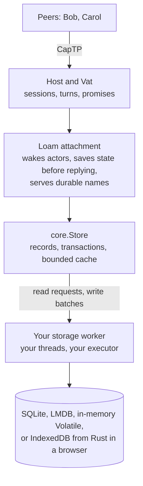
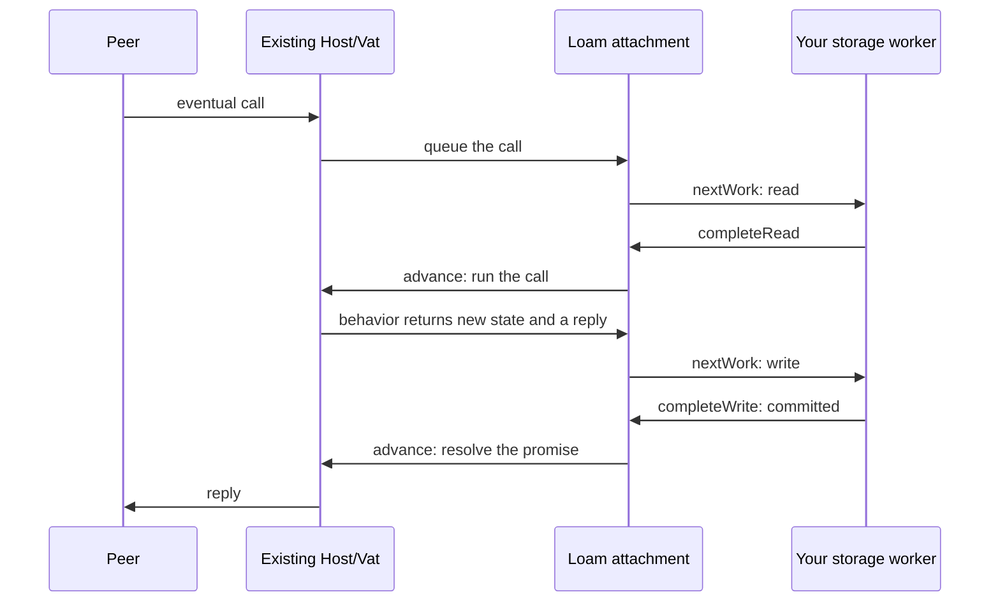

# Loam storage and durable actors

Loam is glowcap's storage layer for objects that must outlive their process.
The [Loam page](https://jimisaacs.github.io/glowcap/loam/) on the website has
diagrams. This guide is for Zig. Programs in C or Rust, including Rust in a
browser, use a smaller part of Loam, covered in the
[C/Rust guide](loam/c-and-rust.md) and the [browser guide](loam/browser.md).

## What Loam is for

Picture a task board shared over CapTP, the protocol glowcap peers use to call
each other's objects. Your program hosts the board, its columns, and its cards
as live objects. Bob holds a reference to one column, and Carol keeps a
sturdyref, a saved reference she can use to reach the board again later. When your program restarts, every
one of those objects is gone, and so is everything Bob and Carol were
holding.

Saving the cards' text does not fix that, because a capability is a live
connection to an object, not a value you can write down. Loam saves the
objects, the references between them, and the durable names peers use to reach
them. After a restart, peers can use those names to restore the same objects. An object
nobody is calling sleeps on disk, so the stored graph can be far larger than
memory.

## The pieces

Loam sits between the Host you already run and a storage engine:



**Records and edges.** Loam stores each object as a record: its data, in a
schema the application declares, plus edges to other records. "This column
holds that card" is an edge. A strong edge keeps its target alive, and a weak
edge only points at it. A record marked as a root, such as the board, is kept
with nothing pointing at it. Anything a root cannot reach through strong
edges is garbage, which [collection](loam/collection.md) removes.

**Transactions.** Moving a card between columns changes two records, and a
transaction saves both changes or neither. Each change names the version of
the record it started from, so an edit prepared from stale data is refused
instead of overwriting a newer change.

**Your code does the I/O.** Loam hands your storage worker read requests and
write batches, and the worker reports back. Loam starts no thread and no event
loop.

**Durable actors.** A [durable actor](#durable-actors), also called a sleepy
actor, keeps its state in a record and runs on the Host and Vat you already
have. Its state can leave memory while every reference to it keeps working. A
call loads the record, runs the actor's code, saves the new state, and only
then replies.

**Durable names.** A [publication](loam/publications.md) saves an actor's
secret name, the swiss number in a sturdyref, in an on-disk index. After a
restart nothing loads until a peer fetches a name, and then only that actor
wakes.

**Managed access.** An optional layer records who may use which resources and
lets the owner pause, resume, or revoke that access. See the
[managed-access guide](loam/access.md).

## Words used throughout

| Term | Meaning |
| --- | --- |
| store | One durable collection of records with its own identity, such as one SQLite store directory. |
| record | One object's saved state: schema, payload bytes, typed edges (references by record identity, not memory address), and a root flag. |
| revision | The store's commit counter. Each change names the revision it replaces. |
| lease | A short-lived borrow of one record version from the cache. |
| batch | The writes one transaction commits, handed to your worker as one unit. |
| worker | Runs reads and batches against the engine. `hosting.Worker` tracks each request until its result is installed, and your code picks the thread. |
| engine | The technology that holds bytes behind one transaction contract: `Sqlite` (the default on disk), `Lmdb`, the in-memory `Volatile`, or your program's own storage through the C key-value callback. |
| backend | The read, commit, lookup, and recover operations the worker drives, which `core.backend` derives from any engine. |
| behavior | The function that runs one schema's actors: saved state and a call in, a reply out. |
| recipe | A saved instruction for getting a reference back: a local record, another attachment, or a sturdyref. |

## A first durable actor

[Example 07](../examples/zig/07_durable_card.zig) stores one card in SQLite,
moves it, shuts everything down, opens the same directory in a fresh Host,
and finds the move still there.

**A schema and a behavior.** The card's payload is one integer, how many
times it has moved. Its behavior reads the saved record and proposes new
state, which counts only once Loam commits it.

```zig
fn card(call_state: *hosting.Call, state: core.RecordView, verb: []const u8, args: []const driver.Value) !driver.Value {
    if (args.len != 0) return error.InvalidArguments;
    if (state.payload.len != 8) return error.InvalidCard;
    const moves = std.mem.readInt(i64, state.payload[0..8], .little);
    if (std.mem.eql(u8, verb, "moves")) return .{ .integer = moves };
    if (std.mem.eql(u8, verb, "move")) {
        const next = try call_state.arena().alloc(u8, 8);
        std.mem.writeInt(i64, next[0..8], moves + 1, .little);
        call_state.replace(next);
        return .{ .integer = moves + 1 };
    }
    return error.NoSuchMethod;
}
```

**A store and a first record.** The program opens SQLite, builds a `core.Store`
with explicit limits, and writes one rooted record so collection keeps it.
Without an attachment, a write is three calls: prepare, let the engine commit
the batch, and report the outcome.

```zig
const ticket = try store.prepare();
const outcome = db.commit(try store.beginWrite(ticket));
try store.completeWrite(ticket, outcome);
```

**An attachment and a capability.** `hosting.Attachment.create` connects the
store to the Host and registers the behavior. `attachment.restore` turns the
record back into an ordinary Host capability that can be called locally or
handed to a peer.

**A call, with its storage work.** The program sends `move` and runs the loop
every embedding runs: drive the Vat, call `attachment.advance()`, and let a
`hosting.Worker` carry out each item from `attachment.nextWork()`. The read
wakes the card, the write saves its new state, and the reply is released after
the write commits.

```zig
var slot: [1]hosting.Worker.Slot = undefined;
var worker: hosting.Worker = .init(&slot, db.readerCapacity());
try worker.drive(attachment, db);
```

**A restart.** The second run reopens the directory with the same store
identity, restores the card, and asks how many moves it has made. The answer
is the one the first run committed. A real program would publish the card
under a [durable name](loam/publications.md) so peers can fetch it after a
restart. Run the example with `zig build examples`.

## The guides, in reading order

| Guide | Read it when you want to know |
| --- | --- |
| [Stores, transactions and reads](loam/store.md) | How a store opens, commits, reads through its cache, and recovers an unknown write. |
| [Durable names](loam/publications.md) | How peers fetch actors by sturdyref after a restart, and how names retire. |
| [Durable capability fields](loam/references.md) | How saved state holds references to other actors, attachments, and remote objects. |
| [Collecting unreachable records](loam/collection.md) | How garbage is found and deleted in bounded batches while the program runs. |
| [SQLite operations](loam/sqlite.md) | How to size, grow, compact, and close the default on-disk store. |
| [LMDB operations](loam/lmdb.md) | How to size, grow, compact, close, and measure an LMDB store. |
| [Managed access](loam/access.md) | How grants, use and control references, revocation and retries work. |
| [Managed endpoints](loam/access-endpoints.md) | How to serve managed references as CapTP endpoints on a Host. |
| [C and Rust](loam/c-and-rust.md) | How C and Rust programs create, share, edit, and restore a resource. |
| [Browser storage](loam/browser.md) | How the Rust profile stores to IndexedDB. |
| [Architecture](loam/architecture.md) | How Loam, actors, and managed access fit together. |
| [Record, transaction, and hosting API](loam/api.md) | How objects, reference fields, leases, transactions, and backend outcomes are represented. |
| [Sleepy actors](loam/actors.md) | How actors sleep, wake, keep call order, and release memory. |
| [Managed access architecture](loam/access-architecture.md) | How resources, facets, grant mutation, and change events are enforced. |
| [Managed access model](loam/access-api.md) | The rules every managed access call keeps and the C ABI boundary. |
| [Managed access storage](loam/access-storage.md) | What storage guarantees for grants, protected queries, restoration, and recovery. |
| [Coverage](loam/coverage.md) | Which tests cover managed access in Zig, C, Rust, and the browser. |
| [Research](loam/research/memory-persistence.md) | The prior-art survey, the [persistence reuse review](loam/research/persistence-reuse.md), and the measurement program. |

The decision records behind these guides start at
[ADR-0162](decisions/adr/ADR-0162-loam-record-transactions-and-lmdb.md) for
records and LMDB and
[ADR-0163](decisions/adr/ADR-0163-record-backed-sleepy-actors.md) for
sleepy actors.

## Durable actors

### Attaching a store

`hosting.Attachment.create(allocator, &host, &store, behaviors, options)`
attaches one store to an existing Host. Keep the Host and Store at stable
addresses and the schema and behavior tables alive until the attachment is
destroyed. Each `Behavior` pairs a schema and version with a deterministic
invocation function:

```zig
fn invoke(call: *hosting.Call, state: core.RecordView,
    verb: []const u8, args: []const driver.Value) !driver.Value
```

### What a behavior may do

A simple actor's record holds all of its durable state. The behavior decodes
the fields it needs and may call `call.replace(payload)` with bytes from
`call.arena()` or borrowed from the current record. Loam commits that new
state before it sends the reply, and a behavior error throws it away. The
record keeps its existing edges.

A behavior has no side effects outside its record, because Loam can throw away
state that fails to commit but cannot unsend an email. Loam saves records, not
Zig structs or thread stacks, and it does not sandbox a behavior from the rest
of the process. A behavior that changes several records uses the hooks
described under [managed endpoints](loam/access-endpoints.md).

### Restoring and saving references

`attachment.restore(current_record_lease)` turns a rooted actor's record into
an ordinary Host capability. `attachment.capture(capability)` does the
reverse for an actor in this attachment: it saves a capability you hold as a
strong edge. Peers only ever hold capabilities, never record names.

`call.edge(index)` restores the capability an edge stores without loading the
target's state, so shared references and cycles never force a chain of loads.
A capability a call returns stays valid until its reply is sent. For
references to another attachment, another Host, or a remote object, use
[stored capability fields](loam/references.md). Saving a reference Loam cannot
restore later is refused. A field marked live holds its capability only until
the process stops, and refuses use after a restart.

### How a call runs

Eventual calls use the Vat and CapTP promises you already have. When a call
arrives, Loam copies its plain-data arguments into the call's own bounded
memory and keeps the original message. Calls to the same sleeping actor share
one load, each actor's calls run in the order they arrived, and ready calls
queue on the Vat. Calls from the network resume through `Host.flushSession`,
so the Host's usual scheduling and session closing still apply.

Your main loop calls `attachment.advance()` and carries out each item from
`attachment.nextWork()`:



The worker follows these rules:

- It receives borrowed read requests and write batches and answers through
  `attachment.completeRead` or `completeWrite` on the thread that owns the
  attachment. It never calls into the Host.
- If a write's outcome is unknown, the store refuses other work. Once every
  other request has finished, the worker's next request is the attachment's
  `recoveryBatch`, and completing it calls `attachment.resolve`.
- Host work resumes through your usual loop. Purely local calls keep running
  through the Vat's own bounded drive.

The [actor process test](../test/loam_actors_crash.zig) runs a call, its
commit, and a reopen on each disk engine.

### Call memory

Each call reserves its byte allowance when it arrives but allocates only as it
needs to. Its arguments and its working memory share that one limit, including
allocator overhead. Reply data borrows the call's memory until the reply is
sent, and callbacks from C or Rust copy their output before returning. When a
newer commit makes the call run again, Loam frees its working memory and keeps
its arguments, with the capabilities they hold.

### Near calls and capability arguments

A near call, one made directly instead of through a promise, to a read-only
actor whose state is in memory borrows the cache. A near call to an actor
whose state is on disk returns `ResidencyRequired` without starting a read, so
use an eventual call, or call `prefetch` and wait first. A near call that
would change state or forward a call returns `DurableTurnRequired`, because
only an eventual call can hold the target and deliver the reply.

`Host.callLocalCapability` queues a local call on the Vat, and capabilities
nested in its arguments and results keep their identity with no session
involved. A queued call still runs if its caller stops waiting. Loam prepares
the reply before it replaces state or resolves a deferred promise. A reply
too large for its fixed allowance reports `ReplyCapacity`, and a failed heap
allocation reports `OutOfMemory`. Either way the deferred promise stays open
and can take a different reply.

Plain local Vat calls answer with plain values. The Host and CapTP paths
accept capabilities nested in arguments and keep them while a call reads,
runs again, and replies. A capability a call receives is not saved on its own.
`capture` saves one that points into the same attachment, and
`hosting.references.beginSave` saves a local or remote reference it can check.
Raw local Vat references and handoffs (references introduced by a third peer)
are unsupported as arguments. Outside a
call, a transaction can change edges with `capture` while no actor calls are
waiting.

### Work after a receipt commits

A Zig content callback can reserve follow-up work: a call it will make on a
target, once the receipt for the original action commits. A confirmed commit
starts that work, and an unknown commit holds it until recovery decides. The
reservation keeps its own copy of the action and the capabilities it needs,
under its own memory allowance, and holds no Store lease while it waits. The
application's receipt, not the reply, says whether the effect happened. The
[Rooms effect guide](rooms/session-effects.md) describes the executor's
failure results (`unsent` and `unknown`), cancellation, and recovery.

### Sleeping

`attachment.sleep(capability)` drops an actor's state from memory while its
capability keeps working. `pin` returns a Store lease, and a pin or a waiting
call keeps an actor awake. By default the cache keeps busy records and drops
the least recently used ones it may. `sleep_policy = .every_turn` puts an
actor to sleep after every call, which is useful in tests. Sleeping is neither
deletion nor revocation. Once nobody holds a capability to an actor, the Vat
frees its endpoint as usual, so stored objects alone take no endpoints.

### Capacity and cost

Attachment options limit the number of endpoints, the number of waiting
calls, each call's memory, and the total memory of waiting calls. Each
session, and local calls together, also get their own count and byte limits,
taken from the Vat's queue limits and counted apart from its run queue. The
cache, pending writes, endpoint bookkeeping, capabilities the Host holds, and
engine and OS pages are separate costs.

Call lookups scan bounded tables, and keeping each actor's calls in order
can cost time quadratic in the call table's size. A cache or endpoint lookup
is one hash probe, and a commit checks the cache's slots against the records
it changed. Measure before raising these limits.

### Durable names and shutdown

[Durable names](loam/publications.md) covers fetching an actor by name,
retiring a name, how long the index keeps entries, and destroying an
attachment.

## Modules

| Module | What it holds |
| --- | --- |
| `glowcap.loam.collections` | Immutable maps that share structure between versions, for actor state and snapshots. Needs no store. |
| `glowcap.loam.records` | Store and object identities, schema limits, typed edges, and checksummed Syrup record encoding. |
| `glowcap.loam.core` | The Store: transactions, completion and recovery, record leases, and the engine contract that `core.backend` builds a worker backend from. Does no I/O. |
| `glowcap.loam.hosting` | Record-backed behaviors, bounded waiting calls, capability edges loaded on demand, and durable names on an existing Host. |
| `glowcap.loam.Volatile` | The in-memory engine, with its own storage byte limit ([in-memory operations](loam/volatile.md)). C and Rust open it through `libglowcap_loam_volatile`. |
| `"glowcap_loam_sqlite"` | Optional module exposing `Sqlite`, the default disk engine, which keeps one SQLite file ([SQLite operations](loam/sqlite.md)). |
| `"glowcap_loam_lmdb"` | Optional module exposing `Lmdb`, the same engine contract over LMDB ([LMDB operations](loam/lmdb.md)). |
| `glowcap.loam.access` | Managed access: resources, grants, use and control references, their storage and hosting, scoped change feeds, and owner cleanup. |

The collections are persistent in the data-structure sense: old versions stay
available because new ones share their structure. Disk storage saves explicit
records, never process pointers or allocator state.

## Limits

**What a crash can lose.** Waiting calls and replies are lost when the process
dies, and a write can commit even though its caller never hears back. A
caller that retries then repeats the change. Managed access keeps receipts so
a retry finds the original result, as
[retrying mutations](loam/access.md#retrying-mutations) describes. Any other
actor must make its own methods safe to retry.

**What can be saved.** A saved field can hold a local capability, a checked
reference into another attachment, or an established remote sturdyref.
Timers, unresolved promises, subscriptions, and outside handles cannot be
saved. Loam has no general durable inbox or outbox, and C, Rust, and the
browser reach only the fixed resource model, not general record graphs.

**One process per store.** Collection traces only the store this process has
open. Deleting a record that is not a root leaves references to it resolving
as gone, and Loam never reuses an object's identity. The
[browser guide](loam/browser.md) runs the same resource lifecycle on
IndexedDB.

**Managed history.** A managed owner keeps a fixed window of its recent
change batches ([known limitations](boundaries.md#managed-access)). Grant,
resource, content, and control changes commit in the caller's transaction,
and an aborted or empty change adds no history. Batches older than the window
can be collected. The [observation guide](loam/access.md#observing-held-access)
covers reading this history, cancellation, and capacity.

[Bounded owner cleanup](loam/access.md#bounded-owner-cleanup) stops new work
on an owner, retires its durable names, compacts deleted resources and revoked
grants, and prunes its indexes. It keeps the counters that stop an old ID or receipt from being
issued again. Collection then reclaims the records left behind.

The [shipped inventory](shipped.md#resource-models) lists what is built.

## Tests

`zig build loam-sqlite-test` and `loam-lmdb-test` run one storage suite over
each disk engine, and the SQLite step also checks that every refusal it
reports changed nothing. The crash tests below kill the process at chosen
points and check what a fresh process finds. Each runs once per disk engine:

- `zig build loam-storage-crash-test` kills a writer before its commit, and
  after the commit but before the Store learns the result.
- `zig build loam-actors-crash-test` restores durable names and actors that
  refer to each other in a cycle, then calls them over CapTP after the
  restart.
- `zig build loam-managed-crash-test` interrupts grant issue, revocation,
  edits, moves, and deletion around their commits, then checks receipts and
  change batches in a fresh process.

[Stability](stability.md) says which platforms and failures these cover.
