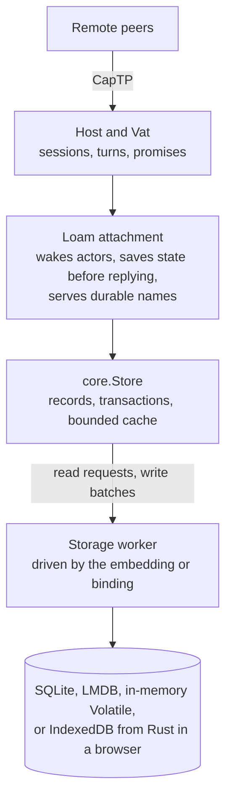

# Loam storage and durable actors

Loam is glowcap's optional storage module. It stores objects, their state,
and the references they hold, and restores them after a restart. The
[Loam page](https://glowcap.org/loam/) explains the model with a task board
and diagrams. This guide covers the Zig integration.

## Choosing an integration

A program needs a local store only for data it owns. Calling a durable object
on another peer uses ordinary glowcap capabilities. Opening a Host does not
open a store or make its actors durable.

| Use | Who sets up storage | Who drives storage work |
| --- | --- | --- |
| Calling a remote durable object | The peer hosting it | That peer's runtime |
| Running Rooms | The [session runtime](rooms/session.md#storage-and-startup) opens SQLite on the server or IndexedDB in the browser | Rooms uses the Rust binding |
| Writing a [Rust application](loam/c-and-rust.md#setting-up) | Your startup code opens a Store, registers content, and attaches it to a Host | The binding schedules work on your Tokio executor |
| Embedding [Zig](#a-first-durable-actor) or [C](loam/c-and-rust.md#driving-storage-from-c) | Your integration code opens a Store and attaches it to a Host when hosting actors | Your executor runs the supplied Worker or C work handles |
| Using [local records](loam/store.md) | Your code opens a Store with schemas and limits, without a Host | Your executor runs engine operations |

Stores, schemas, and attachments are initialized once for their owning
lifetime. Object behaviors handle calls through that integration. C and Rust
expose a smaller resource API, described in the [C/Rust guide](loam/c-and-rust.md)
and its [browser counterpart](loam/browser.md).

## The pieces

For durable actors, an attachment connects the Host to a Store and its storage
engine. The embedding or binding drives the work:



**Records and edges.** Loam stores each object as a record: its data, in a
schema the application declares, plus edges to other records. "This column
holds that card" is an edge. A strong edge keeps its target alive, and a weak
edge only points at it. A record marked as a root, such as the board, is kept
with nothing pointing at it. A record unreachable from roots can be
collected once the running program releases its holds.
[Collection](loam/collection.md) removes those records.

**Transactions.** Moving a card between columns changes two records, and a
transaction saves both changes or neither. Each change names the version of
the record it started from, so an edit prepared from stale data is refused
instead of overwriting a newer change.

**Storage execution.** The core emits read requests and write batches. Loam's
engines perform the I/O, and the embedding or binding schedules it. The Zig
core starts no thread or event loop.

**Durable actors.** A [durable actor](#durable-actors), also called a sleepy
actor, keeps its state in a record and runs on the Host and Vat you already
have. Its state can leave memory while every reference to it keeps working. A
call loads the record, runs the actor's code, saves the new state, and only
then replies.

**Durable names.** A [publication](loam/publications.md) saves an actor's
secret name, the swiss number in a sturdyref, in an on-disk index. After a
restart nothing loads until a peer fetches a name, and then only that actor
wakes.

**Managed access.** An optional layer records who may use which resources and
lets the owner pause, resume, or revoke that access. See the
[managed-access guide](loam/access.md).

## Words used throughout

| Term | Meaning |
| --- | --- |
| store | One durable collection of records with its own identity, such as one SQLite store directory. |
| record | One object's saved state: schema, payload bytes, typed edges (references by record identity, not memory address), and a root flag. |
| revision | The store's commit counter. Each change names the revision it replaces. |
| lease | A short-lived borrow of one record version from the cache. |
| batch | The writes one transaction commits, handed to your worker as one unit. |
| worker | Runs reads and batches against the engine. `hosting.Worker` tracks each request until its result is installed, and your code picks the thread. |
| engine | The technology that holds bytes behind one transaction contract: `Sqlite` (the default on disk), `Lmdb`, the in-memory `Volatile`, or your program's own storage through the C key-value callback. |
| backend | The read, commit, lookup, and recover operations the worker drives, which `core.backend` derives from any engine. |
| behavior | The function that runs one schema's actors: saved state and a call in, a reply out. |
| recipe | A saved instruction for getting a reference back: a local record, another attachment, or a sturdyref. |

## A first durable actor

[Example 07](../examples/zig/07_durable_card.zig) shows the Zig embedding
interface. It stores one card in SQLite,
moves it, shuts everything down, opens the same directory in a fresh Host,
and finds the move still there. Its setup and work loop belong to the storage
integration, while the card's behavior describes the application operation.

**A schema and a behavior.** The card's payload is one integer, how many
times it has moved. Its behavior reads the saved record and proposes new
state, which counts only once Loam commits it.

```zig
fn card(call_state: *hosting.Call, state: core.RecordView, verb: []const u8, args: []const driver.Value) !driver.Value {
    if (args.len != 0) return error.InvalidArguments;
    if (state.payload.len != 8) return error.InvalidCard;
    const moves = std.mem.readInt(i64, state.payload[0..8], .little);
    if (std.mem.eql(u8, verb, "moves")) return .{ .integer = moves };
    if (std.mem.eql(u8, verb, "move")) {
        const next = try call_state.arena().alloc(u8, 8);
        std.mem.writeInt(i64, next[0..8], moves + 1, .little);
        call_state.replace(next);
        return .{ .integer = moves + 1 };
    }
    return error.NoSuchMethod;
}
```

**A store and a first record.** The program opens SQLite, builds a `core.Store`
with explicit limits, and writes one rooted record so collection keeps it.
Without an attachment, a write is three calls: prepare, let the engine commit
the batch, and report the outcome.

```zig
const ticket = try store.prepare();
const outcome = db.commit(try store.beginWrite(ticket));
try store.completeWrite(ticket, outcome);
```

**An attachment and a capability.** `hosting.Attachment.create` connects the
store to the Host and registers the behavior. `attachment.restore` turns the
record back into an ordinary Host capability that can be called locally or
handed to a peer.

**A call, with its storage work.** This Zig example sends `move` and drives
the integration loop: drive the Vat, call `attachment.advance()`, and let a
`hosting.Worker` carry out each item from `attachment.nextWork()`. The read
wakes the card, the write saves its new state, and the reply is released after
the write commits.

```zig
var slot: [1]hosting.Worker.Slot = undefined;
var worker: hosting.Worker = .init(&slot, db.readerCapacity());
try worker.drive(attachment, db);
```

**A restart.** The second run reopens the directory with the same store
identity, restores the card, and asks how many moves it has made. The answer
is the one the first run committed. A real program would publish the card
under a [durable name](loam/publications.md) so peers can fetch it after a
restart. Run the example with `zig build examples`.

## The guides, in reading order

| Guide | Read it when you want to know |
| --- | --- |
| [Stores, transactions and reads](loam/store.md) | How a store opens, commits, reads through its cache, and recovers an unknown write. |
| [Durable names](loam/publications.md) | How peers fetch actors by sturdyref after a restart, and how names retire. |
| [Durable capability fields](loam/references.md) | How saved state holds references to other actors, attachments, and remote objects. |
| [Collecting unreachable records](loam/collection.md) | How garbage is found and deleted in bounded batches while the program runs. |
| [SQLite operations](loam/sqlite.md) | How to size, grow, compact, and close the default on-disk store. |
| [LMDB operations](loam/lmdb.md) | How to size, grow, compact, close, and measure an LMDB store. |
| [Managed access](loam/access.md) | How grants, use and control references, revocation and retries work. |
| [Managed endpoints](loam/access-endpoints.md) | How to serve managed references as CapTP endpoints on a Host. |
| [C and Rust](loam/c-and-rust.md) | How C and Rust programs create, share, edit, and restore a resource. |
| [Browser storage](loam/browser.md) | How the Rust profile stores to IndexedDB. |
| [Architecture](loam/architecture.md) | How Loam, actors, and managed access fit together. |
| [Record, transaction, and hosting API](loam/api.md) | How objects, reference fields, leases, transactions, and backend outcomes are represented. |
| [Sleepy actors](loam/actors.md) | How actors sleep, wake, keep call order, and release memory. |
| [Managed access architecture](loam/access-architecture.md) | How resources, facets, grant mutation, and change events are enforced. |
| [Managed access model](loam/access-api.md) | The rules every managed access call keeps and the C ABI boundary. |
| [Managed access storage](loam/access-storage.md) | What storage guarantees for grants, protected queries, restoration, and recovery. |
| [Coverage](loam/coverage.md) | Which tests cover managed access in Zig, C, Rust, and the browser. |
| [Research](loam/research/memory-persistence.md) | The prior-art survey, the [persistence reuse review](loam/research/persistence-reuse.md), and the measurement program. |

The decision records behind these guides start at
[ADR-0048](decisions/adr/ADR-0048-loam-persistence-foundation.md) for
records and storage integration and
[ADR-0049](decisions/adr/ADR-0049-record-backed-hosting.md) for
sleepy actors.

## Durable actors

The [durable actor guide](loam/actors.md#zig-integration) covers attachment
setup, call memory, reference arguments, storage work, and shutdown. The
[first example](#a-first-durable-actor) above shows the complete startup,
call, and restart sequence.

## Modules

| Module | What it holds |
| --- | --- |
| `glowcap.loam.collections` | Immutable maps that share structure between versions, for actor state and snapshots. Needs no store. |
| `glowcap.loam.records` | Store and object identities, schema limits, typed edges, and checksummed Syrup record encoding. |
| `glowcap.loam.core` | The Store: transactions, completion and recovery, record leases, and the engine contract that `core.backend` builds a worker backend from. Does no I/O. |
| `glowcap.loam.hosting` | Record-backed behaviors, bounded waiting calls, capability edges loaded on demand, and durable names on an existing Host. |
| `glowcap.loam.Volatile` | The in-memory engine, with its own storage byte limit ([in-memory operations](loam/volatile.md)). C and Rust open it through `libglowcap_loam_volatile`. |
| `"glowcap_loam_sqlite"` | Optional module exposing `Sqlite`, the default disk engine, which keeps one SQLite file ([SQLite operations](loam/sqlite.md)). |
| `"glowcap_loam_lmdb"` | Optional module exposing `Lmdb`, the same engine contract over LMDB ([LMDB operations](loam/lmdb.md)). |
| `glowcap.loam.access` | Managed access: resources, grants, use and control references, their storage and hosting, scoped change feeds, and owner cleanup. |

The collections are persistent in the data-structure sense: old versions stay
available because new ones share their structure. Disk storage saves explicit
records, never process pointers or allocator state.

## Limits

**What a crash can lose.** Waiting calls and replies are lost when the process
dies, and a write can commit even though its caller never hears back. A
retry can repeat the change. Managed access keeps receipts so
a retry finds the original result, as
[retrying mutations](loam/access.md#retrying-mutations) describes. Any other
actor must make its own methods safe to retry.

**What can be saved.** A saved field can hold a local capability, a checked
reference into another attachment, or an established remote sturdyref.
Timers, unresolved promises, subscriptions, and outside handles cannot be
saved. Loam has no general durable inbox or outbox, and C, Rust, and the
browser reach only the fixed resource model, not general record graphs.

**One process per store.** Collection traces only the store this process has
open. Deleting a record that is not a root leaves references to it resolving
as gone, and Loam never reuses an object's identity. The
[browser guide](loam/browser.md) runs the same resource lifecycle on
IndexedDB.

**Managed history.** A managed owner keeps a fixed window of its recent
change batches ([known limitations](boundaries.md#managed-access)). Grant,
resource, content, and control changes commit in the caller's transaction,
and an aborted or empty change adds no history. Batches older than the window
can be collected. The [observation guide](loam/access.md#observing-held-access)
covers reading this history, cancellation, and capacity.

[Bounded owner cleanup](loam/access.md#bounded-owner-cleanup) stops new work
on an owner, retires its durable names, compacts deleted resources and revoked
grants, and prunes its indexes. It keeps the counters that stop an old ID or receipt from being
issued again. Collection then reclaims the records left behind.

The [shipped inventory](shipped.md#resource-models) lists what is built.

## Tests

`zig build loam-sqlite-test` and `loam-lmdb-test` run one storage suite over
each disk engine, and the SQLite step also checks that every refusal it
reports changed nothing. The crash tests below kill the process at chosen
points and check what a fresh process finds. Each runs once per disk engine:

- `zig build loam-storage-crash-test` kills a writer before its commit, and
  after the commit but before the Store learns the result.
- `zig build loam-actors-crash-test` restores durable names and actors that
  refer to each other in a cycle, then calls them over CapTP after the
  restart.
- `zig build loam-managed-crash-test` interrupts grant issue, revocation,
  edits, moves, and deletion around their commits, then checks receipts and
  change batches in a fresh process.

[Stability](stability.md) says which platforms and failures these cover.
