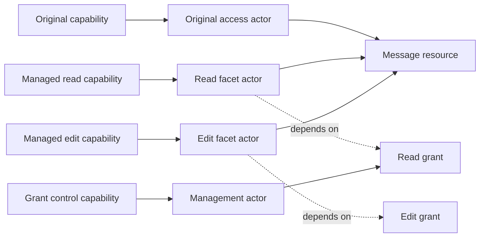
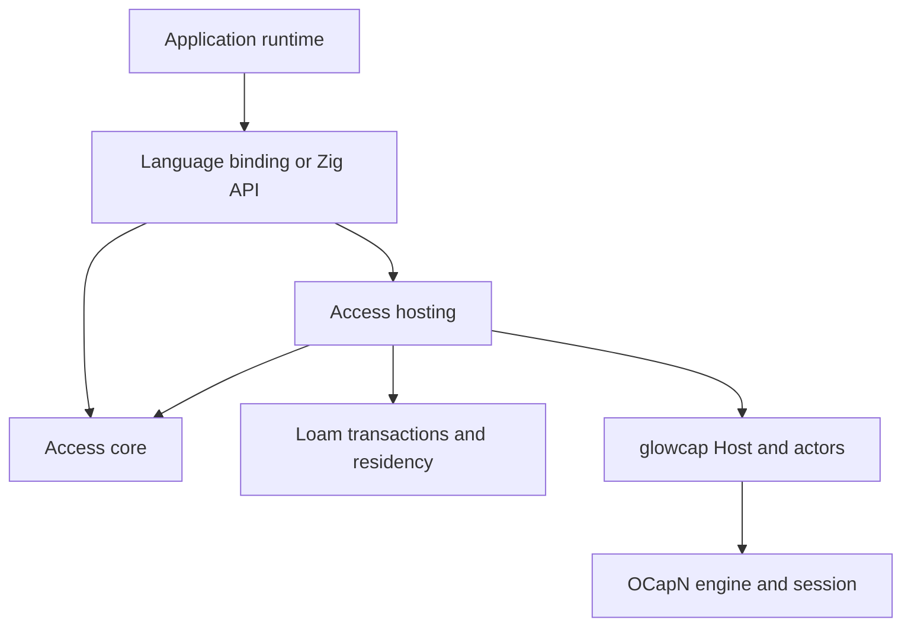

# Managed access architecture

`glowcap.loam.access` is Loam's module for resource access and lifecycle.
[What ships](../shipped.md#resource-models) says which parts exist.

| Decision record | Covers |
| --- | --- |
| [ADR-0153](../decisions/adr/ADR-0153-access-resource-core.md) | Resource and scope core |
| [ADR-0154](../decisions/adr/ADR-0154-access-local-grant-lifecycle.md) | Local grant model |
| [ADR-0155](../decisions/adr/ADR-0155-access-prepared-grant-writes.md) | Grant preparation and exact storage completion |
| [ADR-0157](../decisions/adr/ADR-0157-access-storage-and-residency.md) | Storage and what stays in memory |
| [ADR-0158](../decisions/adr/ADR-0158-access-resource-record-views.md) | Revision-checked resource views and the structural record codec |
| [ADR-0166](../decisions/adr/ADR-0166-access-grant-records-and-plans.md) | Revision-checked grant records, bounded encoding, LMDB tests of atomic records |
| [ADR-0167](../decisions/adr/ADR-0167-managed-owner-storage.md) | Durable owner headers and sparse indexes, bounded resumable reads, shared-transaction staging |
| [ADR-0168](../decisions/adr/ADR-0168-durable-managed-capability-bindings.md) | Durable use and control descriptors, bounded opaque Zig operations |
| [ADR-0169](../decisions/adr/ADR-0169-managed-host-turns.md) | Fixed-resource use and control endpoints through the durable Host attachment, ordinary publication restoration |
| [ADR-0170](../decisions/adr/ADR-0170-durable-facet-derivation.md) | Fixed-resource derivation, hidden publication reservation, bounded retry receipts |
| [ADR-0172](../decisions/adr/ADR-0172-explicit-disclosure-of-returned-capabilities.md) | Exact disclosure of stored reference fields |
| [ADR-0173](../decisions/adr/ADR-0173-dependent-returned-capabilities-and-reference-edits.md) | Dependent local facets, transactional strong-field edits |
| [ADR-0178](../decisions/adr/ADR-0178-managed-lifecycle-and-mutation-receipts.md) | Persistent resource lifecycle, child indexes, moves and leaf deletion, independent child controls, shared mutation receipts |
| [ADR-0179](../decisions/adr/ADR-0179-scoped-change-retention-and-observation.md) | Bounded retained batches and observation |

The [managed access model](access-api.md) states the rules every call keeps,
and
[resource storage](access-storage.md) describes the stored records and how
they load.

## What it does and where it lives

The module lives at `src/loam/access/`. It tracks how resources relate, the
grants that cover them, sharing onward, editable access, and each resource's
lifecycle. Applications define the content, what each permission means, and
which operations exist. Loam stores the tree, decides what stays in memory,
and runs atomic transactions. Actors and the Host run the code and hold the
capabilities.

A plain Loam object needs no managed access record, and managed resources and
plain objects can share one Loam transaction.

[Loam's architecture](architecture.md#modules-and-archives) lays out the
modules and archives. `core` holds the Zig model, `records` the managed
record encoding, and `storage` ties record views and changes to Loam leases
and transactions. `hosting` registers checked behaviors on an existing Host,
backed by Loam. The [C and Rust guide](c-and-rust.md) covers fixed resources
through Loam's optional archive and lists what that API includes. The general
owner and tree APIs are not available there.

The module reuses Loam's cache, storage executor, and actor wake-up.

## Actors, resources, and access

Rooms serves actor behaviors through the Rust Host binding. Its
[session grant publisher](../../apps/rooms/rust/runtime/src/session/managed/opening.rs)
registers checked behaviors through
[durable Host publication](../../bindings/rust/src/host/publication.rs), and
[archive facets](../../apps/rooms/rust/runtime/src/archive/mod.rs) also
create callable objects. The
[Host architecture](../architecture.md#from-a-peer-to-an-application) shows
where those behaviors sit in the Host's actor machinery.

| Concept | What it is and who owns it |
| --- | --- |
| Actor | A callable object at run time, whose behavior runs through the actor layer. |
| Resource | An application object with a stable identity, declared interfaces, and relationships that `loam.access` governs. |
| Capability | The right to call an object, held through glowcap's references. |
| Grant | The terms, dependencies, and status of one managed way in, enforced by the access module. |
| Owner | One managed access domain and the committed state needed to check its resources and grants. |

These live for different lengths of time. An actor can be a short-lived
callback with no resource record, a stored resource can exist with no actor
in memory, and one resource can have several actors that call into it:

Each box in the diagram is a role, and one actor can fill several roles as
long as reference identity and permissions stay the same.

Revoking the read grant leaves the message and the edit grant alone. Pausing
access leaves its reference ready to resume later. Destroying a resource,
retiring an actor, removing a durable name, and revoking a grant are separate
changes, and removing a durable name cannot revoke references people already
hold. Restoring rebuilds callable endpoints from committed records, never
from an old network session or its import and export tables.

Resource IDs name records and cannot be turned into capabilities. Hosting may
create an endpoint on demand only through access someone already holds or a
durable name they were allowed to have. A public lookup by resource ID never
replaces that check.

## Dependency direction

The core imports neither hosting nor Rooms. It does no I/O, never blocks,
takes explicit allocators, and keeps its state bounded. It checks the tree,
evaluates scope, combines policies, changes grants, keeps receipts, and
prepares and completes permission transactions. When a record is not in
memory, it returns a bounded storage request that your program runs before
resuming the core with results checked against the revision.

Hosting connects that model to the Host and actor APIs. It identifies a call
by the capability that was called, checks access, wraps dependent outputs,
and publishes or restores the access the core picks. It keeps no second list
of grants, reference table, or scheduler.

Hosting is behavior constructors and functions that take an existing Host. A
registration handle owns only its registrations and their managed state, and
cannot drive or close the Host.

| Existing part | What it already does | What the access module adds |
| --- | --- | --- |
| OCapN engine and session | Reference identity, protocol checks, promises, and handoffs | No protocol rules or network state. |
| Actors and Vat | Running behaviors and scheduling turns | Behaviors checked against resource and grant state. |
| Host | Registering actors, holding capabilities, durable names, and dispatch | Functions that register those behaviors. |
| Driver and transports | I/O, connections, reachability, and keeping things moving | No driver, transport, or loop. |
| Loam | Shared records, memory, transactions, and recovery | Resource and grant changes, permission checks, and what follows from them. |

The protocol, actors, and an ordinary Host never depend on managed access,
and a Host holds no owner, tree, or grant state unless an application creates
one. One Host can serve many owners and unrelated actors.

The build keeps core and hosting imports apart. C ABI code converts values
and reports outcomes, and makes no policy or recovery decisions.

## Who owns which state

A managed access owner owns its resource and grant records, its policy
schemas, its revisions, and its resources' durable name recipes and receipts.
Loam owns storing them and the transaction state, and only the records in use
stay in memory ([store](store.md)). An owner has no connection list, wire
reference table, promise registry, or worker queue, and the application's
executor runs the work it asks for. Under load, a call gets a typed busy
result or waits in the application's bounded command queue.

| State | Its one owner |
| --- | --- |
| Message bodies, author facts, and file metadata | The application's content, which joins the same transaction when access depends on a change. |
| Resource identity, placement in the tree, and grant dependencies | The managed access owner. |
| A grant's status and terms | The grant record. Facet actors keep its identity, not a copy of its policy. |
| Actor identity and callable reference rows at run time | The existing Vat and Host. |
| Looking up an active durable name | The Host's existing durable name registry. |
| The recipe to restore a durable name's exact access | Managed access's stored state, using the Host's durable name mechanism. |
| Closing connections and settling pending answers | The existing Host and driver. |

A hosting registration keeps one owner and its application context alive.
Facet actors hold a lease on the registration and the resource and grant
identity they serve. Dropping a typed client wrapper releases its reference
and neither revokes a grant nor destroys a resource. An endpoint is freed when
its actor and references are released, with no separate collector.

An owner has one active hosting registration on one Host, and that Host can
serve many owners. Shared stored state needs one writer, which the deployment
or storage provides, and restoring the same access in two processes at once
is not supported replication. Owners combine through capabilities they hold,
never through shared grant tables.

Retiring an owner stops new calls and durable names and retires pending
changes. Existing actor references are then refused through the closed
registration until they are released, so no callback dangles and no content
or storage worker stays alive. Deleting a resource and revoking a grant each
need their own committed change before retirement.

The Host owns shutdown, and the module's deferred answers and outstanding Host
work count as pending Host work. The application waits for storage results
before freeing an owner or starting recovery. Closing the Host cannot make an
outstanding database write disappear, and closing an owner cannot close
anyone else using that Host.

## How it plugs into the Host

The implementation uses the [Host turn API](../../src/driver/core/host/hosting.zig)
and [durable name owner](../../src/driver/core/publish.zig) through the
public Host and driver APIs, never their private internals.

| Operation | How it works |
| --- | --- |
| Call a managed resource | A managed behavior receives the Host turn, builds an invocation from its resource and grant, and calls the application's handler with the checked requirements. |
| Return a new facet during a call | Create its behavior through the turn's capability API. Never call a top-level Host registration API from a callback. |
| Wait for storage or a remote call | Defer the answer and keep its one-time completion. The executor resumes the work on the Host's own thread. |
| Forward a call whose reply needs no change | Forward through the turn after the check. |
| Narrow capabilities in a reply | Send, defer the answer, check and change the reply, then settle the answer. Forwarding at the tail cannot see the result. |
| Publish durable access | Save the durable name's recipe, then use durable Host publication. Removing the name stops lookups, and grant checks still govern references already held. |
| Answer a watcher | The receiver answers `poll`, or a waiting `receive`, after checking current access. |

[Actor caretakers and attenuators](../../src/actors/ocap.zig) provide
revocable forwarding and method filtering. A managed facet reuses their
forwarding without also keeping a caretaker flag beside the stored grant
status, which would give two answers to the same question. It checks its
current grant and uses an ordinary actor behavior to act or refuse.

No global Host hook checks resource policy. Only behaviors that managed
access registers apply it, and calls to ordinary actors keep their path and
cost. If a supported API lacks a turn, deferred-answer, or reference-holding
operation that managed access needs, extend that API with a general operation
and tests instead of rebuilding it inside managed access or a binding.

The registered reply schema tells plain data, dependent capabilities, and
direct handoffs apart, and walks nested values within a bound. A method whose
reply is undeclared cannot claim that managed access narrows what it returns.
Wrapping arbitrary third-party protocols is outside the guarantee, so an
application's adapter must declare what they mean. Input callbacks that can
lead to later delivery or sharing must also declare how permissions apply.

## One implementation across languages

Zig owns the shared access rules. Applications register bounded descriptions
of their permission sets, how constraints combine, and what each change
needs. The vocabulary is permissions, which combine by intersection, and
lower or upper bounds on numeric facts. Zig checks schemas,
evaluates scope, combines terms, and walks local grant chains.

Rooms supplies what its operations mean and the committed content facts. For
example, editing a message needs a declared edit permission and the author
relationship. Rooms produces the requirement and the facts, and managed
access checks them against the access in effect. Facts cannot come from
unchecked caller fields, and mapping operations to requirements is trusted
application code.

| Zig implementation | Rust application and binding |
| --- | --- |
| Checking the tree and scopes | Content schemas and proposed content changes |
| Intersecting permissions and constraint bounds | Declaring permissions and what operations need |
| Grant limits, ancestors, and the access in effect | Committed content facts and relation definitions |
| Pause, resume, revoke, and checking dependent outputs | UI and typed application methods |
| Permission transactions and restoring | Running storage and fitting into the executor |
| Registration and checking handles at run time | Ownership wrappers, error conversion, and callback plumbing |

Applications never implement generic intersection, narrowing, or walking up a
grant chain. A missing general constraint operator is added to the shared Zig
model with tests. A domain-specific check can be a bounded, synchronous
application hook, but it cannot override scope, limits, status, or the grant
chain. Unsupported policy schemas fail.

Zig compile-time helpers and Rust generics describe schemas and give typed views over the same model, and
neither creates a separate grant implementation. Bindings may cache
descriptions for display, never to authorize anything. Remote callers use
application interfaces over OCapN and need not run managed access
themselves.

Rooms' portable content model does not depend on how the Host runs, and its
runtime combines content proposals with managed access checks and storage.
Schema types shared with the portable model stay free of Host, executor, and
transport dependencies. Generic access behavior belongs in Zig, not in the
Rust grant list Rooms keeps for its session grants.

## Calls, storage, and returned capabilities

A protected change follows one path:

1. Hosting receives a call on a held capability and builds a private
   invocation tied to its resource and grant.
2. The application proposes a content change and declares what it needs.
   Managed access checks that against the committed tree, grant, and content
   revisions.
3. Managed access prepares the permission changes, and the application
   prepares the content changes, in one recoverable transaction. No
   capability or content change is visible before the commit.
4. Your program runs the storage work. Loam takes the result and applies each
   participant's changes, managed access included. An unknown write stops the
   owner until recovery. Conflicting changes cannot overtake a pending
   transaction and invalidate its check.
5. Hosting delivers the results, checking current permissions again where
   delivery was queued. Returned managed references carry the grants they
   need and the access to their target.

Ordinary reads write nothing to the grant records. Waiting work finishes
before the final check, so an old check cannot allow a later change after a
revoke. The storage worker runs this sequence and holds no permission state of
its own.

A message's attachment facet depends on both the message grant and the held
file capability, and returning it cannot reveal the file's original access.
The same rule covers subscriptions, nested replies, and continuations.
Application code with its own original access decides which handoffs it
allows, and managed access cannot stop it handing that access out through
another API.

Remote dependencies run through the capabilities held from upstream. Local
records say nothing certain about remote access, and a network split never
turns a remote change into a commit. Each owner reports its own committed
outcome.

## Locators and restoring

The core records resource and grant identities, durable name recipes, and
dependency keys. Host and runtime APIs own locators, publication, recovery,
and connections. Managed access adds no locator format, transport registry,
connection pool, or sturdyref resolver.

Publishing a message facet ties a durable Host name to that message's grant,
and the link never hands out the parent's full access with a selector the
client is trusted to honor. A durable name does not depend on editable
titles, labels, presets, or permissions. Restoring rebuilds the same resource
and grant chain, including paused or revoked status, before allowing calls.

Records of outside dependencies keep the durable reference where one exists.
Live-only dependencies stay live-only, and recording their IDs under a
durable ancestor cannot make them restorable. Following a link gives a typed
unavailable, paused, revoked, or gone result and never retries through a
stronger way in. Rooms owns the recipient's focused views and any separately
allowed navigation back to the source.

## Facets and policy scope

A served endpoint ties together a resource identity, an original or managed
source, and any fixed narrowing. A managed share creates a grant record with
its own control. Opening an attachment through that share can create a
short-lived endpoint with the same grant and a narrower view, without
creating another editable grant or writing storage. A durable share saves
what it needs to rebuild its access. Endpoint references are ordinary Host
capabilities.

Passing on an existing capability keeps its access and its revoke boundary,
and creates neither a grant record nor a new recipient identity. An original
resource capability passes on original access, and a managed facet stays
under its grant. A resource ID never produces an original capability, and a
grant control cannot unwrap its source.

Policy descriptors use stable permission and constraint keys. Display
labels, presets, and UI grouping are separate. Issued grants store their
terms explicitly, so changing a preset cannot widen them. Supported
constraint operators share Zig rules for narrowing and intersection.
A requirement lists the permissions an effect needs and bounds on checked
facts, and every one must hold.

Applications map operations onto requirements and supply facts from their
committed content. A custom check refines a
domain requirement and cannot change how the vocabulary combines.

Each call uses one grant, and managed access never combines permissions from
separate capabilities. An operation that needs several capabilities declares
each requirement and keeps each dependency. Local grant chains are bounded
and kept in a fixed order. Remote dependencies are held references whose
owner keeps enforcing them.

The direct local API and actor calls go through the same checks. Holding the
reference you call is what lets you use its grant. Zig use and control references tie that permission to
committed grant records, and actor hosting calls them through the same
checks. Applications can use managed access on local content without
connecting to anyone.

## Observable access changes

Use endpoints answer `describe-access()` with the scoped snapshot that
[ADR-0171](../decisions/adr/ADR-0171-scoped-access-descriptions.md) defines.
It uses the same checks as a call and includes no owner revision or event
cursor. [Observing managed access](access-observation.md) covers
subscribing and catching up.

Grant changes produce committed change events. Issuing a grant names the new
grant and its parent's child list. Policy, pause, resume, and revoke events
name the affected branch, and one parent change emits one event, not one per
descendant. Moving a resource and other content changes that affect access
also produce events, so views that depend on them can refresh.

The local grant code returns an owned event with each successful change. A
request that changes nothing returns no event, and a failure commits nothing.
Durable events become visible only after the state commits, and describe the
committed result, not a request or a pending write.

A watcher pulls changes from a receiver capability with `poll` or `receive`.
A grant control may watch only the grants it may see. A use facet may offer to
watch its own access without exposing grant administration. A change above
it can become an access-changed notice for that facet without revealing
hidden ancestor IDs, policies, siblings, or unrelated activity. Raw owner
events and revision stamps are internal and never a wire format.

The UI uses these events to refresh access and status, and running services
use them to stop or recheck protected streams and pending work. A revoked
watcher sees only its status. Watching follows the watcher's own permission,
including while its use is paused.

Each receiver keeps an opaque scoped cursor. When the history a cursor needs
has expired, the reply says to start over and carries a fresh snapshot the
watcher may see with a matching cursor, so no change is skipped silently. Managed access
owns ordering and checking cursors, and your program runs storage and
delivery without a second event system.

Protected calls and deferred delivery check current permissions, so a lost or
late event never keeps access alive, and a revoke needs no broadcast or
acknowledgement. The stored owner keeps grant, resource, content, and control
changes in order, in bounded committed batches, with scoped revision stamps
and the affected paths. [Observing held access](access.md#observing-held-access)
provides receipt-backed registration, receive and cancel endpoints, catching
up within what the watcher may see, and opaque cursors.

## Atomic content and access changes

Grant changes are prepared as bounded changes, with room reserved in the tree
and an exact result from storage. The owner's transaction ties
fixed-resource content changes to the permission check (ADR-0169) and adds
atomic sharing and bounded receipts (ADR-0170). One hosted call can also
create a child or change other resources of the same owner, and the change
batch it commits is the record of that operation (ADR-0227). Zig use and
control references enforce their grants and control limits through the same
preparation. [Managed endpoints](access-endpoints.md) covers how to call them
and how long they live.

Managed access checks permissions for transactions that touch its tree or
grants, and the application owns the content. Their shared transaction holds
the managed change, opaque content changes, the expected content revision,
and a receipt. Loam owns the transaction and its recovery state, and keeps no
second copy of the content in Zig.

Loam allows one prepared write per store and one pending permission change
per owner taking part. Other owners and ordinary actors keep running. Reads
can see the last committed state while a write is pending, never its
uncommitted changes, and no conflicting content change gets ahead of it.
After an unknown write, every protected call to that owner is refused until
recovery decides which revision committed.

Preparation checks facts and requirements and reserves what the in-memory
commit needs. The application writes content without publishing it. Once the
write is confirmed durable, the managed access and content revisions advance
together in one synchronous step on the owning executor, with no reentry.
That step allocates nothing and does no I/O. A panic or unexpected failure
stops the owner and reloads the stored record before any result is shown.

A storage result is tied to the owner generation, the transaction, the
revision it started from, and the prepared payload. Rust passes the store's
result to Zig and does not decide which grant change follows. The storage
worker and content callback are trusted code in your program, and the ABI
cannot prove that a malicious worker wrote the bytes.

Transactions with no protected managed changes use Loam directly. Any change
to a fact used for permissions, such as authorship or placement in the tree,
goes through the access module's revision and permission checks.

## Who owns which application interfaces

Managed access owns the shared application interfaces for describing access,
sharing, controlling a grant, and inspecting the resources a holder may see.
Their schemas live with hosting and generate its Zig and binding method
definitions. Rooms owns content methods such as posting and editing a
message, with their permissions, and its generator refers to the shared
schema instead of copying its methods.

These interfaces are ordinary application objects sent over CapTP. They add
no protocol message, transport extension, special bootstrap access, or
global registry of remote resources. Method namespaces and schema IDs keep
management calls apart from application methods. An application's schema
identity fixes which permission vocabulary a grant uses, and a description
or type label from a remote peer cannot create access.

A peer can use a published interface without running the Zig library. A peer
without it returns an unsupported result, and clients never retry through a
broader capability. Generic protocol fixtures belong to managed access, and
Rooms fixtures test its content-specific requirements on top of them.

## Zig, C, and browser builds

The model is its own build module. Hosting depends on it, the actor layer,
and the byte-fed Host, and none of them needs the I/O driver, sockets, or a
particular transport.

The [C and Rust guide](c-and-rust.md) offers opaque Store, Attachment, Call,
and Work handles for fixed resources, and no general owner or tree API.
Capability arguments use Host capability types and ownership calls, and
resource IDs stay plain data even as typed Rust structs.

Loam's optional archive carries managed access exports beside shared storage.
It reuses the Host's opaque handles and links against the Host archive, so it
must not carry another copy of the Host's symbols or build a second Host
behind a handle. Generated headers and binding layouts come from Zig alone.
Compile-time Zig helpers cut boilerplate around the same schema registration,
and application Zig types never pick a different grant algorithm.

Rust's portable content crate keeps its content types, and runtime binding
code converts typed requirements and borrowed fact views to the shared ABI.
Content changes are opaque to Zig, and allocations and kept callbacks each
have an explicit owner who releases them. No Rust callback implements the
access rules. Callbacks from other languages are synchronous and cannot call
back in, and asynchronous work returns through completion handles the
executor drives.

Process builds link managed access with the Host, the chosen driver, and
transports. Rooms browser builds link managed access, the byte-fed Host, and
Rust into one Wasm memory, so calls from Rust into managed access need no
JavaScript round trip or second Wasm instance. The browser executor and
transport adapters drive the Host.

## Costs and rejected alternatives

Managed access creates an owner only when asked and a callable endpoint only
when its access must be handed out. Schema definitions are shared within an
owner, and facets keep identifiers and dependencies, not copies of the tree
or content. A permission check walks a bounded local grant chain and scope,
and a revoke changes one record without rewriting every descendant. A cache
takes part in checks only when it is invalidated by revision.

Content facts are borrowed for synchronous checks. Only data that must
outlive a deferred answer or storage operation is kept or copied, within
explicit bounds, and Host references are kept alive through retain and
release. A plain read through a managed facet writes
nothing and waits in no application queue.

| Alternative | Why we rejected it |
| --- | --- |
| Put managed access inside the protocol engine | Resource policy would tie applications to session rules and add work for unrelated protocol users. |
| Add managed access state to every actor | Short-lived callbacks and resolvers would pay for trees and lifecycles they never use. |
| Add a managed access Host or driver | It would duplicate how work runs, durable names, pending work, and shutdown. |
| Keep a grant evaluator in Rust beside Zig | Two places would decide scope and status, defeating the shared implementation. |
| Offer only a Zig compile-time generic model | Applications in other languages could not supply their types through a runtime ABI without a second implementation. |
| Express everything as a permission mask | It loses scope relations, constraints, content facts, and status dependencies. |
| Forward every managed call unchanged | Returned capabilities and deferred deliveries could escape the grant they came from. |
| Keep every stored resource in memory as an actor | Storage size would decide memory use with no permission reason. |

## Tests

[Stability](../stability.md) lists what Loam's tests leave out.

| Property | What the tests show | Where |
| --- | --- | --- |
| Independent core | The access core builds with no Host, actors, or I/O, and import checks hold that layering. | `arch-check`, `loam-core-wasm-check` |
| Separate facets | Pausing or revoking one facet leaves facets from other grants working, and two grants never add up. | `test/loam/access/grants_test.zig`, `test/loam/access/management_test.zig`, `test/loam/access/hosting_wire_test.zig` |
| Restoring | A restored resource keeps its identity and exact access on both disk engines and from Rust, and a stored resource needs no actor in memory. | `test/loam/engines/capability_test.zig`, `test/loam/hosting/read_scope_test.zig`, `loam-rust-test` |
| Returned access | Dependent facets and subscriptions keep their dependencies through a revoke higher up and a restart. | `test/loam/access/hosting_wire_test.zig`, `test/loam/access/reference_test.zig`, `test/loam/access/observation_lifetime_test.zig` |
| Storage failure | Lost confirmations, retried requests, and interrupted publication never duplicate or widen access. | `test/loam/access/sharing_test.zig`, `test/loam/access/mutation_test.zig`, `loam-managed-crash-test` |
| Atomic commits | Killing the process at each commit step never leaves content and access from different revisions. | `loam-managed-crash-test`, `test/loam/engines/access_test.zig` |
| Shutdown | Closing the Host settles storage work in flight, and late storage results and callbacks never reach freed memory. | `bindings/rust/src/loam/tests/close.rs`, `test/loam/hosting/actors_test.zig` |
| Browser cost | Each operation's IndexedDB transactions, JavaScript calls, rows, and copied bytes are counted, and a resident read or receipt replay records none. | `loam-browser-test` |
| Callback reentry | A storage callback that calls back into Loam is refused. | `test/c_abi/loam_execution_test.zig` |

Loam keeps no reader for older formats, compatibility layer, or Rust
fallback. Stored state that does not match the current format must be reset
by whoever runs it.
