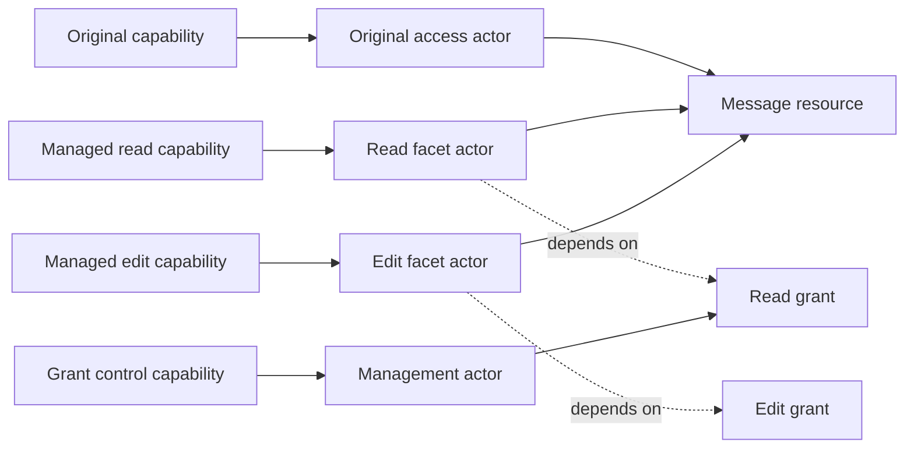
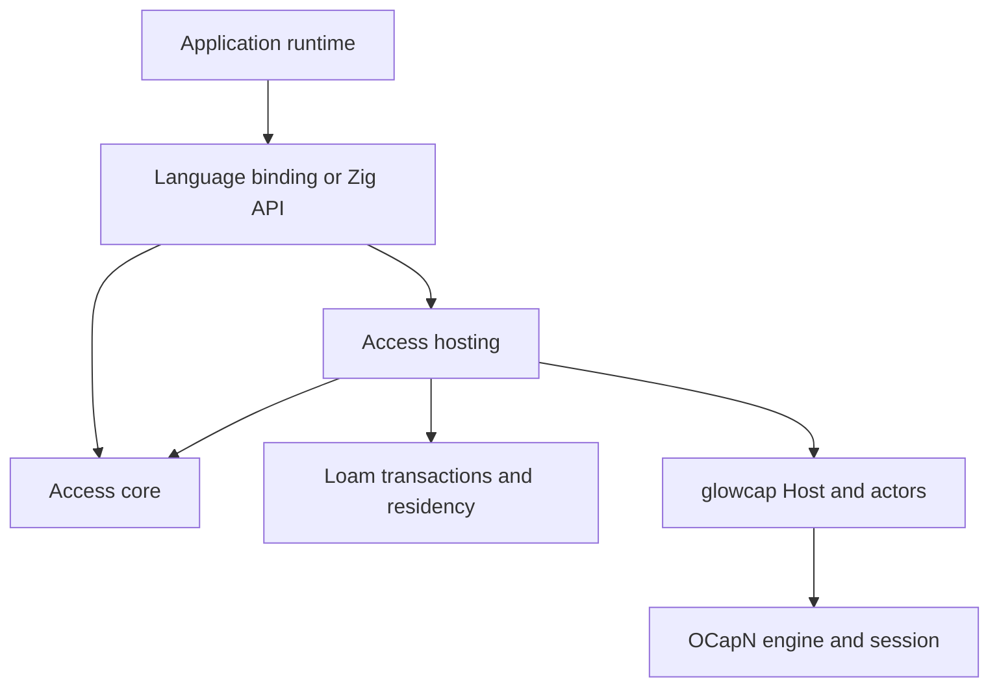

# Managed access architecture

`glowcap.loam.access` is Loam's module for resource access and lifecycle. This
page is its implementation contract. [What ships](../shipped.md#resource-models)
says which parts exist.

| Decision record | Covers |
| --- | --- |
| [ADR-0153](../decisions/adr/ADR-0153-access-resource-core.md) | Resource and scope core |
| [ADR-0154](../decisions/adr/ADR-0154-access-local-grant-lifecycle.md) | Local grant model |
| [ADR-0155](../decisions/adr/ADR-0155-access-prepared-grant-writes.md) | Grant preparation and exact storage completion |
| [ADR-0157](../decisions/adr/ADR-0157-access-storage-and-residency.md) | Storage and residency |
| [ADR-0158](../decisions/adr/ADR-0158-access-resource-record-views.md) | Revision-checked resource views and the structural record codec |
| [ADR-0166](../decisions/adr/ADR-0166-access-grant-records-and-plans.md) | Revision-checked grant records, bounded encoding, LMDB atomic record evidence |
| [ADR-0167](../decisions/adr/ADR-0167-managed-owner-storage.md) | Durable owner headers and sparse indexes, bounded resumable reads, shared-transaction staging |
| [ADR-0168](../decisions/adr/ADR-0168-durable-managed-capability-bindings.md) | Durable use and control descriptors, bounded opaque Zig operations |
| [ADR-0169](../decisions/adr/ADR-0169-managed-host-turns.md) | Fixed-resource use and control endpoints through the durable Host attachment, ordinary publication restoration |
| [ADR-0170](../decisions/adr/ADR-0170-durable-facet-derivation.md) | Fixed-resource derivation, hidden publication reservation, bounded retry receipts |
| [ADR-0172](../decisions/adr/ADR-0172-explicit-disclosure-of-returned-capabilities.md) | Exact disclosure of stored reference fields |
| [ADR-0173](../decisions/adr/ADR-0173-dependent-returned-capabilities-and-reference-edits.md) | Dependent local facets, transactional strong-field edits |
| [ADR-0178](../decisions/adr/ADR-0178-managed-lifecycle-and-mutation-receipts.md) | Persistent resource lifecycle, child indexes, moves and leaf deletion, independent child controls, shared mutation receipts |
| [ADR-0179](../decisions/adr/ADR-0179-scoped-change-retention-and-observation.md) | Bounded retained batches and observation |

The [API sketch](access-api.md) shows call shapes, and
[access storage](access-storage.md) specifies durable records and loading.

## Purpose and placement

The access module lives at `src/loam/access/` and is exposed as
`glowcap.loam.access`. It provides resource relationships, scoped grants,
delegation, editable access, and lifecycle. Applications define content,
permission meanings, and supported operations. Loam supplies graph persistence,
bounded residency, and atomic transactions. Actors and the Host supply
execution and capability custody.

Managed access is a model plus shared enforcement and transition machinery. A
plain Loam object needs no managed access record, and managed resources and
plain objects can participate in one Loam transaction.

The [Loam architecture](architecture.md#modules-and-distribution) owns the
module and archive layout. The module's `core` exports Zig model operations,
`records` exports managed record encoding, and `storage` binds record views and
mutations to Loam leases and transactions. The `hosting` surface registers
guarded behaviors on an existing Host with Loam persistence. The
[C/Rust profile](c-and-rust.md) projects fixed-resource lifecycles through the
optional Loam companion and owns the supported binding surface. General owner
and graph APIs remain wider projection work.

The module uses Loam's shared transaction and recovery mechanism and
contributes admission, resource and grant records, and authority consequences.
It has no pager, cache, database executor, or activation state machine.

## Actors, resources, and authority

Rooms serves actor behaviors through the Rust Host binding. Its
[session grant publisher](../../apps/rooms/rust/runtime/src/session/managed/opening.rs)
registers guarded behaviors through
[durable Host publication](../../bindings/rust/src/host/publication.rs).
[Archive facets](../../apps/rooms/rust/runtime/src/archive/mod.rs) also spawn
callable objects. The [Host architecture](../architecture.md#from-a-peer-to-an-application)
places those behaviors in the Host's actor machinery.

| Concept | Meaning and owner |
| --- | --- |
| Actor | A callable runtime object whose behavior executes through the actor layer. |
| Resource | An application object with stable identity, declared interfaces, and relationships governed by `loam.access`. |
| Capability | Authority to invoke an object, held through glowcap's reference machinery. |
| Grant | Terms, dependencies, and lifecycle for a managed access path, enforced by the access module. |
| Owner | One managed access authority domain and the committed state needed to evaluate its resource and grant relationships. |

These identities have different lifetimes. An actor can be a temporary callback
with no resource record. A stored resource can exist without a resident actor.
A single resource can have several actor-backed entry points:

The diagram shows logical roles. It does not require an allocation per edge or
per grant. Capability aliases and implementation sharing are valid when they
preserve the reference identity and authority contract. An actor is not a
thread or operating-system process.

Revoking the read grant leaves the message and the edit grant intact. Pausing
access leaves its reference usable for later resumption. Destroying a resource,
retiring an actor, removing a publication, and revoking a grant are separate
transitions, and publication removal alone cannot revoke held references.
Restoration recreates callable endpoints from committed authority state. It
does not restore a previous network session or its import and export positions.

Resource IDs name records and cannot construct capabilities. Hosting may
materialize an endpoint on demand only through already-held authority or an
authorized durable publication. A public lookup by resource ID does not replace
that admission.

## Dependency direction

Arrows below mean that the source depends on the target.

The core imports neither hosting nor Rooms. It is synchronous and free of I/O,
with explicit allocators and bounded state. It owns graph validation, scope
evaluation, policy composition, grant transitions, operation receipts, and the
preparation and completion of authority transactions. Cold record lookups yield
bounded storage effects, which the embedding executes before resuming the core
with revision-checked results. Loam storage adapters own database I/O.

Hosting binds that model to the Host and actor APIs. It authenticates an
invocation from the called capability, enforces access, wraps dependent
outputs, and publishes or restores the authority the core selects. It reuses
actor primitives where their contracts fit and keeps no second grant ledger,
reference table, or turn scheduler.

Managed access adds no engine, driver, Host, Vat, scheduler, or event loop. Its
hosting module consists of behavior constructors and integration functions that
take an existing Host. A registration handle owns only those registrations and
their managed access state, and it cannot drive or close the Host. Host APIs
own publication, reference custody, dispatch, and shutdown. Managed access
requests those effects and owns their resource and grant consequences.

| Existing component | Reused responsibility | Access module contribution |
| --- | --- | --- |
| OCapN engine and session | Reference identity, protocol validation, promises, and handoff | No protocol semantics or network state. |
| Actors and Vat | Behavior invocation and turn scheduling | Behaviors guarded by resource and grant state. |
| Host | Actor registration, capability custody, publication, and dispatch | Integration functions that register those behaviors. |
| Driver and transports | I/O, connections, reachability, and runtime progress | No driver, transport, or progress loop. |
| Loam | Shared records, residency, transactions, and recovery | Resource/grant transaction contents, admission, and authority consequences. |

The protocol, actors, and ordinary Host do not depend on managed access. A Host
holds no managed access owner, graph, or grant state unless an application
constructs it. One Host can serve many owners and unrelated actors, and an
owner is not a new Vat, peer identity, or network connection.

The build enforces separate core and hosting import boundaries even though both
live under `src/loam/access/`. C ABI code marshals values and projects
outcomes. It owns no policy or recovery decisions.

## State ownership and lifetime

A managed access owner owns resource and grant records, policy schema
registration, authority revisions, and resource-specific publication and
receipt contents. Loam owns their shared durable storage and transaction state.
Durable records live in the transactional store, and only the admitted working
set is resident ([store](store.md)). An owner has no connection list, wire
reference table, promise resolver registry, or worker queue. Its pending
transaction slot represents an atomic state transition, and the application's
executor runs the requested work. Admission under load returns a typed busy
result or uses the application's bounded command queue.

| State | Sole authority |
| --- | --- |
| Message bodies, author facts, and file metadata | Application content owner, participating in the same transaction when access depends on a change. |
| Resource identity, containment, and grant dependencies | Managed access owner. |
| Current grant status and configured terms | Managed access grant record. Facet actors retain its identity rather than a copied policy. |
| Runtime actor identity and callable reference rows | Existing Vat and Host. |
| Active publication lookup | Existing Host publication registry. |
| Recipe to restore a publication's exact authority | Managed access durable state, using the Host's publication mechanism. |
| Connection retirement and pending answer settlement | Existing Host and driver. |

A hosting registration retains one owner and its application context. Facet
actors retain a registration lease and the resource and grant identity they
serve. Dropping a typed client wrapper releases its reference occurrence and
neither revokes a grant nor destroys a resource. Endpoint reclamation follows
actor and reference custody, with no managed access garbage collector.

An owner has one active hosting registration, attached to one Host. That Host
may serve many owners. Shared durable state requires an exclusive writer
arrangement supplied by deployment or storage. Restoring the same authority
independently in two processes is not supported replication. Cross-owner
composition uses retained capabilities instead of shared mutable grant tables.

Explicit owner retirement closes application admission, stops new publications,
and retires the owner's pending effects. Existing actor references then refuse
through a closed registration until their final release. That small refusal
state prevents dangling callbacks and keeps no content or storage workers
alive. Permanent resource deletion and grant revocation need their own
committed operations before retirement.

The Host owns the aggregate shutdown barrier, and the access module's deferred
answers and outstanding Host effects join its pending-work accounting. The
application also joins storage completion before freeing an owner or beginning
recovery. Host closure cannot make an outstanding database write disappear, and
owner closure cannot close other users of that Host.

## Host integration mechanisms

The implementation uses the [Host turn surface](../../src/driver/core/host/hosting.zig)
and [publication owner](../../src/driver/core/publish.zig). These links
identify the mechanisms and do not permit importing their private leaves.
Supported entrypoints are the public Host and driver surfaces.

| Operation | Integration design |
| --- | --- |
| Call a managed resource | A managed access behavior receives the Host turn and constructs an invocation from its bound resource/grant, then calls the application handler with admitted requirements. |
| Return a new facet during a call | Spawn its behavior through the turn capability API. Do not reenter a top-level Host registration API from a callback. |
| Wait for storage or a remote call | Defer the answer and retain its one-shot completion authority. The executor resumes work on the Host's owning thread. |
| Forward a call with an unchanged permitted reply | Use turn forwarding after admission. |
| Restrict capabilities in a reply | Use send plus deferred completion, validate and transform the reply, then settle the answer. Tail forwarding cannot inspect the result. |
| Publish durable access | Persist its publication recipe, then use durable Host publication. Removal changes discovery. Grant enforcement controls retained references. |
| Deliver a subscription event | Check its retained access path at delivery and use the send/tell mechanism. |

[Actor caretakers and attenuators](../../src/actors/ocap.zig) provide revocable
forwarding and verb filtering. A managed facet reuses their forwarding
mechanism without stacking a caretaker flag and a persisted grant status as
competing authorities. It checks its current grant and uses ordinary actor
behavior to act or refuse. Standalone caretakers keep their own purpose.

No global Host interception hook evaluates resource policy. Only behaviors
registered by managed access apply it, and calls to ordinary actors keep their
path and cost. If a required turn, deferred-answer, or custody operation is
unavailable through a supported surface, extend that surface with a general
operation and its tests. Do not reconstruct the operation inside managed access
or a language binding.

The registered reply schema distinguishes plain data, dependent capabilities,
and independent handoffs. Traversal is bounded and covers nested values. A
method with unknown reply semantics cannot claim managed attenuation of its
outputs. Generic wrapping of arbitrary third-party protocols is outside the
guarantee, and an application adapter must declare their semantics. Input
callbacks also need declared authority treatment where they can cause later
delivery or delegation. A descriptor cache never replaces upstream calls.

## One implementation across languages

Zig owns the common access algebra. Applications register bounded descriptors
for permission sets, constraint composition, and effect requirements. The
vocabulary covers set intersection, lower and upper bounds, exact matches, and
declared resource relations. Zig validates schemas, evaluates scope, combines
terms, and walks local grant dependencies.

Rooms supplies the meanings of its operations and committed content facts. For
example, editing a message requires a declared edit permission and an author
relationship. Rooms produces the requirement and the relevant facts, and
managed access checks it against effective authority. Facts cannot come from
unvalidated caller fields, and requirement mapping is trusted application code.

| Zig implementation | Rust application and binding |
| --- | --- |
| Graph and scope validation | Content schemas and proposed content changes |
| Permission intersection and constraint bounds | Permission declarations and operation requirements |
| Grant ceilings, ancestry, and effective authority | Committed content facts and relation definitions |
| Pause, resume, revoke, and dependent output enforcement | UI and typed application methods |
| Authority transaction and restoration state machines | Storage execution and executor integration |
| Runtime registration and handle validation | Ownership wrappers, error conversion, and callback plumbing |

Applications do not implement generic `meet`, `is_narrower`, or ancestor
traversal. A missing general constraint operator is added to the shared Zig
model with tests. A domain-specific predicate can be supplied as a bounded,
synchronous application hook, but it cannot override scope, ceilings,
lifecycle, or grant dependency checks. Unsupported policy schemas fail
explicitly.

The embedding API is available at runtime. Zig compile-time helpers and Rust
generics describe schemas and provide typed views over the same model, and
neither instantiates a separate grant implementation. Bindings may cache
descriptions for display but cannot use those caches to authorize effects.
Remote consumers use application protocols over OCapN and need not embed
managed access locally.

Rooms' portable content model is independent of Host execution. Its runtime
composes content proposals with managed access admission and persistence. Schema
types shared with the portable model stay free of Host, executor, and transport
dependencies, and the binding does not become its domain model. Generic access
behavior leaves the Rust grant ledger as the Zig implementation replaces it.

## Invocation, persistence, and returned capabilities

A protected mutation follows one authority path:

1. Hosting receives a call on a held capability and constructs a private
   invocation bound to its resource and access path.
2. The application proposes a content operation and declares its requirements.
   Managed access evaluates those against committed graph, grant, and content
   revisions.
3. Managed access prepares the authority changes and the application prepares
   content changes in one recoverable transaction. No capability or content
   effect is exposed before the required commit.
4. The embedding executes storage. Loam consumes the completion receipt and
   installs its participants, including managed access. Uncertain writes fence
   the owner for recovery. Conflicting mutations cannot pass a pending
   transaction and invalidate its admission.
5. Hosting delivers admitted results, applying current authority checks where
   delivery was queued. Returned managed references carry the required grant
   dependencies and underlying target authority.

Ordinary reads do not write a grant ledger. Asynchronous prerequisites finish
before final admission, so an old check cannot authorize a later effect after
revocation. Content and authority share a recoverable transaction where their
changes must be atomic. A storage adapter executes that contract and supplies
no authority state machine.

A message's attachment facet depends on both the message grant and the held
file capability. Returning it cannot reveal the file's original authority. The
same rule covers subscriptions, nested replies, and continuation objects.
Application code with independent original authority is trusted to decide which
handoffs it permits, and managed access cannot stop it from publishing that
authority through another API.

Remote dependencies execute through their retained upstream capabilities. Local
records do not certify remote access, and a partition does not turn a remote
mutation into a successful commit. Each authority owner reports its own
committed outcome.

## Locators and restoration

Managed access hosting works with held capabilities and durable references. The
core records resource and grant identities, publication recipes, and dependency
keys. Host and runtime surfaces own locator handling, publication, recovery,
and connection effects. Managed access adds no locator format, transport
registry, connection pool, or alternate sturdyref resolver.

Publishing a message facet binds a durable Host publication to that message's
access path. The link never exposes unrestricted parent authority plus a
client-enforced selector. Publication identity stays independent of editable
titles, labels, presets, and configured permissions. Restoration reconstructs
the same resource and grant dependency, including paused or revoked state,
before permitting calls.

External dependency records retain the durable reference where one exists.
Live-only dependencies remain live-only, and a durable ancestor cannot make
them restorable by recording their IDs. Link handling yields typed unavailable,
paused, revoked, or gone outcomes and does not retry through a stronger
entrance. The [content plan](../planning/rooms.md#content-model) owns the
recipient's focused views and separately authorized source navigation.

## Facet representation and policy scope

A served endpoint binds a resource identity, an original or managed source, and
any fixed projection restriction. A managed share creates a grant record with
its own control authority. Opening an attachment through that share can create
a transient endpoint carrying the same grant dependency and a narrower
projection, without minting another editable grant or writing storage. An
explicit durable share persists the dependencies needed to reconstruct its
access path. Endpoint references are ordinary Host capabilities.

Directly passing an existing capability preserves its authority and revocation
boundary and creates neither a grant record nor a new recipient identity.
Passing an original resource capability passes that original authority, and
passing a managed facet stays subject to its grant. A resource ID is never an
original capability constructor, and a grant control cannot unwrap its source.

Policy descriptors use stable permission and constraint keys. Display labels,
presets, and UI grouping are separate metadata. Issued grants store explicit
terms, so changing a preset cannot enlarge them. Supported constraint operators
have shared Zig narrowing and intersection rules. Requirement expressions have
bounded conjunctions and alternatives over permissions and validated facts, and
no alternative can bypass resource scope or lifecycle checks.

The requirement vocabulary includes resource selection, permission membership,
ordered bounds, and declared fact relationships. Applications map operations
into it and provide facts from their committed content revision. A predicate
hook refines a domain requirement and cannot redefine the vocabulary's algebra.

An invocation uses one selected authority path. Managed access does not combine
permissions from independent capabilities in the same process. An operation
that requires several capabilities declares each requirement and retains each
dependency. Local grant ancestry is bounded and canonical. Remote dependencies
are held references whose owner continues to enforce them.

The direct local API and actor-call API enter the same admission functions.
Holding the invoked capability reference conveys its grant authority, so no
caller supplies an additional identity or grant credential. Zig use and control
references bind that authority to committed ledger records, and actor hosting
retains and invokes those references through the same enforcement path.
Applications can use managed access on local content without dialing a dummy
session. If the Host cannot expose a needed local operation, its supported
capability surface gains that operation, and managed access still builds no
execution runtime of its own.

## Observable access changes

Use endpoints implement `describe-access()` as the scoped snapshot defined by
[ADR-0171](../decisions/adr/ADR-0171-scoped-access-descriptions.md). It shares
current admission evaluation and emits no owner revision or event cursor.
[Access observation](access-observation.md) describes the subscription and
replay that ship against the contract below.

Grant mutations produce committed change events. Issuance identifies the new
grant and its parent inventory. Policy, pause, resume, and revocation events
identify the affected dependency branch, and one parent change does not rewrite
or emit an event for every descendant. Resource reparenting and other
authority-relevant content changes also produce transaction events so scope
changes can invalidate affected access views.

The local ledger returns an owned event with each successful mutation.
Unchanged requests return no event, and failures leave no committed change.
Durable change events become observable only after the corresponding state
commits, and they describe the committed result, not a request or a prepared
write.

The hosting integration delivers scoped subscriptions using actors and CapTP
send/tell operations. Grant controls may observe only their authorized
inventory. A use facet may offer observation of its own effective access
without exposing grant administration. An ancestor change can become an
access-changed notice for that facet without disclosing hidden ancestor IDs,
policies, siblings, or unrelated activity. Raw owner events and revision stamps
are internal data and not a wire subscription format.

The UI uses these events to refresh access and lifecycle state. Active services
use them to stop or reconsider protected streams and pending work. A minimal
terminal notice may close a subscription when its access is revoked, and it
carries no newly protected content. Event delivery obeys its declared
observation authority, including while use authority is paused.

Subscriptions have bounded queues and opaque scoped cursors. Reconnect or
overflow produces an explicit resynchronization result and an authorized
snapshot with its matching cursor, so changes are never skipped silently.
Managed access owns ordering and cursor validation, and the embedding runs
storage and delivery effects without a parallel event system.

Protected calls and deferred delivery check current authority, so event loss or
delay cannot preserve permission. Revocation needs no synchronous distributed
broadcast or acknowledgement from every holder. The stored owner retains
ordered grant, resource, content, and control effects in bounded committed
batches. Scoped revision stamps and affected paths support scoped projection.
The [observation profile](access.md#observing-held-access) supplies
receipt-backed registration, receive and cancel endpoints, authorized replay,
and opaque cursors. Delivery is pull-based through the held receive capability.

## Atomic content and access changes

The ledger implements bounded prepared grant deltas, graph reservations, and
exact storage completion. The owner transaction binds fixed-resource content
effects to admission (ADR-0169) and adds atomic derivation and bounded receipts
(ADR-0170). Cross-resource content changes and a general operation journal are
not implemented, and the
[open obligations](../roadmap.md#open-obligations-from-retired-plans) holds
them. Zig use and control references enforce selected grants and management
ceilings through the same preparation path. The
[usage guide](access.md#managed-endpoints-on-the-host) owns their calling and
lifetime contract.

Managed access is the admission owner for transactions involving its resource
graph or grants, and the application is the content owner. Their shared
transaction contains a managed access delta, opaque application content
changes, the expected content revision, and an operation receipt. Loam owns this
transaction and its recovery state. It may span database rows without a
monolithic snapshot or a second copy of all content in Zig.

The concurrency contract allows one prepared write per Loam persistence domain
and one staged authority mutation per participating owner. Other owners and
ordinary actors continue running. Reads may observe the last committed state
while a write is pending but not its staged changes. No conflicting content
mutation bypasses the pending transaction. After an uncertain write, all
protected access to that owner refuses until recovery has established which
revision committed.

Preparation validates facts and requirements and reserves the resources the
in-memory commit needs. The application stages content without publishing it.
After durable acknowledgement, the managed access and content revisions advance
within one synchronous, non-reentrant completion on the owning executor. That
installation does not allocate or perform I/O. A panic or unexpected failure
fences the owner and reloads the durable record before any result is exposed.

A completion receipt is bound to the owner generation, transaction identity,
base revision, and prepared payload. Rust conveys the store outcome to Zig and
does not decide which grant transition follows. The storage adapter and content
callback are trusted embedding code. The ABI prevents accidental stale or
mismatched receipts and cannot prove that a malicious adapter wrote the bytes.

Application transactions with no managed access-protected effects use Loam
directly, because managed access is not a general database, journal server, or
workflow framework. Any change to facts used for authority, such as authorship
or containment, participates in the access module's revision and admission
contract.

## Application protocol ownership

Managed access owns the common application interfaces for describing access,
deriving a managed share, controlling a grant, and inspecting authorized
resource relationships. Their schemas live with the hosting integration and
generate its Zig and binding method definitions. Rooms owns content methods
such as posting and editing a message, along with its permission declarations.
The Rooms generator references the common schema instead of copying its verbs.

These interfaces are ordinary application objects carried over CapTP. They add
no protocol message, transport extension, bootstrap privilege, or universal
remote resource registry. Method namespaces and schema identifiers separate
common management operations from application methods. Application schema
identities bind the permission vocabulary used to interpret a grant, and a
remote descriptor or type label cannot create authority.

A peer can use a published managed access interface without embedding the Zig
library. A peer that lacks the interface returns an explicit unsupported
outcome, and clients never retry through a broader capability. Generic managed
access protocol fixtures belong to managed access. Rooms fixtures prove the
content-specific requirements and replies composed with those interfaces.

## Zig, foreign, and browser packaging

The portable model is a distinct build module. Hosting depends on that module,
the actor layer, and the byte-fed Host surface. Neither requires the I/O
driver, sockets, or a particular transport. The public namespace groups these
APIs without reversing their imports.

The [C/Rust profile](c-and-rust.md) exposes opaque Store, Attachment, Call and
Work handles for fixed-resource lifecycles. General owner and graph composition
remain wider projection work. Capability arguments use Host capability types
and ownership operations. Public resource IDs remain data, even when
represented by typed Rust structs.

The Loam companion archive includes managed access exports alongside shared
persistence. It reuses Host opaque handles and links against the Host archive.
It must not emit another copy of the Host symbol family or construct a second
Host behind the handle. Generated headers and binding layouts have one Zig
authority. Compile-time Zig helpers reduce boilerplate around the same runtime
schema registration, and application-defined Zig types do not select a
different grant algorithm.

Rust's portable content crate retains its content types. Runtime binding code
converts typed requirements and borrowed fact views into the common ABI.
Content deltas are opaque to Zig. Allocations and retained callbacks have an
explicit release owner. No Rust callback implements the generic access algebra.
Foreign callbacks are synchronous and non-reentrant, and asynchronous work
returns through completion handles driven by the executor.

Process builds link managed access with the Host and the selected driver and
transports. Rooms browser builds link managed access, the byte-fed Host, and
Rust into one Wasm memory. Rust-to-managed access calls need no JavaScript
round trip or second Wasm instance. The browser executor and transport adapters
drive the Host. These are implementation requirements whose builds and costs
must be verified.

## Cost and rejected alternatives

Managed access allocates an owner only when requested and a callable endpoint
only when its authority must be exposed. Registered schema definitions are
shared within an owner. Facets retain identifiers and dependencies, not copies
of the graph or content. Access evaluation walks a bounded local grant chain and
scope relationship. Revocation changes the authoritative record without
rewriting every descendant. Caching is optional and needs explicit revision
invalidation before it can participate in admission.

Content facts are borrowed for synchronous checks. Only data that must survive
a deferred answer or storage operation is retained or copied, with explicit
bounds. Host-owned references are preserved through retain and release
operations. Measure Zig and binding paths before claiming latency, allocation,
or size targets. A scalar read does not acquire a persistence write or an
application queue because it uses a managed facet.

| Alternative | Reason for rejecting it |
| --- | --- |
| Put managed access inside the protocol engine | Resource policy would couple applications to session semantics and impose work on unrelated protocol consumers. |
| Add managed access state to every actor | Temporary callbacks and resolvers would acquire unrelated graph and lifecycle costs. |
| Introduce a managed access Host or driver | Duplicates existing execution, publication, pending-work, and shutdown ownership. |
| Keep a grant evaluator in Rust beside Zig | Creates two authorities for scope and lifecycle, defeating the shared implementation. |
| Expose only a Zig compile-time generic model | Foreign applications cannot supply their types through a runtime ABI without another implementation strategy. |
| Express everything as a permission mask | Loses scope relations, constraints, content facts, and lifecycle dependencies. |
| Forward every managed call unchanged | Returned capabilities and deferred deliveries can escape the originating grant. |
| Treat every persistent resource as a permanently resident actor | Couples storage scale to endpoint residency without an authority requirement. |

## Implementation evidence

The architecture is an implementation direction and not a performance or
correctness result. Its first complete integration exercises Rust Rooms over
the Zig runtime API, including a returned attachment and durable recovery. The
implementation ADR must amend the generic access ownership described in
[ADR-0147](../decisions/adr/ADR-0147-rooms-rust-application-boundary.md) while
preserving its Rust content and single-memory browser boundaries.

| Scenario | Required evidence |
| --- | --- |
| Shared implementation | Zig and Rust execute the same grant fixtures and outcomes. Rust contains no graph evaluator or grant lifecycle engine. |
| Independent use | Registering managed access creates no additional Host, Vat, driver, or event loop. Retiring a managed access owner leaves unrelated Host users alive. Ordinary actors work without managed access. The managed access core builds without actors, Host, Rooms, or I/O. |
| Multiple access paths | Pausing or revoking one facet preserves independent facets, the underlying resource, and unrelated actors on the same Host. |
| Resource lifetime | Stored resources need no resident actor. Restoration preserves resource identity and exact authority without restoring network tables. |
| Returned authority | Attachments and subscriptions retain all required dependencies after edits, ancestor revocation, and restoration. |
| Durable failure | Lost acknowledgements, repeated operations, and interrupted publication cannot duplicate or broaden authority. |
| Consumer cost | Measure process and Wasm ABI crossings, allocations, retained state, and copying on issue, invoke, edit, and restore paths. |
| Shared runtime | Local and far invocations, deferred storage, and reply transformation run through existing Host turns and answers. Callback reentry is refused. |
| Atomic content | A crash or panic at each preparation, acknowledgement, installation, and publication boundary cannot expose mixed content/access revisions. |
| Shutdown | Host close waits for admitted Host work. Owner retirement preserves unrelated actors. Storage completion and late callbacks cannot access freed state. |
| Packaging | Core import checks forbid Host/I/O dependencies. Archive symbol checks prove one Host implementation. Browser linking uses one memory. |

The [Rooms implementation phases](../planning/rooms.md#ordered-implementation-and-exit-criteria)
replace existing contracts directly. No parallel format reader, compatibility
ledger, or Rust fallback evaluator accompanies this work. Development state that
cannot satisfy the new contract needs an operator reset.
