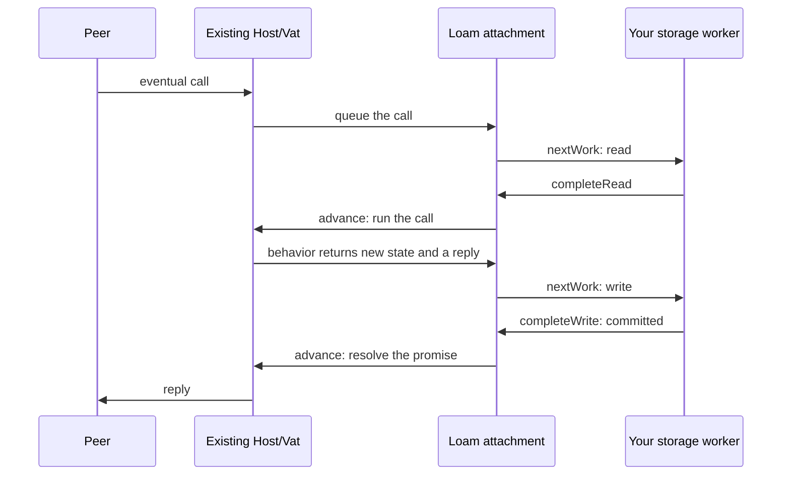

# Sleepy actors and durable hosting

A sleepy actor, also called a durable actor, can drop its state from memory
while its identity and the references to it keep working. An eventual call
(one queued to run later on the [Vat](../architecture.md)) wakes it first. Ordinary
actors still work without a store. The [API page](api.md)
covers store and attachment lifetimes.

Like the
[Goblins persistence tutorial](https://files.spritely.institute/docs/guile-goblins/0.17.0/Persistence-tutorial.html),
Loam keeps a behavior's description apart from its storage. Loam also makes
three things explicit: who borrows memory in Zig, that loading never blocks,
and when a commit becomes visible.

## What is supported

The [first durable actor example](../loam.md#a-first-durable-actor) shows how to use this on an
existing Host and Vat:

- Behavior backed by a record, with bounded waking, local capability fields,
  durable names that can be restored and retired, and replies that wait for
  the commit ([ADR-0049](../decisions/adr/ADR-0049-record-backed-hosting.md)).
  A stored record nobody references takes no endpoint. A held reference keeps
  only a little routing data, plus any state you pin.
- Calls that load the records they need and take part in transactions
  ([ADR-0052](../decisions/adr/ADR-0052-managed-owner-lifecycle.md)). A managed use
  endpoint is tied to one resource and its content, and a control prepares
  the edits it permits. When another commit lands first, the call prepares
  again, and it finishes any reads it submitted before releasing its state.
- Sharing one resource, with bounded receipts
  ([ADR-0052](../decisions/adr/ADR-0052-managed-owner-lifecycle.md)).
  Records are prepared on the Vat, the new durable name's entry is reserved
  when the Host finishes its turn, and the name works only after a confirmed
  commit.
- Capability arguments the call owns, and local capability edges returned
  through the Host and CapTP. Typed [local and remote fields](references.md)
  keep exactly the authority they saved and what restoring it depends on.
- Retiring a durable name through the attachment's write queue. Lookups stop
  once the retirement commits, stay stopped if the outcome is unknown, and
  come back if recovery shows the retirement never landed.
- Looking up a durable name only when a peer asks, which shares fetches
  through the same cache and restores the exact target without scanning or
  creating endpoints early
  ([ADR-0007](../decisions/adr/ADR-0007-sturdyrefs-and-publication.md)).

Not supported: general narrowing of returned capabilities and durable outgoing
events. Timers, subscriptions, OS handles, and unresolved promises cannot be
saved, and waiting calls live only in memory. The [browser guide](browser.md)
covers the single-resource model in the browser.

## Identity, waking, and what stays alive

Loam keeps an in-memory entry only for an actor that is awake or being woken.
A sleeping object with no local or network references needs none. A held
reference keeps a little routing data and its own holds, not the target's
state or the graph it reaches. Durable names and stored edges keep their
targets alive by their own rules.

Loads are shared per object, per generation, and per Store. Callers that
arrive together share one wake, and their waiting messages count against the
existing per-source and per-owner limits. A load is taken in only if the
generation and revision are still current, so a deleted object, a replaced
owner, or a late load can never bring old state back. A storage failure is
different from a missing object and never creates a fresh actor. Retries pass
through the same limits.

Looking up a durable name also checks that the name is still published.
Retiring a name stops new lookups through it. It does not revoke references
already handed out or delete a target that something else keeps alive.

An actor's record names its behavior and schema versions, its stored fields,
and its reference edges. Waking an actor with an unknown version is refused.
Waking keeps sharing and cycles intact without loading the whole graph, and it runs none of the application's setup effects, such as sending
welcome messages or issuing new grants. Roots held across Vats must be in
place before collection can free anything during a restart, so restoring
Vats in a different order cannot lose edges.

## Calls and ordering

An eventual call to a sleeping actor keeps the call and asks your executor
for a load, while the Vat goes on with other work. When the load completes,
the call joins the Vat's existing queues, with no second ordering. Each call
source keeps the order it promises, including for messages that arrive while
the actor is going to sleep. Waiting calls and loads are counted against
their limits before any memory is allocated for them.

A near call cannot quietly wait on disk. Its fast path needs the target in
memory and pinned for the call, and an asynchronous acquire can bring it into
memory first. A near call to an actor on disk reports that the target must be
loaded, without running it. It never blocks, pauses a stack, or runs a caller
again that may already have had effects. Code that walks a large graph on
disk uses eventual calls or bounded prefetching.

Canceling a call ends the caller's interest in it, as usual. It does not
abandon a load in progress or a write that may have committed. When the last
waiter leaves, the operation is canceled only if the worker can show how it
ended. Pins and completion state stay charged until their owner can release
them. CapTP promise pipelining works as usual while an actor wakes and its
changes commit.

## Sleeping and when changes become visible

An actor may sleep once nothing borrows it and it is between turns. Its
current state must already be committed before Loam drops it, so a write that
is prepared or whose outcome is unknown keeps the actor awake. If the state
has not changed since the last commit, Loam can drop it with no new write,
so a read-only wake writes nothing. A call that races with sleeping either
finds the state still in memory or waits for the committed version to load,
and no call is lost.

Timers, pending promises, subscriptions, and outside handles each decide
explicitly whether the actor may sleep. Work owned by the runtime can outlive
the behavior if it targets a stable identity and keeps what it needs alive.
Otherwise it pins the state or keeps the actor awake. A stack, socket, or
borrowed pointer cannot be saved automatically. Putting an actor to sleep
frees its memory without running the application's delete or revoke code.

Saved changes become visible to anyone only after the transaction commits.
Replies that promise the change is saved, new durable names, and the matching
change events all wait for the commit. Change events saved with the change
carry sequence numbers and cursors, so they can be replayed and duplicates
dropped. When a call on disk resumes, and before a deferred reply hands out a
protected capability, Loam checks the grant as it is now. A cached copy of
the content or an earlier event never stands in for that check. <!-- status-allow: runtime state or operation ordering -->

Sleeping does not mean a message was durably accepted, and waiting calls can
be lost if the process dies. A durable inbox or outbox would need its own
receipt and retry rules before Loam could promise that. A local snapshot never
takes back access that peers have already seen over the network. State kept
by a snapshot is charged on its own and can keep memory in use even after the
actor sleeps.

## Memory limits

Two policies decide what sleeps: a byte-limited least-recently-used policy
over actors that may sleep, and a policy that puts every eligible actor to
sleep after each turn, for stress tests. Counting actors alone cannot bound
memory when actors differ in size, so payloads, bookkeeping, uncommitted
state, pins, wake queues, and engine memory are charged separately. Commits
and cleanup keep enough room to make progress when memory is tight. If
nothing can sleep, new calls are refused and the limit holds. Counters for
loads and sleeps, and the reason an actor cannot sleep, show where memory
went.

The [hosting tests](../../test/loam/hosting/) exercise these contracts.
[Process tests](../loam.md#tests) check reopening on each disk engine, and the
[managed access coverage](coverage.md) maps grants and resource behavior to
their tests. The [stability guide](../stability.md#storage-failure-coverage)
defines what the failure probes cover. Functional checks do not establish
sleep and wake latency or capacity for an application.

## Zig integration

The [first durable actor example](../loam.md#a-first-durable-actor) shows a
complete program. The following sections cover setup, call lifetimes, and
shutdown for applications using the same Host and Store integration.

### Attaching a store

`hosting.Attachment.create(allocator, &host, &store, behaviors, options)`
attaches one store to an existing Host. Keep the Host and Store at stable
addresses and the schema and behavior tables alive until the attachment is
destroyed. Each `Behavior` pairs a schema and version with a deterministic
invocation function:

```zig
fn invoke(call: *hosting.Call, state: core.RecordView,
    verb: []const u8, args: []const driver.Value) !driver.Value
```

### What a behavior may do

A simple actor's record holds all of its durable state. The behavior decodes
the fields it needs and may call `call.replace(payload)` with bytes from
`call.arena()` or borrowed from the current record. Loam commits that new
state before it sends the reply, and a behavior error throws it away. The
record keeps its existing edges.

Keep a behavior's effects inside its proposed record changes. Loam can
discard state that fails to commit but cannot unsend an email. Loam saves records, not
Zig structs or thread stacks, and it does not sandbox a behavior from the rest
of the process. A behavior that changes several records uses the hooks
described under [managed endpoints](access-endpoints.md).

### Restoring and saving references

`attachment.restore(current_record_lease)` turns a rooted actor's record into
an ordinary Host capability. `attachment.capture(capability)` does the
reverse for an actor in this attachment: it saves a capability you hold as a
strong edge. Peers only ever hold capabilities, never record names.

`call.edge(index)` restores the capability an edge stores without loading the
target's state, so shared references and cycles never force a chain of loads.
A capability a call returns stays valid until its reply is sent. For
references to another attachment, another Host, or a remote object, use
[stored capability fields](references.md). Saving a reference Loam cannot
restore later is refused. A field marked live holds its capability only until
the process stops, and refuses use after a restart.

### How a call runs

Eventual calls use the Vat and CapTP promises you already have. When a call
arrives, Loam copies its plain-data arguments into the call's own bounded
memory and keeps the original message. Calls to the same sleeping actor share
one load, each actor's calls run in the order they arrived, and ready calls
queue on the Vat. Calls from the network resume through `Host.flushSession`,
so the Host's usual scheduling and session closing still apply.

Your main loop calls `attachment.advance()` and carries out each item from
`attachment.nextWork()`:



The worker follows these rules:

- It receives borrowed read requests and write batches and answers through
  `attachment.completeRead` or `completeWrite` on the thread that owns the
  attachment. It never calls into the Host.
- If a write's outcome is unknown, the store refuses other work. Once every
  other request has finished, the worker's next request is the attachment's
  `recoveryBatch`, and completing it calls `attachment.resolve`.
- Host work resumes through your usual loop. Purely local calls keep running
  through the Vat's own bounded drive.

The [actor process test](../../test/loam_actors_crash.zig) runs a call, its
commit, and a reopen on each disk engine.

### Call memory

Each call reserves its byte allowance when it arrives but allocates only as it
needs to. Its arguments and its working memory share that one limit, including
allocator overhead. Reply data borrows the call's memory until the reply is
sent, and callbacks from C or Rust copy their output before returning. When a
newer commit makes the call run again, Loam frees its working memory and keeps
its arguments, with the capabilities they hold.

### Near calls and capability arguments

A near call, one made directly instead of through a promise, to a read-only
actor whose state is in memory borrows the cache. A near call to an actor
whose state is on disk returns `ResidencyRequired` without starting a read, so
use an eventual call, or call `prefetch` and wait first. A near call that
would change state or forward a call returns `DurableTurnRequired`, because
only an eventual call can hold the target and deliver the reply.

`Host.callLocalCapability` queues a local call on the Vat, and capabilities
nested in its arguments and results keep their identity with no session
involved. A queued call still runs if its caller stops waiting. Loam prepares
the reply before it replaces state or resolves a deferred promise. A reply
too large for its fixed allowance reports `ReplyCapacity`, and a failed heap
allocation reports `OutOfMemory`. Either way the deferred promise stays open
and can take a different reply.

Plain local Vat calls answer with plain values. The Host and CapTP paths
accept capabilities nested in arguments and keep them while a call reads,
runs again, and replies. A capability a call receives is not saved on its own.
`capture` saves one that points into the same attachment, and
`hosting.references.beginSave` saves a local or remote reference it can check.
Raw local Vat references and handoffs (references introduced by a third peer)
are unsupported as arguments. Outside a
call, a transaction can change edges with `capture` while no actor calls are
waiting.

### Work after a receipt commits

A Zig content callback can reserve follow-up work: a call it will make on a
target, once the receipt for the original action commits. A confirmed commit
starts that work, and an unknown commit holds it until recovery decides. The
reservation keeps its own copy of the action and the capabilities it needs,
under its own memory allowance, and holds no Store lease while it waits. The
application's receipt, not the reply, says whether the effect happened. The
[Rooms effect guide](../rooms/session-effects.md) describes the executor's
failure results (`unsent` and `unknown`), cancellation, and recovery.

### Sleeping

`attachment.sleep(capability)` drops an actor's state from memory while its
capability keeps working. `pin` returns a Store lease, and a pin or a waiting
call keeps an actor awake. By default the cache keeps busy records and drops
the least recently used ones that are allowed to sleep.
`sleep_policy = .every_turn` puts an actor to sleep after every call, which
is useful in tests. Sleeping is neither
deletion nor revocation. Once nobody holds a capability to an actor, the Vat
frees its endpoint as usual, so stored objects alone take no endpoints.

### Capacity and cost

Attachment options limit the number of endpoints, the number of waiting
calls, each call's memory, and the total memory of waiting calls. Each
session, and local calls together, also get their own count and byte limits,
taken from the Vat's queue limits and counted apart from its run queue. The
cache, pending writes, endpoint bookkeeping, capabilities the Host holds, and
engine and OS pages are separate costs.

Call lookups scan bounded tables, and keeping each actor's calls in order
can cost time quadratic in the call table's size. A cache or endpoint lookup
is one hash probe, and a commit checks the cache's slots against the records
it changed. Measure before raising these limits.

### Durable names and shutdown

[Durable names](publications.md) covers fetching an actor by name,
retiring a name, how long the index keeps entries, and destroying an
attachment.
