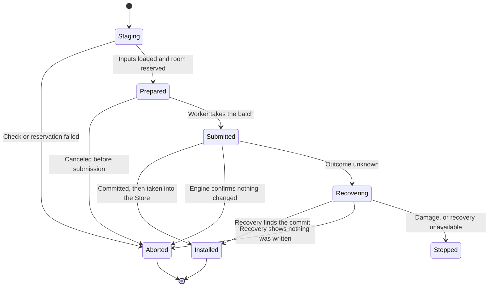

# Loam record, transaction, and hosting API

The code below is sketch notation. The
[Loam guide](../loam.md) has the real type and method names, and the
[managed access model](access-api.md) covers resource management.

## How an application uses it

An application opens a store with an identity, its schemas, an engine, and
memory limits. It attaches the store to the [Host](../architecture.md) it already runs when it needs
callable objects, or uses records locally with no Host at all. Managed access
registers its schemas and checked behaviors on that same store and Host. None
of these steps creates another Vat (where the Host's actors run) or executor.

```text
store = Loam.open(identity, schemas, engine, limits)
attachment = Loam.attach(existing_host, store, actor_restorers)
resources = Loam.access.register(attachment, domain, policy, content_handler)

plain_record = store.transaction(create_document_data)
managed_document = resources.create(document_schema, initial_content)
share = managed_document.derive(read_terms)
collection.insert(share.access)
```

`resources` is optional. Creating and sharing a managed resource use the same
transactions as a plain record. Opening an existing store and creating a new
one are separate calls, and a failed open never creates an empty store or
falls back to memory.

## Identities and records

| Value | What Loam promises |
| --- | --- |
| Store identity | Stays the same through recovery. A new store needs a new identity. It has nothing to do with a network address. |
| Object identity | Names one record within one store, and a destroyed object's identity is never reused. A position in the database file is never an identity. |
| Revision | The store's commit counter, which only goes up. When it would overflow, writes are refused. |
| Schema identity and version | Pick the registered decoder and the code that rebuilds the object. An unknown version is refused. |
| Root | A stored entry that keeps a record alive. Naming a root gives no peer access to it. |
| Durable name | A versioned recipe the Host uses to restore exactly the capability that was published. |

Store identity, actor identity, and a managed access owner's identity are
separate things. Managed access maps its resource and grant names to records
through an index that commits with each create and delete, and that index
gives callers no way to get a capability. Loam never works out a network
address from a storage key or a managed resource path.

A record has an identity, a schema and version, a revision, a bounded payload,
and typed reference fields. Its checksum catches truncation and accidental
damage, but it cannot stop someone who controls the storage from changing it.
An engine may keep these parts in separate tables, as long as they change in
the same transaction. Field counts, nesting, payload lengths, and edge counts
are checked before anything is allocated, and the same schema checks apply to
input from Zig, from C or Rust, and from disk.

Each schema supplies code to encode, check, list references, and rebuild the
object where that applies. Rebuilding gives the same result for the same
committed input, does no I/O, and has no outside effects. A reference to
another peer that cannot be reached is reported as unresolved or broken,
whichever its field declares, and never turns into the owner's authority.

## Reference fields

```text
ReferenceField =
    LocalData(object, retention = strong | weak)
  | Capability(saved_descriptor, retained_dependency)
```

The application writes a capability it holds into a typed field, and the Host
builds the saved form. No public function makes a capability from a record ID.
Trusted code on the store side can address records directly, but anything a
peer can call needs the authority of the capability it called.

When a transaction saves a capability field, it holds the reference and asks
the Host for its saved form. A local managed facet keeps its link to its
grant. A reference to another peer must have an established way to restore
it. Saving a reference that cannot outlive the process returns `NotDurable`,
though an in-memory record can hold it while the process runs.

Replacing a field drops the old reference only when the new payload and edge
commit. An abort releases what the transaction held. If the completion is
lost, Loam keeps enough to tell whether the old or the new references
survived. Cleanup outside the store after a commit has an owner and a bounded
number of retries.

Returning a field is separate from loading it. The behavior decides whether
the reply hands over the saved capability as it is or a version that checks
every call against the caller's own grant. Encoding the reply cannot change
that choice.

## Reads and leases

```text
acquire(object, expected_revision?) -> Ready(ReadLease) | Pending(ticket) | Error
ReadLease.view() -> validated borrowed record
ReadLease.release()
```

Acquiring a record does no I/O. A cache miss returns a bounded read request
instead. When the read completes, Loam checks that it belongs to this Store,
this request, these records, and the expected revision before it caches the
result. A duplicate, stale, or canceled completion cannot replace newer data.

A lease keeps one version of a record's bytes in memory for as long as you
hold it, and its view cannot outlive it. A short read may borrow a value from
the engine until the next operation on that transaction, and Loam finishes
with it before the transaction ends. To keep a value across an `await`, copy
it into memory you own or hold a lease. The C API never exposes an engine
transaction pointer.

A lease that keeps an older version charges its bytes to the cache. It keeps
the data, not the right to act on it, so every managed operation checks
current permissions even when it reads older content. Each lease reports the
bytes it holds, and Loam checks the per-operation and per-store limits before
it loads anything.

## Transactions

```text
begin(domain, expected_revision) -> Transaction
Transaction.read / create / replace / remove / set_root
Transaction.store_capability(held_reference) -> staged reference field
Transaction.enlist(participant) -> participant access to this transaction
Transaction.prepare() -> Prepared | NeedRecords | Error
submit(Prepared) -> ticket
complete(ticket, backend_outcome) -> Installed | Unchanged | RecoveryRequired
```

A transaction holds its pending records, edge changes, the records it read,
other participants' changes, and the cache room it needs once it commits.
Each store has at most one prepared write at a time. Reads can use the last
committed revision while a write is in flight, and a read from disk never
shows a newer revision before the Store has taken it in.

A transaction may write a record it already wrote. Writing the same record
again with the same expected revision replaces the pending bytes, and the
batch holds one change per record. A different expected revision, or writing a
record the transaction removed, is refused. Each step reads the transaction's
own pending changes back, so several steps that each change one record (an
owner header, a parent row, a shared directory page) still produce one change
per record. A step prepared against an older revision is refused before
anything is submitted.

Participants check and add changes, quickly and without blocking. Managed
access is one participant: it checks scopes, grant revisions, and what each
operation needs. Application content is another. A participant never submits
its own write, opens its own engine transaction, or saves a grant before its
content. New capabilities and change events stay unpublished until the
commit lands.

`NeedRecords` pauses a transaction before it is submitted. Load the missing
records, then check again against the current revisions. Staging callbacks can
run more than once, so they must not publish, do I/O, or cause effects that
cannot be repeated. Once submitted, work goes through completion and recovery
and is never prepared again.



A ticket names the Store and the submission, and a completion names the batch
and the revision it committed. C or Rust code cannot forge a completion from
arbitrary numbers. Loam trusts the worker to report I/O outcomes truthfully
and checks that tickets and phases match. It cannot defend against a backend
that lies about success.

Canceling before submission aborts locally. After submission, canceling asks
for the outcome but frees nothing the worker may still touch. A successful
commit stays committed even if the caller is gone. Shutdown waits for
outstanding storage work before it releases callbacks or store memory.

## Retries and receipts

Managed endpoints keep a bounded set of receipts through the shared
`RetryWindow`:

- Each endpoint keeps <!-- value ../../src/loam/access/records/retry_window.zig capacity -->8<!-- /value --> receipts for derivations and <!-- value ../../src/loam/access/records/retry_window.zig capacity -->8<!-- /value --> for edits.
  `derive` and `derive-managed` share the first set, and
  `mutate(sequence, method, args...)` uses the second.
- Each application method declares whether it is read-only, safe to repeat,
  or backed by a receipt.
- A resent request is checked against current permissions again. Its saved
  result is tied to the source, method, arguments, and any dependent target.
- A resent sequence with different arguments conflicts, a sequence from the
  future is refused, and one that has left the window has expired.
- A result that holds capabilities keeps their edges, including the issuer's
  separate control.
- Owner cleanup keeps the counters that stop an old sequence from being reused,
  even after it frees the payloads.

The [managed access guide](access.md#retrying-mutations) gives the limits and
recovery details.

A receipt makes one local change safe to retry. It ties the request's identity
and arguments to the committed result, including any durable name it issued.
A receipt does not make a change on another peer happen exactly
once.

## Storage work and failure

The Store asks your storage worker for three kinds of work, each with bounded input and one owner
for its completion: read, commit, and recover. In Zig, your worker runs the
blocking engine calls on your own executor. In the browser, the worker runs
each prepared batch inside one IndexedDB transaction and reports the result
back the same way.

| Outcome | Meaning |
| --- | --- |
| Success | The whole batch is durable, as the engine's settings promise, and reports its revision. |
| Unchanged | The engine can show that this operation committed nothing. |
| Unknown | The operation may have committed. Stop other work and recover before deciding. |
| Corrupt | Loam cannot confirm the store's identity, format, or graph. Do not restore capabilities from it. |
| Capacity | Storage, memory, kept versions, or an operation limit stopped the operation. The error names which. |

Each engine's page says what failures its durability covers, how it syncs,
and which platforms it assumes. Surviving a process restart and surviving
power loss are separate claims with separate tests, and IndexedDB needs its
own. An engine must never report a weaker guarantee as a stronger one.

## Host attachment and durable actors

The [actor guide](actors.md) covers waking, call order, sleeping, and their
tests. The attachment connects that lifecycle to the store.

An attachment registers restore functions and storage callbacks on an
existing Host. It borrows the store, behavior descriptions, and callback
contexts, and your program keeps them alive until the attachment is
destroyed. If teardown reports `Busy`, pending callbacks and storage results
stay alive. The attachment cannot run or close the Host. Ordinary actor state
uses the same records and references as managed access.

`hosting.Worker` carries an attachment's storage work through slots your
program allocates:

1. `next` takes a request into a free slot.
2. `run` executes it against the engine.
3. `complete` hands the result to the Store.
4. `release` frees the slot.

Only `run` may happen on another thread, and you join that thread before
`complete`. `drive` repeats all four on the calling thread until the
attachment has no work. When the attachment's own write has an unknown
outcome, its next request is recovery. Recovery waits until no other slot is
busy, and other work waits for recovery. The worker starts no thread and owns
no engine.

The worker takes the engine's `readerCapacity` when it starts and runs no more
reads and lookups at once than that, while still offering the write. Recovery
runs alone, with no other engine work beside it.

A durable actor's record names its behavior type and version and its state
edges. A sleeping actor keeps its identity, whether it can be published, and
the references it holds, but not its behavior's state. Eventual calls queue on
the Vat. Each target loads and checks its state once before its calls run, and
a deleted target or an out-of-date load is never put in the cache.

A near call needs its target already in memory and pinned, or loaded on
purpose before the call. An actor with uncommitted changes stays in memory
until they commit. A paused call keeps its bounded state and is handled at
shutdown. Saving actor state does not keep pending promises, accepted calls,
or network sessions across a restart.

## C, Rust, and the browser

`libglowcap_loam` gives C the Store, the attachment, borrowed calls, and
storage work. `libglowcap_loam_sqlite` and `libglowcap_loam_lmdb` add the disk
engines, and Rust exposes all of it under `loam`. The
[C and Rust guide](c-and-rust.md) covers what that API includes, how it is
tested, and what it leaves out. Zig schemas and typed wrappers follow the same
rules.

- Borrowed inputs last for the call. Inputs kept past the call have an
  explicit owning handle.
- Callbacks are bounded and synchronous, cannot call back into Loam, and
  cannot unwind across C.
- Choosing a codec never replaces Loam's permission checks.
