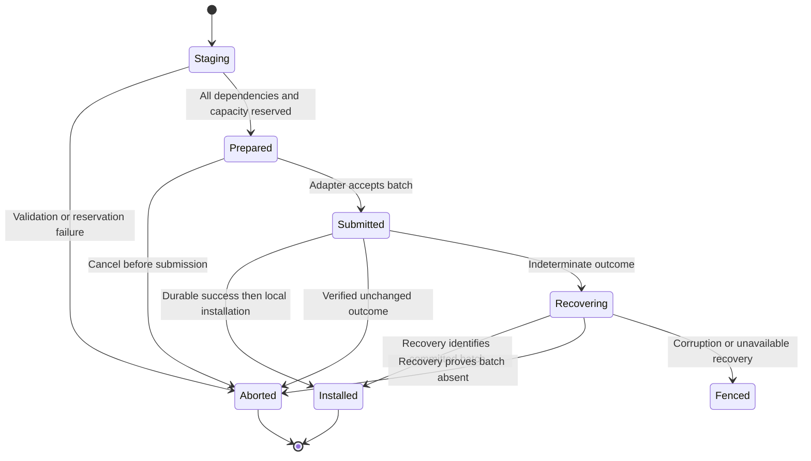

# Loam record, transaction, and hosting API

This is the contract for the full Loam integration, in illustrative notation.
For the APIs you can call today, use the [usage guide](../loam.md), whose
type and method names are authoritative. The
[managed access API](access-api.md) adds resource management.

## Application experience

An application opens a store with explicit identity, schema registration,
backend, and memory limits. It attaches persistence to an existing Host when
it needs callable objects. It can also use records locally with no Host.
Enabling managed access registers its schemas and guarded behaviors on that same
store and Host. None of these operations creates another Vat or executor.

```text
store = Loam.open(identity, schemas, backend, limits)
attachment = Loam.attach(existing_host, store, actor_restorers)
resources = Loam.access.register(attachment, domain, policy, content_handler)

plain_record = store.transaction(create_document_data)
managed_document = resources.create(document_schema, initial_content)
share = managed_document.derive(read_terms)
collection.insert(share.access)
```

These are call shapes. `resources` is optional. Managed access creation and
sharing use the same transaction mechanism as the plain record. Opening an
existing store is distinct from creating a new store, and failure never
recreates an empty authority domain or falls back to volatile storage.

## Stored identities and records

| Value | Contract |
| --- | --- |
| Store identity | Stable across verified recovery. Fresh creation requires a fresh identity. It is independent of a network locator. |
| Object identity | Stable store-qualified record name with an incarnation that cannot alias a destroyed object. Physical page addresses are not identities. |
| Revision | Monotonic committed version within a persistence domain. Overflow refuses mutation. |
| Schema identity and version | Select a registered structural decoder and reconstruction contract. Unknown versions fail explicitly. |
| Root | A durable retention entry managed through authorized store operations. Naming a root does not grant remote access to its contents. |
| Publication descriptor | A versioned recipe interpreted by Host integration to restore the exact callable authority. |

Store identity, actor identity, and a managed access owner identity are
distinct. Managed access resource and grant names resolve to stored records
through its participant's indexed mapping, which commits with creation and
deletion and gives callers no way to obtain a capability. A network locator is
never inferred from a physical storage key or a managed access resource path.

A logical record has an identity, schema and version, revision, bounded payload,
and typed reference fields. Its envelope detects truncation and accidental
corruption and does not authenticate a malicious storage administrator. The
physical engine can store these in separate indexed families provided they
participate in the same transaction. Field counts, nesting, payload lengths, and
edge counts are bounded before allocation. Schema validation is shared by Zig,
foreign, and restored input paths.

Application descriptors provide encoding, validation, reference enumeration,
and behavior reconstruction when applicable. Reconstruction is deterministic
for its committed inputs and performs no I/O and emits no externally visible
effects. A missing foreign reference is represented as unresolved or broken
according to its declared contract and never becomes owner authority.

## Reference fields

```text
ReferenceField =
    LocalData(object, retention = strong | weak)
  | Capability(saved_descriptor, retained_dependency)
```

This is semantic notation. The application writes a held capability into a
typed field, and Host integration creates the internal descriptor. No public
capability constructor takes a record ID. Trusted store operations can address
records directly, while remotely exposed operations require the called
capability's authority.

For capability fields, the transaction retains the reference and prepares its
durable representation through the Host. A local managed facet
retains its grant dependency. A foreign reference needs an established durable
restoration contract. Storing a live-only reference in persistent state returns
`NotDurable`. A volatile record can retain it for that lifetime.

Replacing a field removes its old durable retention edge only when the new
payload and edge commit. Abort releases staged custody. A lost completion
keeps enough staging state to determine whether old or new custody survived.
External cleanup after commit has a retained owner and bounded retry policy.

Returning a field is separate from loading it. An application or managed access
handler declares whether the reply hands over the saved capability directly or
creates a projection dependent on the invoking facet. Encoding consumes that
authorized result and cannot choose the disclosure policy.

## Bounded reads and leases

```text
acquire(object, expected_revision?) -> Ready(ReadLease) | Pending(ticket) | Error
ReadLease.view() -> validated borrowed record
ReadLease.release()
```

Acquisition performs no I/O in the synchronous core. A miss emits a
bounded effect. Completion is checked against the store incarnation, ticket,
requested identities, and revision constraints before installing resident data.
Duplicate, stale, and canceled completions cannot replace current state.

A lease pins the record bytes and their version for its lifetime. The view
cannot outlive the lease. Short synchronous reads may borrow mapped values while
the adapter holds a valid transaction. Crossing an asynchronous boundary
requires bounded owned materialization or a snapshot lease. The public ABI
exposes no backend transaction pointers.

A snapshot lease preserves a data version and charges retained storage. It does
not preserve historical permission to act, so every managed operation uses
current authority even if its content comes from a retained snapshot.
Leases expose their charged bytes, and admission enforces per-operation and
per-store limits before loading.

## Atomic mutations

```text
begin(domain, expected_revision) -> Transaction
Transaction.read / create / replace / remove / set_root
Transaction.store_capability(held_reference) -> staged reference field
Transaction.enlist(participant) -> participant access to this transaction
Transaction.prepare() -> Prepared | NeedRecords | Error
submit(Prepared) -> ticket
complete(ticket, backend_outcome) -> Installed | Unchanged | RecoveryRequired
```

Transactions own staged data, edge deltas, read dependencies, participant
changes, and reserved installation capacity. There is one prepared write per
domain initially. Reads can use the last installed revision while a write is
pending. A cold read cannot expose a newer backend revision before installation.

A transaction may re-propose a record it already staged. Staging the same
record ID again with the same revision expectation replaces the staged bytes,
and the submitted batch holds one mutation per record. A different expectation,
or re-proposing a staged removal, refuses. Staging may read its own proposals
back through the transaction, which is how several operations that each advance
one record (an owner header, a parent row, a shared directory page) compose into
one header mutation per owner. Each stage validates against the transaction's
composed state, and a stage prepared against an older revision refuses before
anything submits.

Participants provide bounded synchronous validation and staging. Managed access
uses that boundary to check scopes, grant revisions, and operation requirements.
Application content is another participant. They do not submit independent
writes, run nested backend transactions, or persist a grant before its content.
New capabilities and completion events remain unpublished until installation.

`NeedRecords` suspends preparation before submission. Load the missing inputs,
then validate again against current revisions. Staging callbacks may run again,
so they cannot publish, perform I/O, or carry unrepeatable external effects.
Submitted work follows completion and recovery and is never replayed as
preparation.



An operation ticket identifies the exact incarnation and submission. A backend
completion identifies the submitted batch and committed revision. Foreign
callers cannot manufacture a receipt from arbitrary integers. The trusted
adapter is responsible for truthful I/O outcomes, and shared Zig verifies
ticket and phase consistency. A false success from a malicious backend is
outside the trusted embedding contract.

Cancellation before submission aborts locally. After submission, cancellation
requests settlement but does not free state while an adapter can still access
it. Commit success remains committed even if the caller disappears. Shutdown
joins outstanding work through the existing Host/embedding barrier before
releasing callbacks or store memory.

Managed endpoints implement bounded receipts through the shared `RetryWindow`.
Each endpoint has separate eight-receipt derivation and mutation domains.
`derive` and `derive-managed` share the former, and
`mutate(sequence, method, args...)` uses the latter. Application methods declare
read-only, idempotent or receipt-backed behavior. Current admission precedes
replay, and source identity, method, arguments, and any dependent target bind
the recorded result. Changed intent conflicts, future requests refuse, and
retired sequences expire. Capability results retain durable edges, including
separate issuer control. The [usage guide](access.md#retrying-mutations) states
limits, ownership, and recovery evidence. Terminal cleanup preserves these floors
after payload reclamation.

An operation receipt makes a particular local mutation retryable. It binds
operation identity and intent to the committed result, including publication
identity when issuance is involved. Retention is bounded with persisted operation
epochs and a retirement floor, so a request from a retired epoch refuses as
expired and never becomes a new mutation. Retained operations return their recorded
result subject to current disclosure authority. Changed intent needs a new
operation identity. The receipt does not make arbitrary remote side effects
exactly-once.

## Adapter effects and failure

The synchronous core emits `ReadBatch`, `CommitBatch`, or `Recover` effects with
bounded inputs and a single completion owner. Zig adapters run blocking engine
access on the embedding's executor. Browser adapters execute prepared batches
inside one supported browser transaction and report its completion to the same
state machine.

| Outcome | Required meaning |
| --- | --- |
| Success | The entire batch meets the selected durability contract and reports its revision. |
| Unchanged | The adapter can establish that this operation made no committed change. |
| Indeterminate | The operation may have committed. Fence protected work and recover before deciding. |
| Corrupt | Validation cannot establish the store's identity, format, or graph consistency. Do not restore authority. |
| Capacity | Storage, resident memory, retained versions, or operation limits prevent admission or completion. Identify the relevant bounded resource. |

The durability profile states its failure model, synchronization, and supported
platform assumptions. Process restart and power loss are different tests.
Browser transaction completion needs its own documented durability profile. An
adapter may not label weaker completion as the stronger profile.

## Host attachment and sleepy actors

The [actor contract](actors.md) owns activation, call scheduling, eviction,
and their acceptance tests. The attachment API below binds that lifecycle to
the shared store.

An attachment registers restorers and persistence callbacks on an existing
Host. It borrows the store, behavior descriptors and application callback
contexts, and the embedding keeps them alive until attachment destruction
succeeds. A Busy teardown leaves pending callbacks and storage completions
alive. The attachment cannot run or close the Host. Ordinary actor state uses
the same record and reference mechanisms as managed access state.

`hosting.Worker` carries an attachment's storage work through slots the
application allocates. `next` takes a request into a free slot, `run` executes
it against the backend, `complete` installs the result, and `release` frees the
slot. Only `run` may execute on another thread, and the owner joins it before
`complete`. `drive` repeats all four on the calling thread until the
attachment has no work. When the attachment's own write is uncertain, the next
request is its recovery batch. Recovery waits until no other slot is active,
and ordinary work waits for recovery, so an attachment uses one worker at a
time. The worker starts no thread and owns no backend.

Persistent actor descriptors identify behavior type/version and state edges.
Dormant entries retain identity, publication eligibility, and live reference
custody without retaining behavior payloads. Eventual calls enqueue through the
Vat. One activation per target loads and validates the required state before
delivery. Deletion or a stale activation generation prevents installation.

Near synchronous calls require a pinned resident target or explicit acquisition
before entering the turn. A dirty actor cannot be evicted until its relevant
state commits. Suspended calls retain bounded continuation state and participate
in shutdown. Persisting actor state alone does not promise survival of pending
promises, accepted calls, or network sessions across restart.

## Foreign implementation requirements

The foreign create, share, edit, restart, and reopen journey is implemented
through the Host and held capability types. Its [consumer guide](c-and-rust.md)
records scope and proof. `libglowcap_loam` projects portable Store, Attachment,
borrowed Call and submitted Work ownership. `libglowcap_loam_lmdb` supplies
optional LMDB execution. Rust exposes the first profile under `loam`.

Generic leases and graph transactions, saved-reference authoring and owner
lifecycle are not projected. They follow real consumer journeys. Zig descriptors
and typed wrappers use the same schema and effect contracts. Borrowed inputs
last for the call.
Asynchronously retained inputs have an explicit owning handle. Callbacks are
bounded, synchronous, non-reentrant, and cannot unwind across C. Public codec
selection does not permit replacing the authority evaluator.

Before freezing these interfaces, exercise a Zig caller, a Rust caller, and a
browser executor through the same create, store-capability, restart, and load
path. Check releases during pending I/O, stale completion after reopen, schema
failure, revocation during cold loading, and one transaction spanning plain and
managed objects. The implementation resolves the abbreviated types here through
those paths and adds no speculative generic APIs.
