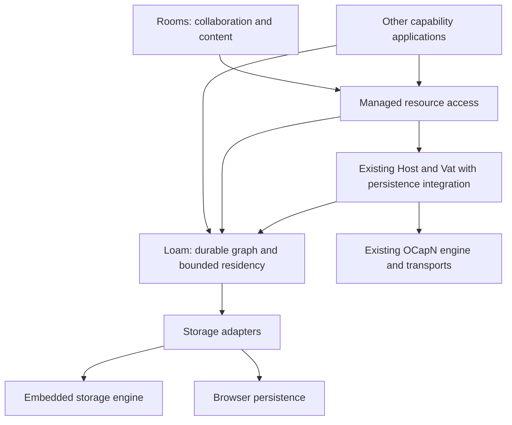
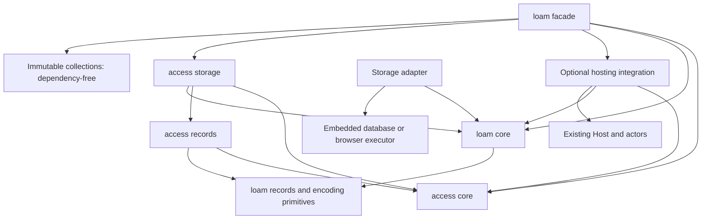
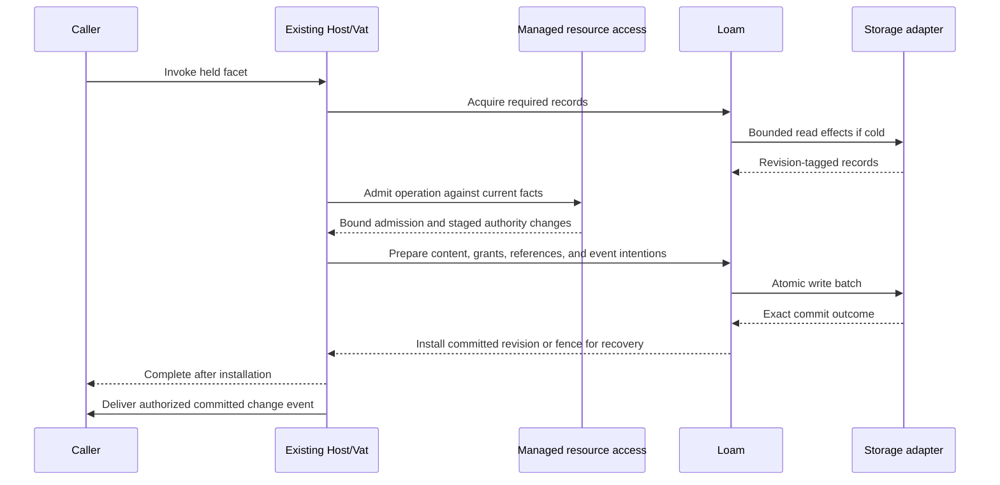

# Loam: durable capability applications

Loam is glowcap's persistence foundation, and its access module manages who can
use which resources.
[ADR-0161](../decisions/adr/ADR-0161-loam-foundation-and-access-extension.md)
records the architecture. The [usage guide](../loam.md) covers the Zig APIs, and
the [API contract](api.md) specifies operations and lifetimes.

## Product and ownership

glowcap supplies capability networking, actors, a Vat, a Host, and optional
persistence. Applications can use those mechanisms directly or use Loam's access
module for resources with managed grants. Rooms supplies directories, rooms,
conversations, messages, memberships, and the interfaces for working with them.

Loam makes a durable graph of ordinary records and capability-bearing objects
usable with bounded resident memory. Its access module adds resource scopes,
permission algebra, managed facets, delegation, and mutable grant lifecycle.
Creating a store or an ordinary actor allocates no resource owner and runs no
grant evaluation.



These arrows describe responsibility flow. Persistence roots keep objects
retained. They differ from the access module's authority roots and from a
directory displayed at the top of a user interface.

| Owner | Responsibility |
| --- | --- |
| Loam core | Stored identity, schemas, versions, reference edges, retention, bounded record leases, prepared batches, and recovery state. |
| Loam record codecs | Encode and validate storage records using explicit format versions and bounded buffers. |
| Existing actors/Vat persistence integration | Dormant actor identity, activation, eviction eligibility, and coordination of turns with commits. |
| Existing Host persistence integration | Capability custody, exact restoration, durable publications, and externally visible completion. |
| Loam storage adapters | Execute reads and atomic writes through the existing embedding executor. Report exact completion classes. |
| Managed access | Resource relationships, scopes, grants, ceilings, lifecycle, operation admission, and authorized observation. |
| Application | Domain schemas, method meanings, declared effects, content facts, and presentation. |

An application can mix managed resources and ordinary stored objects in one
transaction. Managed access is a transaction participant and not a second database. It
decides the authority conditions for its changes, and Loam supplies their
common atomic persistence and recovery mechanism.

## Design acceptance

Each record, capability hold, transaction, and recovery effect traces to one
owner. Immutable bytes are validated when their owner admits them, and current
authority is checked when they are used. A responsibility lives in the one layer
that can enforce it. A faster path that weakens a refusal or pushes bookkeeping
onto callers is not acceptable, and neither is a simpler interface that hides
repeated work.

## Modules and distribution

The public namespace is `glowcap.loam`, including `glowcap.loam.access`.
The access module's resource and grant model is under `access.core`. Owner,
directory, resource, grant, capability, and event codecs are under
`access.records`. `access.storage` supplies bounded reads, opaque capability
operations, and transaction staging. The layout below is the target structure,
and `shipped.md` lists what exists:

```text
src/loam/
  mod.zig                 Public Loam surface, including the managed access extension
  collections/            Dependency-free immutable data structures
  core/                   Graph transactions, retention, residency
  records/                Storage format and schema-driven encoding
  hosting/                Integration using public Host and actor interfaces
  backends/               Optional storage backends
  access/
    core/                 Resource graph, policy, grants, admission
    records/              Owner, directory, resource, grant, capability, and event encoding
    storage/              Bounded loading, opaque capabilities, and shared-transaction staging
    hosting/              Guarded behaviors and management interfaces
src/c_abi/loam/            Foreign projection of the same implementation
bindings/rust/src/loam/    Typed fixed-resource lifecycle binding
```

The `libglowcap_loam` companion uses the `glowcap_loam_` symbol family for
shared storage and fixed-resource lifecycle operations. The optional
`libglowcap_loam_lmdb` companion owns blocking LMDB execution. Rust enables the
`loam` feature. The [C/Rust guide](c-and-rust.md) owns the projected lifecycle
and its bounds, and the [browser guide](browser.md) owns IndexedDB execution of
the same portable companion. General owner and graph editing are not projected
to C or Rust.

The facade can export both concerns while their cores remain independent:



The access module's policy algebra is usable without I/O. Its persistence
binding uses Loam's public record and transaction contracts. Loam core imports
no access module, Host, actor implementation, CapTP session, transport, or
backend. Hosting integration depends on both sides and binds callbacks through
supported APIs. The Host does not import the Loam facade.

The namespace owns no process state. Plain networking works without a store, and
local persistence works without a network connection. Loam and managed access add
no engine, driver, Host, Vat, worker pool, or independent turn queue.

## Schemas, codecs, and protocol independence

Three contracts have separate versions and owners:

| Contract | Meaning |
| --- | --- |
| Application schema | Typed data, reference fields, reconstruction rules, and domain invariants. |
| Storage format | Record envelopes, field encodings, durable reference descriptors, and indexes. |
| Wire codec | Encoding of calls and values for the connection's protocol profile. |

One schema description drives field encoding and edge enumeration. Reference
fields cannot hide in opaque payload bytes, and payload and reference metadata
commit together. Generated bindings keep no parallel lists of capability fields.
Opaque byte fields remain valid data.

The structural storage codec uses Syrup primitives and reuses bounded borrowing
and encoding support without importing session tables. A packed layout or blob
representation can later implement the same logical record contract when
measurements justify it. Changing a connection's wire codec does not change
durable object identity or require a database rewrite.

Loam understands retention and reference descriptor types. Host integration
understands how a capability is saved and restored, and supplies local
publication recipes or established foreign sturdyrefs that preserve source
authority. Codecs serialize those descriptors. They never select a stronger
reference, mint authority, or reinterpret import and export positions as
identity.

Storing a live-only capability in durable content fails. An asynchronous foreign
save is a prerequisite resolved through Host calls before local commit, and it
is not a distributed transaction. Its retained result and any abandoned save
need a release and cleanup owner.

## Transactions and protected calls

One persistence domain has one writer, serialized by its Vat or embedding
owner. The domain is a transaction boundary and not an actor runtime or network
identity. Several domains sharing an engine do not gain cross-domain atomicity.



The final event is illustrative, since recipients may differ from the mutating
caller. Event delivery has its own current-authority check, and a missed event
cannot permit stale access on the next protected call.

The application declares all effects, and managed access admits them against the
invoked capability. Admission is bound to resource and policy revisions and
cannot survive a yield. Loading and other prerequisites finish before final
admission, and changed facts require re-evaluation. Conflicting mutations
serialize or return a bounded busy or conflict result.

Loam coordinates one batch containing content, managed access state, reference
edges, receipts, and durable event intentions. Prepared state cannot leak callable
facets before commitment. Installation after success is allocation-free because
preparation reserved its necessary memory and publication capacity.

Known-unchanged failure discards staging. Indeterminate completion fences the
domain until recovery determines the committed state. The adapter reports what
happened, and shared Zig logic owns the phase transition. Recovery never
replays an operation that may already have committed. External calls require
their own retry contract, and local transactions cannot promise exactly-once
remote effects or roll back a delivered reply.

## Residency, retention, and the scale target

The 500,000-session target is a networking measurement. Persistence adds
independent budgets for resident records, active endpoints, dirty state, leases,
operation scratch, retained history, and queued completions. A session reserves
no application graph or database snapshot.

Sleepy actors retain identity and live reference custody while eligible behavior
leaves memory. The first eventual delivery coalesces activation with other calls
to that target. The Vat preserves admission limits and ordering while the
embedding executes cold I/O. Synchronous near calls require a resident target or
prior acquisition and never block on disk. The [sleepy-actor contract](actors.md)
owns the activation and eviction rules.

Graph retention is independent of residency. Durable roots, typed strong edges,
live custody, leases, and retained versions keep objects alive, and weak edges
do not. Collection uses stored edge metadata without waking actor behavior.
Cycles need tracing, because reference counting alone cannot collect them.
Reclamation runs incrementally against a consistent version, validates against
current roots and writes before deletion, and never reuses a live identity.

The [collection contract](collection.md) owns how tracing works and what it
costs. Local tracing never collects another peer's heap, and
[reference preparation](references.md) retains recipes before loading or
waiting for another owner.

Containment, capability dependency, retention, and UI placement stay distinct.
Shared and cyclic graphs cannot obtain reachable sizes by adding child totals.
Report stored bytes, owner-charged bytes, resident bytes, and retained snapshot
bytes separately. Exact reachable-size queries budget traversal or maintain
costed indexes.

Memory-mapped reads can page fault, so cold mapped access runs outside the Host
turn and read transaction lifetimes are bounded. A held remote capability does
not hold an LMDB reader for its lifetime. Browser transactions cannot span
awaited work, so the validated write batch is assembled before the backend
transaction opens.

Opening a store allocates no actor cell or resident descriptor per stored
object. Durable indexes answer publication and object lookups on demand. Only
active custody, in-flight work, and the configured working set have resident
entries. Startup metadata is measured independently of graph size.

## Implementation order and acceptance

### Readiness before the C ABI

A Loam contract lands in Zig and its storage adapters first, with lifetime and
cost documentation and failure evidence. C and Rust then project it without an
authority engine of their own. The [access storage contract](access-storage.md)
and [actor contract](actors.md) own the detailed acceptance cases. The LMDB
profile is not claimed on macOS until the maintainer's macOS run in the
[open obligations](../roadmap.md#open-obligations-from-retired-plans)
passes.

### Implementation sequence

Failure and measurement evidence land with each feature. The open work is:

1. Establish supported power-loss assumptions for LMDB before claiming them.
2. Exercise Rooms and an independent non-chat application, with plain records
   beside managed resources, returned facets, ancestor edits, reorganization,
   and restored subscriptions.
3. Compare backend and layout costs under matching durability before choosing
   the production profile. Consider SQLite or a custom pager only when
   measurements locate a limit in the storage engine itself.

The [research workload](research/memory-persistence.md#experiment-sequence-and-decision-points)
owns measurements and fault injection.
