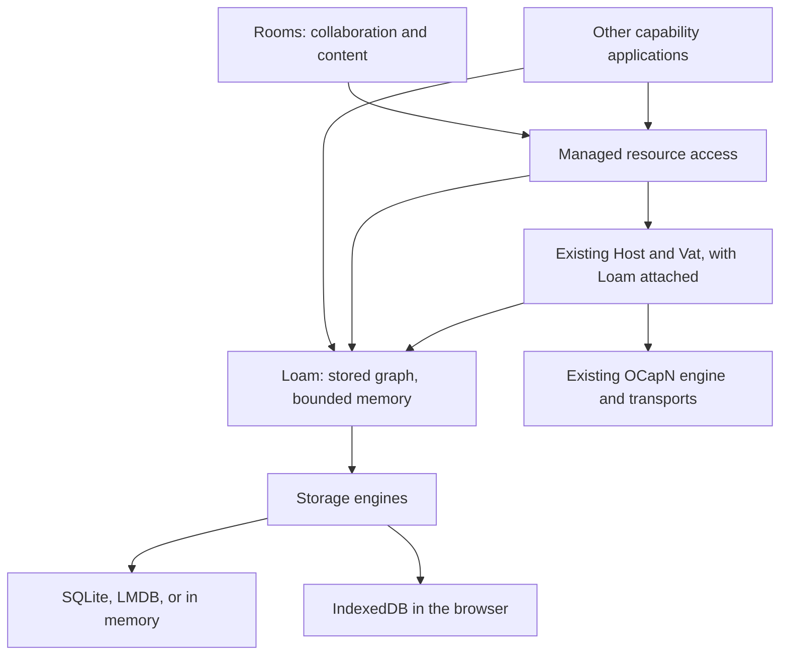
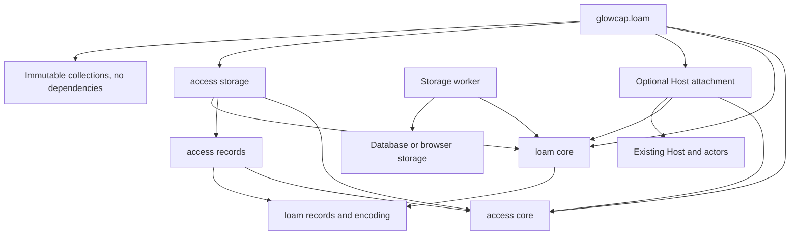
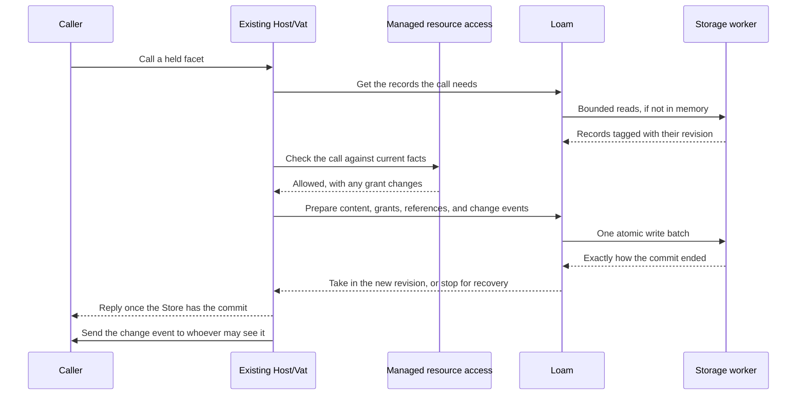

# Loam: durable capability applications

Loam is glowcap's storage layer, and its access module manages who can use
which resources. This page shows how the parts fit and which part owns each
job. [ADR-0161](../decisions/adr/ADR-0161-loam-foundation-and-access-extension.md)
records the design, the [Loam guide](../loam.md) covers the Zig API, and the
[API page](api.md) covers operations and lifetimes.

## Who owns what

glowcap supplies capability networking, actors, a Vat, a Host, and optional
storage. Applications can use those directly, or use Loam's access module for
resources with managed grants. Rooms builds directories, rooms,
conversations, messages, and memberships on top of them.

Loam stores a graph of ordinary records and of objects that hold
capabilities, and keeps only a bounded part of it in memory. The access module
adds resource scopes, permission rules, managed facets, delegation, and grants
that can be edited, paused, and revoked. Creating a store or an ordinary actor
creates no resource owner and checks no grants.

The arrows show which part relies on which. A storage root keeps objects
alive. It is different from the access module's owner of a resource tree, and
from whatever directory an interface shows at the top.

| Part | What it owns |
| --- | --- |
| Loam core | Stored identities, schemas, versions, reference edges, what stays alive, record leases, prepared batches, and recovery. |
| Loam record encoding | Encoding and checking records, with explicit format versions and bounded buffers. |
| Actors on the Vat | Sleeping actors' identities, waking them, deciding when they may sleep, and lining up their turns with commits. |
| Host attachment | Held capabilities, restoring them exactly, durable names, and when a peer sees a result. |
| Storage workers | Running reads and atomic writes on your program's executor, and reporting exactly how each one ended. |
| Managed access | Resource relationships, scopes, grants, their limits and lifecycle, checking each operation, and change feeds. |
| Application | Its schemas, what its methods mean, the effects they declare, content facts, and presentation. |

An application can change managed resources and ordinary stored objects in
one transaction. Managed access takes part in Loam's transactions rather than
keeping a second database. It decides whether a change is allowed, and Loam
saves it atomically and recovers it.

## Design rules

Each record, held capability, transaction, and recovery step has one owner.
Bytes are checked once when they enter, and permissions are checked each time
they are used. Each job lives in the one layer that can enforce it. A faster
path that weakens a refusal or hands bookkeeping to callers is not
acceptable, and neither is a simpler API that hides repeated work.

## Modules and archives

The public namespace is `glowcap.loam`, including `glowcap.loam.access`.
The access module's resource and grant model is in `access.core`, and its
record encodings for owners, directories, resources, grants, capabilities,
and events are in `access.records`. `access.storage` supplies bounded reads,
capability operations, and transaction staging. The C API lives in
`src/c_abi/loam/`, and the Rust binding in `bindings/rust/src/loam/`.

`libglowcap_loam` exports the `glowcap_loam_` functions for shared storage and
the single-resource lifecycle. The optional `libglowcap_loam_sqlite` and
`libglowcap_loam_lmdb` archives run blocking storage work, and Rust enables
the `loam` feature. The [C and Rust guide](c-and-rust.md) covers that API and
its limits, and the [browser guide](browser.md) covers running the same
archive over IndexedDB.

The `loam` module exports both parts while their cores stay separate:

The access module's permission rules work without any I/O, and its storage
uses Loam's public record and transaction API. Loam core imports no access
module, Host, actor, CapTP session, transport, or storage engine. The Host
attachment depends on both sides and connects them through public APIs. The
Host does not import Loam.

Loam keeps no global state. Networking works without a store, and local
storage works without a network. Loam and managed access add no engine,
driver, Host, Vat, thread pool, or run queue of their own.

## Schemas, storage format, and wire format

Three formats have separate versions and owners:

| Format | What it covers |
| --- | --- |
| Application schema | Typed data, reference fields, how to rebuild the object, and the application's own rules. |
| Storage format | Record headers, field encodings, saved references, and indexes. |
| Wire codec | How calls and values are encoded for the connection's protocol. |

One schema description drives both field encoding and the list of edges.
Reference fields cannot hide inside opaque payload bytes, and the payload and
its references commit together. Generated bindings keep no separate list of
capability fields. Opaque byte fields are still allowed as plain data.

The storage encoding uses Syrup and shares glowcap's bounded encoding code
without touching session tables. Changing a connection's wire codec does not
change any stored object's identity or require rewriting the database.

Loam knows what keeps a record alive and how references are stored. The Host
attachment knows how to save and restore a capability, and supplies either a
local recipe or an established sturdyref on another peer that keeps the
original authority. Encoding writes those down. It never picks a stronger
reference, creates authority, or treats CapTP import and export positions as
identities.

Saving a capability that cannot outlive the process into durable content
fails. Saving a reference to another peer may need a call to that peer before
the local commit, and that is not a distributed transaction. The result it
keeps, and any save that is abandoned, each need an owner that releases and
cleans them up.

## Transactions and protected calls

Each store has one writer at a time, ordered by its Vat or by your program.
A store is a transaction boundary, not an actor runtime or a network
identity. Several stores in one engine do not commit atomically together.

The last step is a sketch, since an event's recipients may differ from the
caller. Each event delivery checks permissions again, and a missed event can
never let someone use access they have lost on their next call.

The application declares every effect, and managed access checks each one
against the capability that was called. That check is tied to the resource
and policy revisions and is redone after any wait. Loading and other
preparation finish before the final check, and anything that changed in the
meantime is checked again. Conflicting changes run one at a time or return a
busy or conflict result.

Loam commits content, managed access state, reference edges, receipts, and
change events in one batch. Nothing prepared can hand out a callable facet
before the commit. Taking in a successful commit allocates nothing, because
preparation already reserved the memory and the room for new durable names.

A failure that is known to have changed nothing discards the prepared batch.
An unknown outcome stops the store until recovery learns what was committed.
The worker reports what happened, and Loam's shared Zig code decides what
comes next. Recovery never runs an operation again if it may already have
committed. Calls to other peers need their own retry rules: a local
transaction cannot make a remote effect happen exactly once or take back a
reply already sent.

## Memory, what stays alive, and scale

glowcap's 500,000-session target is a networking measurement. Storage adds its
own limits for cached records, active endpoints, uncommitted state, leases,
scratch space, kept history, and queued completions. A session reserves no
part of an application graph or database snapshot.

A sleeping actor keeps its identity and the references it holds while its
state leaves memory. The first eventual call wakes it, together with any other
calls to it, and the Vat keeps its limits and call order while your program
reads from disk. A near call needs the target in memory already and never
blocks on disk. The [actor guide](actors.md) covers waking and sleeping.

What stays alive is separate from what is in memory. Roots, strong edges,
held capabilities, leases, and kept versions keep objects alive, and weak
edges do not. Collection reads stored edges without waking actors. Cycles need
tracing, because reference counting alone cannot free them. Collection works
in small steps against a consistent version, checks current roots and writes
before deleting anything, and never reuses an identity that is still live.

The [collection guide](collection.md) covers how tracing works and what it
costs. Collection never reaches into another peer's objects, and
[stored references](references.md) are saved before Loam loads or waits for
another owner.

Containment, capability dependency, what keeps an object alive, and where the
interface shows it are four separate things. In a graph with sharing and
cycles you cannot get a total size by adding up children, so Loam reports
stored bytes, bytes charged to an owner, bytes in memory, and bytes held by
old versions separately. An exact reachable-size query needs a traversal
budget or an index that tracks the cost.

Storage reads can block, so storage work runs outside the Host's message
processing and read transactions stay short. Holding a remote capability does
not hold an engine read transaction open. A browser transaction cannot span
an `await`, so Loam assembles and checks the whole write batch before it opens
the IndexedDB transaction.

Opening a store creates no actor or in-memory entry per stored object.
Indexes on disk answer durable name and object lookups when they are asked.
Only active holds, work in flight, and the configured cache take memory, and
startup cost does not grow with the graph.

## Order of work

A Loam feature lands first in Zig and its storage engines, with its lifetimes,
costs, and failure tests written down. C and Rust then expose it without
deciding any permissions themselves. The
[access storage guide](access-storage.md) and [actor guide](actors.md) hold
the detailed cases, and the
[research plan](research/memory-persistence.md#experiment-sequence-and-decision-points)
holds the measurements and fault injection.
