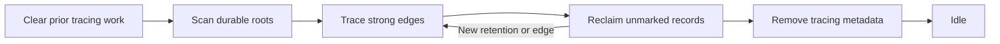

# Collecting unreachable records

Collection deletes the records no root reaches through strong edges, including
cycles that only hold each other up. It runs as ordinary write batches that you
schedule, so it does not pause the program and its work list does not have to
fit in memory. This guide is part of the [Loam guide](../loam.md).

## Running a cycle

Call `store.prepareCollection(work_limit)` to prepare one bounded batch, then
commit it like any other write: `beginWrite`, the backend's commit, and
`completeWrite`. Read `store.metadata.collection.phase` and keep going in
later batches until it is `idle`. An unknown outcome uses the same
[recovery steps](store.md#when-a-writes-outcome-is-unknown) as a content
write.

## What keeps a record alive

The collector keeps everything reachable along strong edges from:

- durable roots
- live local custody (below)
- pending reads
- pinned record versions. A pinned historical version also keeps the strong
  edges it had.

Weak edges keep nothing alive, and unreachable cycles are reclaimed. Tracing
reads stored records without running actor behavior or warming the cache.

`store.retain(object_id)` and `releaseRetention(token)` hold local custody
outside leases. These checked tokens keep a record alive whether or not it is
cached. They grant no remote call authority and do not survive a restart.
Actor endpoints register this custody automatically and release it when they
retire or their attachment closes, so an actor someone holds stays callable
after collection even when it is asleep and not a root.

## Changes during a cycle

A cycle spans many batches, and the program keeps running between them. These rules
keep that safe:

- The first preparation captures live custody once for the whole cycle.
- Between batches, the Store reserves journal space before it publishes a new
  retention, lease or pending read, then records that the new target must be
  marked.
- The first lease on a resident record records its strong edges. Further
  leases on that same version add no work.
- While a batch is prepared, new leases and retention claims wait until it
  settles. Existing leases stay usable and may be released.
- An ordinary write between batches records its new strong edges in the same
  transaction as the content change.
- Once root scanning begins, new or changed records survive the current cycle.
- The sweep finishes outstanding tracing work before deleting another
  candidate.

A reopen discards an incomplete cycle and starts again from fresh roots.

## Bounds

Collection reuses one record-sized scratch buffer, plus a journal of at most
`max_collection_roots` identifiers until the cycle finishes. If the journal
lacks room, the first preparation or the new custody is refused before it
takes effect.

Each tracing batch borrows all pending marking obligations. Only a confirmed
collection receipt acknowledges them. An abort or uncertain outcome keeps
them. Unchanged custody is copied, fingerprinted and seeded once per cycle,
not once per batch. Root shading has its own bound, so the record and phase
work limit does not bound every batch's work, and each traced record can add
up to the configured edge limit. New custody during the final phase needs no
marking because deletion is over. A cycle after a completed one starts
directly with roots. After an interrupted one, it clears old tracing rows in
separate batches first.
[ADR-0189](../decisions/adr/ADR-0189-loam-collection-custody-admission.md)
owns this admission contract, and the
[cost profile](../../bench/loam/README.md#collection-custody-cost) separates
root work from tracing and commit counts.

Durable marks and a FIFO work queue live in the backend, so storage needs
headroom for marks, queue entries and atomic writes. A full map aborts the
batch without deleting anything not yet proven garbage. The volatile backend
charges these internal rows to its byte limit. LMDB walks ordered cursors
while the volatile test backend scans its hash table, so their costs differ.

## Effect on the cache and totals

A batch that removes no objects keeps current resident bytes. A batch that
sweeps objects clears the cache conservatively, because its receipt does not
list the deleted identities. Old leases stay historical either way.

Reclamation updates the object count and encoded record bytes atomically.
Those totals exclude backend indexes, tracing metadata and mapped-page
overhead. Reclaiming records does not shrink the database file.
[Offline compaction](lmdb.md#shrinking-the-file) does. Budget collection
before storage runs out.

## Evidence

The process-kill test covers interrupted sweeps. The LMDB workload measures
bounded collection service time and its interference with queued reads, and a
bounded storage-executor workload measures ordinary and durable calls during
collection.
