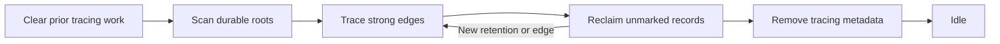

# Collecting unreachable records

Collection deletes the records no root reaches through strong edges, including
cycles that only hold each other up. A root is a record marked to stay alive,
and a strong edge is a reference field that keeps its target alive. It runs as ordinary write batches that you
schedule, so it does not pause the program and its work list does not have to
fit in memory. See the [Loam guide](../loam.md) for the rest of the store.

## Running a cycle

Call `store.prepareCollection(work_limit)` to prepare one bounded batch, then
commit it like any other write: `beginWrite`, the backend's commit, and
`completeWrite`. Read `store.metadata.collection.phase` and keep going in later
batches until it is `idle`. The [C and Rust
guide](c-and-rust.md#driving-storage-from-c) names the verbs that run the same
batch from an archive. An unknown outcome uses the same [recovery
steps](store.md#when-a-writes-outcome-is-unknown) as a content write.

## What keeps a record alive

The collector keeps everything reachable along strong edges from:

- durable roots
- local retentions (below)
- pending reads
- record versions a lease still holds. An older version kept this way also
  keeps the strong edges it had.

Weak edges keep nothing alive, and unreachable cycles are reclaimed. Tracing
reads stored records without running actor behavior or filling the cache.

`store.retain(object_id)` and `releaseRetention(token)` keep a record alive
without a lease, whether or not it is cached. A retention gives no peer any
access and does not survive a restart. Each actor endpoint holds one until the
endpoint goes away or its attachment closes, so an actor someone holds stays
callable after collection, even asleep and not a root.

## Changes during a cycle

A cycle spans many batches, and the program keeps running between them. These
rules keep that safe:

- The cycle's first batch records the retentions that exist at that moment.
- Between batches, a new retention, lease, or read reserves room in the work
  list before it takes effect, and its record is queued for marking.
- The first lease on a record in the cache queues that record's strong edges.
  More leases on the same version add no work.
- While a batch is prepared, new leases and retentions wait until it commits
  or aborts. Existing leases stay usable and may be released.
- An ordinary write between batches queues its new strong edges in the same
  transaction as the content change.
- Once the cycle starts scanning roots, new or changed records survive it.
- The sweep finishes queued tracing work before it deletes another record.

Reopening the store drops an unfinished cycle, and the next one starts from
the roots again.

## Bounds

Collection reuses one record-sized scratch buffer, plus a work list of at most
`max_collection_roots` identifiers until the cycle finishes. If the work list
has no room, the cycle's first batch or the new retention is refused before it
takes effect.

- Each tracing batch takes all queued marking work, and only a confirmed
  commit clears it. An abort or unknown outcome keeps it.
- Retentions that have not changed are copied and queued once per cycle, not
  once per batch.
- A batch finishes the step it started, so it can run two steps past the work
  limit.
- Scanning roots has its own limit, so the work limit does not cap every
  batch, and each traced record can add up to the configured edge limit.
- A retention made during the final phase needs no marking, because deletion
  is already over.
- A cycle that follows a finished one starts with the roots. After an
  interrupted one, it first clears the old tracing rows in separate batches. <!-- status-allow: runtime state or operation ordering -->

[ADR-0050](../decisions/adr/ADR-0050-transactional-reclamation.md)
records these rules, and the
[cost measurements](../../bench/loam/README.md#collection-cost) separate
root work from tracing and commit counts.

The engine stores the marks and a first-in, first-out work queue, so the store
needs free space for them and for the batch writes. A full store aborts the
batch without deleting anything it has not shown to be garbage. The in-memory
engine counts these rows against its byte limit. Both disk engines find rows
with ordered queries, while the in-memory engine scans its hash table, so
their costs differ.

## Effect on the cache and totals

A batch that deletes nothing leaves the cache as it was. A batch that deletes
records clears the whole cache, because it does not list which records it
deleted. Old leases keep reading the version they hold either way.

Reclamation updates the object count and encoded record bytes atomically.
Those totals exclude engine indexes, tracing metadata and engine page caches.
Reclaiming records makes pages reusable without shrinking the database file.
Use [SQLite compaction](sqlite.md#shrinking-the-file) or
[LMDB offline compaction](lmdb.md#shrinking-the-file) to shrink it. Budget
collection before storage runs out.

## Tests and measurements

The process-kill test interrupts sweeps. The
[workload guide](../../bench/loam/README.md) measures how long collection
batches take, how much they delay queued reads, and how ordinary and durable
calls fare while collection runs.
