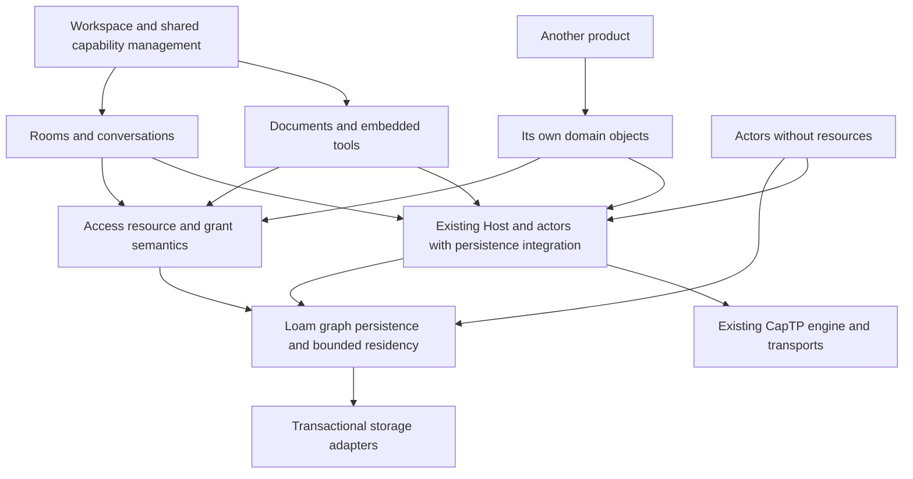

# Memory and persistence for glowcap

This study owns the prior-art survey, physical storage alternatives, and
experiments for Loam. The [planning guide](../../planning/README.md) and the
[roadmap](../../roadmap.md#durable-applications) own priority.

The [Loam architecture](../architecture.md) and
[ADR-0161](../../decisions/adr/ADR-0161-loam-foundation-and-access-extension.md)
own the accepted layer boundaries. The [API contract](../api.md) and
[sleepy-actor contract](../actors.md) specify the behavior candidates must
support. Backend selection and measured costs remain open, and the experiments
below test implementations against those contracts.

The [Zig Loam slice](../../loam.md) implements a local-record baseline with LMDB
and volatile storage. The comparative experiments below remain open.

Sources were reviewed on 2026-09-14. Candidate behavior below is attributed to
primary documentation and papers. The [persistence reuse review](native-reuse.md)
adds pinned source findings for Sandstorm's Blackrock, POST++, and Goblins.
These findings support building the shared object and capability layer over an
existing engine. They establish neither novelty nor a performance advantage.

## The question to answer

Can an application work with a durable graph of objects and capabilities, with
small predictable memory costs, without assembling a database mapping,
restoration machinery, and reference-retention protocol for every application?

The promising abstraction is a persistent object graph with typed reference
fields, atomic updates, bounded residency, and explicit capability restoration.
Physical addresses are temporary access paths. Stable object identity and exact
capability authority survive eviction, relocation, and restart. Local borrowing
and remote invocation can use different mechanics while preserving the same
object and authority semantics.

An embedded database may provide the first physical implementation, and a
region store may ultimately fit better. The work compares whole-system cost:
access, encoding, authority checks, crash recovery, reclamation, bindings, and
the developer's first application.

## The whole product is the acceptance test

The product combines a capability-oriented application workspace with organized,
branching conversation. Its foundation must also support another product with
a different domain, and storage throughput alone cannot establish that fit.

Keep the [Rooms content model](../../planning/rooms.md) as the domain authority:
directories organize rooms and other placements. Rooms provide shared context.
Conversations organize an ongoing discussion. Each message has one canonical
conversation. Documents, task boards, and embedded tools can be resources with
different schemas and behavior. They need not pretend to be conversations.

The common product layer provides navigation by held references, direct sharing
or managed facets, permission presets with a custom editor, pause/revoke/edit,
provenance, and change subscriptions. Applications describe their supported
permissions and domain operations. Managed access validates those operations. The UI
renders their descriptions without becoming an authority evaluator. Content
schemas drive persistence and capability fields once, and UI schemas describe
controls, not physical database records.



The diagram shows proposed responsibility flow and not a source import graph.
The persistence core has no upward dependency on Host, managed access, or a
particular app. The hosting adapter connects those concerns through their public
interfaces.

Use one acceptance journey to make the architectural requirements concrete:

1. Create a room containing a conversation, a document, and an interactive task
   board. Each uses the same sharing controls but exposes appropriate actions.
2. Branch from a message into another conversation. Preserve canonical message
   identity and permitted provenance under the existing reorganization contract.
3. Share a managed message facet into another workspace. Reading that placement
   does not reveal siblings or an attachment's original authority. A separate
   board application stores the facet in one of its own typed fields.
4. Customize the facet after sharing, then pause it. The committed change drives
   authorized UI updates, and the next protected operation sees the new state
   even if the observer missed the event. Search, counts, notifications, and
   previews obey the same disclosure boundary as opening the object.
5. Evict the source objects and restart the owner. Restore the same references,
   limits, controls, and retained graph edges without eager actor creation.
6. Disconnect a browser, reconnect it, and attempt the operation again. Cached
   bytes already delivered remain copies. The UI distinguishes a local draft
   or cached view from an authorized operation against the current owner.
7. Build a small independent planning or document product on the same storage,
   sharing, and hosting mechanisms. It supplies domain types and behavior, not
   a copy of Rooms' persistence, reference-retention, or grant code.

Same-owner reorganization can be atomic. Cross-owner placement or transfer uses
capability operations with their own failure and retry semantics, and a shared
visual workspace is not a distributed transaction boundary. Remote authority
dependencies remain calls through held upstream capabilities. An offline peer
cannot claim current upstream authority from an old cached grant, and
separately delegated offline authority would need its own product contract.

A browser can host an object without a central application server holding
authority. Durable bytes alone do not make that object reachable while the
browser is closed. Hosting availability, relay reachability, backup custody, and
authority ownership are separate choices that the product must explain.
Embedding in an iframe changes presentation and not availability.

An extensible workspace also needs an application isolation boundary. An
embedded tool receives selected capabilities, and the platform must prevent it
from acquiring others through ambient APIs. Browser-origin and sandbox policy or
process and compartment isolation owns that enforcement. Managed access does
not turn arbitrary Zig or C code into a safe plugin. Isolation and a capability
introduction UI are platform work to specify before accepting untrusted
applications.

The architecture earns reuse if the second product has a shorter implementation
and the first product has a coherent experience. Count repeated application
code, reference and permission bugs, first-use steps, and interaction latency
alongside database and memory measurements.

## Three persistence problems

| Problem | State that survives | Additional obligation |
| --- | --- | --- |
| Persistent data graph | Object identity, typed fields, edges, roots, versions | Atomic graph updates, relocation, schema compatibility, and reclamation. |
| Durable capability graph | Exact original, facet, control, or foreign-reference restoration recipe | Restore the same authority and dependencies, including intervening revocations. Integrate with Host custody and publication. |
| Recoverable actor execution | Accepted work, actor state transitions, durable operation results, and outbound intentions | Define acceptance and reply durability, retry behavior, and effects that escaped before failure. |

Implementing the first does not establish the second or third. Persisting an
actor's data does not preserve its stack, pending network answer, or an effect
already performed by another peer. Durable execution needs an explicit protocol
and not a snapshot of CapTP tables.

The Vat offers opt-in local snapshots and immutable state replacement, and its
snapshots do not rewind the network. The `src/loam/collections/` HAMT provides
structural sharing in memory and no disk durability. Keep those distinctions when
reusing their mechanisms. See
[ADR-0060](../../decisions/adr/ADR-0060-vat-local-time-travel.md) and
[ADR-0061](../../decisions/adr/ADR-0061-persistent-collections-module.md).

## Existing implementation is the baseline

This is a focused source inventory. Each implementation experiment identifies
which owner it reuses, extends, or replaces before adding another mechanism.

| Existing owner | Implemented mechanism | Obligation for the shared design |
| --- | --- | --- |
| [Actor snapshots](../../../src/actors/vat/boxed.zig) and [immutable collections](../../../src/loam/collections/mod.zig) | Local state sharing, copy-on-write, and restore without rewinding the network. | Reuse state ownership where appropriate. These in-memory mechanisms do not provide disk recovery. |
| [Host durable publication contract](../../boundaries.md) | Stable publication names when the embedding preserves identity and publication entropy. | Connect restored objects to existing publication and custody machinery. |
| [Session owner](../../../apps/rooms/rust/runtime/src/session/managed.rs) | Shared native/browser checkpoint and effect recovery, including persisted identity. | Preserve commit ordering and pending-operation ownership when extracting reusable execution support. |
| [Grant owner](../../../apps/rooms/rust/runtime/src/session/managed/content.rs) | Prepare, persist, then install. Protected access is disabled after uncertain writes. | Keep one authority evaluator and one durable completion owner. |
| [Filesystem storage](../../../apps/rooms/rust/platform/src/storage/atomic.rs) | Synced replacement and explicit unchanged versus indeterminate failure. | Carry these failure classes into the storage contract. Compare recovery guarantees as well as speed. |
| [Archive storage](../../../apps/rooms/rust/archive.md) and [browser transactions](../../../apps/rooms/rust/browser/src/storage/transaction.rs) | Durable records, blobs, shares, bounded transfers, and retained asynchronous operations. | Preserve cancellation and reference-lifecycle behavior across native and browser adapters. |

Some reusable mechanisms live in Rooms' Rust packages. Moving their ownership
into Zig requires equivalent recovery evidence and removal of the superseded
implementation when its callers move. Keeping browser I/O in Rust does not
justify a second grant evaluator or activation state machine there.

## What the prior art contributes

[Symas' LMDB overview](https://symas.com/lmdb.php) identifies the
[OpenLDAP repository](https://git.openldap.org/openldap/openldap/-/tree/mdb.master/libraries/liblmdb)
on `mdb.master` as the development source. Use that upstream for source review
and pin the revision used in experiments. The GitHub repository is a published
clone and is neither an independent implementation nor a different backend
candidate.

| System or research | Mechanism worth learning from | Fit and limit for glowcap |
| --- | --- | --- |
| [LMDB's C API](https://git.openldap.org/openldap/openldap/-/blob/mdb.master/libraries/liblmdb/lmdb.h) | Ordered keys, copy-on-write transactions, mapped value borrows, and several named databases within one environment. | Strong physical-store candidate. Transactions and value pointers have bounded lifetimes. Old readers retain pages, and writers serialize. Managed access authority remains a separate responsibility. |
| [libmdbx transactions](https://libmdbx.dqdkfa.ru/doxygen/group__c__transactions.html) | A related C engine with explicit parking and eviction of read transactions. | Worth a secondary comparison if reader retention dominates. A parked transaction's old pointers cannot be dereferenced until valid restoration. It does not remove the lifetime problem. |
| [Microvium snapshots](https://github.com/coder-mike/microvium/blob/main/doc/concepts.md) | A controlled object heap and executable environment that can be snapshotted and restored. | Useful model for explicit roots and resumable environments. Adopting the VM would introduce another execution model rather than persist arbitrary Zig/Rust state. |
| [PMDK](https://github.com/daos-stack/pmdk) | `libpmemobj` supplies transactional object allocation for persistent memory. | Relevant physical-memory experiment for suitable deployments. It supplies neither CapTP custody nor grant lifecycle. Platform and durability assumptions need their own profile. |
| [Metall](https://github.com/llnl/metall) | A C++ allocator for mapped persistent data structures, with filesystem-backed snapshots. | Useful region/allocator comparison. C++ containers and allocator discipline are additional integration constraints, and snapshots alone do not establish the access module's commit contract. |
| [Stasis](https://www2.eecs.berkeley.edu/Pubs/TechRpts/2010/EECS-2010-2.html) | Reusable transactional storage below a fixed database data model, allowing control of layout and access methods. | Especially relevant to the module question: recovery machinery and an application's data model can have different owners. Study the design before deciding that a bespoke layout requires writing every storage mechanism. |
| [NV-Heaps](https://cseweb.ucsd.edu/~swanson/papers/Asplos2011NVHeaps.pdf) | Transactional persistent objects with explicit attention to pointer safety and persistent corruption. | A persistent allocator must prevent invalid lifetime edges and reuse errors as well as flush bytes. Published measurements concern that paper's hardware/model, not glowcap. |
| [Mnemosyne](https://pages.cs.wisc.edu/~swift/papers/asplos11_mnemosyne.pdf) | Persistent regions and durable memory transactions. | Evidence that memory-like persistence has a separate consistency mechanism. Its storage-class-memory assumptions cannot be transferred to ordinary SSD mmap without analysis. |
| [Twizzler](https://www.usenix.org/conference/atc20/presentation/bittman) | OS-supported persistent objects and object-relative cross-object pointers. | Close conceptual prior art for persistent identity and relocation. It is an operating-system design, not a portable C/Zig library to embed in Rooms. |
| [Goblins portraits](https://files.spritely.institute/docs/guile-goblins/0.17.0/Persistence-capable-objects.html) | Rooted object graphs, cycles, and explicit descriptions containing data and references. | Reuse the separation of behavior reconstruction from storage representation. A lower-level implementation should improve native ownership and cost without losing the graph semantics. |
| [Goblins sleepy actors, 0.18.0](https://spritely.institute/news/spritely-goblins-v0-18-0-sleepy-actors.html) | Actors retain live references while their state sleeps in storage, and wake on message delivery. The release includes least-recently-used and every-turn sleep strategies. | Direct precedent for required lazy actor residency. Measure glowcap's native ownership and integration against this behavior. Lazy activation itself is established prior art. |
| [Cap'n Proto persistent interfaces](https://github.com/capnproto/capnproto/blob/master/c%2B%2B/src/capnp/persistent.capnp) | Saving a capability for later restoration, with persistence orthogonal to its application interface. | Reference restoration is an interface contract, not the serialization of a client pointer. Study the separation without importing a second RPC stack or its realm-specific conventions. |

PMDK's old [pmem/pmdk repository](https://github.com/pmem/pmdk) is archived and
directs users to `daos-stack/pmdk`. Pin a candidate revision and supported
platform before evaluating it.

Microvium's [host imports](https://github.com/coder-mike/microvium/blob/main/doc/reference.md)
also expose a restoration obligation: the restoring host rebinds import IDs. For
glowcap, that host must restore the intended authority and not merely find a
function with a matching number. Copying heap bytes cannot make external
references durable.

## Capability possession and memory access

A held grant capability both identifies the grant and conveys its authority,
so there is no second user identity or ACL check. Managed access evaluates the
current grant represented by that held reference, including its dependencies.

A transaction handle can similarly represent authority over a storage snapshot
within a trusted API. Exporting an object that holds that transaction through
CapTP exposes the authority of its methods. Unrestricted `get(key)` and cursor
access would expose the transaction's inventory, while a scoped resource
interface exposes only its authorized operations and results.

A C or Zig pointer is not hardware-enforced isolation from unsafe code in the
same address space. Passing an allocator explicitly improves custody and
dependency structure but does not stop such code from following other
addresses. Hardware-enforced pointer bounds and provenance are a distinct
facility, illustrated by [CHERI](https://ctsrd-cheri.github.io/cheri-c-programming/background/cheri-capabilities.html).
An untrusted extension needs a compartment or process boundary. That is
independent of ordinary CapTP callers, which hold protocol references.

Do not send memory addresses or mmap offsets as remotely usable references.
Host publications and session reference tables bind remote calls to the
relevant object. A restored endpoint reopens durable state through the hosting
integration, and managed access then applies its grant semantics when
appropriate. Promise pipelining routes dependent calls through the promise
system. It neither extends a transaction lifetime nor makes a commit durable.

An old read transaction creates an important semantic fork:

- An ordinary managed reference observes current authority before disclosing
  a deferred result. A pre-revocation content snapshot cannot supply the current
  grant decision. The first implementation restarts at the current committed
  owner revision, preserving the existing single-revision admission contract.
- An explicitly retained historical view requires a separate interface and
  retention budget. It may retain old content, but ongoing mediated access can
  still be revocable. An exported copy already delivered to a recipient cannot
  be recalled. Historical content does not imply historical grant authority.

## Ownership and integration

The [Loam ownership contract](../architecture.md#product-and-ownership)
assigns graph persistence to Loam, resource authority to `loam.access`, and
activation and capability custody to integration with the existing Vat and
Host. Its acceptance test includes a second consumer using persistence without
resource kinds, scopes, grant masks, or lifecycle. A durable counter actor with
a reference to another object is the minimum second consumer. If it needs
managed resource records to persist, the implementation has failed that
boundary.

The `loam.collections` leaf supplies immutable collections. The implemented
`access.records.ResourceRecord` is a resource-specific codec, and its byte
grammar does not freeze Loam's generic storage layout. Experiments include
ordinary records and actor state alongside managed resources in one transaction,
so a backend cannot succeed by implementing only the resource codec.

## Actor persistence requirements

The [sleepy-actor contract](../actors.md) owns activation, scheduling, eviction,
and durable visibility. The experiments below exercise that contract through
ordinary actors and managed resources, including cold calls, current authority,
bounded waiters, and recovery.

## Graph programming model

Applications declare fields once: scalars, byte content, local object references,
and capability references with their disclosure policies. A generated descriptor
can drive encoding, edge enumeration, validation, and reconstruction. Rust can
derive that descriptor, and Zig can construct it at compile time. The C ABI
exposes opaque handles and bounded buffers. Permission decisions stay in Zig.

An illustrative API sequence, not an implemented interface:

```text
conversation.append({ body, attachment: held_capability }) -> message
message.share(terms) -> { use, control }
saved_collection.insert(use)
close_and_reopen_owner()
saved_collection.get(entry) -> the same managed use authority
control.pause() -> committed change
restored_use.read() -> paused
```

The application supplies capabilities and content and keeps no second list of
foreign keys in sync. Typed capability fields enlist their restoration recipes
and retention edges in the containing transaction. A schema omitting such a
field fails registration or encoding and never silently produces a
non-restorable graph. Pointer fields and transient handles need an explicit
exclusion or reconstruction rule.

Sharing and cycles are preserved through stable object identity. Loading a
reference does not recursively instantiate everything reachable, and a small
live handle can resolve on demand. Millions of stored objects do not need
millions of resident handle cells, because only the active set has resident
entries.

Four edge meanings stay distinct: data references, capability dependencies,
retention roots, and resource containment. A containment move is a managed
access operation. An ordinary graph link neither reparents a resource nor
expands authority. Provenance is another declared relationship and not
automatic ownership. Cycles in data are valid even though owned containment and
grant ancestry have their own restrictions.

Storage restores the capability originally saved. The method exposing that field
separately chooses whether disclosure preserves it directly or adds the invoking
facet as a dependency. A limited collection view cannot reveal a stored
original. This is the [reference disclosure
contract](../access-storage.md#references-embedded-in-application-content),
applied through the generated field descriptor.

## Competing physical designs

### Ordered key/value graph

LMDB can represent a dynamic graph without pointer swizzling. Store nodes by
stable identity, outgoing edges by source and field, reverse retention edges
by target, and collection order in a separate index. Update node payloads,
edges, roots, and managed access records in one environment transaction. Several named
databases can organize these families without creating separate commits.
Cycles and shared nodes need no special physical pointer representation.

The cost is indexed lookup and bounded encoding. Test inline
small records and clustered edge batches before assuming one lookup per edge
is unavoidable. SQLite can implement the same logical model with indexed rows.
Its [WAL transaction model](https://www.sqlite.org/wal.html) provides a useful
comparison under equivalent durability and reader-lifetime constraints.

LMDB's mapped values are borrowed until update or transaction end, as specified
by its [C header](https://git.openldap.org/openldap/openldap/-/blob/mdb.master/libraries/liblmdb/lmdb.h).
End the read transaction after bounded materialization or synchronous use.
Do not retain it across an unbounded network wait. Map resizing must retire
affected borrows before remapping. A page fault can block a mapped read even
when the library performs no read syscall, so cold access belongs off the Host
turn. Zero-copy is a measured access path and not an API promise.

### Persistent regions with stable handles

Prototype immutable regions containing compact records and relative references
within a region. Cross-region links use stable object identities through a
relocation index. A transaction writes changed regions and atomically publishes
a new root/version manifest. An unchanged region is shared between revisions.

This tests whether clustering and structural sharing can improve graph access,
incremental persistence, and snapshots together. Raw struct layouts are not
portable across compiler versions or machines. A checked region layout can
permit direct scalar access where alignment, endian, and lifetime requirements
are satisfied. Otherwise the loader materializes a bounded view. Capabilities
remain declared fields with separate custody.

Before treating this as a production store, specify torn writes, flush ordering,
manifest recovery, allocation reuse, checksums, index rebuilding, interrupted
compaction, and durable roots. A checksum detects corruption and does not make a
multi-record update atomic. Reclamation cannot reuse an identity that an old
capability could still name. Bare mmap plus an allocator solves none of these.

An experimental region layout can store immutable extents and its root manifest
inside an existing transactional engine, which isolates the value of the layout
from the cost of inventing recovery. A separate raw-file engine is justified
only if measurements identify the existing engine as the limiting mechanism.
Stasis is relevant prior art for that decomposition.

### Memory and reclamation across both designs

Use separate lifetime classes: turn scratch, active-operation borrows, clean
resident data, prepared dirty data, and durable reachability. A released call
borrow may release RAM while its object remains durably reachable. Conversely,
a revoked capability need not delete content. Resource deletion does not erase
the identity retirement information needed to refuse old references.

Use bounded pools or slabs for active handles and operation state, and regions
for immutable payloads where measurements justify them. Reuse existing Vat
scratch and Host custody instead of imposing a universal allocator on the wire
path. Eviction invalidates a borrow through its owning lifetime. It never
changes a capability's target. C consumers need acquire and release rules, and
safe Rust wrappers make references unable to outlive their guard.

Local acyclic metadata can use reference counts. General durable object graphs
need tracing from persisted roots, explicit deletion, or another cycle-aware
scheme. An incremental collector must coordinate its snapshot and write barrier
with transactions so a newly committed edge cannot point to reclaimed state.
Remote sturdyref holders are not enumerable. Durable publications remain roots
until explicitly retired under their contract. Do not infer global death from
one session's release.

Budget clean bytes, pinned bytes, dirty bytes, handles, pending calls, snapshots,
and maintenance separately. Account for the engine cache and OS residency in
whole-process measurements. Bound admission before allocation, charge retained
work to its owner, and keep progress capacity for commit/abort and cleanup.
No consumer can pin the entire store through unlimited lazy reads or snapshots.

## Research hypotheses and ways to reject them

| Hypothesis | Experiment | Evidence against it |
| --- | --- | --- |
| One generic graph substrate serves actors and managed access. | Persist a plain actor graph and a resource/grant graph through the same record, edge, loading, and commit mechanisms. | The plain actor imports managed access or duplicates storage/restoration machinery. |
| Schema descriptors remove application persistence plumbing. | Round-trip a cyclic graph containing originals, managed uses, bounded controls, and a foreign durable reference from Zig and a Rust consumer. | A consumer writes its own grant evaluator or maintains parallel reference indexes by hand. |
| Region layout reduces meaningful cost. | Compare identical graph workloads using individual records and packed immutable extents over the same transaction engine. | Reduced lookup CPU is outweighed by write amplification, retained history, copying, or p99 pause time. |
| LMDB is a better native physical fit than SQLite. | Use the same workload, hardware, durable acknowledgement contract, cache budget, and crash matrix. | Its whole-system memory, reader retention, operational complexity, or tail latency outweighs access savings. |
| Authority can stay current without rewriting descendants. | Revoke an ancestor while cold descendants and a deferred reply are pending, then evict/restart and retry. | An old snapshot or cached verdict admits a later protected disclosure, or a parent edit requires rewriting the descendant population. |
| Lazy persistence preserves networking progress. | Delay reads, exhaust pins, force major faults, and run compaction while unrelated actors exchange calls. | Storage blocks a Host turn, queue memory grows without bound, or ordinary actor cost grows with stored object count. |

A possible later optimization is a cached admission witness containing the
versions of all authority dependencies it used. Its validity is checked against
current owner state before use. Parent edits, scope moves, schema changes,
writer replacement, and restart invalidate relevant witnesses. Event delivery
alone is insufficient, because a disconnected observer can miss an event. Start
with the shared evaluator and measure whether this optimization earns its
complexity.

## Experiment sequence and decision points

These experiments support the [implementation
stages](../architecture.md#implementation-order-and-acceptance), and the
architecture owns build order. The implemented LMDB path is the baseline. SQLite
is an optional comparison when measurements locate a physical-engine constraint.
Another backend is not a prerequisite for Rooms integration. Region layouts
remain an experiment until their whole-system costs justify adoption.

1. **Specify the observable model.** Define store incarnations, identity reuse,
   roots/edges, local and foreign reference restoration, commit visibility, and
   recovery failures. Model short interleavings of create/store/revoke/load/
   restart and assert no authority amplification, no stale admission, and no
   lost committed edge. Keep protocol conformance separate from store tests.
2. **Prove the lower boundary with two consumers.** Use a plain actor graph and
   managed access, including sleepy actors and ordinary non-actor records in one store.
   Map existing Rooms storage/recovery owners before extracting their mechanisms.
   Build the shared record/loading contract and descriptor experiment
   before freezing the foreign ABI. The current
   resource view is useful evidence, not a complete generic graph design.
3. **Measure the application workload before changing engines.** Establish the
   LMDB baseline with conversation and message graphs, hot/cold calls, unrelated
   edits, wakeup bursts, and collection beside foreground work. Separate
   endpoint custody, cached data, engine memory, and OS pages. Use the results
   to decide whether an alternative engine or packed immutable regions warrant
   an experiment. Match durability, including flush settings, instead of
   comparing an asynchronous commit against a durable one. Publish reproducible
   inputs, engine revisions, allocations, copied bytes, major faults, write
   amplification, retained history, commit tails, and quiescent memory.
4. **Attack recovery and custody.** Kill the process before/after each commit and
   publication boundary. Inject dropped completions, torn/corrupt records,
   storage-full, late loads, interrupted compaction, and stale writer custody.
   Process kills alone are not power-loss proof. Test old-backup restoration:
   keeping a public identity requires authoritative recovery history that does
   not undo exposed revocations. Otherwise restore under a new identity.
5. **Exercise real CapTP and bindings.** A saved facet survives process restart.
   A control edit is a committed event. The next protected near or far call
   observes it. Pipelined dependent calls wait for committed publication. Use
   product fronts and outside peers, then the browser adapter. A mock
   pointer-to-reference bridge proves none of these properties.
6. **Select the production profile.** Use the evidence to select backend and
   layout defaults, supported limits, and any necessary API refinements. Record
   the measured decision in an ADR and update the owning contracts. Each
   implementation stage removes the prerelease representations it replaces.

The baseline platform is a normal operating system and SSD. The browser is a
separate required persistence profile. PMDK, NVM, and hardware compartments are
additional experiments with their assumptions stated. No single implementation
is assumed to achieve their costs on every platform.

Full recoverable actor execution follows the graph, reference, and sleepy-actor
proof. The initial integration defines commit visibility and limits
pending-call survival. The stronger execution contract must define which calls
were durably accepted, how duplicate local operations return the same result,
and how outbound intentions are retried. A durable local receipt cannot promise
exactly-once effects at an arbitrary remote service. Execution reuses the Vat
and Host, and no second scheduler hides that unsolved protocol.

The proposed contribution is the combination of Zig ownership, automatic
reference-aware persistence, bounded lazy residency, and current capability
semantics across local and remote calls. Each constituent has prior art. The
experiments must show that their composition is useful, efficient, and secure
before it can be described as an advance.
