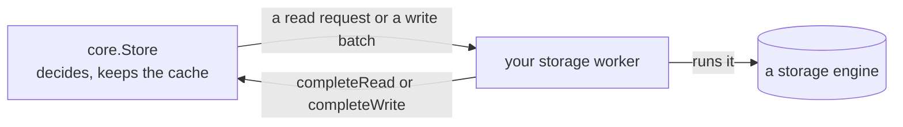

# Stores, transactions and reads

A Store keeps validated records in memory and prepares storage work for your
executor. [SQLite operations](sqlite.md) and [LMDB operations](lmdb.md) cover
the disk engines that hold its records between runs.

Every operation follows one pattern. Loam's `core.Store` decides what to read
or write and hands your code a request. Your storage worker runs it against an
engine and hands the result back. The Store touches no disk, starts no thread,
and never waits.

## Opening a store

A disk store is one directory, owned by one process at a time. SQLite is the
default disk engine, and `Lmdb` opens the same way.

To create one, make an empty directory, choose a fresh store identity, and call
`Sqlite.open(path, .{ .mode = .{ .create = identity } })`. To reopen it, pass
`.open = identity`. The engine checks that the identity matches. Missing
metadata, an existing store on create, an identity mismatch, and another process
holding the directory are distinct failures. No error falls back to volatile
storage or resets an existing store.

A program that saves its store identity before it first opens the store can
use `.bootstrap = identity`. It creates the store if it is missing, opens it
if it exists, keeps existing records, and refuses damaged or mismatched
metadata. Switch to `.open` once your program knows the store holds its
application root, so a missing store is reported instead of quietly replaced
by an empty one.

Construct `core.Store` from the engine's claimed metadata, your schema
descriptors, and explicit memory limits. The Store borrows the schemas for its
whole lifetime. Keep the Store and its engine at stable addresses while a
worker borrows them.

One execution context owns each Store and delivers its completions. Workers
receive batches or read requests and never mutate the Store themselves. SQLite
and LMDB allow concurrent reads and one writer, and the Store has at most one
write in flight.

The in-memory engine needs its calls serialized, which its C archive does for C
and Rust. It allows several readers or one writer. A second writer, or a read
during a write, returns `Busy`, so every borrowed row stays valid without a
copy.

A disk engine holds a fixed number of read transactions at once, and
`readerCapacity()` reports it. SQLite opens
<!-- value ../../src/loam/engines/sqlite/mod.zig max_readers -->4<!-- /value -->
reader connections by default and LMDB
<!-- value ../../src/loam/engines/lmdb/mod.zig max_readers -->16<!-- /value -->
reader slots, and the C archives open those defaults. `hosting.Worker` takes
that count and hands out no more reads at once, so a pool of any size never
exceeds it. A read begun past it outside the worker is refused as
`ReaderCapacity`.

## Changing records

A transaction runs `begin`, then `allocateId` for each new record, then
`putCopying` or `remove` for each change, then `prepare` and `beginWrite`.
When the change builds a cycle, allocate every new ID before writing any
record, so each record can name the others.

A record carries its schema and version, its payload, its typed edges, and
whether it is a root. `putCopying` takes the revision of the record it
replaces, or null for a new one, so an edit prepared from stale data is
refused instead of overwriting a newer change. It copies the proposal and
assigns the next committed revision. Changing the root flag is part of the
same atomic write as the content.

`beginWrite` returns a batch that borrows Store-owned memory. Your worker runs
`backend.commit(batch)` and delivers the outcome to `Store.completeWrite`.
A successful `completeWrite` means the Store took the outcome, not that the
write committed, so check the outcome itself. In a Host-based program, run disk
engine storage on your existing executor, never inside the Host's own
processing of a message.

## When a write's outcome is unknown

An I/O failure or lost completion can leave a write whose result nobody knows.
The Store keeps the batch and refuses reads and new writes until you recover
it:

1. Join the worker that ran the write and finish any other engine transactions.
2. Get `Store.recoveryBatch` and pass it to the backend's `recover`.
3. Deliver what recovery found through `Store.resolve`.

Disk-engine recovery needs exclusive access and reports `Busy` while an
operation still holds the engine. It refreshes failed engine state under the
existing directory lock and confirms what is on disk before it returns an
answer. If recovery fails, the write stays unknown, so keep the batch and try
again.

Keep the Store and engine open until recovery succeeds. Closing and reopening
the engine starts a new Store, as a process restart does, and the new Store
cannot recover the old one's write.

A timeout or an abandoned caller does not prove the write aborted, so neither
one lets the Store take new work. The [storage tests](../../test/loam/engines/storage_test.zig)
run these paths with complete and interrupted transactions.

## Reading records

Reads mirror writes. `Store.acquire` returns either a lease on a version
already in memory or a read request. Your worker runs `backend.read(request)` and
returns the result to `Store.completeRead`. Acquire again to get the lease.
A second request for a record that is already loading reports `PendingRead`
instead of issuing another load. Loam keeps no list of callers waiting on
that load, so your code must.

`Store.view` borrows the validated record bytes until `Store.release`. A held
lease can keep an older version readable after a later commit. Released,
A lease token that was released, came from another Store, or is out of date
is refused. Canceling a read keeps its buffer until the worker finishes, and
the canceled result never reaches the cache.

`currentView` refuses a lease on an older version, so code that decides what
a capability may do always sees the current record. `view` still reads older
versions. A record being intact and a lease being current are separate
checks, and caching a record never makes an old lease current.

## Cache and memory

Each cache slot holds either a read in progress or a record's bytes in memory,
which never change. Completion checks the bytes once, and later views borrow
them after checking the lease.

A read reserves a maximum-size record buffer, because the engine reports the
length only when it returns the record. Completion copies the record into a
buffer of its encoded size and frees the reservation, so the cache charges each
resident record its real size. During that copy the heap briefly holds one
record beyond the budget. A transaction can opt into `retainOnCommit`,
which moves its prepared buffers into free cache slots at their actual encoded
size. That installation allocates nothing
and never evicts a version that a lease still holds.

A walk that knows which records it needs next can read them early. Restoring a
page of references and checking a receipt's edges both start up to
`Limits.read_ahead` reads ahead of the record they wait on. An early read
holds a cache slot until the walk pins its record or a commit makes it stale.
It never takes the last free slot or the last record's worth of the byte
budget, and a walk that needs room waits for an early read to land rather than
being refused. Size `cache_slots` and `resident_bytes` for the walk's own
leases plus this depth.

These budgets are independent of each other and of the store's object count:

- the cache byte limit and its occupancy
- the slot and lease tables, each with a bounded setup cost that includes one
  checked record header per slot
- staged writes, with their own byte and mutation limits

Encoding measures a record before allocating and copies each changed record
once. Disk engine reads copy into the reserved buffer and finish before
returning.
The in-memory engine's data and both disk engines' page caches sit outside the
Store's cache budget. [SQLite operations](sqlite.md#transactions-and-connections)
and [LMDB operations](lmdb.md#read-failures) describe those separate costs.

Store metadata reports the object count, root count, and exact encoded record
bytes. Those totals exclude indexes, database pages, cache metadata and
in-flight writes, so they measure neither the reachable graph nor process
memory.

## What a commit costs

Batch validation reads each changed record, its committed revision, and the
targets of the strong edges the change introduces. An edge the committed
revision already held was verified when it committed and is not fetched
again. A target inside the batch is found by scanning the batch's own list of
changes, never the whole store, and a strong edge to a record the batch removes
refuses the batch.

After a commit, unchanged records in the cache stay valid for the new
revision. Changed and removed records go stale, and `retainOnCommit` can put
the new versions straight into the cache. Each lease keeps the revision it was taken
at, so reused bytes never make an old lease current. A read in progress is
refused if any commit lands before it completes.

## Adding a storage engine

An engine is the technology that holds bytes, and Loam asks one thing of it:
transactions. `beginRead` opens a read transaction with `get`, `next`, and
`end`. `beginWrite` opens a write transaction with `get`, `next`, `put`,
`remove`, and then `commit` or `abort`. Keys are byte strings compared in byte
order, and `next` returns the first row under a prefix after a floor. The
floor can sort before the prefix or lie outside it.

Opening an engine takes whatever arguments it owns and is outside the contract.
`readerCapacity` reports how many read transactions can be open at once, and
the next one is refused as `ReaderCapacity`.

`core.backend` derives the worker's read, commit, lookup, and recover from any
engine once, so an engine implements no record logic. `checkEngine` and
`checkBackend` refuse at compile time with a message that names the missing
operation. One suite, `test/loam/core/engine_scenario.zig`, proves an
engine, and a test root like `test/loam/core/engine_test.zig` is all it takes
to run it. A refused `close` while a transaction is open is `error.Busy`,
and the engine then starts no new transaction until the close is retried.

A slice that `get` or `next` returns stays valid until the next `get`, `next`,
`put`, or `remove` on that transaction, or until the transaction ends. Copy it
if you need to keep it longer. The next operation may take that slice as input,
and the engine must preserve the input while it runs.

A refused `put` or `remove` applied nothing and ends the transaction,
so a later `commit` can never apply part of a batch. `commit` reports a
failure as refused only when the library's own code proves the write never
reached its commit point, and as unknown otherwise. The engine's error
mapping names the proof beside each refused code, and the
[SQLite page](sqlite.md#commits) shows both outcomes.

SQLite, LMDB, and the in-memory `Volatile` are the engines in this library. The
browser's IndexedDB reaches Loam through the C key-value callback instead, the
path for any engine that cannot block, which the
[C and Rust guide](c-and-rust.md#driving-storage-from-c) describes. A C archive
for a new blocking engine applies `src/c_abi/loam/executor.zig` to the engine,
the way `src/c_abi/loam_lmdb/mod.zig` does for LMDB. The Rust binding opens an
engine through an `Engine` value, and that trait is sealed, so a new engine is
added inside the binding crate.

## Closing a store

Finish or cancel reads, recover any unknown write, release leases, then
deinitialize the Store.
Closing a disk engine is covered in [SQLite operations](sqlite.md#closing)
and [LMDB operations](lmdb.md#closing).
