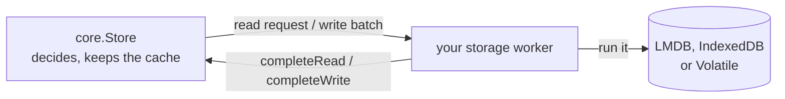

# Stores, transactions and reads

A store is where Loam keeps records. This guide is the storage half of the
[Loam guide](../loam.md). [LMDB operations](lmdb.md) covers the on-disk
backend's capacity and maintenance.

Every operation here follows one pattern. Loam's `core.Store` decides what to
read or write and hands your code a request. Your storage worker runs that
request against a backend and hands the result back. The Store touches no disk,
starts no thread, and never waits.

## Opening a store

An LMDB store is one directory on disk, owned by one process at a time.

To create one, make an empty directory, choose a fresh store identity, and call
`Lmdb.open(path, .{ .mode = .{ .create = identity } })`. To reopen it, pass
`.open = identity`. The backend checks that the identity matches. Missing
metadata, a store that already exists on create, an identity mismatch, and
another process holding the directory are distinct failures. No error falls back
to volatile storage or resets an existing store.

An embedding that persists its private store identity before opening can use
`.bootstrap = identity`. This mode atomically creates missing metadata or opens
that exact existing identity. It preserves existing records and refuses corrupt
or mismatched metadata. Use ordinary `.open` once the embedding has confirmed
its application root, so a missing store cannot silently replace that root.

Construct `core.Store` from the backend's claimed metadata, your schema
descriptors, and explicit memory limits. The Store borrows the schemas for its
whole lifetime. Keep the Store and its backend at stable addresses while a
worker borrows them.

One execution context owns each Store and delivers its completions. Workers
receive batches or read requests and never mutate the Store themselves. The
volatile backend needs its calls serialized. LMDB allows concurrent reads and
one writer, and the Store admits one outstanding write at a time.

## Changing records

A transaction runs `begin`, then `allocateId` for each new record, then
`putCopying` or `remove` for each change, then `prepare` and `beginWrite`.
When the change builds a cycle, allocate every new ID before writing any
record, so each record can name the others.

A record carries its schema and version, its payload, its typed edges, and
whether it is a root. `putCopying` takes the revision of the record it
replaces, or null for a new one, so an edit prepared from stale data is
refused instead of overwriting a newer change. It copies the proposal and
assigns the next committed revision. Changing the root flag is part of the
same atomic write as the content.

`beginWrite` returns a batch that borrows Store-owned memory. Your worker runs
`backend.commit(batch)` and delivers the outcome to `Store.completeWrite`.
Check the outcome itself: a delivery that succeeds does not make an unchanged
backend result into a committed write. In a Host-based program, run LMDB
storage on your existing executor, outside the Host turn.

## When a write's outcome is unknown

A crash or I/O failure can leave a write whose result nobody knows. The Store
then keeps the batch and fences reads and new writes until you settle it:

1. Join the worker that ran the write.
2. Get `Store.recoveryBatch` and pass it to the backend's `recover`.
3. Deliver what recovery found through `Store.resolve`.

A timeout or an abandoned caller does not prove the write aborted, so neither
one unfences the Store. The [LMDB tests](../../test/loam/lmdb/storage_test.zig)
run these paths with complete and interrupted transactions.

## Reading records

Reads mirror writes. `Store.acquire` returns either a lease on a resident
version or a read request. Your worker runs `backend.read(request)` and
returns the result to `Store.completeRead`. Acquire again to get the lease.
A second request for a record that is already loading reports `PendingRead`
instead of issuing another load. Your code owns any callers waiting on it.

`Store.view` borrows the validated record bytes until `Store.release`. A held
lease can keep an older version readable after a later commit. Released,
foreign and stale lease tokens are refused. Canceling a read keeps its buffer
until the worker finishes, and the canceled completion cannot install data.

`currentView` refuses a historical lease, so code that restores authority
always sees the current record. `view` still allows historical reads. Record
integrity and current authority are separate checks: caching a decoded record
never makes an old lease current.

## Cache and memory

Each cache slot holds either a pending read or immutable resident bytes with
their checked record envelope. Completion validates the bytes once, and later
views borrow that envelope after checking the lease.

The cache charges a maximum-size record buffer for each read. A transaction
can opt into `retainOnCommit`, which moves its prepared buffers into free
cache slots at their actual encoded size. That installation allocates nothing
and never displaces a pinned snapshot.

These budgets are independent of each other and of how many objects the store
holds:

- the cache byte limit and its occupancy
- the slot and lease tables, each with a bounded setup cost that includes one
  checked envelope per slot
- staged writes, with their own byte and mutation limits

Encoding measures a record before allocating and copies each changed record
once. LMDB readers copy into the reserved buffer and finish before returning.
The volatile backend's data and LMDB's mapped, OS-resident pages are outside
the cache budget.

Store metadata reports the object count, root count, and exact encoded record
bytes. Those totals exclude indexes, database pages, cache metadata and
in-flight writes, so they measure neither the reachable graph nor process
memory.

## What a commit costs

Batch validation reads the changed records and their strong targets. It
resolves references inside the batch by scanning the bounded mutation table,
never the whole store.

After a commit, unchanged resident records carry into the new revision.
Changed and removed records go stale, and prepared replacements can become
resident through `retainOnCommit`. Each lease keeps the revision it was taken
at, so reused bytes never make an old lease current. A pending read is still
refused if any commit lands before it completes.

## Closing a store

Retire reads, settle writes, release leases, then deinitialize the Store.
Closing the LMDB backend is covered in [LMDB operations](lmdb.md#closing).
