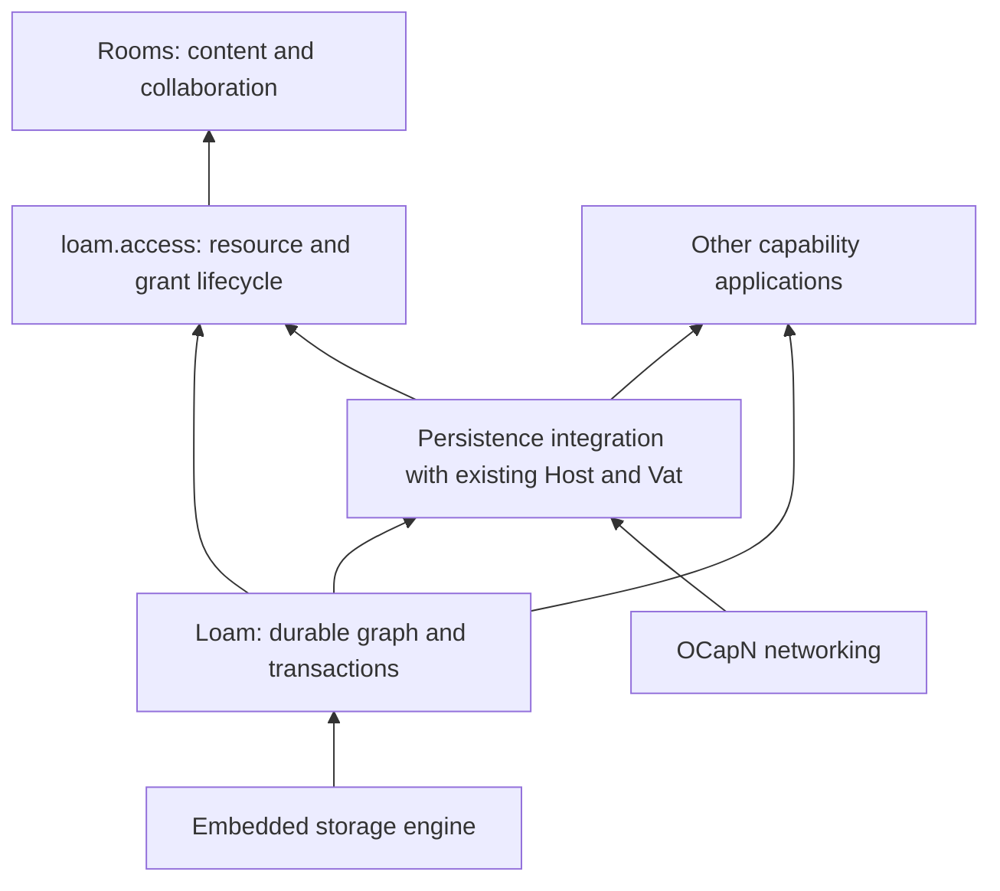

# Design and implementation plans

Status: active plan index. The [roadmap](../roadmap.md) owns project priority;
this guide maps the design documents and their responsibilities. The
[shipped inventory](../shipped.md) owns implementation status. A contract in
these plans describes the intended behavior unless it explicitly names
implemented evidence.

## Definition of complete

Work taken from these plans is complete when all of the following are true:

1. The implementation meets its stated acceptance criteria, including the
   applicable failure, ownership and cost requirements.
2. The relevant checks pass for the resulting source. Tests or reports at the
   owning surface record the evidence and its limits.
3. Contracts, examples and current-state documentation describe the result.
   Remove finished tasks and dependencies from active queues. Delete a temporary
   plan when no work remains, retaining durable contracts and evidence at their owners.
4. The verified changes and planning cleanup are committed and integrated into
   the local `dev` branch. Verify that `dev` contains the resulting commit and
   that the worktree has no uncommitted changes from the task.

A verified working diff or a commit confined to a worktree branch is still
unfinished. Follow the repository's
[integration procedure](../../.agents/rules/cli.md#git-posture) to land the work.

A completed slice of a larger item must have explicit scope and evidence.
Record its implemented behavior at the owning surface and leave only the
remaining obligations in the queue. The parent item stays open until all of
its acceptance criteria are met; documenting an omitted requirement does not
complete it. Documentation-only cleanup follows the same integration requirement
and uses the relevant documentation check.

## Priority and readiness

Agent work picked up from this directory resumes Rooms in its dependency order.
The C/Rust and browser fixed-resource lifecycles and bounded managed-control
helpers are implemented; the
[C/Rust guide](../loam/c-and-rust.md) and [browser guide](../loam/browser.md)
record their scope and evidence. The [backend acceptance queue](loam/completion.md)
retains unperformed macOS acceptance under maintainer ownership; OS portability
and target validation are outside this agent sequence. They remain required
before claiming support on those targets.

Failure and cost evidence land with each feature. A completed registration or
transaction slice does not complete the C/Rust resource path: create, share,
edit, restart and reopen must work together through the consumer.

| Lane | Next action and prerequisite |
| --- | --- |
| Loam | Maintainer-owned macOS acceptance remains in the [completion queue](loam/completion.md#execution-order). |
| Rooms | Session declarations, saved-reference fields, bounded codecs and persisted permission dependencies are proved. Project scope-aware applicability, exact targets and management in the [dependency order](rooms/integration.md#shared-prerequisite-and-remaining-order), then replace session authority and follow the Rooms phases. |
| Visualizer | Re-measure on the reporting machine's real GPU before deciding whether further renderer changes are needed. |
| Publication | Follow the maintainer account checklist, then exact-commit release evidence and archive publication. These external actions do not block local engineering. |
| Crypto-version transition | Resume when the upstream wire contract is agreed; the upstream watch owns that condition. |
| A2A | Deferred by ADR-0084; do not expand it while picking up ready work. |
| Runtime semantics | Write the outbound prepare/commit ADR; the other items in the [runtime semantics plan](runtime-semantics.md) wait on maintainer decisions. |

The [roadmap](../roadmap.md) also tracks independent platform and reachability
work outside these plans. Its release and platform requirements still apply;
none is an implicit prerequisite for starting the local Loam queue.

## Loam and Rooms

Start with the [Loam architecture](loam/architecture.md) for the foundation,
then the [Rooms content model](rooms/content.md) for the application it should
support. Loam supplies persistent objects and capabilities with bounded
resident memory. Its included `loam.access` module adds managed resources,
grants, delegation, and editable access. Rooms supplies the collaboration
model and interface. Applications can use Loam without managed resources.

Arrows show what supplies each capability, rather than source imports. The
architecture document owns the module dependency graph. Persistence integration
uses the existing execution owners; Loam adds no separate actor runtime.

| Reader's question | Owning document |
| --- | --- |
| How do glowcap, Loam, actors, and managed access fit together? | [Loam architecture and implementation stages](loam/architecture.md) |
| Which verified Loam gap comes next, what does it depend on, and what removes it? | [Temporary completion queue and execution order](loam/completion.md#execution-order) |
| How are objects, reference fields, leases, transactions, and backend outcomes represented? | [Loam API contract](loam/api.md) |
| How do actors sleep, wake, preserve call ordering, and release memory? | [Sleepy actors and durable hosting](loam/actors.md) |
| How are resources, facets, grant mutation, and change events enforced? | [Managed access architecture](loam/access/architecture.md) |
| What does an application use from Zig or a language binding to define and manage resources? | [Managed access API](loam/access/api.md) |
| What must storage prove for grants, protected queries, restoration, and recovery? | [Managed access storage requirements](loam/access/storage.md) |
| What evidence must managed access provide at each integration surface? | [Managed access acceptance](loam/access/acceptance.md) |
| What are directories, rooms, conversations, messages, and branching or reorganization? | [Rooms content and interaction model](rooms/content.md) |
| How do direct sharing, facets, provenance, and recursive composition work? | [Rooms resource and sharing model](rooms/resource-model.md) |
| How do presets, Custom permissions, pause, and revocation appear in the interface? | [Rooms access editor](rooms/access-editor.md) |
| Which permission admits each method and returned capability? | [Rooms operation authority](rooms/authority.md) |
| Which records, limits and recovery transactions must Rooms implement? | [Rooms authority storage and budgets](rooms/persistence.md) |
| Which consumers and recovery mechanisms must be replaced? | [Rooms consumer and recovery inventory](rooms/integration.md) |
| How do the opening sharing scenarios behave through their whole lifecycle? | [Rooms sharing walkthroughs](rooms/scenarios.md) |
| Which Rooms surfaces change together, and what proves completion? | [Rooms integration plan](rooms/access-grants.md) |

## Persistence research and prior art

The research lives under `loam/research/`. Begin with the persistence reuse review
for the build-or-adapt recommendation; use the broader study for alternative
memory models and the measurement program.

| Evidence or question | Document |
| --- | --- |
| Sandstorm's Blackrock, Goblins storage internals, POST++, source revisions, and which systems libraries can be reused | [Persistence reuse review](loam/research/native-reuse.md) |
| LMDB and SQLite, persistent heaps and regions, memory isolation, graph size, and whole-product experiments | [Memory and persistence research](loam/research/memory-persistence.md) |

The selected direction builds the shared object/capability layer over an
existing engine. LMDB is implemented, and the
[native workload](../../bench/loam/README.md) measures managed lifecycle, ancestry, sustained native workers, foreign restoration, retention and process memory.
The [completion queue](loam/completion.md) retains macOS acceptance. Compare
another backend if measurements identify a physical-engine constraint, under
matching durability and workload. A custom pager requires
evidence that the physical engine is the limiting factor. The research keeps
that evidence and its limits
separate from the accepted [ownership decision](../decisions/adr/ADR-0161-loam-foundation-and-access-extension.md).

## Implementation and document ownership

The [Loam architecture](loam/architecture.md#implementation-order-and-acceptance)
owns the layer stages and the implementation readiness checkpoint. Much of the record,
LMDB, actor and managed integration is already implemented; use the
[roadmap](../roadmap.md#durable-applications) to extend it in priority
order rather than restart those stages. The Zig implementation and first C/Rust and browser lifecycles
have consumer integration evidence. Rooms is ready for application integration.
Outstanding macOS acceptance remains a maintainer-owned
platform obligation, not an agent scheduling prerequisite.
Research supplies measurements and failure cases throughout. The access
storage requirements specialize acceptance; they do not introduce a second
backend or execution sequence.

Rooms design can be refined alongside that work. Its
[integration sequence](rooms/access-grants.md#ordered-implementation-and-exit-criteria)
consumes the shared foundation before replacing session access and expanding
room, directory, and conversation workflows.

Keep generic persistence contracts in the Loam API, actor lifecycle in the
actor contract, resource authority in managed access, and application semantics
in Rooms. Link to the owning contract when another document needs it. Accepted
decisions belong in [ADRs](../decisions/README.md); source observations and
unproven alternatives belong in research. The [completion definition](#definition-of-complete)
governs evidence, planning cleanup and integration into `dev`.

## Other plans

| Work | Plan and status owner |
| --- | --- |
| OCapN crypto-version transition | [Protocol plan](ocapn-crypto-version-handshake.md), waiting on [upstream](../upstream-watch.md). |
| Visualizer performance | [Remaining measurement](ocapnviz-backlog.md), ordered in the roadmap. |
| Repository and website publication | [Public release readiness](public-release-readiness.md), ordered in the roadmap. |
| A2A facade | [Historical design sketch](glowcap-a2a-on-captp-design.md), deferred by ADR-0084. |
