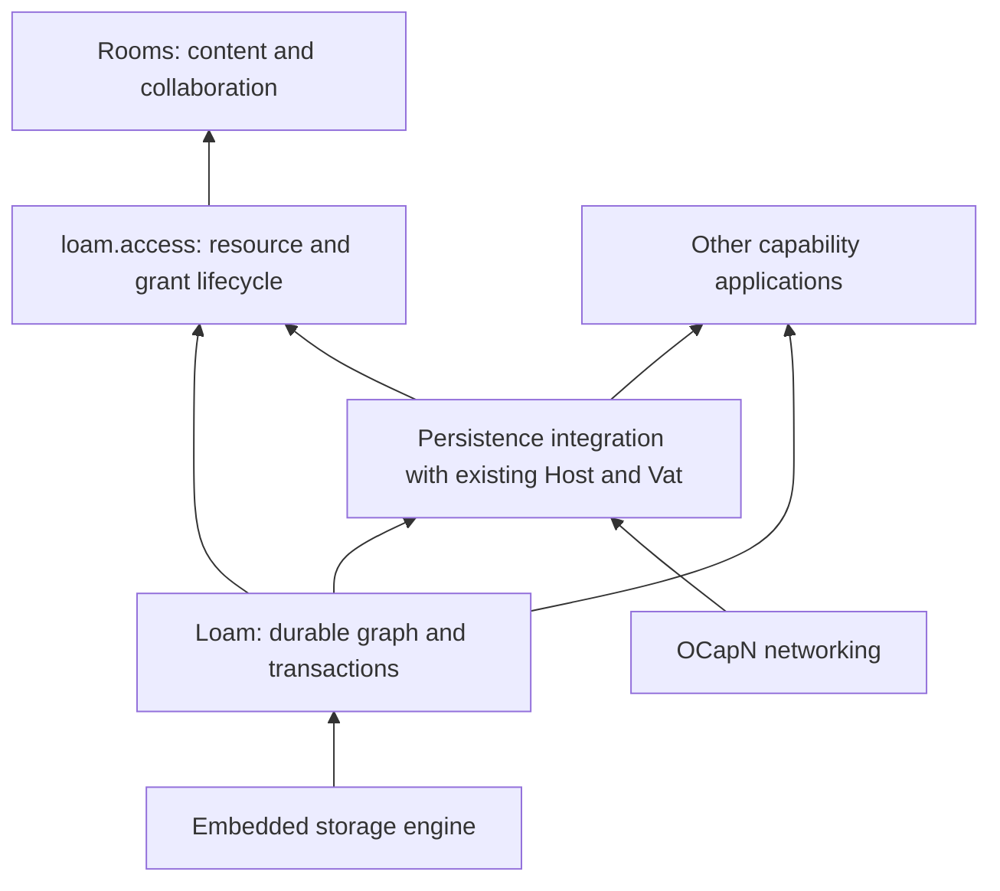

# Design and implementation plans

Status: active plan index. The [roadmap](../roadmap.md) owns project priority
and the [shipped inventory](../shipped.md) owns implementation status. A
contract in these plans describes intended behavior unless it names
implemented evidence.

## Definition of complete

Work taken from these plans is complete when all of the following are true:

1. The implementation meets its stated acceptance criteria, including the
   applicable failure, ownership and cost requirements.
2. The relevant checks pass for the resulting source. Tests or reports at the
   owning surface record the evidence and its limits.
3. Contracts, examples and current-state documentation describe the result.
   Remove finished tasks and dependencies from active queues. Delete a temporary
   plan when no work remains, retaining durable contracts and evidence at their owners.
4. The verified changes and planning cleanup are committed and integrated into
   the local `dev` branch. Verify that `dev` contains the resulting commit and
   that the worktree has no uncommitted changes from the task.

A verified working diff or a commit confined to a worktree branch is still
unfinished. Follow the repository's
[integration procedure](../../.agents/rules/cli.md#git-posture) to land the work.

A completed slice of a larger item must have explicit scope and evidence.
Record its implemented behavior at the owning surface and leave only the
remaining obligations in the queue. The parent item stays open until all of
its acceptance criteria are met. Documenting an omitted requirement does not
complete it. Documentation-only cleanup follows the same integration requirement
and uses the relevant documentation check.

## Priority and readiness

Agent work picked up from this directory resumes Rooms in its dependency order.
Failure and cost evidence land with each feature. The C/Rust resource path is
complete only when create, share, edit, restart and reopen work together
through the consumer.

| Lane | Next action and prerequisite |
| --- | --- |
| Loam | Maintainer-owned macOS acceptance remains in the [maintainability and security plan](../roadmap.md#open-obligations-from-retired-plans). |
| Rooms | Execute the [Rooms plan](rooms.md#ordered-implementation-and-exit-criteria) phases in order. The [managed session](../rooms/session.md) owns production startup, browser state, retained admission and shared management. |
| Visualizer | Re-measure on the reporting machine's real GPU before deciding whether further renderer changes are needed ([plan](../roadmap.md#open-obligations-from-retired-plans)). |
| Publication | Follow the maintainer account steps in the [maintainability and security plan](../roadmap.md#open-obligations-from-retired-plans), then exact-commit release evidence and archive publication. These external actions do not block local engineering. |
| Crypto-version transition | Resume when the upstream wire contract is agreed. The upstream watch owns that condition. |
| A2A | Deferred by ADR-0084. Do not expand it while picking up ready work. |
| Runtime semantics | Local sends commit with the turn (ADR-0191), far sends retract with a failed turn (ADR-0194), and one runtime owns dial retry and the release-on-drop setting (ADR-0193). |

OS portability and target validation are outside this agent sequence, but
support on a target is not claimed without them. The [roadmap](../roadmap.md)
tracks that and other platform work. None of it blocks the local queue.

## Loam and Rooms

The Loam foundation is documented under [`docs/loam/`](../loam.md#the-guides-in-reading-order).
Its design contracts ([architecture](../loam/architecture.md), [API](../loam/api.md),
[sleepy actors](../loam/actors.md), [managed access architecture](../loam/access-architecture.md),
[managed access API](../loam/access-api.md), and [managed access storage](../loam/access-storage.md))
describe shipped behavior. The [Rooms plan](rooms.md) holds the application
work that is not built: recursive rooms, directory access, conversation
workflows, and the shared access editor. Loam supplies persistent objects and
capabilities with bounded resident memory. Its included `loam.access` module adds managed resources,
grants, delegation, and editable access. Rooms supplies the collaboration
model and interface. Applications can use Loam without managed resources.

Arrows show what supplies each capability, not source imports. The
architecture document owns the module dependency graph. Persistence integration
uses the existing execution owners, and Loam adds no separate actor runtime.

| Reader's question | Owning document |
| --- | --- |
| How does Rooms admit work, configure allowances and recover from overload? | [Rooms work admission](../rooms/admission.md) |

## Persistence research and prior art

Start with the persistence reuse review for the build-or-adapt recommendation.

| Evidence or question | Document |
| --- | --- |
| Sandstorm's Blackrock, Goblins storage internals, POST++, source revisions, and which systems libraries can be reused | [Persistence reuse review](../loam/research/native-reuse.md) |
| LMDB and SQLite, persistent heaps and regions, memory isolation, graph size, and whole-product experiments | [Memory and persistence research](../loam/research/memory-persistence.md) |

Loam builds its object and capability layer over LMDB, and the
[LMDB workload](../../bench/loam/README.md) measures it. Compare another
backend, or write a custom pager, only when measurements show the storage
engine is the limit under matching durability and workload. The
[ownership decision](../decisions/adr/ADR-0161-loam-foundation-and-access-extension.md)
is accepted and the research does not reopen it.

## Implementation and document ownership

The [Loam architecture](../loam/architecture.md#implementation-order-and-acceptance)
owns the layer stages and the readiness checkpoint. Extend it in
[roadmap](../roadmap.md#durable-applications) order rather than restarting
those stages. Recursive room and directory resources are the next application
integration, in the Rooms
[integration sequence](rooms.md#ordered-implementation-and-exit-criteria).

Keep generic persistence contracts in the Loam API, actor lifecycle in the
actor contract, resource authority in managed access, and application semantics
in Rooms. Link to the owning contract when another document needs it. Accepted
decisions belong in [ADRs](../decisions/README.md). Source observations and
unproven alternatives belong in research. The [completion definition](#definition-of-complete)
governs evidence, planning cleanup and integration into `dev`.

## Other plans

| Work | Plan and status owner |
| --- | --- |
| OCapN crypto-version transition | [Protocol plan](ocapn-crypto-version-handshake.md), waiting on [upstream](../upstream-watch.md). |
| A2A facade | [Historical design sketch](glowcap-a2a-on-captp-design.md), deferred by ADR-0084. |
