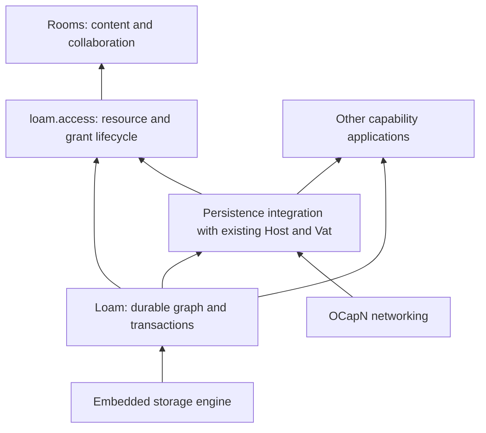

# Design and implementation plans

Status: active plan index. The [roadmap](../roadmap.md) owns project priority;
this guide maps the design documents and their responsibilities. The
[shipped inventory](../shipped.md) owns implementation status. A contract in
these plans describes the intended behavior unless it explicitly names
implemented evidence.

## Loam and Rooms

Start with the [Loam architecture](loam/architecture.md) for the foundation,
then the [Rooms content model](rooms/content.md) for the application it should
support. Loam supplies persistent objects and capabilities with bounded
resident memory. Its included `loam.access` module adds managed resources,
grants, delegation, and editable access. Rooms supplies the collaboration
model and interface. Applications can use Loam without managed resources.

Arrows show what supplies each capability, rather than source imports. The
architecture document owns the module dependency graph. Persistence integration
uses the existing execution owners; Loam adds no separate actor runtime.

| Reader's question | Owning document |
| --- | --- |
| How do glowcap, Loam, actors, and managed access fit together? What is built next? | [Loam architecture and implementation order](loam/architecture.md) |
| Which verified Loam gaps can an implementer complete and remove before the C ABI? | [Temporary completion queue](loam/completion.md) |
| How are objects, reference fields, leases, transactions, and backend outcomes represented? | [Loam API contract](loam/api.md) |
| How do actors sleep, wake, preserve call ordering, and release memory? | [Sleepy actors and durable hosting](loam/actors.md) |
| How are resources, facets, grant mutation, and change events enforced? | [Managed access architecture](loam/access/architecture.md) |
| What does an application use from Zig or a language binding to define and manage resources? | [Managed access API](loam/access/api.md) |
| What must storage prove for grants, protected queries, restoration, and recovery? | [Managed access storage requirements](loam/access/storage.md) |
| What is the managed access implementation order, and what proves each slice complete? | [Managed access implementation and acceptance](loam/access/acceptance.md) |
| What are directories, rooms, conversations, messages, and branching or reorganization? | [Rooms content and interaction model](rooms/content.md) |
| How do direct sharing, facets, provenance, and recursive composition work? | [Rooms resource and sharing model](rooms/resource-model.md) |
| How do presets, Custom permissions, pause, and revocation appear in the interface? | [Rooms access editor](rooms/access-editor.md) |
| Which Rooms surfaces change together, and what proves completion? | [Rooms integration plan](rooms/access-grants.md) |

## Persistence research and prior art

The research lives under `loam/research/`. Begin with the persistence reuse review
for the build-or-adapt recommendation; use the broader study for alternative
memory models and the measurement program.

| Evidence or question | Document |
| --- | --- |
| Sandstorm's Blackrock, Goblins storage internals, POST++, source revisions, and which systems libraries can be reused | [Persistence reuse review](loam/research/native-reuse.md) |
| LMDB and SQLite, persistent heaps and regions, memory isolation, graph size, and whole-product experiments | [Memory and persistence research](loam/research/memory-persistence.md) |

The selected direction builds the shared object/capability layer over an
existing engine. LMDB is implemented; representative managed workloads still
need evidence. Compare another backend if measurements identify a physical-engine
constraint, under matching durability and workload. A custom pager requires
evidence that the physical engine is the limiting factor. The research keeps
that evidence and its limits
separate from the accepted [ownership decision](../decisions/adr/ADR-0161-loam-foundation-and-access-extension.md).

## Implementation and document ownership

Follow the [Loam implementation order](loam/architecture.md#implementation-order-and-acceptance):
record and transaction contracts, LMDB durability, sleepy actors, managed
access integration, foreign/browser consumers, then composed product evidence.
The [readiness checkpoint](loam/architecture.md#readiness-before-the-c-abi)
must close before Loam's C ABI and Rust projection begin.
The research experiments supply measurements and failure cases throughout
those stages. The access storage requirements specialize their acceptance
criteria; they do not introduce a second backend or execution sequence.

Rooms design can be refined alongside that work. Its
[integration sequence](rooms/access-grants.md#ordered-implementation-and-exit-criteria)
consumes the shared foundation before replacing session access and expanding
room, directory, and conversation workflows.

Keep generic persistence contracts in the Loam API, actor lifecycle in the
actor contract, resource authority in managed access, and application semantics
in Rooms. Link to the owning contract when another document needs it. Accepted
decisions belong in [ADRs](../decisions/README.md); source observations and
unproven alternatives belong in research. Update the shipped inventory as
implementation gains evidence and retire the corresponding planning material.

## Other plans

| Work | Plan and status owner |
| --- | --- |
| OCapN crypto-version transition | [Protocol plan](ocapn-crypto-version-handshake.md), waiting on [upstream](../upstream-watch.md). |
| Visualizer performance | [Remaining measurement](ocapnviz-backlog.md), ordered in the roadmap. |
| Repository and website publication | [Public release readiness](public-release-readiness.md), ordered in the roadmap. |
| A2A facade | [Historical design sketch](glowcap-a2a-on-captp-design.md), deferred by ADR-0084. |
