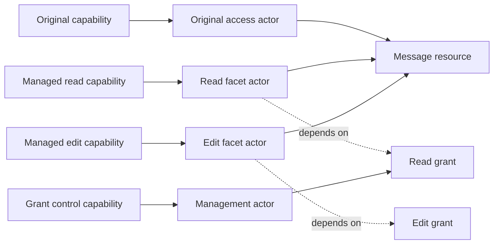
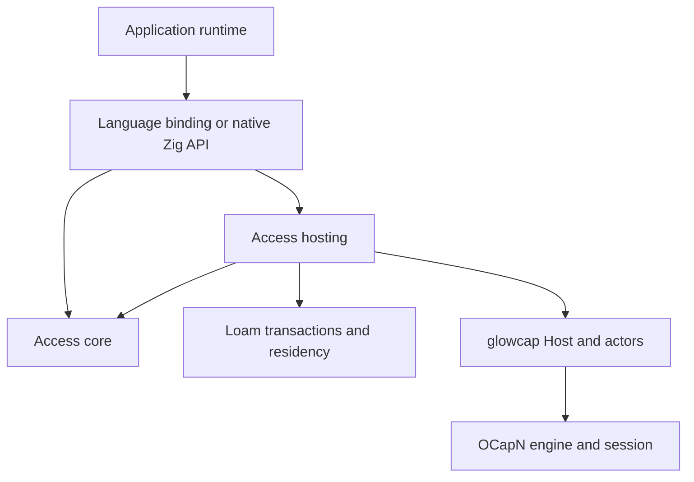

# Managed access architecture

Status: active plan. This document designs `glowcap.loam.access`, the included
Loam module for resource access and lifecycle management. The first resource/scope
slice is described by [ADR-0153](../../../decisions/adr/ADR-0153-access-resource-core.md);
[shipped inventory](../../../shipped.md#resource-models) owns current coverage.
The local grant model is described by
[ADR-0154](../../../decisions/adr/ADR-0154-access-local-grant-lifecycle.md);
[ADR-0155](../../../decisions/adr/ADR-0155-access-prepared-grant-writes.md) adds
preparation and exact storage completion.
[ADR-0166](../../../decisions/adr/ADR-0166-access-grant-records-and-plans.md)
extends evaluation and preparation to revision-checked grant records, with
bounded encoding and native atomic record evidence.
[ADR-0167](../../../decisions/adr/ADR-0167-managed-owner-storage.md) adds durable
owner headers and sparse indexes, bounded resumable reads, and shared-transaction
staging. [ADR-0168](../../../decisions/adr/ADR-0168-durable-managed-capability-bindings.md)
adds durable use/control descriptors and bounded opaque native operations.
[ADR-0169](../../../decisions/adr/ADR-0169-managed-host-turns.md) adds fixed-resource
use and control endpoints through the existing durable Host attachment and
ordinary publication restoration.
[ADR-0170](../../../decisions/adr/ADR-0170-durable-facet-derivation.md) adds
fixed-resource derivation, hidden publication reservation, and bounded retry
receipts.
[ADR-0172](../../../decisions/adr/ADR-0172-explicit-disclosure-of-returned-capabilities.md)
adds exact disclosure of stored reference fields.
[ADR-0173](../../../decisions/adr/ADR-0173-dependent-returned-capabilities-and-reference-edits.md)
adds dependent local facets and transactional strong-field edits. Independent
child control management, scoped event delivery, and the broader application
API remain to build.
The remaining architecture below is an implementation contract, not a claim
that its complete owner, hosting, or ABI surfaces exist. The [roadmap](../../../roadmap.md#durable-applications) owns
priority; the [Rooms plan](../../rooms/access-grants.md) owns product integration.
The [API sketch](api.md) supplies illustrative call shapes, and the
[resource model](../../rooms/resource-model.md) owns sharing semantics. The
[storage and performance plan](storage.md) specifies durable records,
bounded loading, backend transactions, calling patterns, and measurements.
The [memory and persistence research](../research/memory-persistence.md) evaluates
Loam's generic graph mechanisms and compares native backends. The
[Loam contract](../architecture.md) owns shared persistence; this plan owns
resource-management requirements on that foundation.

## Purpose and placement

The access module manages resource access and lifecycle. It is included at
`src/loam/access/` and exposed as `glowcap.loam.access`. It provides resource
relationships, scoped grants, delegation, editable access, and lifecycle.
Applications define content, permission meanings, and supported operations.
Loam supplies graph persistence, bounded residency, and atomic transactions;
existing actors and Host supply execution and capability custody.

Managed access is a model plus shared enforcement and transition machinery. Its value
is preserving authority rules while grants, containment, and content change.
A plain Loam object needs no managed access record. Managed resources and plain objects
can nevertheless participate in one Loam transaction.

The [Loam architecture](../architecture.md#modules-and-distribution) owns the
module and archive layout. The access module's implemented `core` exports native model
operations; `records` exports managed record encoding, and `storage` binds
record views and mutations to Loam leases and transactions. The proposed `hosting`
surface registers guarded behaviors on an existing Host with Loam persistence.
The planned libglowcap_loam archive includes managed access, and the Rust `loam` feature
includes `loam::access`. No separate managed access archive or feature switch is required.

The implementation uses Loam's shared transaction and recovery mechanism.
Managed access contributes admission, resource/grant records, and authority consequences.
It does not implement its own pager, cache, database executor, or activation
state machine. The APIs below remain proposed unless the shipped inventory
identifies their implementation.

## Actors, resources, and authority

Rooms already serves actor behaviors through the Rust Host binding. Its
[session grant publisher](../../../../apps/rooms/rust/runtime/src/grants/publications.rs)
registers guarded behaviors through
[durable Host publication](../../../../bindings/rust/src/host/public.rs).
[Archive facets](../../../../apps/rooms/rust/runtime/src/archive/mod.rs) also spawn
callable objects. The [existing architecture](../../../architecture.md#from-a-peer-to-an-application)
places those behaviors in the Host's actor machinery.

| Concept | Meaning and owner |
| --- | --- |
| Actor | A callable runtime object whose behavior executes through the actor layer. |
| Resource | An application object with stable identity, declared interfaces, and relationships governed by `loam.access`. |
| Capability | Actual authority to invoke an object, held through glowcap's reference machinery. |
| Grant | Terms, dependencies, and lifecycle for a managed access path, enforced by the access module. |
| Owner | One managed access authority domain and the committed state needed to evaluate its resource and grant relationships. |

These identities have different lifetimes. An actor can be a temporary callback
with no resource record. A stored resource can exist without a resident actor.
A single resource can have several actor-backed entry points:

This diagram shows logical roles, not a required allocation per edge or per
grant. Capability aliases and implementation sharing are valid when they
preserve the reference identity and authority contract. An actor is not a
thread or operating-system process.

Revoking the read grant leaves the message and independent edit grant intact.
Pausing access leaves its reference usable for later resumption. Destroying a
resource, retiring an actor, removing a publication, and revoking a grant are
separate transitions. Publication removal alone cannot revoke held references.
Restoration recreates callable endpoints from committed authority state; it
does not restore a previous network session or its import/export positions.

Resource IDs name records and cannot construct capabilities. Hosting may
materialize an endpoint on demand only through already-held authority or an
authorized durable publication. A public lookup by resource ID is not a
replacement for that admission.

## Dependency direction

Arrows below mean that the source depends on the target.

The core imports neither hosting nor Rooms. It is synchronous and free of I/O,
with explicit allocators and bounded state. It owns graph validation, scope
evaluation, policy composition, grant transitions, operation receipts, and
the preparation and completion of authority transactions. Cold record lookups
yield bounded storage effects; the embedding executes them and resumes the
core with revision-checked results. Loam storage adapters own database
I/O without adding it to the protocol or managed access core.

Hosting binds that model to the existing Host and actor APIs. It authenticates
an invocation from the called capability, enforces access, wraps dependent
outputs, and publishes or restores the exact authority selected by the core.
It reuses existing actor primitives where their contracts fit. It does not
maintain a second grant ledger, reference table, or turn scheduler.

Managed access introduces no engine, driver, Host, Vat, scheduler, or event loop.
Its hosting module consists of behavior constructors and integration functions
that take an existing Host. A registration handle owns only those registrations
and their managed access state; it cannot drive or close the Host. Existing Host APIs own
publication, reference custody, dispatch, and shutdown. Managed access requests those
effects and owns only their resource/grant consequences.

| Existing component | Reused responsibility | Access module contribution |
| --- | --- | --- |
| OCapN engine and session | Reference identity, protocol validation, promises, and handoff | No protocol semantics or network state. |
| Actors and Vat | Behavior invocation and turn scheduling | Behaviors guarded by resource and grant state. |
| Host | Actor registration, capability custody, publication, and dispatch | Integration functions that register those behaviors. |
| Driver and transports | I/O, connections, reachability, and runtime progress | No driver, transport, or progress loop. |
| Loam | Shared records, residency, transactions, and recovery | Resource/grant transaction contents, admission, and authority consequences. |

The protocol, actors, and ordinary Host do not depend on managed access. Hosts incur no
managed access owner, graph, or grant state unless an application constructs it. One Host
can serve multiple managed access owners and unrelated actors. A managed access owner is not a
new Vat, peer identity, or network connection.

The build must enforce separate core and hosting import boundaries even though
both live under `src/loam/access/`. C ABI code marshals values and projects outcomes;
it owns no policy or recovery decisions.

## State ownership and lifetime

A managed access owner owns resource and grant records, policy schema registration, authority
revisions, and resource-specific publication and receipt contents. Loam owns
their shared durable storage and transaction state. Durable
records live in the transactional store; only the admitted working set is
resident. The current array-backed model does not implement that loading
contract yet. An owner has no connection list, wire reference table, promise resolver
registry, or worker queue. Its pending transaction slot represents an atomic
state transition; the existing application executor runs the requested work.
Admission under load returns a typed busy result or uses the application's
existing bounded command queue. Managed access does not introduce another scheduler.

| State | Sole authority |
| --- | --- |
| Message bodies, author facts, and file metadata | Application content owner, participating in the same transaction when access depends on a change. |
| Resource identity, containment, and grant dependencies | managed access owner. |
| Current grant status and configured terms | managed access grant record; facet actors retain its identity rather than a copied policy. |
| Runtime actor identity and callable reference rows | Existing Vat and Host. |
| Active publication lookup | Existing Host publication registry. |
| Recipe to restore a publication's exact authority | managed access durable state, using the Host's existing publication mechanism. |
| Connection retirement and pending answer settlement | Existing Host and driver. |

A hosting registration retains one owner and its application context. Facet
actors retain a registration lease and the exact resource/grant identity they
serve. Dropping a typed client wrapper only releases its reference occurrence;
it neither revokes a grant nor destroys a resource. Endpoint reclamation follows
existing actor/reference custody rather than a managed access garbage collector.

The initial design permits one active hosting registration per owner, attached
to one existing Host. That Host may serve many owners. Shared durable state
requires an exclusive writer arrangement supplied by deployment or storage;
restoring the same authority independently in two processes is not supported
replication. Cross-owner composition uses retained capabilities rather than
shared mutable grant tables.

Explicit owner retirement closes its application admission, stops new
publications, and retires its own pending effects. Existing actor references
then refuse through a closed registration until their final release. This
small retained refusal state prevents dangling callbacks; it does not keep
content or storage workers alive. Permanent resource deletion and grant
revocation require their own committed operations before retirement.

Host shutdown continues to own the aggregate shutdown barrier. The access module's deferred
answers and outstanding Host effects participate in its existing pending-work
accounting. The application also joins storage completion before freeing an
owner or beginning recovery. Host closure cannot make an outstanding database
write disappear, and owner closure cannot close other users of that Host.

## Existing integration mechanisms

The implementation should use the existing
[Host turn surface](../../../../src/driver/core/host/hosting.zig) and
[publication owner](../../../../src/driver/core/publish.zig). These source links
identify current mechanisms, not permission to import their private leaves.
Supported entrypoints remain the public Host and driver surfaces.

| Operation | Integration design |
| --- | --- |
| Call a managed resource | A managed access behavior receives the existing Host turn and constructs an invocation from its bound resource/grant, then calls the application handler with admitted requirements. |
| Return a new facet during a call | Spawn its behavior through the existing turn capability API. Do not reenter a top-level Host registration API from a callback. |
| Wait for storage or a remote call | Defer the existing answer and retain its one-shot completion authority. The current executor resumes work on the Host's owning thread. |
| Forward a call with an unchanged permitted reply | Use existing turn forwarding after admission. |
| Restrict capabilities in a reply | Use send plus deferred completion, validate and transform the reply, then settle the existing answer. Tail forwarding cannot inspect the result. |
| Publish durable access | Persist its publication recipe, then use existing durable Host publication. Removal changes discovery; grant enforcement controls retained references. |
| Deliver a subscription event | Check its retained access path at delivery and use the existing send/tell mechanism. |

[Actor caretakers and attenuators](../../../../src/actors/ocap.zig) already provide
revocable forwarding and verb filtering. Managed access should reuse their forwarding
mechanism without stacking a caretaker flag and a persisted grant status as
competing authorities. A managed facet checks its current managed access grant and uses
ordinary actor behavior to act or refuse. Existing standalone caretakers keep
their independent purpose.

No global Host interception hook evaluates resource policy. Only managed access-registered
behaviors apply it. Calls to ordinary actors keep their current path and cost.
If a required turn, deferred-answer, or custody operation is unavailable through
a supported surface, extend that existing surface with a general operation and
its tests. Do not reconstruct the operation inside managed access or a language binding.

The access module's registered reply schema distinguishes plain data, dependent capabilities,
and explicitly independent handoffs. Traversal is bounded and covers nested
values. A method with unknown reply semantics cannot claim managed attenuation
of all its outputs. Generic wrapping of arbitrary third-party protocols is
outside the guarantee; an application adapter must declare their semantics.
Input callbacks also require declared authority treatment where they can cause
later delivery or delegation. A descriptor cache never replaces upstream calls.

## One implementation across languages

Zig owns the common access algebra. Applications register bounded descriptors
for permission sets, constraint composition, and effect requirements. The
initial vocabulary covers set intersection, lower and upper bounds, exact
matches, and declared resource relations. Zig validates schemas, evaluates
scope, combines terms, and walks local grant dependencies.

Rooms supplies the meanings of its operations and committed content facts.
For example, editing a message requires a declared edit permission and an
author relationship. Rooms produces the requirement and the relevant facts;
managed access checks it against effective authority. Facts cannot come from unvalidated
caller fields, and requirement mapping remains trusted application code.

| Zig implementation | Rust application and binding |
| --- | --- |
| Graph and scope validation | Content schemas and proposed content changes |
| Permission intersection and constraint bounds | Permission declarations and operation requirements |
| Grant ceilings, ancestry, and effective authority | Committed content facts and relation definitions |
| Pause, resume, revoke, and dependent output enforcement | UI and typed application methods |
| Authority transaction and restoration state machines | Storage execution and executor integration |
| Runtime registration and handle validation | Ownership wrappers, error conversion, and callback plumbing |

Applications do not implement generic `meet`, `is_narrower`, or ancestor
traversal. A missing general constraint operator is added to the shared Zig
model with tests. A domain-specific predicate can be supplied as a bounded,
synchronous application hook, but cannot override scope, ceilings, lifecycle,
or grant dependency checks. Unsupported policy schemas fail explicitly.

The public embedding API is available at runtime. Zig compile-time helpers
and Rust generics describe schemas and provide typed views over the same
model; neither instantiates a separate grant implementation. Bindings may
cache descriptions for display, but cannot use those caches to authorize
effects. Remote consumers use application protocols over OCapN and need not
embed managed access locally.

Rooms' portable content model remains independent of Host execution. Its
runtime composes content proposals with managed access admission and persistence.
Any schema types shared with that portable model must remain free of Host,
executor, and transport dependencies; the binding does not become its domain
model. Generic access behavior is removed from the existing Rust grant ledger
as the Zig implementation replaces it.

## Invocation, persistence, and returned capabilities

A protected mutation follows one authority path:

1. Hosting receives a call on an actual held capability and constructs a
   private invocation bound to its resource and access path.
2. The application proposes a content operation and declares its requirements.
   managed access evaluates those against committed graph, grant, and content revisions.
3. Managed access prepares the authority changes and the application prepares content
   changes in one recoverable transaction. No capability or content effect is
   exposed before the required commit.
4. The embedding executes storage. Loam consumes the exact completion receipt
   and installs its participants, including managed access;
   uncertain writes fence the owner for recovery. Conflicting mutations cannot
   pass a pending transaction and invalidate its admission.
5. Hosting delivers admitted results, applying current authority checks where
   delivery was queued. Returned managed references carry the required grant
   dependencies and underlying target authority.

Ordinary reads do not write a grant ledger. Asynchronous prerequisites finish
before final admission; an old check cannot authorize a later effect after
revocation. Content and authority must share a recoverable transaction where
their changes must be atomic. A storage adapter executes that contract; it
does not supply another authority state machine.

A message's attachment facet depends on both the message grant and the held
file capability. Returning it cannot reveal the file's original authority.
The same rule covers subscriptions, nested replies, and continuation objects.
Application code with independent original authority remains trusted to decide
which handoffs it intentionally permits; managed access cannot stop it from publishing
that authority through another API.

Remote dependencies continue to execute through their retained upstream
capabilities. Local records do not certify remote access, and a partition does
not turn a remote mutation into a successful commit. Each authority owner
reports its own committed outcome.

## Locators and restoration

Managed access hosting works with actual capabilities and durable references. The core
records resource/grant identities, publication recipes, and dependency keys;
existing Host and runtime surfaces own locator handling, publication, recovery,
and connection effects. Managed access introduces no locator format, transport registry,
connection pool, or alternate sturdyref resolver.

Publishing a message facet binds a durable Host publication to exactly that
message's access path. The link never exposes unrestricted parent authority
plus a client-enforced selector. Publication identity stays independent of
editable titles, labels, presets, and configured permissions. Restoration
reconstructs the same resource and grant dependency, including paused or
revoked state, before permitting calls.

External dependency records retain the exact durable reference where one
exists. Live-only dependencies remain live-only; a durable ancestor cannot
make them restorable by recording their IDs. Link handling yields typed
unavailable, paused, revoked, or gone outcomes rather than retrying a stronger
entrance. The [content plan](../../rooms/content.md#deep-links-and-durable-access)
owns the recipient's focused views and separately authorized source navigation.

## Facet representation and policy scope

A served endpoint binds a resource identity, an original or managed access
source, and any fixed projection restriction. A managed share creates a grant
record with its own control authority. Opening an attachment through that share
can create a transient endpoint carrying the same grant dependency and a
narrower projection; it need not mint another editable grant or write storage.
An explicit durable share persists the dependencies needed to reconstruct its
exact access path. Endpoint references remain ordinary Host capabilities.

Directly passing an existing capability preserves its authority and revocation
boundary. It creates neither a grant record nor a new recipient identity.
Passing an original resource capability passes that original authority; passing
a managed facet stays subject to its grant. A resource ID is never an original
capability constructor, and a grant control cannot unwrap its source.

Policy descriptors use stable permission and constraint keys. Display labels,
presets, and UI grouping are separate metadata. Issued grants store explicit
terms, so changing a preset cannot enlarge them. Supported constraint operators
have shared Zig narrowing and intersection rules. Requirement expressions have
bounded conjunctions and alternatives over permissions and validated facts;
no alternative can bypass resource scope or lifecycle checks.

The initial requirement vocabulary includes resource selection, permission
membership, ordered bounds, and declared fact relationships. Applications map
operations into it and provide facts from their committed content revision.
A predicate hook refines a domain requirement and cannot redefine that
vocabulary's algebra. This keeps author checks expressible without making Rust
implement the generic scope evaluator or introducing an unrestricted policy
programming language.

An invocation uses one selected authority path. Managed access does not silently combine
permissions from independent capabilities in the same process. An operation
that intentionally requires several capabilities declares each requirement and
retains each dependency. Local grant ancestry is bounded and canonical;
remote dependencies are held references whose owner continues to enforce them.

The direct local API and actor-call API enter the same admission functions.
Holding the invoked capability reference conveys its grant authority; there is
no additional identity or grant credential to supply. Native use and control
references bind that authority to committed ledger records. Actor hosting must
retain and invoke those references through the same enforcement path.
Applications must be able to use managed access on local content without dialing a dummy
session. If the existing Host cannot expose a
needed local operation, its supported capability surface gains that operation;
managed access still does not construct another execution runtime.

## Observable access changes

Use endpoints implement `describe-access()` as the scoped snapshot defined by
[ADR-0171](../../../decisions/adr/ADR-0171-scoped-access-descriptions.md).
It shares current admission evaluation and emits no owner revision or event
cursor. The subscription and replay contract below remains to implement.

Grant mutations produce committed change events. Issuance identifies the new
grant and its parent inventory; policy, pause, resume, and revocation events
identify the affected dependency branch. One parent change does not require
rewriting or emitting one event for every descendant. Resource reparenting and
other authority-relevant content changes also produce transaction events so
scope changes can invalidate affected access views.

The current local ledger returns an owned event with each successful mutation.
Unchanged requests return no event, and failures leave no committed change.
The transaction layer must preserve this contract: durable change events become
observable only after the corresponding state commits. Events describe the
committed result, not a request, an optimistic checkbox, or a prepared write.

The access module's hosting integration delivers scoped subscriptions using the existing
actors and CapTP send/tell operations. Grant controls may observe only their
authorized inventory. A use facet may offer observation of its own effective
access without exposing grant administration. An ancestor change can become an
access-changed notice for that facet without disclosing hidden ancestor IDs,
policies, siblings, or unrelated activity. Raw owner events and revision stamps
are internal data, not a wire subscription format.

The UI uses these events to refresh access and lifecycle state. Active services
use them to stop or reconsider protected streams and pending work. A minimal
terminal notice may close a subscription when its access is revoked; that
notice carries no newly protected content. Event delivery itself must obey its
declared observation authority, including while use authority is paused.

Subscriptions have bounded queues and opaque scoped cursors. Reconnect or
overflow produces an explicit resynchronization result and an authorized
snapshot with its matching cursor, rather than silently skipping changes.
Managed access owns ordering and cursor validation; the embedding runs existing storage
and delivery effects without implementing a parallel event system.

Protected calls and deferred delivery still check current authority. Event
loss or delay cannot preserve permission. No synchronous distributed broadcast
or immediate acknowledgement from every holder is required for revocation.
The native ledger does not yet implement these subscriptions, transaction
events for resource changes, retention, or replay.

## Atomic content and access changes

The current ledger implements bounded prepared grant deltas, graph reservations,
and exact storage completion. The complete owner transaction described here
now binds fixed-resource content effects to admission through ADR-0169. ADR-0170
extends it with atomic derivation and bounded receipts. Cross-resource content
changes and a general operation journal remain requirements. Native use/control
references enforce selected grants and management ceilings through the same
preparation path; the [usage guide](../../../loam.md#managed-endpoints-on-the-host)
owns their supported calling and lifetime contract.

Managed access is the admission owner for transactions involving its resource graph or
grants. The application remains the content owner. Their shared transaction
contains a managed access delta, opaque application content changes, the expected content
revision, and an operation receipt. Loam owns this transaction and its recovery
state. It may span database rows without requiring a monolithic
snapshot or a second copy of all content in Zig.

The initial concurrency contract allows one prepared write per Loam persistence
domain and one staged authority mutation per participating managed access owner.
Other owners and ordinary actors continue running. Reads may observe the last
committed state while a write is pending, but must not observe its staged
changes. No conflicting content mutation bypasses the pending transaction.
After an uncertain write, all protected access to that owner refuses until
recovery has established which revision committed.

Preparation validates facts and requirements and reserves the resources needed
for the in-memory commit. The application stages content without publishing it.
After durable acknowledgement, the managed access and content revisions advance within
one synchronous, non-reentrant completion on the owning executor. This final
installation must not allocate or perform I/O. A panic or unexpected failure
fences the owner and reloads the durable record before any result is exposed.

A completion receipt is bound to the owner generation, transaction identity,
base revision, and prepared payload. Rust conveys the store outcome to Zig;
it does not decide which grant transition follows. The storage adapter and
content callback are trusted embedding code. The ABI prevents accidental stale
or mismatched receipts; it cannot prove a malicious adapter wrote the bytes.

Application-specific transactions with no managed access-protected effects use Loam
directly. Managed access does not become a general database, journal server,
or workflow framework. Any change to facts used for authority, such as authorship
or containment, must participate in the access module's revision and admission contract.

## Application protocol ownership

Managed access owns the common application interfaces for describing access, deriving a
managed share, controlling a grant, and inspecting authorized resource
relationships. Their schemas live with the access module's hosting integration and generate
its native and binding method definitions. Rooms owns content methods such as
posting and editing a message, along with its concrete permission declarations.
The Rooms generator references the common schema instead of copying its verbs.

These interfaces are ordinary application objects carried over existing CapTP.
They add no protocol message, transport extension, bootstrap privilege, or
universal remote resource registry. Method namespaces and schema identifiers
separate common management operations from application methods. Application
schema identities bind the permission vocabulary used to interpret a grant;
a remote descriptor or type label cannot create authority.

A peer can use a published managed access interface without embedding the Zig library.
A peer that lacks the interface returns an explicit unsupported outcome.
Clients never retry through a broader capability to compensate. Generic managed access
protocol fixtures belong to managed access; Rooms fixtures prove the content-specific
requirements and replies composed with those interfaces.

## Native, foreign, and browser packaging

The portable model is a distinct build module. Hosting depends on that module,
the existing actor layer, and the byte-fed Host surface. Neither requires the
native driver, sockets, or a particular transport. The public namespace groups
these APIs without reversing their imports.

The C ABI exposes opaque managed access owner, registration, and transaction handles.
Its capability arguments use existing Host capability types and ownership
operations. It must not invent a managed access reference representation that bindings
translate into Host identities through unchecked integers. Public resource IDs
remain data, even when represented by typed Rust structs.

The Loam companion archive includes managed access exports alongside shared persistence. It reuses existing Host opaque
handles and links against the existing Host archive; it must not emit another
copy of the Host symbol family or construct a second Host behind the handle.
Generated headers and binding layouts have one Zig authority. Compile-time
native helpers reduce boilerplate around the same runtime schema registration;
application-defined Zig types do not select a different grant algorithm.

Rust's portable content crate retains its content types. Runtime binding code
converts typed requirements and borrowed fact views into the common ABI.
Content deltas are opaque to Zig; allocations and retained callbacks have an
explicit release owner. No Rust callback implements the generic access algebra.
Foreign callbacks are synchronous and non-reentrant; asynchronous work returns
through completion handles driven by the existing executor.

Native builds link managed access with the existing Host and selected driver/transports.
Rooms browser builds link managed access, the byte-fed Host, and Rust into the existing
single Wasm memory. No JavaScript round trip or second Wasm instance is needed
for Rust-to-managed access calls. The existing browser executor and transport adapters
continue to drive the Host. These are implementation requirements whose actual
builds and costs must be verified.

## Cost and rejected alternatives

Managed access allocates an owner only when requested and a callable endpoint only when
its authority must be exposed. Registered schema definitions are shared within
an owner. Facets retain identifiers and dependencies rather than copies of the
graph or content. Initial access evaluation walks a bounded local grant chain
and scope relationship; revocation changes the authoritative record without
rewriting every descendant. Caching is optional and requires explicit revision
invalidation before it can participate in admission.

Borrow content facts for synchronous checks. Retain or copy only data that must
survive a deferred answer or storage operation, with explicit bounds. Preserve
Host-owned references through existing retain/release operations. Measure
native and foreign paths before claiming latency, allocation, or size targets.
A scalar read should not acquire a persistence write or an application queue
solely because it uses a managed facet.

| Alternative | Reason for rejecting it |
| --- | --- |
| Put managed access inside the protocol engine | Resource policy would couple applications to session semantics and impose work on unrelated protocol consumers. |
| Add managed access state to every actor | Temporary callbacks and resolvers would acquire unrelated graph and lifecycle costs. |
| Introduce a managed access Host or driver | Duplicates existing execution, publication, pending-work, and shutdown ownership. |
| Keep a grant evaluator in Rust beside Zig | Creates two authorities for scope and lifecycle, defeating the shared implementation. |
| Expose only a Zig compile-time generic model | Foreign applications cannot supply their types through a runtime ABI without another implementation strategy. |
| Express everything as a permission mask | Loses scope relations, constraints, content facts, and lifecycle dependencies. |
| Forward every managed call unchanged | Returned capabilities and deferred deliveries can escape the originating grant. |
| Treat every persistent resource as a permanently resident actor | Couples storage scale to endpoint residency without an authority requirement. |

## Implementation evidence

The architecture is a proposed implementation direction, not a performance or
correctness result. Its first complete integration exercises Rust Rooms over
the Zig runtime API, including a returned attachment and durable recovery.
The implementation ADR must amend the generic access ownership described in
[ADR-0147](../../../decisions/adr/ADR-0147-rooms-rust-application-boundary.md) while
preserving its Rust content and single-memory browser boundaries.

| Scenario | Required evidence |
| --- | --- |
| Shared implementation | Native Zig and Rust execute the same grant fixtures and outcomes; Rust contains no graph evaluator or grant lifecycle engine. |
| Independent use | Registering managed access creates no additional Host, Vat, driver, or event loop. Retiring a managed access owner leaves unrelated Host users alive. Ordinary actors work without managed access; the managed access core builds without actors, Host, Rooms, or I/O. |
| Multiple access paths | Pausing or revoking one facet preserves independent facets, the underlying resource, and unrelated actors on the same Host. |
| Resource lifetime | Stored resources need no resident actor; restoration preserves resource identity and exact authority without restoring network tables. |
| Returned authority | Attachments and subscriptions retain all required dependencies after edits, ancestor revocation, and restoration. |
| Durable failure | Lost acknowledgements, repeated operations, and interrupted publication cannot duplicate or broaden authority. |
| Consumer cost | Measure native and Wasm ABI crossings, allocations, retained state, and copying on issue, invoke, edit, and restore paths. |
| Shared runtime | Local and far invocations, deferred storage, and reply transformation run through existing Host turns and answers. Callback reentry is refused. |
| Atomic content | A crash or panic at each preparation, acknowledgement, installation, and publication boundary cannot expose mixed content/access revisions. |
| Shutdown | Host close waits for admitted Host work; owner retirement preserves unrelated actors; storage completion and late callbacks cannot access freed state. |
| Packaging | Core import checks forbid Host/I/O dependencies; archive symbol checks prove one Host implementation; browser linking uses one memory. |

The [Rooms implementation phases](../../rooms/access-grants.md#ordered-implementation-and-exit-criteria)
replace existing contracts directly. No migration layer, compatibility ledger,
or Rust fallback evaluator accompanies this work. Existing development state
that cannot satisfy the new contract requires an explicit operator reset.
