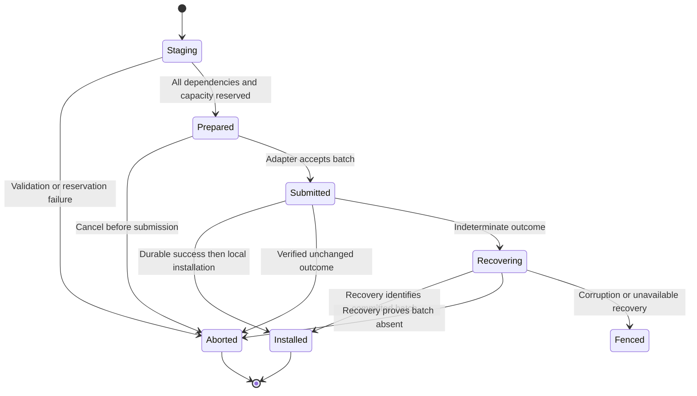

# Loam record, transaction, and hosting API

Status: active plan. This is an implementation contract with illustrative
notation for the full integration. The [usage guide](../../loam.md) documents
the implemented records, transactions, and record-backed actor profile; the native types and method names
there are authoritative for current consumers. The [architecture](architecture.md) owns
placement and dependency direction; the
[roadmap](../../roadmap.md#durable-applications) owns priority. The
[managed access API](access/api.md) adds resource management through `glowcap.loam.access`.
Its [durable owner usage guide](../../loam.md#durable-owner-operations) describes
the implemented storage participant and its explicit loading and commit path.
The [managed endpoint guide](../../loam.md#managed-endpoints-on-the-host) describes
fixed-resource use, control, and derivation through the existing attachment;
the broader fluent API below remains a design sketch.

## Application experience

An application opens a store with explicit identity, schema registration,
backend, and memory limits. It attaches persistence to an existing Host when
it needs callable objects. It can also use records locally with no Host.
Enabling managed access registers its schemas and guarded behaviors on that same store
and Host. None of these operations creates another Vat or executor.

```text
store = Loam.open(identity, schemas, backend, limits)
attachment = Loam.attach(existing_host, store, actor_restorers)
resources = Loam.access.register(attachment, domain, policy, content_handler)

plain_record = store.transaction(create_document_data)
managed_document = resources.create(document_schema, initial_content)
share = managed_document.derive(read_terms)
collection.insert(share.access)
```

These are desired call shapes. `resources` is optional. Managed access creation and sharing
must use the same transaction mechanism as the plain record. Opening an
existing store is distinct from creating a new store; failure cannot silently
recreate an empty authority domain or fall back to volatile storage.

## Stored identities and records

| Value | Contract |
| --- | --- |
| Store identity | Stable across verified recovery. Fresh creation requires a fresh identity; it is independent of a network locator. |
| Object identity | Stable store-qualified record name with an incarnation that cannot alias a destroyed object. Physical page addresses are not identities. |
| Revision | Monotonic committed version within a persistence domain. Overflow refuses mutation. |
| Schema identity and version | Select a registered structural decoder and reconstruction contract; unknown versions fail explicitly. |
| Root | A durable retention entry managed through authorized store operations. Naming a root does not grant remote access to its contents. |
| Publication descriptor | A versioned recipe interpreted by Host integration to restore the exact callable authority. |

Store identity, actor identity, and a managed access owner identity are distinct. Managed access
resource and grant names resolve to stored records through its participant's
indexed mapping. That mapping commits with creation and deletion; it is not a
caller-controlled way to obtain a capability. Do not infer a network locator
from a physical storage key or a managed access resource path.

The initial logical record has an identity, schema/version, revision, bounded
payload, and typed reference fields. Its envelope detects truncation and
accidental corruption; corruption checks do not authenticate a malicious
storage administrator. The physical engine can store these in
separate indexed families provided they participate in the same transaction.
Bound field counts, nesting, payload lengths, and edge counts before allocation.
Schema validation is shared by native, foreign, and restored input paths.

Application descriptors provide encoding, validation, reference enumeration,
and behavior reconstruction when applicable. Reconstruction is deterministic
for its committed inputs and cannot perform arbitrary I/O or emit externally
visible effects. A missing foreign reference is represented as unresolved or
broken according to its declared contract; it never becomes owner authority.

## Reference fields

```text
ReferenceField =
    LocalData(object, retention = strong | weak)
  | Capability(saved_descriptor, retained_dependency)
```

This is semantic notation. The application writes a held capability into a
typed field; Host integration creates the internal descriptor. There is no
public capability constructor taking a record ID. Ordinary trusted store
operations can address records directly, while remotely exposed operations
require the called capability's authority.

For capability fields, the transaction retains the exact reference and
prepares its durable representation through the Host. A local managed facet
retains its grant dependency. A foreign reference needs an established durable
restoration contract. Storing a live-only reference in persistent state returns
`NotDurable`; an explicitly volatile record can retain it only for that lifetime.

Replacing a field removes its old durable retention edge only when the new
payload and edge commit. Abort releases staged custody. A lost completion
keeps enough staging state to determine whether old or new custody survived.
External cleanup after commit has a retained owner and bounded retry policy.

Returning a field is separate from loading it. An application or managed access handler
declares whether the reply hands over the saved capability directly or creates
a projection dependent on the invoking facet. Encoding must consume that
authorized result and cannot choose the disclosure policy itself.

## Bounded reads and leases

```text
acquire(object, expected_revision?) -> Ready(ReadLease) | Pending(ticket) | Error
ReadLease.view() -> validated borrowed record
ReadLease.release()
```

Acquisition performs no hidden I/O in the synchronous core. A miss emits a
bounded effect. Completion is checked against the store incarnation, ticket,
requested identities, and revision constraints before installing resident data.
Duplicate, stale, and canceled completions cannot replace current state.

A lease pins the record bytes and their version for its lifetime. The view
cannot outlive the lease. Short synchronous native reads may borrow mapped
values while the adapter holds a valid transaction; crossing an asynchronous
boundary requires bounded owned materialization or an explicit snapshot lease.
The public ABI does not expose backend transaction pointers.

A snapshot lease preserves a data version and charges retained storage. It
does not preserve historical managed access permission to act. Every managed operation
uses current authority even if its content comes from a retained snapshot.
Leases expose their charged bytes, and admission enforces per-operation and
per-store limits before loading.

## Atomic mutations

```text
begin(domain, expected_revision) -> Transaction
Transaction.read / create / replace / remove / set_root
Transaction.store_capability(held_reference) -> staged reference field
Transaction.enlist(participant) -> participant access to this transaction
Transaction.prepare() -> Prepared | NeedRecords | Error
submit(Prepared) -> ticket
complete(ticket, backend_outcome) -> Installed | Unchanged | RecoveryRequired
```

Transactions own staged data, edge deltas, read dependencies, participant
changes, and reserved installation capacity. There is one prepared write per
domain initially. Reads can use the last installed revision while a write is
pending; a cold read cannot expose a newer backend revision before installation.

Participants provide bounded synchronous validation and staging. Managed access uses
that boundary to check scopes, grant revisions, and operation requirements.
Application content is another participant. They do not submit independent
writes, run nested backend transactions, or persist a grant before its content.
New capabilities and completion events remain unpublished until installation.

`NeedRecords` suspends preparation before submission. Load the missing inputs,
then validate again against current revisions. Staging callbacks may run again
and therefore cannot publish, perform I/O, or carry unrepeatable external effects.
Submitted work follows completion/recovery and is never replayed as preparation.



An operation ticket identifies the exact incarnation and submission. A backend
completion identifies the submitted batch and committed revision; foreign
callers cannot manufacture a receipt from arbitrary integers. The trusted
adapter is responsible for truthful I/O outcomes, and shared Zig verifies
ticket/phase consistency. Treat a false success from a malicious backend as
outside the trusted embedding contract.

Cancellation before submission aborts locally. After submission, cancellation
requests settlement but does not free state while an adapter can still access
it. Commit success remains committed even if the caller disappears. Shutdown
joins outstanding work through the existing Host/embedding barrier before
releasing callbacks or store memory.

An operation receipt can make a particular local mutation retryable. It binds
operation identity and intent to the committed result, including publication
identity when issuance is involved. Bound retention with persisted operation
epochs and a retirement floor: a request from a retired epoch refuses as expired
rather than becoming a new mutation. Retained operations return their recorded
result subject to current disclosure authority. Changed intent needs a new
operation identity. The receipt does not make arbitrary remote side effects
exactly-once.

## Adapter effects and failure

The synchronous core emits `ReadBatch`, `CommitBatch`, or `Recover` effects
with bounded inputs and a single completion owner. Native adapters run blocking
engine access on the embedding's existing executor. Browser adapters execute
prepared batches inside one supported browser transaction and report its
completion to the same state machine.

| Outcome | Required meaning |
| --- | --- |
| Success | The entire batch meets the selected durability contract and reports its revision. |
| Unchanged | The adapter can establish that this operation made no committed change. |
| Indeterminate | The operation may have committed; fence protected work and recover before deciding. |
| Corrupt | Validation cannot establish the store's identity, format, or graph consistency; do not restore authority. |
| Capacity | Storage, resident memory, retained versions, or operation limits prevent admission or completion; identify the relevant bounded resource. |

The durability profile states its failure model, synchronization, and supported
platform assumptions. Native process restart and power loss are different
tests. Browser transaction completion needs its own documented durability
profile. An adapter may not label weaker completion as the stronger profile.

## Host attachment and sleepy actors

The [actor contract](actors.md) owns activation, call scheduling, eviction,
and their acceptance tests. The attachment API below binds that lifecycle to
the shared store.

An attachment registers restorers and persistence callbacks on an existing
Host. Its lifetime retains the store and application callback context, but it
cannot run or close the Host. Ordinary actor state uses the same record and
reference mechanisms as managed access state.

Persistent actor descriptors identify behavior type/version and state edges.
Dormant entries retain identity, publication eligibility, and live reference
custody without retaining behavior payloads. Eventual calls enqueue through the
existing Vat; one activation per target loads and validates the required state
before delivery. Deletion or a stale activation generation prevents installation.

Near synchronous calls require a pinned resident target or explicit acquisition
before entering the turn. A dirty actor cannot be evicted until its relevant
state commits. Suspended calls retain bounded continuation state and participate
in shutdown. Persisting actor state alone does not promise survival of pending
promises, accepted calls, or network sessions across restart.

## Native and foreign implementation requirements

Build the first foreign surface around a complete Rooms resource journey:
create, share, edit, restart, and reopen. Reuse the existing binding Host and
held capability types. Add the required Loam store, lease, and transaction
ownership as that path needs them; a complete implementation of every sketch
in this plan is not an entry requirement. Native managed-access tests must first prove
atomic content/grant/event commitment and current admission during cold loading.

Zig descriptors and typed Rust wrappers must drive the same schema and effect
contracts. The C ABI exposes opaque store, attachment, lease, prepared batch,
and result handles with explicit release. Borrowed inputs last for the call;
asynchronously retained inputs have an explicit owning handle. Callbacks are
bounded, synchronous where declared, non-reentrant, and cannot unwind across C.

Loam and managed access share the libglowcap_loam archive. The Rust binding exposes managed access
under its `loam::access` module. Database selection is separate from resource-model
availability; callers using only plain records allocate no managed access state. Public
codec selection does not permit replacing the authority evaluator.

Before freezing these interfaces, exercise a native caller, a Rust caller, and
a browser executor through the same create/store-capability/restart/load path.
Check releases during pending I/O, stale completion after reopen, schema failure,
revocation during cold loading, and one transaction spanning plain and managed
objects. The implementation must resolve the abbreviated types here through
those complete paths, rather than introduce speculative generic APIs.
