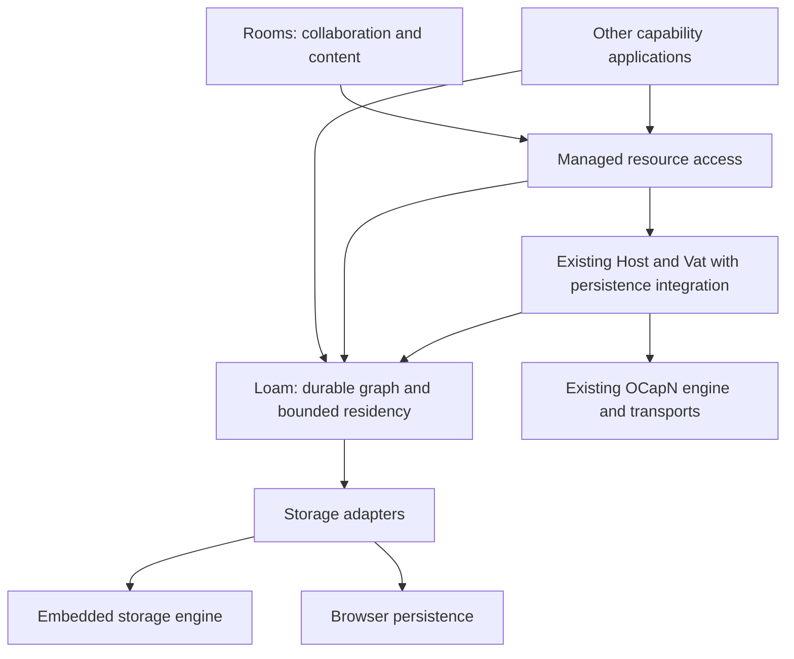
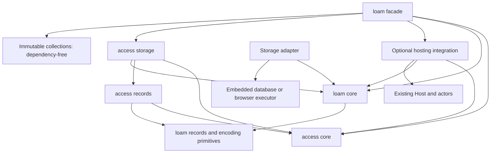
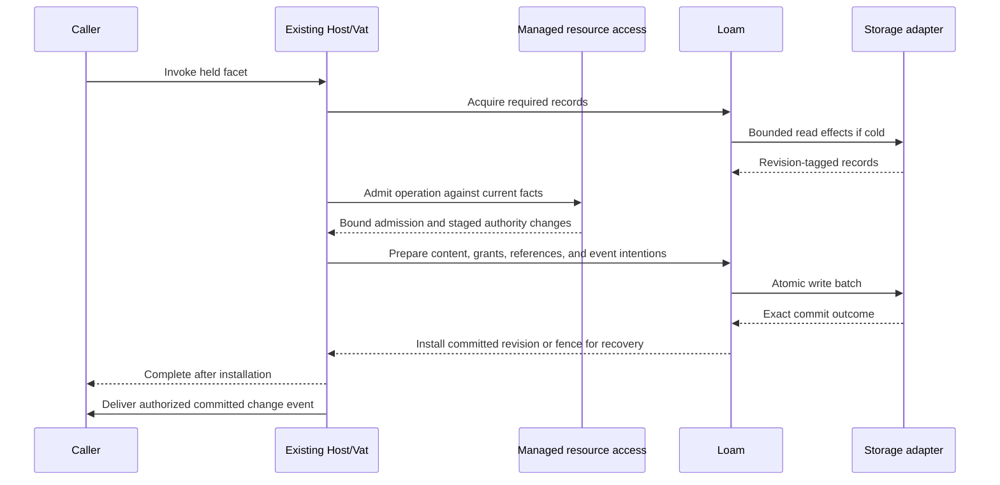

# Loam: durable capability applications

Status: active plan. Loam is glowcap's application persistence foundation, with
resource access lifecycle management supplied by its access module. The
[roadmap](../../roadmap.md#durable-applications) owns priority and
[ADR-0161](../../decisions/adr/ADR-0161-loam-foundation-and-access-extension.md)
records the architecture. The [API contract](api.md) specifies operations
and lifetimes. The [planning guide](../README.md) maps the research, managed
access, and Rooms contracts. The [shipped inventory](../../shipped.md#resource-models) distinguishes
implemented record storage, record-backed sleepy actors, local capability
restoration, and managed access primitives from the remaining integration. The [usage guide](../../loam.md) describes
the current Zig APIs.

## Product and ownership

glowcap supplies capability networking, actors, a Vat, a Host, and optional
persistence. Applications can use those mechanisms directly or use Loam's access
module for resources with managed grants. Rooms supplies directories, rooms,
conversations, messages, memberships, and the interfaces for working with them.

Loam makes a durable graph of ordinary records and capability-bearing objects
usable with bounded resident memory. Its access module adds resource scopes,
permission algebra, managed facets, delegation, and mutable grant lifecycle.
The module is available with Loam; creating a store or an ordinary actor must
not allocate a resource owner or run grant evaluation.



These arrows describe responsibility flow. The module dependency graph below
prevents the integration from becoming a second runtime. Persistence roots keep
objects retained; they are distinct from the access module's authority roots and from a
directory displayed at the top of a user interface.

| Owner | Responsibility |
| --- | --- |
| Loam core | Stored identity, schemas, versions, reference edges, retention, bounded record leases, prepared batches, and recovery state. |
| Loam record codecs | Encode and validate storage records using explicit format versions and bounded buffers. |
| Existing actors/Vat persistence integration | Dormant actor identity, activation, eviction eligibility, and coordination of turns with commits. |
| Existing Host persistence integration | Capability custody, exact restoration, durable publications, and externally visible completion. |
| Loam storage adapters | Execute reads and atomic writes through the existing embedding executor; report exact completion classes. |
| Managed access | Resource relationships, scopes, grants, ceilings, lifecycle, operation admission, and authorized observation. |
| Application | Domain schemas, method meanings, declared effects, content facts, and presentation. |

An application can mix managed resources and ordinary stored objects in one
transaction. Managed access is a transaction participant, not a second database. It
decides the authority conditions for its changes; Loam supplies their common
atomic persistence and recovery mechanism.

## Modules and distribution

The public namespace is `glowcap.loam`, including `glowcap.loam.access`.
The access module's resource and grant model is under `access.core`; owner, directory,
resource, grant, capability, and event codecs are under `access.records`.
Its implemented `access.storage` supplies bounded reads, opaque capability
operations, and transaction staging. The rest of this layout is an
implementation destination, not an inventory of existing files:

```text
src/loam/
  mod.zig                 Public Loam surface, including the managed access extension
  collections/            Dependency-free immutable data structures
  core/                   Graph transactions, retention, residency
  records/                Storage format and schema-driven encoding
  hosting/                Integration using public Host and actor interfaces
  backends/               Optional storage backends
  access/
    core/                 Resource graph, policy, grants, admission
    records/              Owner, directory, resource, grant, capability, and event encoding
    storage/              Bounded loading, opaque capabilities, and shared-transaction staging
    hosting/              Guarded behaviors and management interfaces
src/c_abi/loam/            Foreign projection of the same implementation
bindings/rust/src/loam/    Typed binding, including its access module
```

The planned C companion archive is libglowcap_loam. Its resource operations use
the glowcap_loam_access_ symbol family within that archive. There is no separate
access archive or required access feature switch. A Rust `loam` feature exposes both
surfaces; database dependencies remain explicitly selected. The archive
and foreign APIs are unimplemented and must enter the existing archive and
header generators together.

The facade can export both concerns while their cores remain independent:



The access module's policy algebra stays usable without I/O. Its persistence
binding uses Loam's public record and transaction contracts. Loam core imports no access module,
Host, actor implementation, CapTP session, transport, or backend. Hosting
integration depends on both sides and binds callbacks through supported APIs;
the existing Host need not import the Loam facade. Update the build's import
inventory as each module is implemented, with negative dependency probes.

The namespace itself owns no process state. Plain networking must remain usable
without a store, and local persistence without a network connection. No Loam or
managed access engine, driver, Host, Vat, worker pool, or independent turn queue is added.

## Schemas, codecs, and protocol independence

Three contracts have separate versions and owners:

| Contract | Meaning |
| --- | --- |
| Application schema | Typed data, reference fields, reconstruction rules, and domain invariants. |
| Storage format | Record envelopes, field encodings, durable reference descriptors, and indexes. |
| Wire codec | Encoding of calls and values for the connection's protocol profile. |

One schema description should drive field encoding and edge enumeration.
Reference fields cannot hide in opaque payload bytes. Payload and reference
metadata must commit together; generated bindings must not maintain parallel
lists of capability fields. Explicit opaque byte fields remain valid data.

Use existing Syrup primitives for the initial structural storage codec. Reuse
bounded borrowing and encoding support without importing session tables. A
packed layout or blob representation can later implement the same logical
record contract when measurements justify it. Changing a connection's wire
codec does not change durable object identity or require a database rewrite.

Loam understands retention and reference descriptor types. Host integration
understands how an actual capability is saved and restored. It supplies local
publication recipes or established foreign sturdyrefs, preserving exact source
authority. Codecs serialize those descriptors; they never select a stronger
reference, mint authority, or reinterpret import/export positions as identity.

Storing an unsupported live-only capability in durable content fails explicitly.
An asynchronous foreign save is a prerequisite resolved through existing Host
calls before local commit. It is not a distributed transaction. Its retained
result and any abandoned save need an explicit release/cleanup owner.

## Transactions and protected calls

One persistence domain starts with one writer serialized by its existing Vat
or embedding owner. The domain is a transaction boundary, not a new actor
runtime or network identity. Several domains sharing an engine do not acquire
cross-domain atomicity automatically.



The final event is illustrative: recipients may differ from the mutating
caller. Event delivery is subject to its own current-authority check. Missing
an event cannot permit stale access on the next protected call.

The application declares all effects, and managed access admits them against the actual
invoked capability. Admission is bound to resource and policy revisions and
cannot survive an arbitrary yield. Loading or other prerequisites happen before
final admission; changed facts require re-evaluation. Conflicting mutations
serialize or return a bounded busy/conflict result.

Loam coordinates one batch containing content, managed access state, reference edges,
receipts, and durable event intentions. Prepared state cannot leak callable
facets before commitment. Installation after success is allocation-free because
preparation reserved its necessary memory and publication capacity.

Known-unchanged failure discards staging. Indeterminate completion fences the
domain until recovery determines the committed state. The adapter reports what
happened; shared Zig logic owns the phase transition. Recovery cannot blindly
replay an operation that may already have committed. External calls require
their own retry contract; local transactions cannot promise exactly-once remote
effects or roll back an already delivered reply.

## Residency, retention, and the scale target

The 500,000-session target remains a networking measurement. Persistence adds
independent budgets for resident records, active endpoints, dirty state, leases,
operation scratch, retained history, and queued completions. A session does
not reserve an application graph or a database snapshot merely by existing.

Sleepy actors retain identity and live reference custody while eligible behavior
leaves memory. First eventual delivery coalesces activation with other calls
to that target. The existing Vat preserves admission limits and ordering while
the embedding executes cold I/O. Synchronous near calls require an explicitly
resident target or prior acquisition; they cannot secretly block on disk.
The [sleepy-actor contract](actors.md)
owns the detailed activation and eviction rules.

Graph retention is independent of residency. Durable roots, typed strong edges,
live custody, leases, and retained versions keep the required objects alive.
Weak edges do not. Collection uses stored edge metadata without waking actor
behavior; cycles require tracing rather than reference counting alone. Reclaim
incrementally against a consistent version and validate against current roots
and writes before deletion. Reclamation cannot reuse a live identity.

The implemented collector uses bounded writer transactions and a persisted
mark queue. It scans durable roots and traces strong local edges, current live
custody, leases, and retained versions. Each batch captures live retention and
freezes new claims until completion. A content commit records new strong edges
atomically for tracing, including additions to already-marked records. Sweep
drains those obligations before reclaiming another candidate. New or changed
records survive the active trace. Deletion and reclamation totals commit
together. Reopen starts a fresh trace rather than trusting an incomplete sweep.
The [cleanup contract](../../loam.md#collecting-unreachable-records) owns the
shipped APIs and costs. Foreign references remain outside this profile; adding
them requires local custody leaves, never permission to collect another peer's heap.

Keep containment, capability dependency, retention, and UI placement distinct.
Shared and cyclic graphs cannot obtain reachable sizes by simply adding child
totals. Report stored bytes, owner-charged bytes, resident bytes, and retained
snapshot bytes separately. Exact reachable-size queries must budget traversal
or maintain explicitly costed indexes.

Memory-mapped reads can page fault. Execute cold mapped access outside the Host
turn and bound read transaction lifetimes. A held remote capability must not
implicitly hold an LMDB reader for its lifetime. Browser transactions also
cannot span arbitrary awaited work; assemble the validated write batch before
opening the backend transaction.

Opening a store must not allocate an actor cell or resident descriptor for
every stored object. Durable indexes answer publication and object lookups on
demand. Only active custody, in-flight work, and the configured working set
require resident entries. Measure startup metadata independently of graph size.

## Implementation order and acceptance

### Readiness before the C ABI

Complete the Zig API and storage contracts before adding Loam C exports or Rust wrappers.
The [completion queue](completion.md) records source-verified
remaining tasks, dependencies, and the evidence required to remove each item.
It distinguishes existing mechanisms from missing integration and measurements.
Remove that temporary queue when complete; keep the resulting contracts here
and their implementation standing in the shipped inventory.

Readiness covers scoped use and management, exact returned/stored capability
authority, atomic resource operations, authorized observation and retries,
retirement and LMDB maintenance, failure/lifetime evidence, and representative
cost. Durable publication lookup must preserve bounded cold-start residency and
own the transition between storage commit and Host admission.
Passing the existing test aggregate alone cannot close an unimplemented contract.
Each contract requires implementation in Zig and its storage adapters,
lifetime/cost documentation, and evidence for its failure cases.

The [access storage contract](access/storage.md) and [actor contract](actors.md)
own the detailed acceptance cases. Browser storage and an alternative physical
backend are separate platform work; they do not substitute for closing these
Zig API and LMDB obligations. After this checkpoint closes, expose the C ABI
and Rust projection of those tested mechanisms without adding another authority engine.

### Implementation sequence

The [persistence reuse review](research/native-reuse.md) recommends building this
integration over a mature engine. Measure the LMDB implementation with
Rooms-shaped Zig workloads first. SQLite remains a possible comparison if
measurements identify a physical-engine constraint, not a prerequisite for
Rooms integration. A custom pager or journal requires
evidence locating a limitation in the physical engine rather than the graph
layout, retained readers, or execution integration.

1. Extend the implemented record/edge and transaction core as the integration
   requires. The [implemented storage profile](../../loam.md) covers local records, roots,
   cycles, bounded leases, and exact completion with volatile and LMDB backends.
   Local tracing reclamation shares the record transaction path. Foreign
   schema-driven capability fields remain to implement.
2. Broaden LMDB durability evidence beyond the implemented reopen, map-full,
   process-kill, and interrupted-reclamation tests. LMDB map growth and
   physical-size inspection are implemented. Add compaction and replacement,
   and establish supported power-loss assumptions before claiming those guarantees.
3. Connect ordinary actor portraits and publications to the existing Host/Vat.
   Include sleepy activation, startup without eager behavior reconstruction,
   shutdown barriers, and current-authority restoration in this first integration.
4. Connect managed access records and admission as transaction participants. Replace its
   fixed-capacity resident representation where required without duplicating
   its authority evaluator. Prove content and grants commit atomically.
5. Expose the smallest complete shared C ABI and typed Rust path that Rooms can
   use to create, share, edit, restart, and reopen a persistent resource. Extend
   the existing Host, held capability, and runtime bindings. Exercise a browser
   executor before freezing the execution API. Match borrowed/owned lifetimes
   and recovery decisions across LMDB and browser backends. No binding implements an
   independent activation or grant algorithm.
6. Exercise Rooms and an independent non-chat application. Include plain records
   beside managed resources, returned facets, ancestor edits, reorganization,
   and restored subscriptions. Compare backend and layout costs under matching
   durability settings before choosing the production profile.

The [research workload](research/memory-persistence.md#experiment-sequence-and-decision-points)
owns measurements and fault injection. Every implementation stage updates the
shipped inventory and removes superseded prerelease machinery in its consumers.
No compatibility aliases, format readers, or duplicate Rust authority engine
are needed for an unreleased model.
