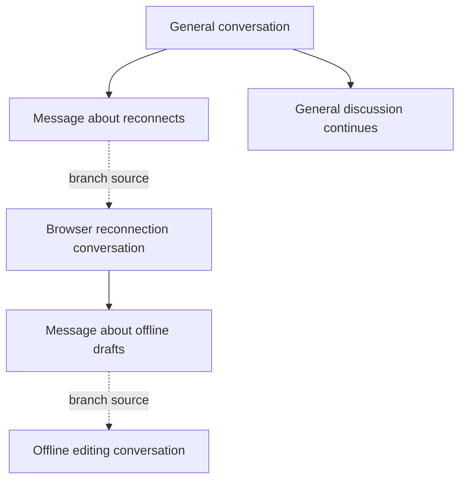

# Rooms content and interaction model

Status: active plan. This document defines the proposed content model and UX
for the [Rooms implementation plan](access-grants.md). The
[roadmap](../../roadmap.md#durable-applications) owns priority. The
[resource model](resource-model.md) owns capability sharing and the
[managed access architecture](../loam/access/architecture.md) owns generic resource authority.
These contracts replace unsupported prerelease behavior directly.

## Product shape

Rooms remains the application name. A room remains a participation context.
Managed access supplies resource access and lifecycle management beneath the application;
resource interfaces determine what people can do with particular content.
Shared access controls do not require every resource to have the same screen.

| Surface | User's question | Primary interaction |
| --- | --- | --- |
| Directory | Where can I go? | Browse, search, and organize entrances to rooms and other resources. |
| Room | What is happening here? | Participate through conversations, inspect recent activity and shared material, and manage available access. |
| Conversation | What are we discussing? | Read and compose ordered messages, reply, and follow or start branches. |
| Message | What was said? | Read one contribution, inspect permitted context, reply, share, or edit within held authority. |
| File | What was shared? | Preview or retrieve the authorized content and inspect available metadata. |

A room can contain nested rooms, conversations, and shared entries. Directories
usually list rooms but may also present entrances to conversations, messages,
files, or other directories. A directory listing never grants access merely
because an item is listed. Directory discussion, when offered, is an explicit
conversation with its own access path.

```text
Directory: Projects
  Room: Development
    Conversation: General
    Conversation: Browser reconnection
      Message: Reconnection loses the draft
      Branch: Offline editing
    Room: Design
      Conversation: Navigation
    Shared entry: A message from another room
```

This example combines organization and visible discussion links. Branching
does not make a conversation structurally owned by its initiating message.
Rooms and directories can be recursive; ordinary discussion does not require
creating another room.

## Content records and relationships

Managed access owns stable resource IDs and owned containment. Rooms content records use
those IDs; they do not repeat the graph as a second authoritative parent map.
The types below describe the proposed schema, not compiling Rust definitions.

| Record | Application-owned content |
| --- | --- |
| Directory | Title, description, and authorized discovery/entry behavior. |
| Room | Title, description, room-wide subject, default conversation ID, and participation settings. |
| Conversation | Editable title, open/archived state, message ordering, and optional branch provenance. |
| Message | Author relationship, original creation marker, body revision, attachments, optional reply target, and withdrawal state. |
| Entry | Stable placement identity, label override where permitted, retained capability, and disclosed sharing context. |
| Branch provenance | Source conversation ID and initiating message IDs, plus separately authorized navigation references. |
| Reorganization record | Operation identity, affected resource IDs, source/destination placements, and authorized context explaining the change. |

| Relationship | Contract |
| --- | --- |
| Owned containment | the access module's acyclic graph within one authority owner; used for subtree scope. |
| Canonical conversation | Every published message's owned parent is one conversation. Rooms validates this kind constraint in the content transaction. |
| Reply target | A reference to another message; it does not define containment, grant authority, or require that the target remain readable. |
| Branch source | How a conversation began; independent of its organizational home and access dependencies. |
| Shared placement | Another appearance through retained access, without copying or moving the original content. |
| Delegation dependency | the access module's actual authority chain, never inferred from visual nesting or provenance. |

Every published message belongs to exactly one conversation. Drafts and copied
text remain application data until published. Sharing a message into another
place creates an entry referring to it; moving the original changes canonical
membership. A conversation's message index is derived from the same committed
containment changes, not an independently editable membership list.

Titles are mutable metadata. Topic means the conversation's subject or title;
it is not another content type. The room-wide subject is a separate property.
A conversation has stable identity even when its title, first message,
organizational home, or branch source changes visibility.

Message author identity comes from admitted application membership or other
declared author authority. Nicknames and caller-supplied author fields are not
proof. An agent, attached session, or delegated seat may act under different
authority; the message records the application-defined provenance available at
admission without claiming a universal human identity.

## Opening each surface

The ordinary directory view shows a paginated list or grid of destinations,
search, and controls for adding or organizing entries where allowed. Listing
metadata is disclosed under directory access; a private target's title is not
automatically copied into a public listing. Each entry identifies its resource
kind and opens the appropriate view rather than a generic capability inspector.

A room opens its default General conversation with a conversation sidebar.
The overview is a distinct view of authorized recent activity, conversations,
shared resources, and nested rooms. A room created for normal participation
creates its General conversation in the same content/access transaction.
Selecting a different default requires room-management authority. Archiving
the default requires choosing or creating a replacement in that transaction.

A conversation view has a title, ordered message stream, composer when posting
is allowed, and a branch/context panel. Opening a resource with read-only access
shows useful content without a disabled composer dominating the screen. Access
inspection and management use the common [facet editor](access-editor.md).

A direct message link opens a focused message view. It shows author and source
context only as permitted, with independently authorized navigation to the
conversation or room. Missing parent access is normal; the UI does not render
an empty room around the message or fetch a stronger entrance to fill it.

Direct conversations use the same conversation/message content model. Their
entry and participation defaults differ from a room conversation. A room is
not a mandatory wrapper around every conversation in the system.

## Replies and branching

An ordinary reply adds a message to the same conversation and records its reply
target. The target may be displayed as a bounded preview or jump link when
readable. Replying does not automatically create a separate conversation.

The Branch conversation action is available from a message, a selected range,
or conversation controls. It opens a compact editor with a suggested title,
destination, source context preview, and the access that will be used. The
default destination is the current room; the user can select another place
for which creation and publication are authorized.



The default branch operation creates a new conversation without moving or
copying the selected source messages. It retains authorized source references
and records origin data. The composer opens in the new conversation. This
preserves the existing discussion and avoids silently changing its audience.
Moving selected messages is a separate reorganization action.

Where the creator can publish to the source conversation, branching adds a
continuation entry there. A private branch does not leak its title or existence
to an audience that lacks the declared discovery access. Creating a private
branch with only a private source backlink is valid. Reciprocal entries across
owners are separate operations; failure to post one does not roll back a
successfully created conversation on another owner or imply distributed commit.

The new conversation is discoverable in its destination and through permitted
source links. Its branch tree is a view over provenance, with bounded traversal
and inaccessible nodes omitted or shown without private metadata. It is not a
second containment graph. Renaming or moving the branch preserves this origin.

The right to read a source message does not imply permission to post a branch
marker, create a conversation in its room, or expose the message to others.
Creation and source sharing require their respective capabilities. A child
created through a restricted room grant returns access within that grant's
delegation contract; creation does not mint a bypass to original room authority.

## Sharing and discussing content elsewhere

Share here places the exact selected access into a destination that accepts
entries. The chooser previews the target kind, disclosed metadata, destination
audience, and whether sharing passes existing access or creates a managed facet.
The [resource model](resource-model.md#the-shared-model) owns those two
sharing modes. Ordinary placement never silently mints a new grant.

In a directory, a conversation is a destination. In a room, it is a discussion
entry. In another conversation, it is a linked discussion card. A shared
message appears as a live referenced card with source context where permitted.
The entry stores a capability, not only a source ID or a copied body.

A shared message offers two distinct reply actions where authorized:

- Reply in source opens its canonical conversation under separately held
  posting authority. Read access to the message alone does not enable it.
- Discuss here posts a new local message referencing the source, or starts a
  local branch. Its canonical conversation is the destination conversation.

The UI names the destination beside the composer so a reply cannot silently go
to the wrong audience. A directory or room-level entry first selects or creates
a conversation for Discuss here. Quoting copied text is visibly different from
a live reference: revocation cannot recall copied data.

Revoking a shared facet leaves a bounded unavailable entry rather than silently
substituting a cached unrestricted message. Persisted previews and indexes must
obey the application's retention contract; caches cannot authorize redisclosure.
Independent capabilities may still provide access, but switching to one is an
explicit user choice rather than an automatic fallback.

## Reorganization contracts

The [storage contract](persistence.md#reorganization-transaction) owns the
atomic authority checks, audience-change management ceiling and bounded
transaction. [ADR-0183](../../decisions/adr/ADR-0183-rooms-scoped-sharing-and-recovery.md)
settles this design; application integration remains unimplemented.

Move distinguishes changing an entry's placement from changing original owned
content. The UI labels the operation and shows its scope before execution.
Reference placements may cross directories, rooms, and conversations through
the collection's supported entry interface. Original content obeys its kind
constraints, including messages remaining in conversations.

| Operation | Identity and membership result | Access result |
| --- | --- | --- |
| Rename | Resource ID, message membership, and branch provenance stay unchanged. | No change to grant terms or audience. |
| Move entry | The destination receives the selected held reference and placement context; the original resource stays put. | Requires source entry removal and destination insertion authority. Cross-owner placement is separately acknowledged. |
| Move conversation | Within an owner, reparent the conversation to a supported organizational container. Message IDs and conversation membership remain unchanged. | Revalidate all affected subtree scopes and destination disclosure before commit. |
| Move messages | Within an owner, reparent selected messages to a destination conversation. Message IDs, authorship, creation markers, and reply targets survive. | Preview gains/losses of scope coverage; existing grant ancestry is never silently rewritten. |
| Split conversation | Create a new conversation and move the selected messages in one owner transaction, recording branch/reorganization provenance. | Requires creation, source reorganization, destination posting, and any audience change authority. |
| Merge conversations | Select one destination, move admitted source messages there, and archive the source conversations with authorized continuation information. Source conversation IDs remain valid archived resources. | Source grants do not become destination-wide grants. Existing scoped message access is evaluated through its unchanged authority dependencies. |
| Archive conversation | Preserve its identity and readable history; ordinary posting stops. | Existing read grants remain subject to their terms; reopening requires management authority. |
| Withdraw message | Preserve its identity and canonical conversation as a tombstone with permitted metadata. Remove body visibility under the withdrawal contract. | Held references cannot retrieve withdrawn content through another view. |

Moves of original owned content across authority owners are not transparent
reparenting. Share here is the supported composition across owners. An explicit
copy/import creates new resources with recorded source context and requires
permission to disclose the content. It does not pretend to preserve original
identity, grants, or distributed atomicity. Ownership transfer is outside this
plan and needs a separate protocol before it can be offered.

A real reparent can make an existing subtree-derived grant lose coverage. The
operation must disclose that effect and require the authority to change that
audience. A link may remain resolvable yet refuse access; preservation of a
resource ID does not promise unchanged authorization. Exact-object access stays
usable only if every dependency still permits the object. Grant ceilings and
source dependencies cannot be replaced merely to keep an old link working.

The audience preview shows only principals or grant descriptions the operator
may inspect. Unknown remote audiences are identified as unknown rather than
enumerated from cached descriptors. Operations require current revisions;
changed scope or content between preview and commit produces a conflict and
an updated preview. No unconditional confirmation bypasses admission.

An archived source conversation can explain that content moved, but its
continuation link is restricted to authority actually held for the destination.
It cannot redirect a source-only reader to the destination's original
capability. Reply and branch links retain stable target IDs and become
unavailable when their retained access cannot reach those targets.

## Ordering, unread state, search, and notifications

Each conversation has an append order independent of wall-clock time. A new
post receives its order at the owning content commit. Moved messages retain
original creation markers and their relative source order, then receive
destination positions at the chosen insertion point. Concurrent insertion is
resolved under the destination revision. A sender-controlled timestamp never
reclassifies old content as new for history permissions.

Read state belongs to the user's session or workspace and uses stable
conversation identity plus delivered activity markers. Message identity avoids
double-counting repeated placements of the same message. A move is a separate
activity event; reading a source message does not silently mark all intervening
destination messages read. The destination can show moved content as newly
introduced without pretending it was newly authored.

Branch creation does not automatically subscribe every source participant to
every new branch. The creator follows the branch by default; other people may
follow explicitly or through their chosen room-level notification preferences.
Those preferences select among authorized events and cannot create access.
Mentions address admitted application identities, and delivery rechecks the
recipient's current access path.

Search, unread counts, recent activity, previews, and notifications must use
the same scope and history bounds as direct reads. Aggregate counts cannot leak
private branches or siblings. Index records retain source and access provenance
needed to filter or invalidate results. Revocation, withdrawal, and history
narrowing invalidate affected material before it can be served as authorized
content again. Actual delivery and retention guarantees are explicit; bytes
already received by another peer cannot be recalled.

## Deep links and durable access

The sharing UI asks managed access hosting to publish the selected resource access.
Glowcap's existing Host supplies durable publication and capability recovery;
the runtime supplies locator handling and connection effects. Managed access records the
publication-to-resource/grant binding and its restoration dependencies. The
portable resource model adds no transport parser or separate locator scheme.

A message link restores a message capability. It does not expose an unrestricted
conversation locator with a client-enforced message path. A receiver may open
the message without room membership or conversation browsing authority. Source
navigation is separately authorized. Branch and placement context can accompany
a link without becoming an alternative source of authority.

Both original references and managed facets may be durable where their owner
supports it. Creating a durable name does not make live-only dependencies
persistent. Publication failure after committed issuance is retryable with the
same identity. A paused link restores paused access; a revoked link cannot
restore working access through a broader publication.

## Verification and implementation sequence

The parent plan owns implementation order. This document supplies content and
interaction requirements for its recursive Rooms and conversation phases.
Portable content fixtures own semantic expectations; process/browser journeys
prove that controls and navigation exercise the same capabilities.

| Journey | Evidence required |
| --- | --- |
| First use | Create a room and General conversation atomically, post immediately, and start a named conversation without creating another room. |
| Message identity | Every published message has one canonical conversation; shared placements and replies cannot create a second membership. |
| Branch | Branch from one message or a range, preserve originals, continue both discussions, and navigate permitted origin links after rename or move. |
| Private branch | Source readers without branch discovery access learn no private title, count, or notification metadata. |
| Shared reply | Read a message without its parent, distinguish Reply in source from Discuss here, and enforce posting authority independently. |
| Reorganization | Rename, move, split, merge, archive, and withdraw under stale revisions and limited grants; stable identities never substitute for lost authority. |
| Cross-owner placement | Partial source/destination failure reports exact committed outcomes; retry does not duplicate content or impersonate ownership transfer. |
| Deep link | Restore exact original or managed access, including paused, revoked, gone, and unavailable dependencies. |
| Aggregates | Search, unread, activity, previews, and notifications disclose no more than direct access, including after scope changes. |
| Continuity | Preserve reply targets, provenance, original creation markers, and destination ordering through reorganizations and restart. |

Implementation updates the content schemas, protocol definitions, storage,
process/browser clients, editor, and operation receipts together. Unsupported
development formats are reset explicitly. Each runtime uses the same content
model and exact selected authority.
