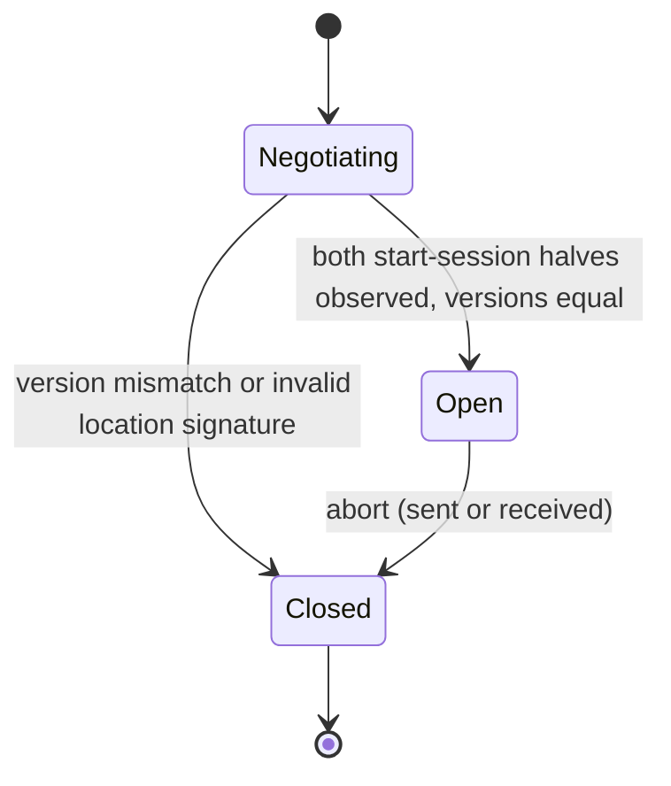
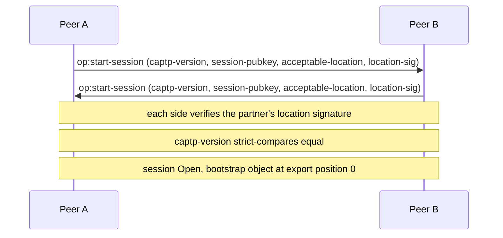
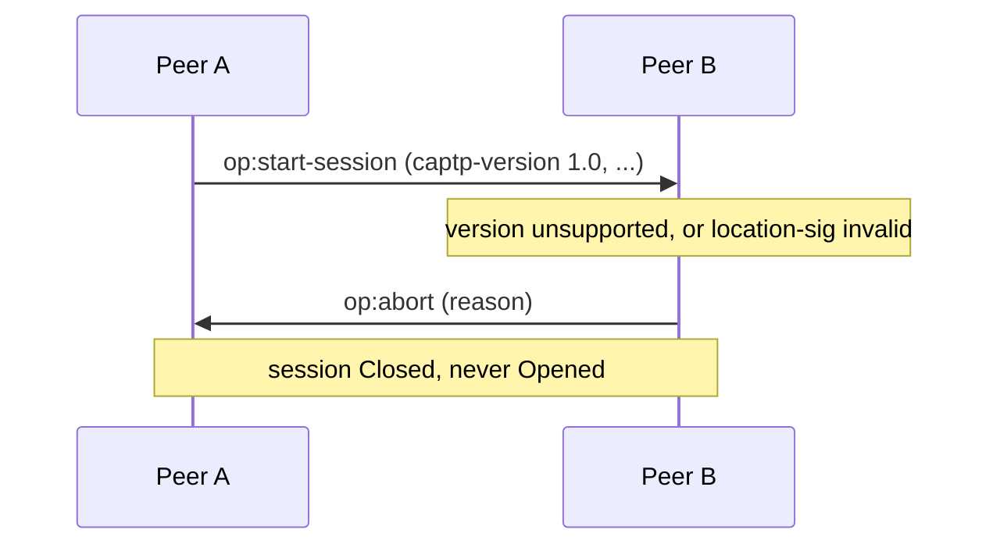
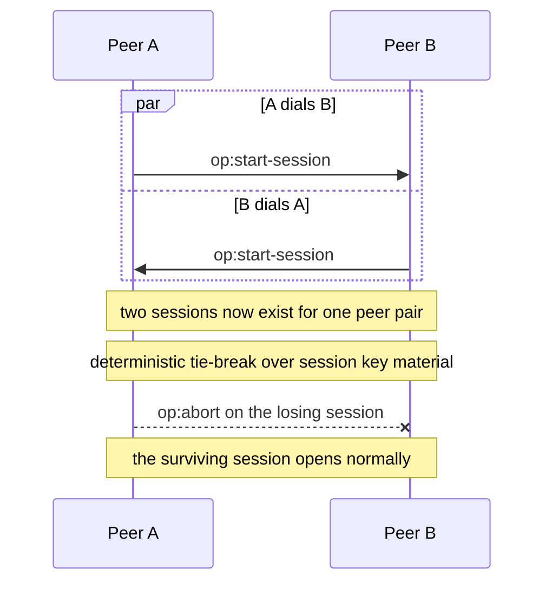
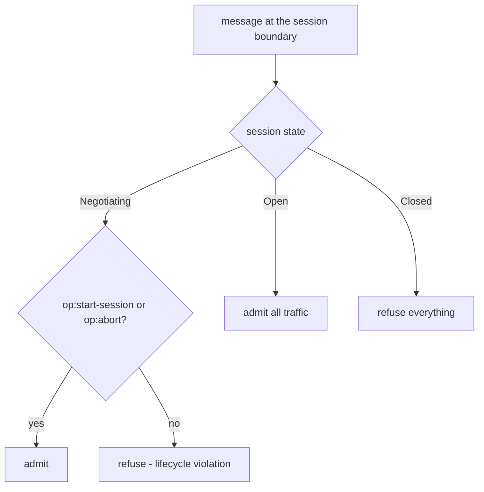
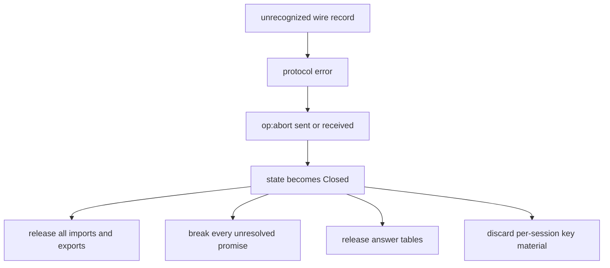

# Session lifecycle

Anchors: CapTP Specification § Sessions, § op:start-session, § Ending a session,
§ Crossed hellos.

## SL-1: Session state machine

The lifecycle is one-way: a session moves from `Negotiating` to `Open` to
`Closed`. No transition reverses; a closed session never reopens.

## SL-2: op:start-session handshake

Anchor: CapTP Specification § op:start-session. Each side sends one
`op:start-session`; the session opens when both halves have been observed and
verified. The bootstrap object is installed at export position 0.

## SL-3: Handshake refusal

A version mismatch or a location signature that fails verification is fatal: the
offended side sends `op:abort` and the session moves straight to Closed without
ever opening.

## SL-4: Crossed hellos

Anchor: CapTP Specification § Crossed hellos. Two peers dialing each other
simultaneously produce two half-open sessions for one peer pair. A deterministic
tie-break over the two sessions' key material selects the survivor; the losing
session is aborted. Exactly one open session per peer pair survives.

## SL-5: Per-state message admission

What a session admits depends only on its state. While negotiating, only the
handshake itself (`op:start-session`) and `op:abort` get through; authority-
bearing traffic (`op:deliver`, `op:resolve`, gc ops, `op:listen`, `op:get`,
`op:index`, handoffs) requires Open.

## SL-6: Abort teardown effects

Anchor: CapTP Specification § Ending a session. `op:abort` (in either direction)
severs the session: all imports and exports release, unresolved promises break,
and per-session key material is discarded. An unrecognized wire record reaches
the same teardown: a record the receiver does not recognize is a protocol error,
and a protocol error aborts the session.

One deliberate survivor: the handoff-count replay guard is keyed by the
Exporter–Receiver session identity, not the carrying transport, and it lives in
the vat-scoped gift registry. A host that keeps one registry across CapTP
sessions therefore refuses a reconnecting Receiver's replayed count (see
[06-handoffs.md](06-handoffs.md) HO-7).
