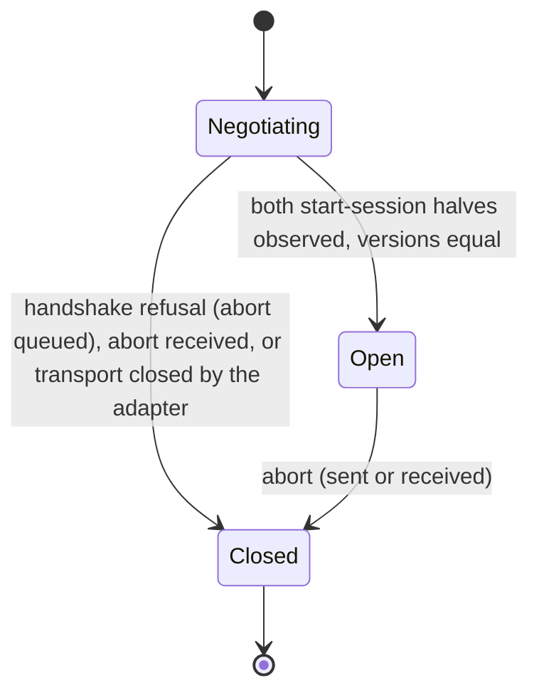
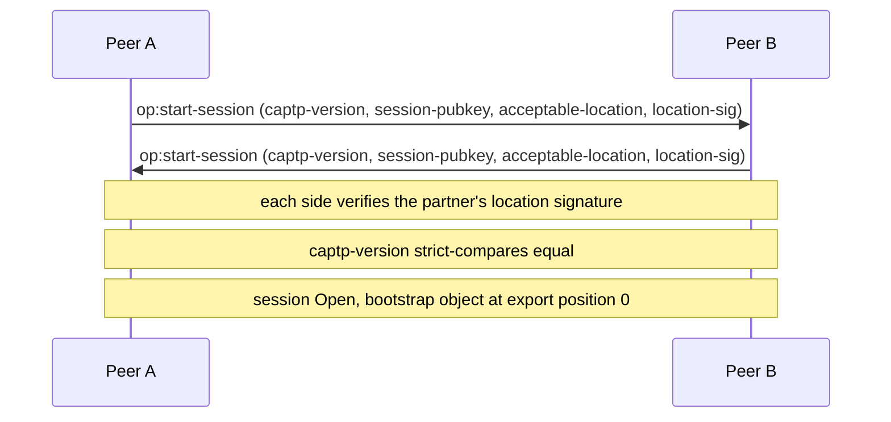
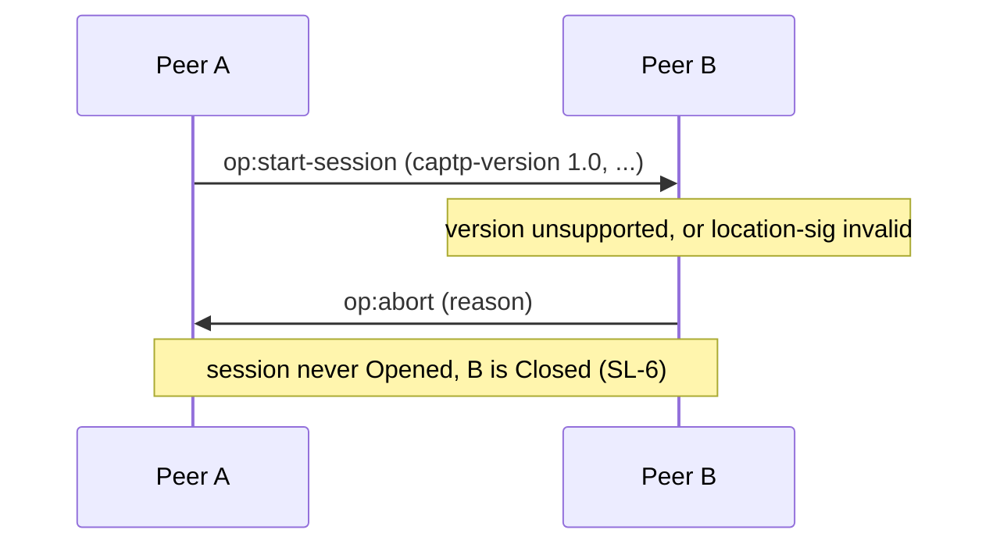
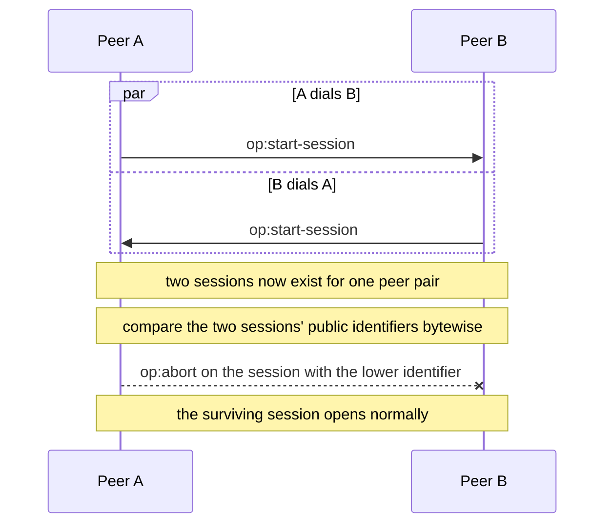
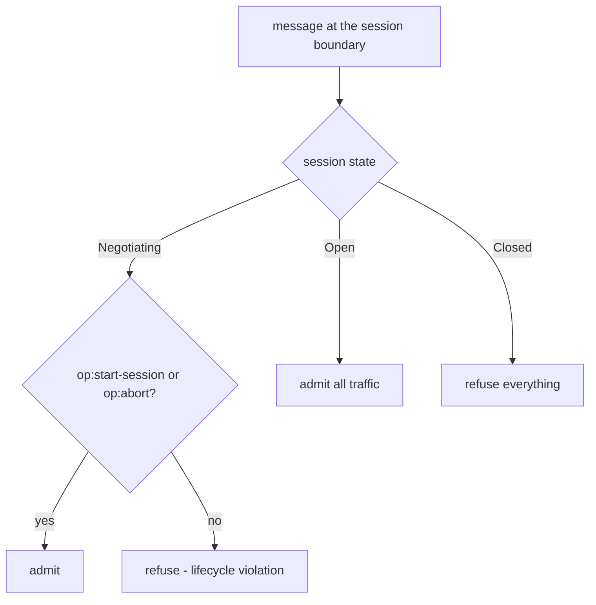
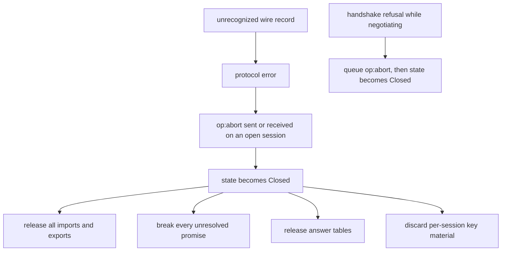

# Session lifecycle

These diagrams follow the CapTP Specification sections CapTP Overview,
op:start-session, Ending a session, and Crossed Hellos Resolution.

## SL-1: Session state machine

The lifecycle is one-way: a session moves from `Negotiating` to `Open` to
`Closed`. A refused handshake is terminal like every other abort
([ADR-0030](../decisions/adr/ADR-0030-failure-and-close-policy.md)). A
closed session never reopens.

## SL-2: op:start-session handshake

Anchor: CapTP Specification § op:start-session. Each side sends one
`op:start-session`. The session opens when both halves have been observed and
verified. The bootstrap object is installed at export position 0.

## SL-3: Handshake refusal

A version mismatch or a location signature that fails verification refuses the
handshake: the offended side emits the typed `op:abort` and closes the CapTP
session. The refused hello never opens the session, and no corrected hello is
admitted on the aborted stream.

## SL-4: Crossed hellos

Anchor: CapTP Specification § Crossed hellos. Two peers dialing each other
simultaneously produce two half-open sessions for one peer pair. Each side
compares the public identifiers of the two sessions byte by byte, and the
session with the lower identifier is aborted.

## SL-5: Per-state message admission

What a session admits depends only on its state. While negotiating, only the
handshake itself (`op:start-session`) and `op:abort` get through. Authority-
bearing traffic (`op:deliver`, gc ops, `op:listen`, `op:get`,
`op:index`, handoffs) requires Open.

## SL-6: Abort teardown effects

Anchor: CapTP Specification § Ending a session. `op:abort` (in either direction)
severs an open session: all imports and exports release, unresolved promises
break, and per-session key material is discarded. An unrecognized wire record
is a protocol error, and a protocol error aborts the session. A handshake
refusal while still `negotiating` (version mismatch, bad signature, partner-key
pin) queues an outbound `op:abort` and then closes the session
([ADR-0030](../decisions/adr/ADR-0030-failure-and-close-policy.md)).

Handoff replay authority follows the same lifecycle. Each live
Receiver–Exporter session owns one monotonic accepted count. Closing it destroys
that counter. Deposited gifts likewise die with their Gifter–Exporter session.
See [06-handoffs.md](06-handoffs.md) HO-7.
