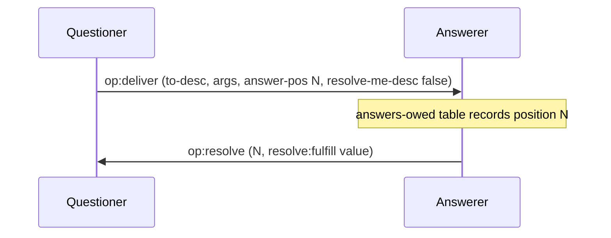
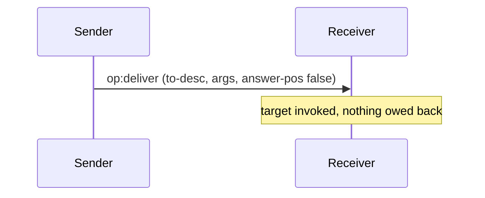
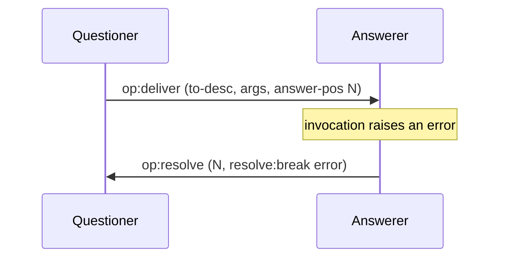
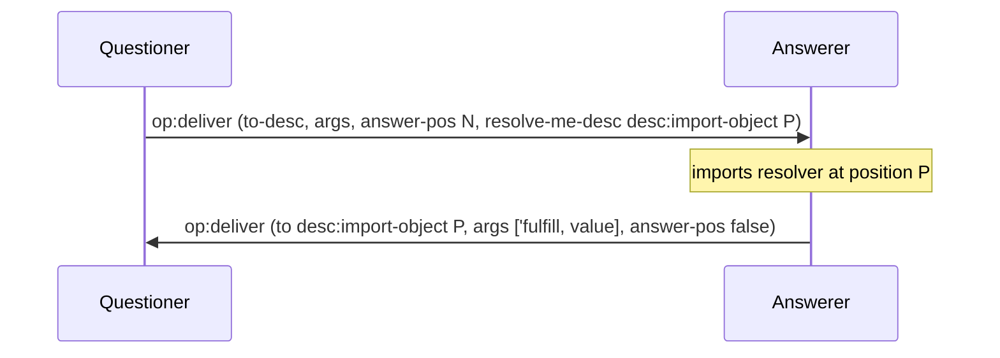
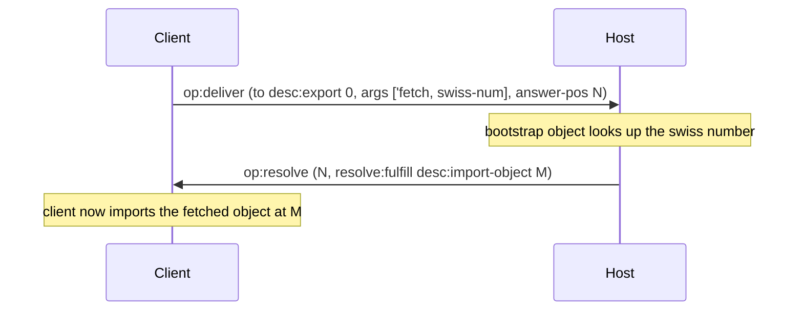
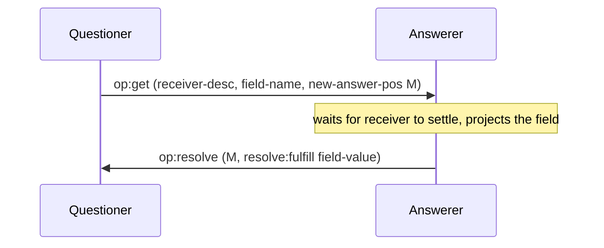
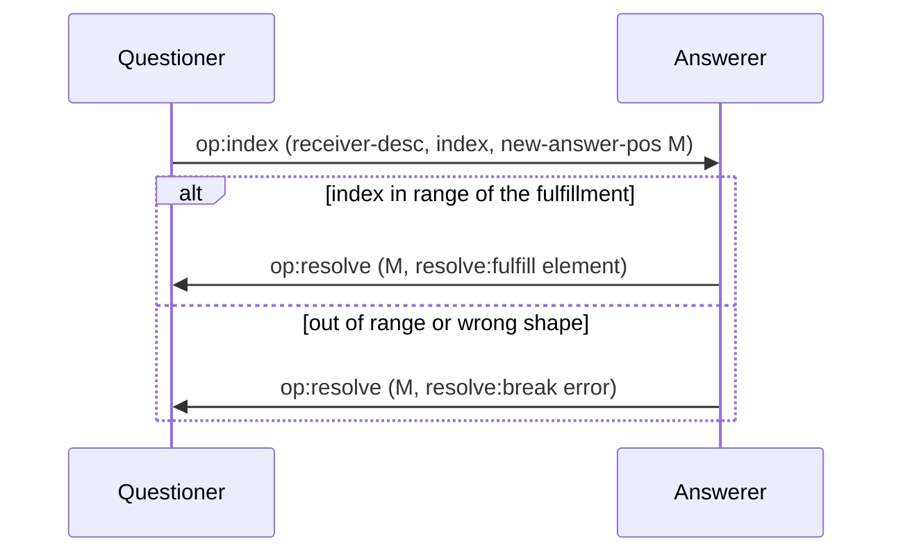

# Deliver and resolve

Anchors: CapTP Specification § op:deliver, § The bootstrap Object, § op:get, §
op:index.

One vocabulary note before the diagrams: the draft CapTP specification has no
`op:resolve` section. The `op:resolve` operator and its `resolve:fulfill` /
`resolve:break` arms are pancake's PreSpec profile shape, tracking the pair of
settlement operators — `op:resolve` and `op:break` — the OCapN working group has
agreed to adopt. The 2026-02-10 meeting minutes in `conformance/ocapn-spec/`
record that consensus; the wire encoding is still unsettled upstream, and
pancake's single `op:resolve` with fulfill and break arms is its PreSpec
rendering of the pair. On the v1.0 wire that Goblins speaks, settlement travels
as the resolver-callback deliver DR-4 shows. Every `op:resolve` arrow in this
diagram set is drawing the PreSpec shape of that settlement.

## DR-1 — op:deliver with an answer

The questioner allocates a fresh answer position; the answerer records it and
later settles it with exactly one `op:resolve`.

## DR-2 — op:deliver with no answer (one-way)

Fire-and-forget: the answer position is `false`, so no `op:resolve` ever
returns. The receiver invokes the target and the transaction ends there. There
is no separate one-way record — a one-way send is an `op:deliver` whose answer
is `false`.

## DR-3 — op:resolve with a break

Settlement has two shapes: `resolve:fulfill` carries a value, `resolve:break`
carries an error. A broken answer propagates its error to anything pipelined
against it (see [03-promises-and-pipelining.md](03-promises-and-pipelining.md)).

## DR-4 — resolve-me-desc resolver callback

The fourth `op:deliver` operand may name a resolver object the questioner
exports. The answerer imports it and later _delivers the resolution to it_ as an
ordinary call carrying `'fulfill` or `'break`, instead of (or alongside) the
`op:resolve` path.

## DR-5 — Bootstrap fetch

Anchor: CapTP Specification § The bootstrap Object. Export position 0 is always
the bootstrap object. `fetch` with a swiss number is how a peer turns held
out-of-band authority into a live reference.

## DR-6 — op:get

`op:get` projects one field out of a receiver's eventual fulfillment into a
fresh promise. It breaks if the fulfillment has no such field, and it inherits
the receiver's rejection if the receiver breaks.

## DR-7 — op:index

`op:index` is the list-shaped sibling of `op:get`: it projects one element by
index. An index out of range breaks the new answer.

