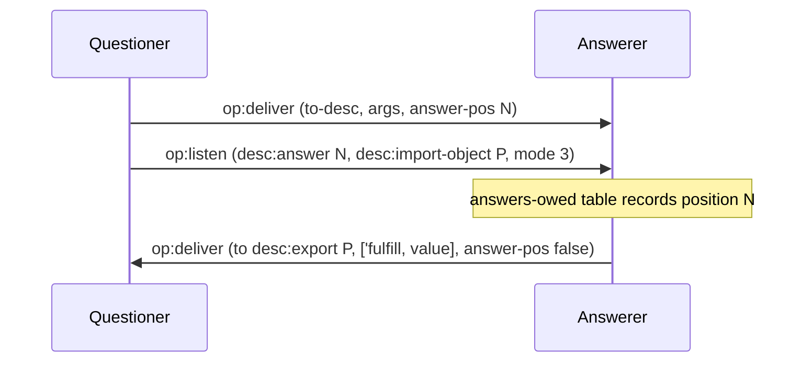
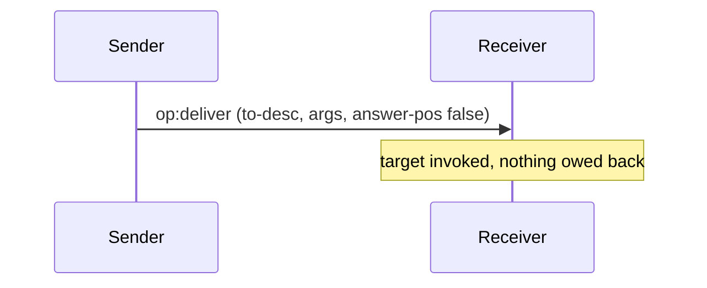
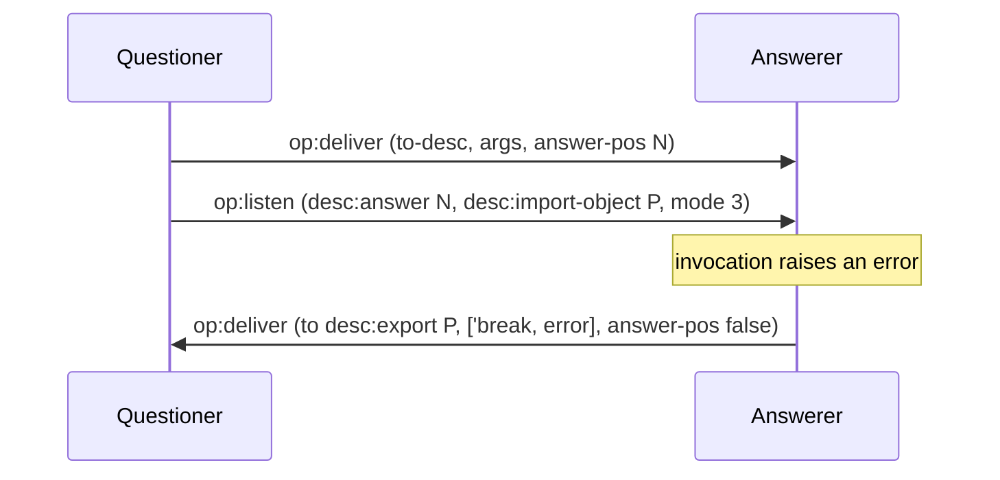
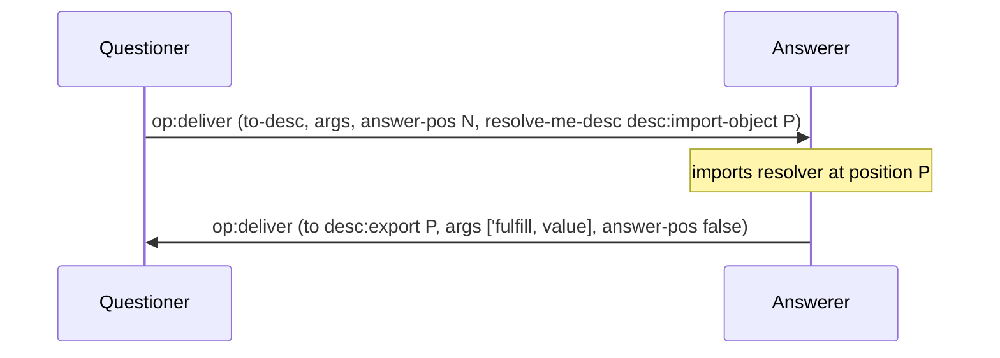
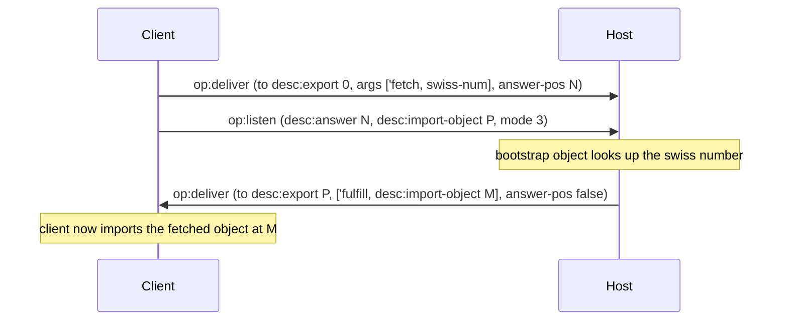
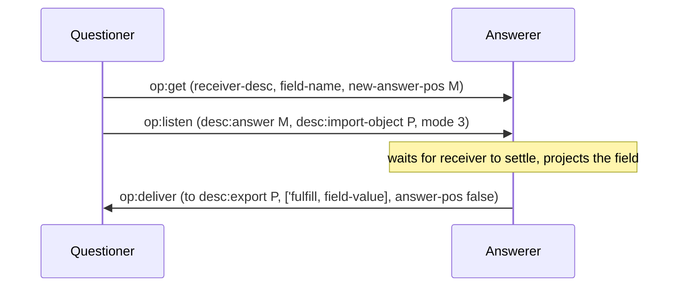
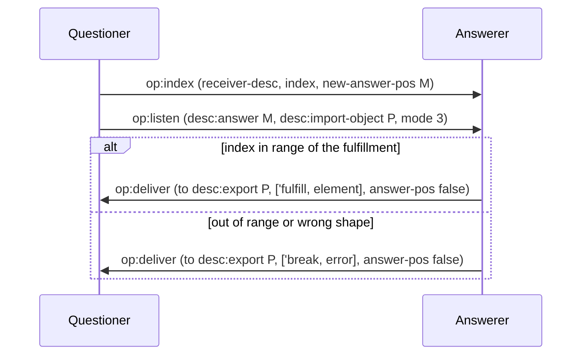

# Deliver and resolve

These diagrams follow the CapTP Specification sections op:deliver, The
bootstrap Object, op:get, and op:index.

These diagrams use the next profile unless a step says V1.0. Next follows the
pending promise-listening proposal: an answered operation is followed by an
`op:listen`, and settlement returns as a resolver callback. Goblins V1.0 puts
that resolver in `op:deliver` instead. Neither profile sends wire `op:resolve`.

## DR-1: op:deliver with an answer

The questioner allocates a fresh answer position and follows the operation with
a mode-3 listen. The answerer records both and later calls the resolver once.

## DR-2: op:deliver with no answer (one-way)

Fire-and-forget: the answer position is `false`, so no callback returns.
The receiver invokes the target and the transaction ends.

## DR-3: Settlement with a break

The callback's `fulfill` arm carries a value and its `break` arm carries an
error. A broken answer propagates its error to anything pipelined against it
(see [03-promises-and-pipelining.md](03-promises-and-pipelining.md)).

## DR-4: V1.0 inline resolver

On Goblins V1.0, the fourth `op:deliver` operand names the resolver object. The
answerer imports it and later delivers `'fulfill` or `'break` to it. V1.0 does
not need a following listen for this answer.

## DR-5: Bootstrap fetch

Anchor: CapTP Specification § The bootstrap Object. Export position 0 is always
the bootstrap object. `fetch` with a swiss number is how a peer turns held
out-of-band authority into a live reference.

## DR-6: op:get

`op:get` projects one field out of a receiver's eventual fulfillment into a
fresh promise. It breaks if the fulfillment has no such field, and it inherits
the receiver's rejection if the receiver breaks.

## DR-7: op:index

`op:index` is the list-shaped sibling of `op:get`: it projects one element by
index. An index out of range breaks the new answer.

