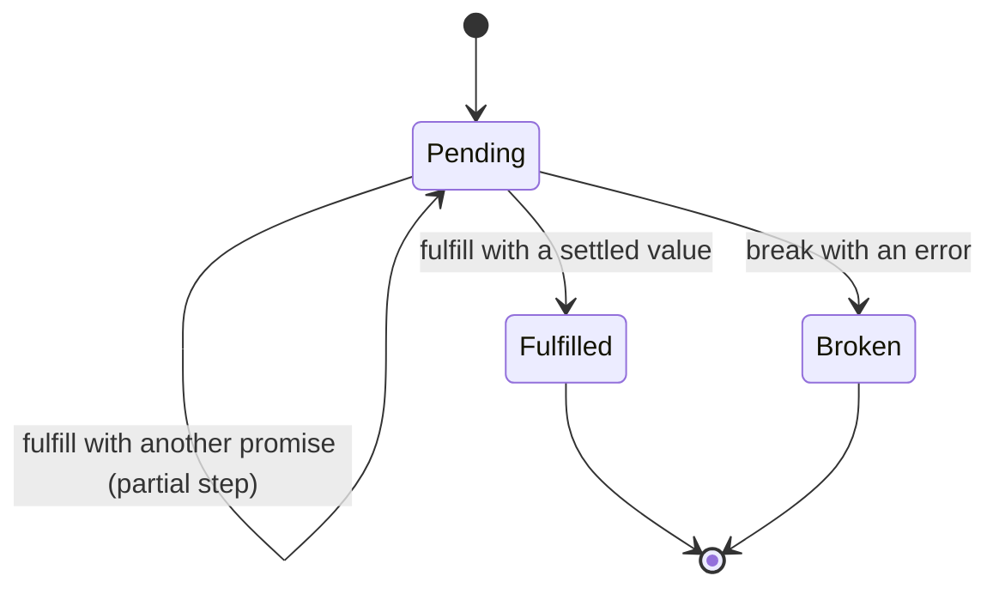
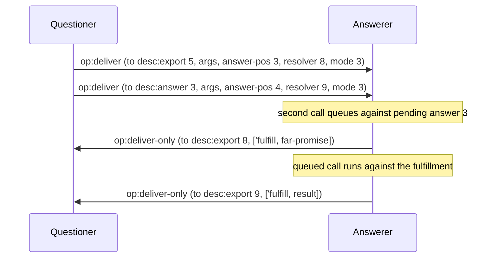
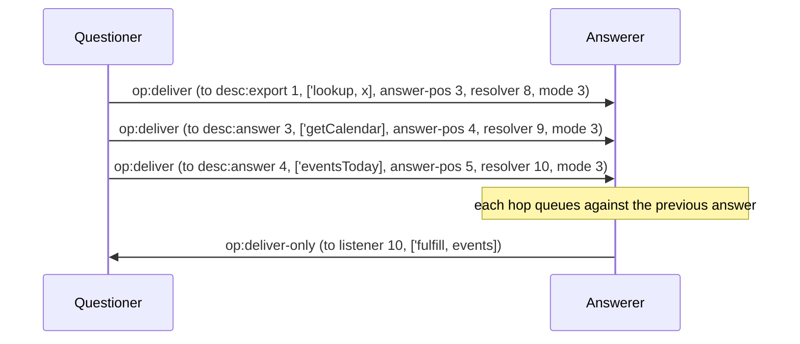
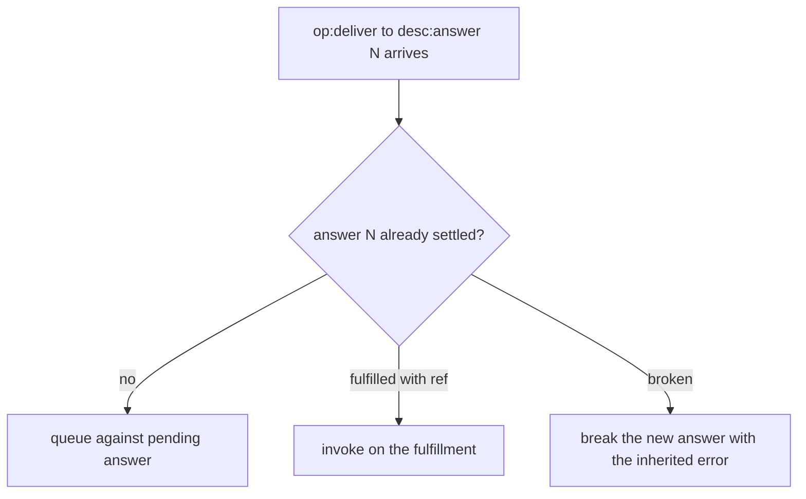
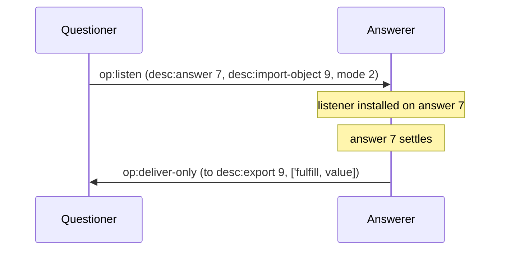
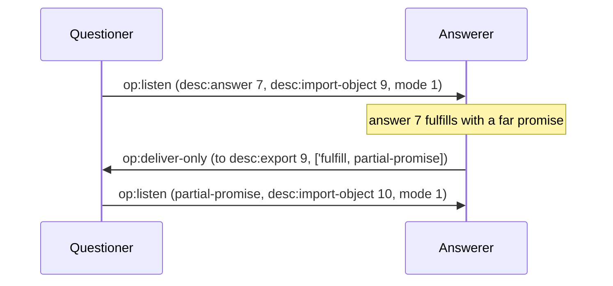
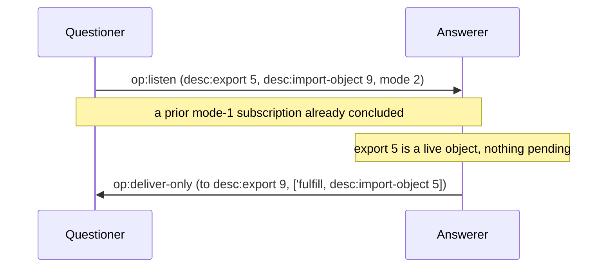

# Promises and pipelining

These diagrams follow the CapTP Specification sections Promises, Promise
pipelining, and op:listen. They use next's integer listen modes. Goblins V1.0
translates its Boolean `wants-partial?` at the codec boundary.

## PP-1: Promise lifecycle

A promise settles once, into Fulfilled or Broken. Fulfilling with
_another promise_ is a partial step: the promise stays pending against the new
target until a non-promise value or an error arrives.

## PP-2: Pipelined deliver on an answer

A questioner may target `desc:answer N` before N has resolved. The answerer
queues the pipelined call against the pending answer and runs it on settlement,
saving the round-trip. On next, a call carries its resolver and listen mode
inline. Mode 1 requests shortening, and mode 3 requests shortening or settlement.
The optional answer position enables pipelining independently of the resolver.

## PP-3: Multi-hop chain

`a.lookup(x).getCalendar().eventsToday()` is three hops, each anchored on the
previous answer position. On the wire each hop is its own `op:deliver` against
`desc:answer`. An encoding with richer path types may carry the chain in fewer
frames, but the semantics stay this chain.

## PP-4: Deliver to an already-resolved answer

If the answer has settled by the time a pipelined deliver targeting it arrives,
the call forwards to the resolution: invoked on the fulfillment value, or broken
immediately with the inherited error. Another same-peer promise re-anchors the
call on its exact backing answer, including when that promise is a local
export paired with a virtual answer.

## PP-5: Settling listener

Mode 2 follows a shortening subscription and asks only for settlement. The answerer delivers the resolution to the
listener as an ordinary call. A same-peer promise fulfillment re-anchors the
listener without firing it.

## PP-6: Shortening listener

Mode 1 asks only for shortening. A far-promise fulfillment fires the listener
once. The receiving peer installs a new mode-1 listener on the returned promise.

## PP-7: op:listen on an already-settled target

A settling listener on an already-settled target fires immediately with that
resolution. Shapes:

- an already-settled **answer** (suite `test_op_listen_already_has_answer`)
- a live **object export** (fulfill of that export)

A **local promise export** uses its explicit pairing with a backing answer.
Listeners follow that answer through same-peer promise chains. A bare
unresolved export without the pairing refuses with `InvalidReference`, because
no settlement authority could discharge its subscription.

