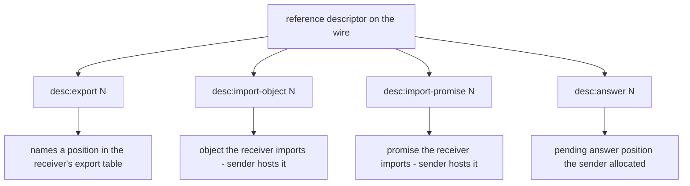
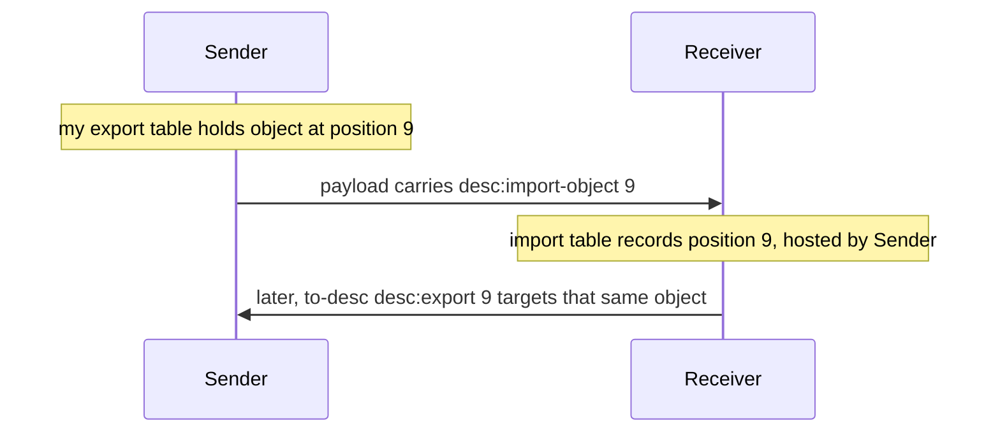
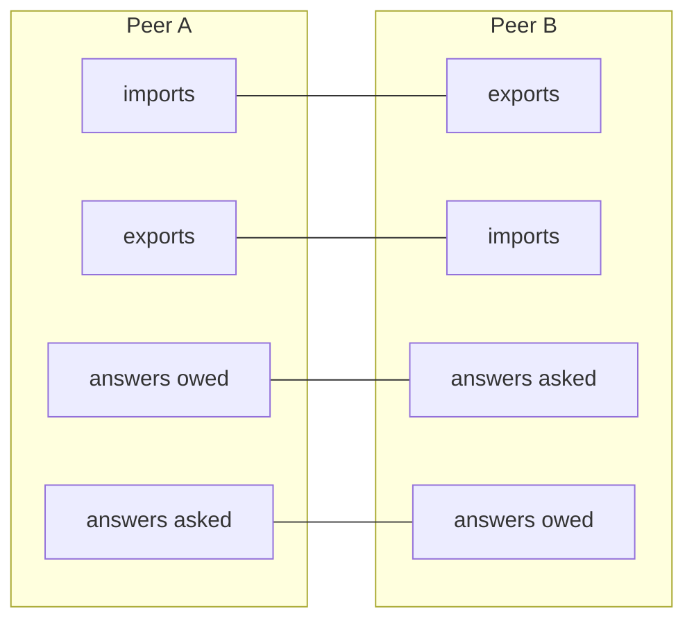
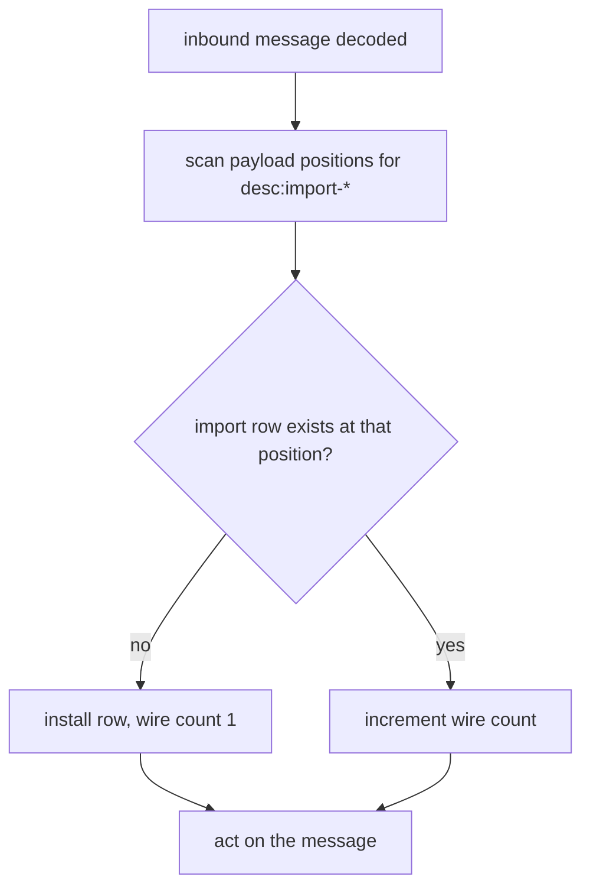

# References and tables

Anchors: CapTP Specification § Descriptors, § Export and import tables.

## RT-1 — Descriptor taxonomy

Four wire descriptors name positions in session tables. Which table they
index, and on whose side, is the whole game; the next two diagrams, RT-2 and
RT-3, pin it down.

## RT-2 — The perspective flip

Descriptors are written from the *receiver's* point of view. An object the
sender hosts therefore travels as `desc:import-object` — "you will import
this" — and the receiver records a fresh import row pointing back at the
sender. The same position number means opposite things on the two sides.

## RT-3 — The four tables

Each side keeps exports (objects it hosts), imports (the mirror of the
partner's exports), answers-asked (questions it allocated), and answers-owed
(questions the partner allocated). Each table pairs with its mirror across
the wire.

Position allocation is one-sided: a peer allocates positions only in its own
export table and its own answers-asked table; the mirrors fill in on receipt.

## RT-4 — Import installation on inbound traffic

Every `desc:import-object` / `desc:import-promise` appearing in an inbound
message's payload installs (or increments) an import row before the message
is acted on. This is what makes later `op:gc-exports` accounting sound — see
[05-gc.md](05-gc.md).

