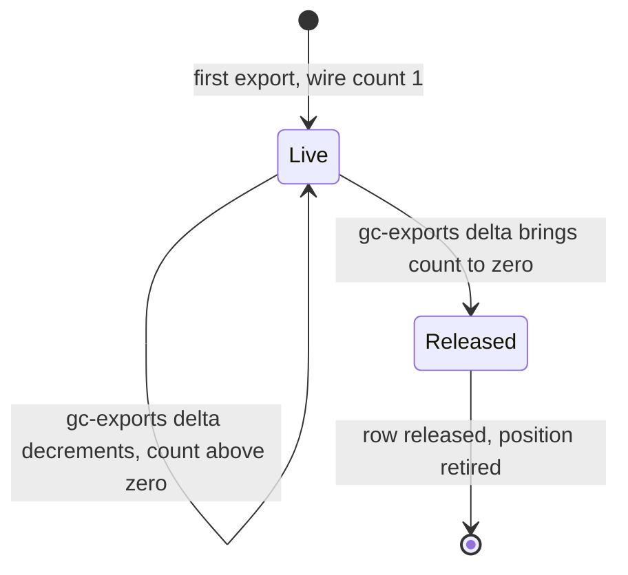
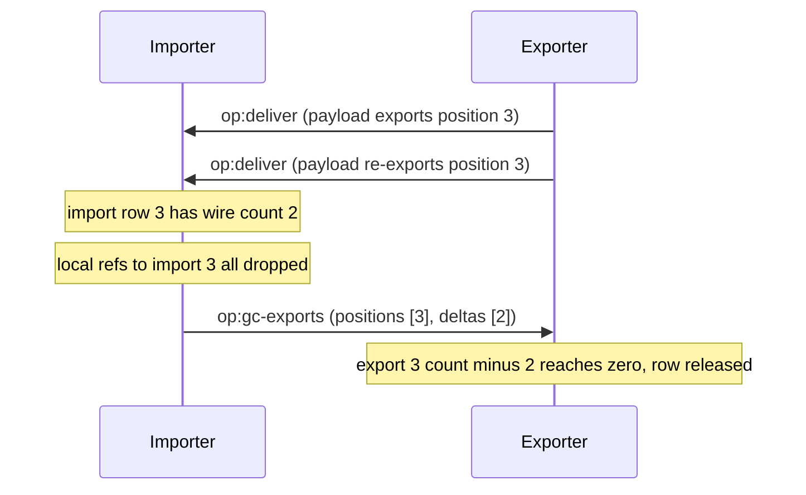
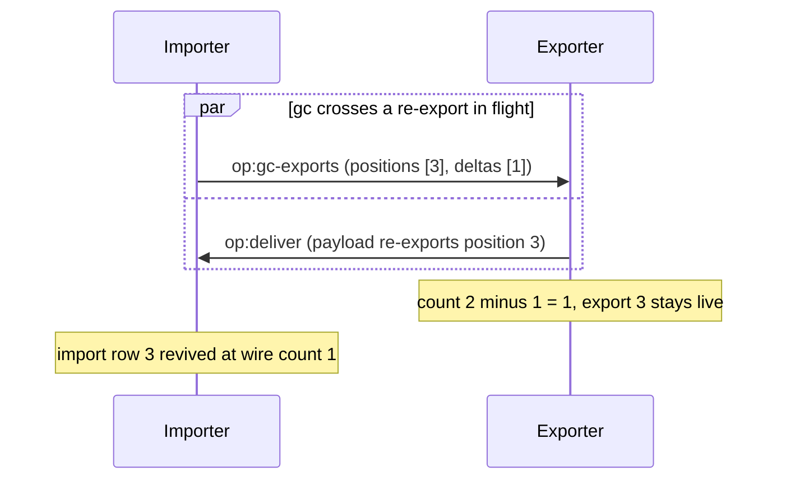
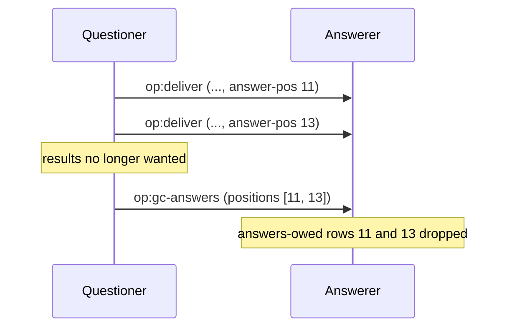

# Garbage collection

Anchors: CapTP Specification § op:gc-exports, § op:gc-answers. Wire labels per
the spec and Goblins (`op:gc-exports` carries parallel position and delta lists;
`op:gc-answers` carries positions only).

## GC-1: Export refcount lifecycle

An export row's wire count goes up each time the position crosses the wire and
down by gc deltas. The row releases only at zero. Export positions are monotonic
within a session and are never reused.

## GC-2: op:gc-exports with wire-deltas

The importer tells the exporter how many wire references it is dropping per
position. The message carries two parallel lists: positions and deltas.

## GC-3: Why deltas: the resurrection race

A bare "release position 3" would race a re-export of 3 already in flight.
Counting deltas makes the race benign: both sides converge on the same nonzero
count and the export stays live.

## GC-4: op:gc-answers

The questioner releases answer positions it allocated. Answer positions are
single-reference, so there are no deltas: a listed position is released
outright, and the answerer drops the row along with any resolver bookkeeping
tied to it.

