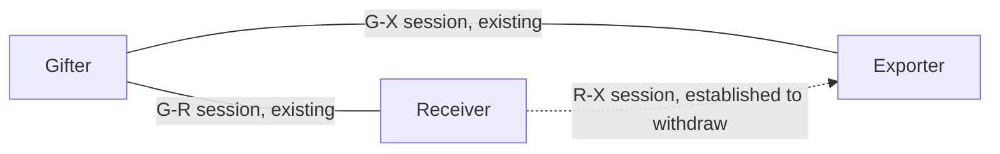
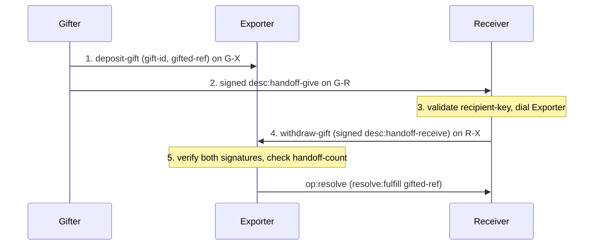
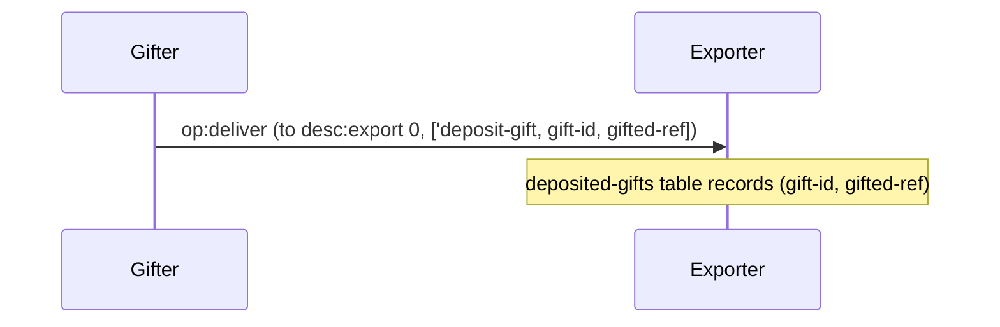
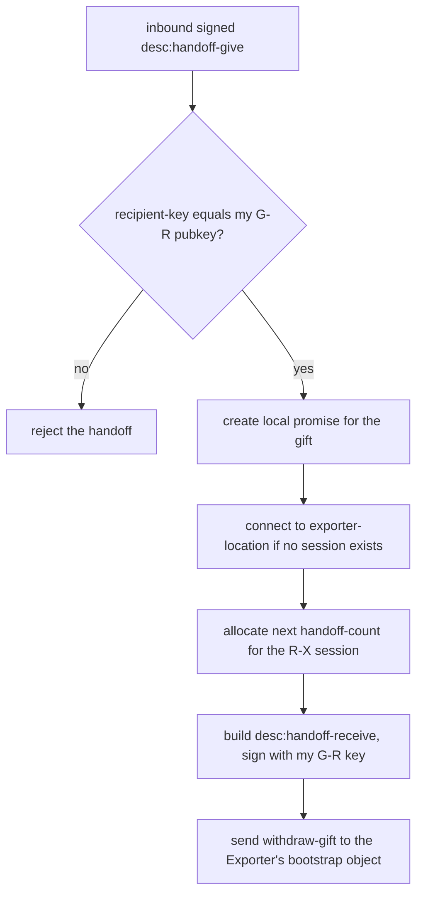
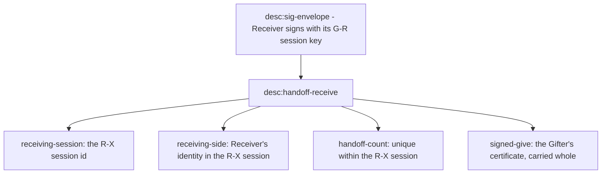
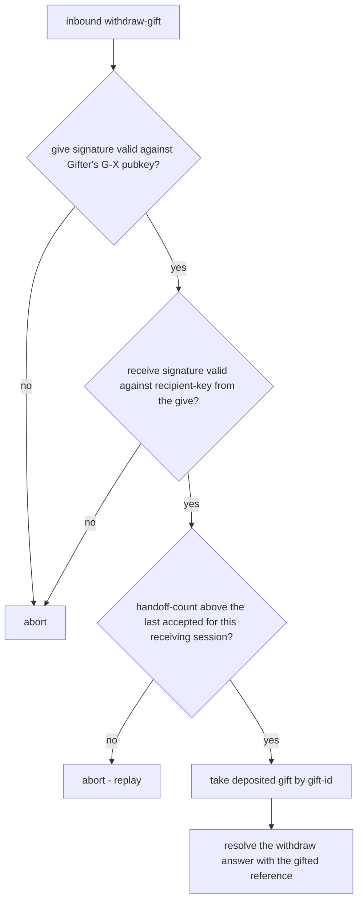
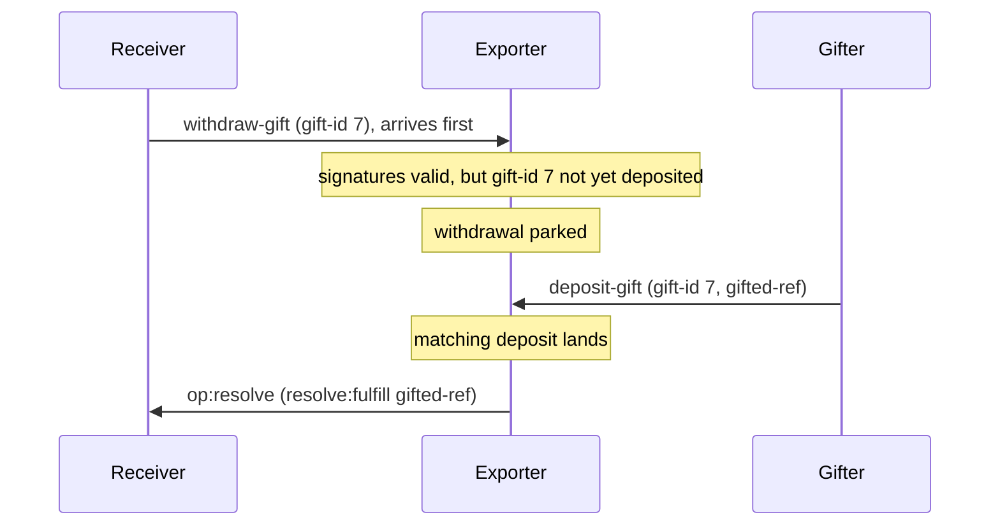

# Three-party handoffs

Anchors: CapTP Specification § Third-party handoffs (depositing the gift,
desc:handoff-give, desc:handoff-receive, withdrawing the gift, validation). All
certificates ride `desc:sig-envelope` (Ed25519 over the canonical bytes of the
inner certificate). The `op:resolve` settlement arrows below draw pancake's
PreSpec shape; on the v1.0 wire the same settlement is the resolver-callback
deliver (see the vocabulary note and DR-4 in
[02-deliver-and-resolve.md](02-deliver-and-resolve.md)).

## HO-1: Roles and sessions

Three peers hold three sessions between them. The Gifter already talks to both
other parties; the Receiver↔Exporter session is established (if absent) to
withdraw.

## HO-2: Happy path overview

This diagram shows the five steps end-to-end; HO-3 through HO-7 zoom into each.

## HO-3: Step 1: deposit-gift

Step 1 is an ordinary bootstrap-object call on the Gifter↔Exporter session. The
Exporter stores the gift keyed by gift-id until a matching withdrawal.

## HO-4: The desc:handoff-give certificate

The give carries five fields, signed by the Gifter with its key from the **G↔X**
session. Each field exists so a specific later check can hold, as HO-5 and HO-7
show.

## HO-5: Step 3: Receiver-side validation

The Receiver cannot verify the Gifter's signature yet, because it has never seen
the Gifter's G↔X pubkey; that check belongs to the Exporter. What the Receiver
_can_ check is that the give was addressed to it.

## HO-6: The desc:handoff-receive certificate

The receive carries four fields wrapping the original signed give. The Receiver
signs it with its key from the **G↔R** session, not the R↔X session, and that is
what binds the new R↔X identity to the identity the Gifter addressed.

## HO-7: Step 5: Exporter-side validation

The Exporter is the only party that can verify both signatures: it knows the
Gifter's pubkey from the G↔X session, and the give itself carries the
recipient-key that must have signed the receive. A repeated handoff-count is a
replay and aborts the session.

The count guard is monotonic per receiving-session identity (the R↔X session the
receive names). It lives in the vat-scoped gift registry rather than in any one
CapTP session, so a host that keeps that registry across reconnects refuses a
replayed count.

## HO-8: Withdraw before deposit

The two inbound legs race: the Receiver's withdrawal can reach the Exporter
before the Gifter's deposit does. The Exporter parks a validated withdrawal
until the matching gift-id lands, then dispatches.

