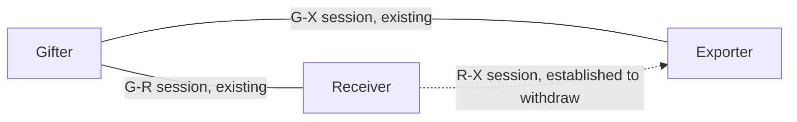
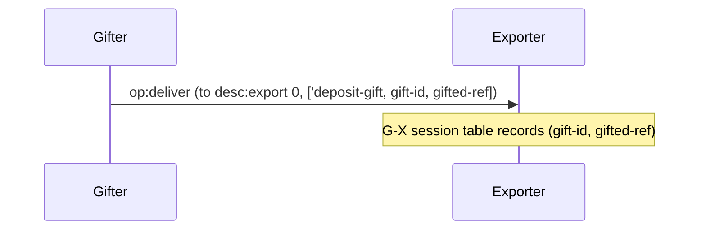
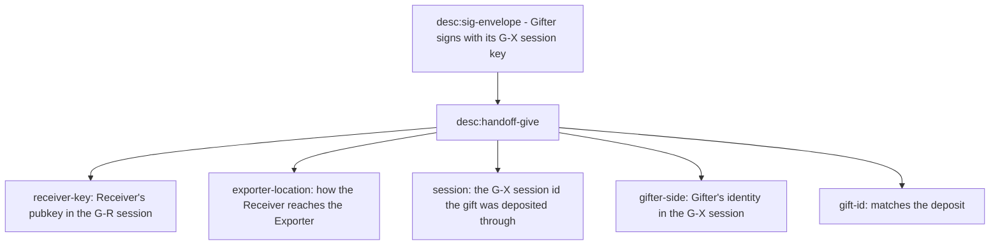
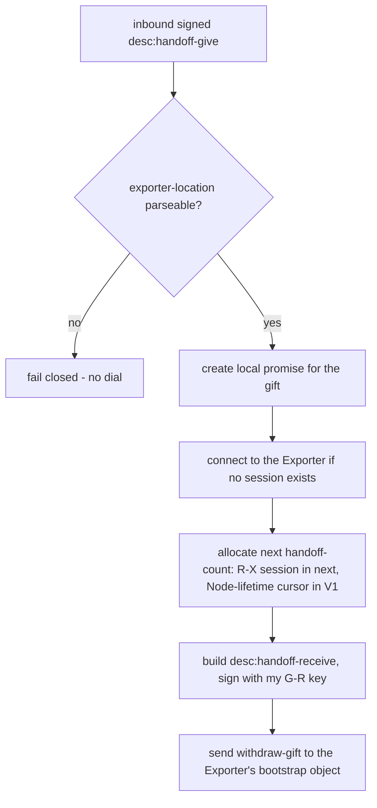
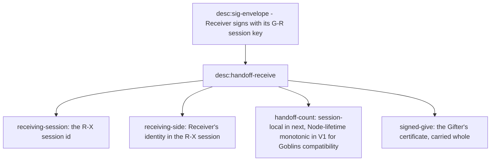
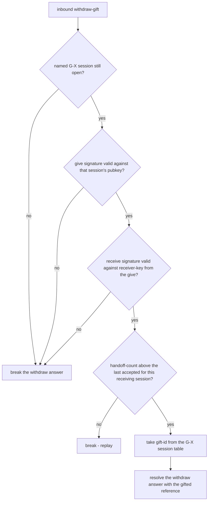
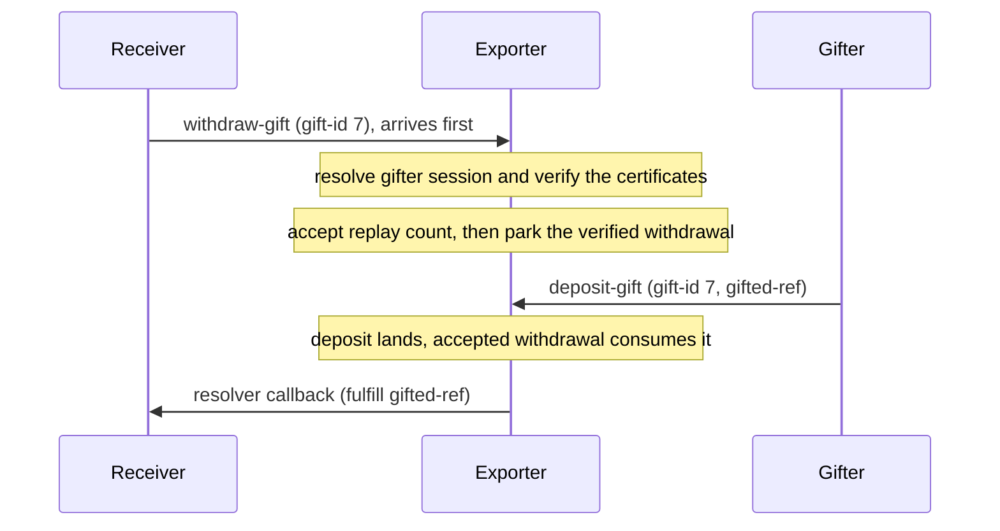

# Three-party handoffs

These diagrams follow the CapTP Specification sections Third Party Handoffs
(depositing the gift, desc:handoff-give, desc:handoff-receive, validation) and
The bootstrap Object (the `withdraw-gift` method). All certificates ride
`desc:sig-envelope` (Ed25519 over the canonical bytes of the inner
certificate). Settlement arrows below are resolver callbacks. Both profiles carry the
resolver in the withdrawal deliver, and next also carries the listen mode.

## HO-1: Roles and sessions

Three peers hold three sessions between them. The Gifter already talks to both
other parties. The Receiver establishes the Receiver–Exporter session, if it
is absent, to withdraw.

## HO-2: Happy path overview

HO-3 through HO-7 zoom into each of the five steps.

## HO-3: Step 1: deposit-gift

Step 1 is an ordinary bootstrap-object call on the Gifter–Exporter session. The
Exporter stores the gift in that session's table, keyed by gift-id, until a
matching withdrawal or session close.

## HO-4: The desc:handoff-give certificate

The give carries five fields, signed by the Gifter with its key from the
Gifter–Exporter (G-X) session. Each field exists so a specific later check can
hold, as HO-5 and HO-7 show.

## HO-5: Step 3: Receiver-side validation

The Receiver cannot verify the Gifter's signature yet, because it has never seen
the Gifter's G-X pubkey. That check belongs to the Exporter. The spec also
suggests the Receiver check that the give's receiver-key names it. glowcap
leaves that to the Exporter too, where the receive must be signed by that
key (HO-7), so a mis-addressed give fails at withdraw rather than locally.
What the Receiver does check locally is the exporter-location: an unparseable
locator fails closed with no dial.

## HO-6: The desc:handoff-receive certificate

The receive carries four fields wrapping the original signed give. The Receiver
signs it with its key from the Gifter–Receiver (G-R) session, not the
Receiver–Exporter (R-X) session. That is what binds the new R-X identity to the
identity the Gifter addressed.

## HO-7: Step 5: Exporter-side validation

The Exporter is the only party that can verify both signatures. It knows the
Gifter's pubkey from the G-X session, and the give itself carries the
receiver-key that must have signed the receive. A failed check refuses the
withdrawal by breaking its answer with a typed reason. The session stays open.

Replay authority lives with the live sessions:

- The count guard is one monotonic scalar on the live R-X session.
- The gift table belongs to the live G-X session.
- Closing either `Peer` destroys the authority it owns. No Host- or Vat-wide
  replay map survives.
- Every Host session derives a distinct signing seed from a process-fresh,
  domain-separated session root and a monotonic counter (ADR-0097). A
  reconnect cannot recreate the old side or session names, so an old signed
  receive cannot name a replacement session.
- The V1 Node uses a separate lifetime cursor for receive-certificate issuance
  to accommodate the pinned Goblins counter behavior across reconnects.

## HO-8: Withdraw before deposit

The two inbound legs race: the Receiver's withdrawal can reach the Exporter
before the Gifter's deposit does. The Exporter resolves the still-open gifter
session named by the give, verifies both signatures and the receiving-session
names, and advances the Receiver–Exporter session's replay counter before it
waits. When the matching gift-id lands, the accepted withdrawal consumes it
without treating its own count as a replay.

