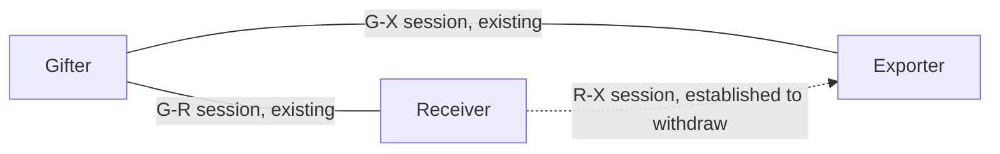
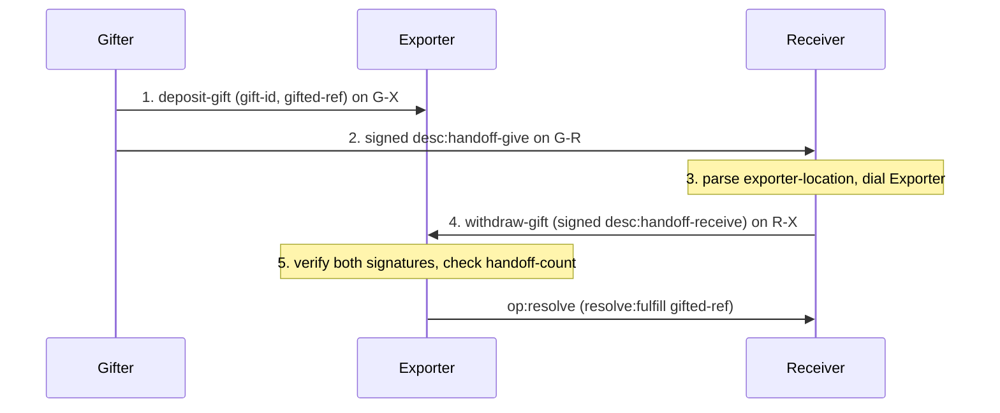
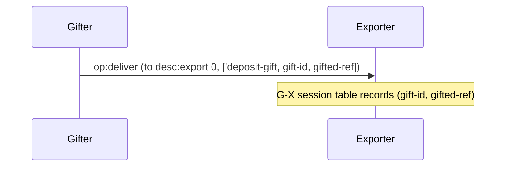
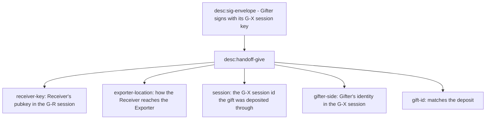
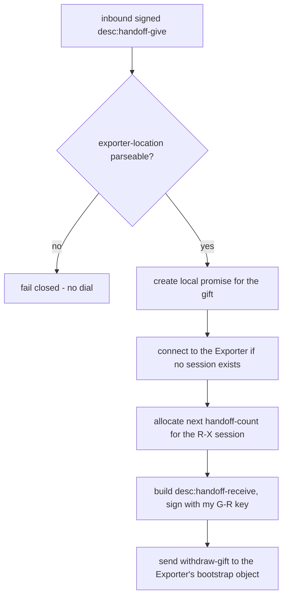
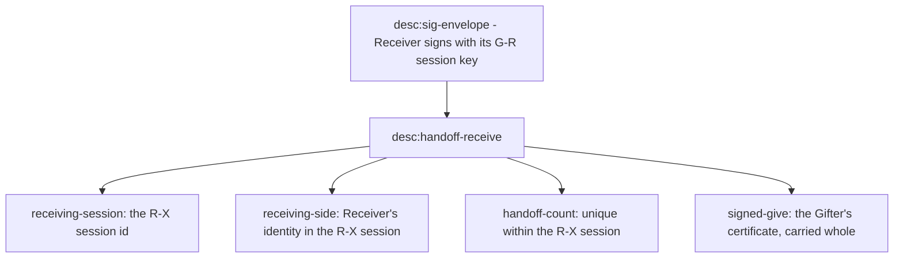
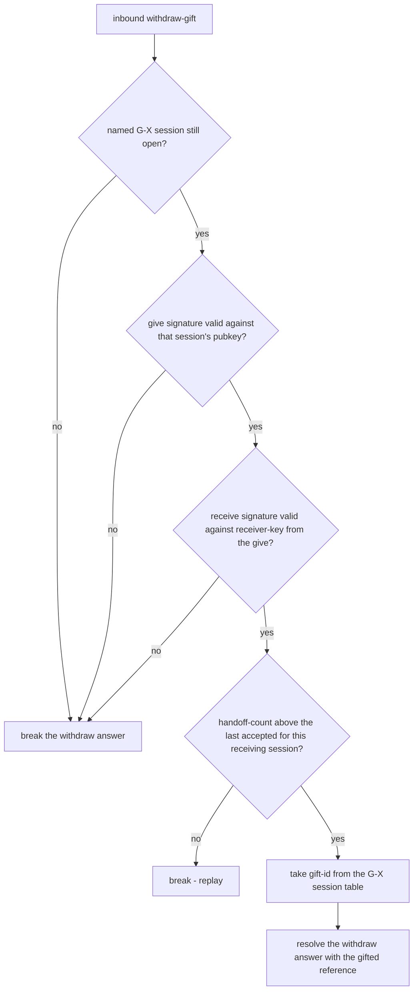
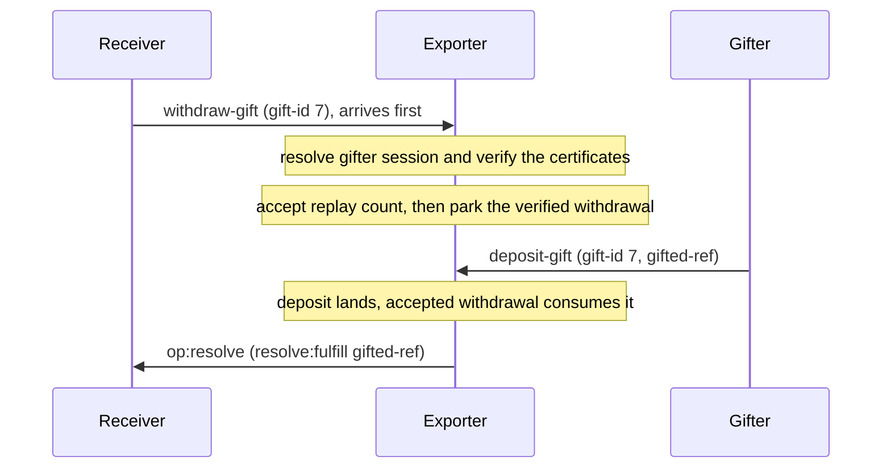

# Three-party handoffs

Anchors: CapTP Specification § Third Party Handoffs (depositing the gift,
desc:handoff-give, desc:handoff-receive, validation) and § The bootstrap Object
(the `withdraw-gift` method). All
certificates ride `desc:sig-envelope` (Ed25519 over the canonical bytes of the
inner certificate). The `op:resolve` settlement arrows below draw pancake's
`pancake-next` profile shape; on the v1.0 wire the same settlement is the
resolver-callback deliver (see the vocabulary note and DR-4 in
[02-deliver-and-resolve.md](02-deliver-and-resolve.md)).

## HO-1: Roles and sessions

Three peers hold three sessions between them. The Gifter already talks to both
other parties. The Receiver–Exporter session is established (if it is absent)
in order to withdraw.

## HO-2: Happy path overview

This diagram shows the five steps end-to-end; HO-3 through HO-7 zoom into each.

## HO-3: Step 1: deposit-gift

Step 1 is an ordinary bootstrap-object call on the Gifter–Exporter session. The
Exporter stores the gift in that session's table, keyed by gift-id, until a
matching withdrawal or session close.

## HO-4: The desc:handoff-give certificate

The give carries five fields, signed by the Gifter with its key from the
Gifter–Exporter (G-X) session. Each field exists so a specific later check can
hold, as HO-5 and HO-7 show.

## HO-5: Step 3: Receiver-side validation

The Receiver cannot verify the Gifter's signature yet, because it has never seen
the Gifter's G-X pubkey. That check belongs to the Exporter. The spec also
suggests the Receiver check that the give's receiver-key names it; pancake
leaves that to the Exporter too, where the receive must be signed by exactly
that key (HO-7), so a mis-addressed give fails at withdraw rather than locally.
What the Receiver does check locally is the exporter-location: an unparseable
locator fails closed with no dial.

## HO-6: The desc:handoff-receive certificate

The receive carries four fields wrapping the original signed give. The Receiver
signs it with its key from the Gifter–Receiver (G-R) session, not the
Receiver–Exporter (R-X) session. That is what binds the new R-X identity to the
identity the Gifter addressed.

## HO-7: Step 5: Exporter-side validation

The Exporter is the only party that can verify both signatures. It knows the
Gifter's pubkey from the G-X session, and the give itself carries the
receiver-key that must have signed the receive. A failed check refuses the
withdrawal by breaking its answer with a typed reason; the session stays open.

The count guard is one monotonic scalar on the live R-X session. The gift table
belongs to the live G-X session. Closing either `Peer` destroys the authority it
owns; no Host- or Vat-wide replay map survives. The current Host does reuse its
session key, however, so a reconnect can recreate the same side and session
names. Until ADR-0097 supplies fresh per-session keys, an old signed receive can
resolve against that replacement session and consume a later same-id deposit.

## HO-8: Withdraw before deposit

The two inbound legs race: the Receiver's withdrawal can reach the Exporter
before the Gifter's deposit does. The Exporter resolves the still-open gifter
session named by the give, verifies both signatures and the receiving-session
names, and advances the Receiver–Exporter session's replay counter before it
waits. When the matching gift-id lands, the accepted withdrawal consumes it
without treating its own count as a replay.

