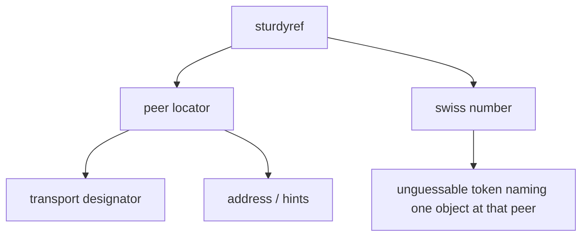
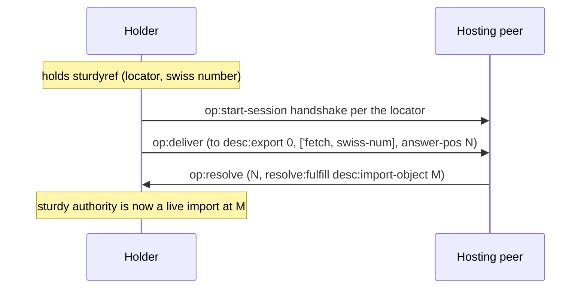
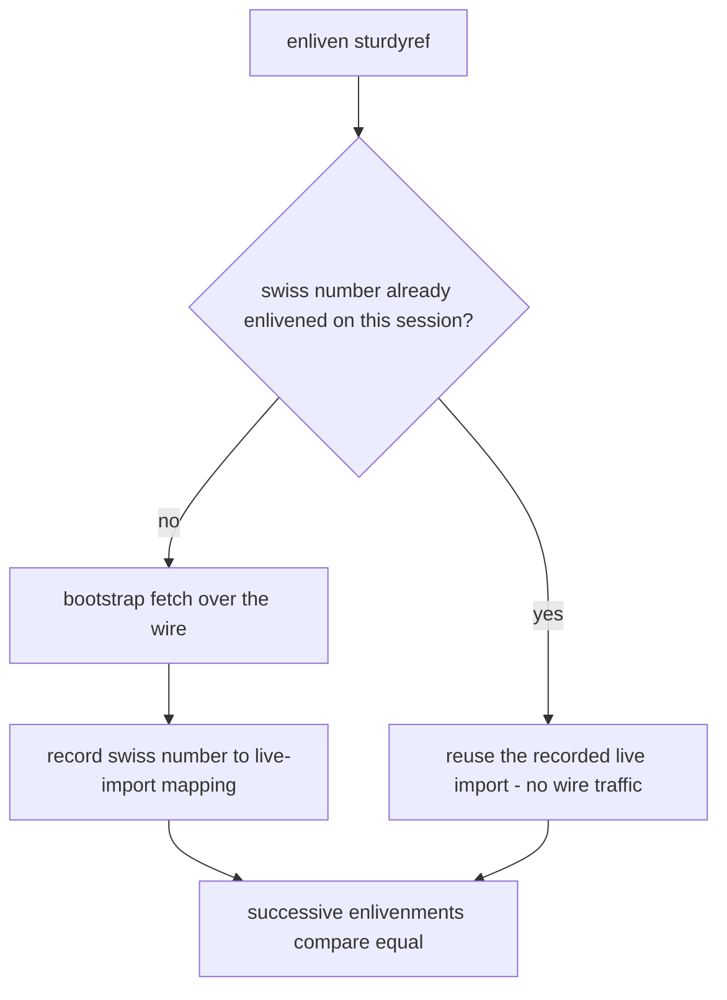

# Sturdyrefs and locators

Anchors: OCapN Locators specification; CapTP Specification § The bootstrap
Object (fetch). The `op:resolve` settlement arrow in ST-2 draws pancake's
PreSpec shape; on the v1.0 wire the same settlement is the resolver-callback
deliver (see the vocabulary note and DR-4 in
[02-deliver-and-resolve.md](02-deliver-and-resolve.md)).

## ST-1 — Sturdyref anatomy

A sturdyref is offline authority: a locator saying *where* the hosting peer
lives plus a swiss number saying *which* object to fetch there. It carries no
live session state and survives restarts on both sides.

## ST-2 — Enlivenment

Turning a sturdyref into a live reference takes two moves: establish a
session per the locator (if none exists), then bootstrap-`fetch` the
swiss number. The result is
an ordinary import — from here on, sturdyref origin is invisible.

## ST-3 — Enlivenment dedup

OCapN's equality rules require successive enlivenments of the same sturdyref
over the same session to yield references that compare equal. Practically: a
second fetch of an already-enlivened swiss number reuses the existing live
import rather than minting a divergent one.

