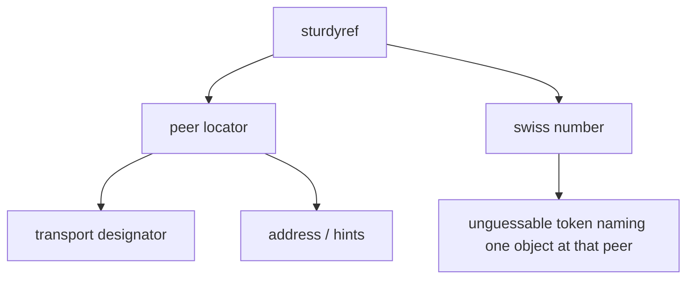
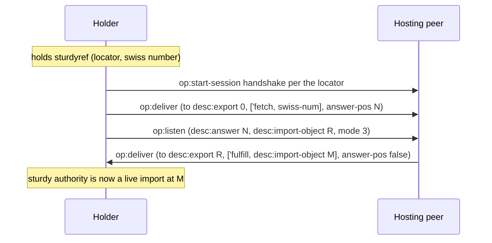
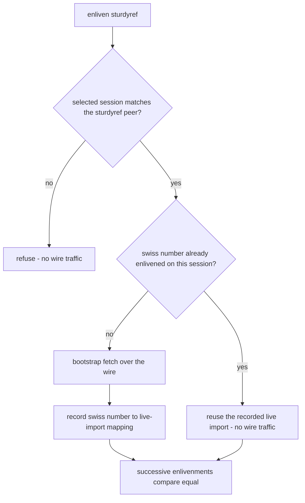

# Sturdyrefs and locators

These diagrams follow the OCapN Locators specification and the CapTP
Specification section The bootstrap Object (fetch). The next profile follows an
answered fetch with a mandatory listen. Goblins V1.0 carries the resolver in
the fetch deliver instead.

## ST-1: Sturdyref anatomy

A sturdyref is offline authority: a locator saying _where_ the hosting peer
lives plus a swiss number saying _which_ object to fetch there. It carries no
live session state, so the token survives restarts. Whether it still redeems
after the hosting peer restarts depends on that host re-registering the swiss
number under the same identity. glowcap's default Host registry is ephemeral
(see [boundaries](../boundaries.md)).

## ST-2: Enlivenment

Turning a sturdyref into a live reference takes two moves: establish a session
per the locator if none exists, then bootstrap-`fetch` the swiss number. The
result is an ordinary import.

## ST-3: Enlivenment dedup

OCapN's equality rules require successive enlivenments of the same sturdyref
over the same session to compare equal. A second fetch of an already-enlivened
swiss number therefore reuses the existing live import. The Host first checks
that the selected session's transport and designator match the sturdyref. Hints
do not affect peer identity, and a mismatch is refused before cache lookup or
wire traffic.

