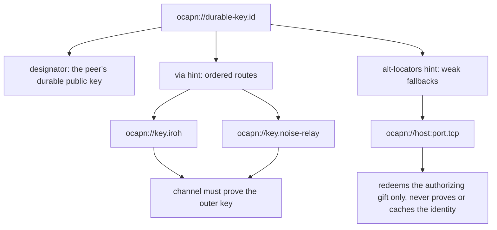
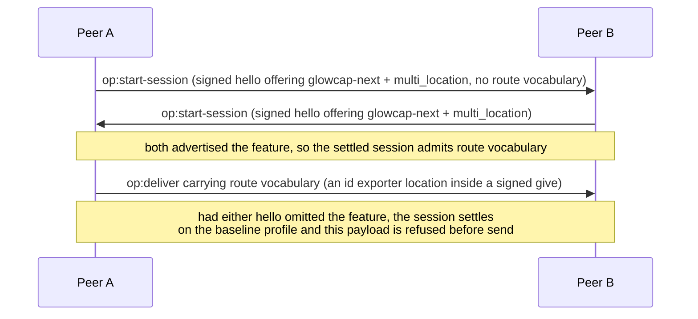
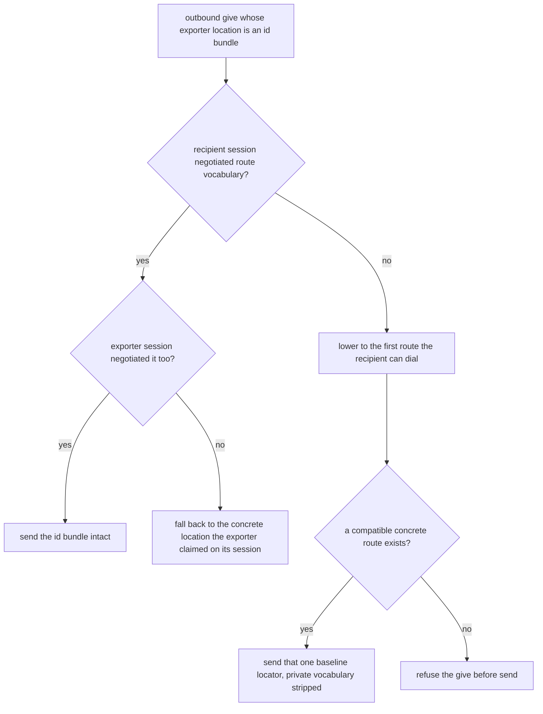
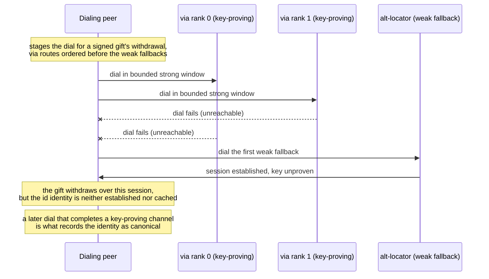
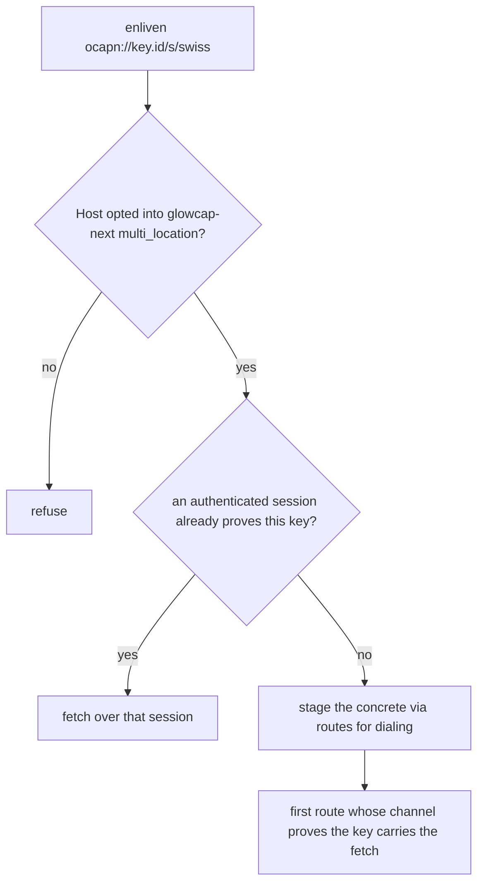

# Multi-home routes `[glowcap-next]`

Anchors: [ADR-0125](../decisions/adr/ADR-0125-identity-route-multihome.md);
OCapN Locators and Netlayers specifications (which define the single-location
baseline these diagrams extend); [upstream watch](../upstream-watch.md) for the
extension's standing. Nothing on this page is pinned-draft behavior: every
flow is gated behind `glowcap-next` negotiation, and a baseline or Goblins
session never sees this vocabulary.

## MH-1: The `id` locator

An `id` locator names a peer by a durable public key instead of by one
transport address. Routes live in hints, which the Netlayers draft already
excludes from peer identity. `via` carries the ordered routes that must prove
the outer key; `alt-locators` carries weak fallbacks that redeem a signed gift
without ever establishing the identity. Route URIs are percent-encoded inside
the hint value and separated by `|`, with the count and byte size bounded
before any allocation.

A route under `via` is admitted only when its transport can prove a durable
key on its own channel (an encrypted peer-id handshake, a sealed Noise
channel, or an authorized signaling exchange) and its designator names the
same key as the outer `id`. A cleartext keyed route is refused there, because
its key is only a dial target.

## MH-2: Negotiating the vocabulary

Route vocabulary is a named `glowcap-next` feature. A first hello carries
none of it, because the sender does not yet know what the partner accepts.
Only after both signed hellos advertise the feature does the settled session
admit it; a hello that carries an `id` route outside such an offer is malformed.

## MH-3: Lowering a signed give

A signed give crosses two sessions: the exporter's and the recipient's. Route
vocabulary survives only in their intersection. A recipient that did not
negotiate it receives one concrete route on a transport it demonstrably
participates in, or the give is refused; it is never handed experimental
vocabulary to ignore.

## MH-4: Dialing an `id` bundle

No physical `id` session exists. The generic dial planner refuses the symbol;
only the pending-dial expansion resolves it into concrete routes. Source order
is the explicit rank: Node races at most the first two strong routes, refills
that bounded window in order, and accepts the first proved completion. It
cancels every still-running loser. Weak fallbacks begin one at a time only
after every strong route fails. A weak fallback may complete the withdrawal
its signed gift authorized, and nothing more.

## MH-5: Enlivening an `id` sturdyref

An `id` sturdyref is honored only by a Host that opted into the feature. It
reuses any session whose channel already authenticated the same key,
including a baseline session, because no route syntax crosses that
established channel. Otherwise the concrete `via` routes are staged as in
MH-4.

